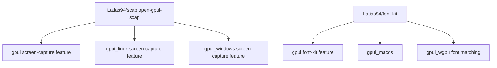

# Zed Fork Dependency Audit

**Date**: 2026-06-06
**Status**: Historical audit with maintained November successors
**Related**: [ADR 0001](../adr/0001-open-gpui-fork-strategy.md), [Verification](../verification.md)

## Problem

Open GPUI initially depended on Zed-maintained external forks after the clean workspace import.
The initial resolution selected public crates.io packages or Open GPUI-owned forks. The fixed-target
November successors below supersede individual historical selections when the official mechanism
needs an exact dependency source.
The former `zed-scap` dependency resolves through `open-gpui-scap`, and the former
`zed-font-kit` dependency resolves through an Open GPUI-owned `font-kit` fork.

The goal is to replace, justify, or own each fork without weakening the clean license and dependency
boundary established by ADR 0001. The goal is not to remove behavior for the sake of avoiding forks:
if a fork carries renderer, text, screen-capture, or platform behavior that Open GPUI needs, the
right endpoint can be an Open GPUI-owned fork with a documented delta and verification gates.

## Current Dependency Map



## Resolved Forks

| Fork | Resolution | Compatibility note | Evidence |
| --- | --- | --- | --- |
| `zed-reqwest` | November 10 selects official `33bc764aa15ff7b200bf7c93bd96e24878d53e14`, superseding registry `=0.13.4`. | The exact source is MIT OR Apache-2.0. Its request-local redirect policy preserves an imported client's actual settings; the former reconstruction cache could not. Remove that cache instead of preserving a registry-only constraint. The source reintroduces rustls-pemfile 2.2, whose RUSTSEC-2025-0134 notice is informational unmaintained status, not a reported vulnerability; no advisory suppression is added. | [Current import and dependency evidence](zed-gpui-import.md#november-10-http-and-release-download-dependencies); affected HTTP/public-consumer qualification in the owning plan |
| `zed-scap` package | Replaced with the Open GPUI-owned `open-gpui-scap` fork at `https://github.com/Latias94/scap`, branch `main`. | The fork keeps the public `scap` crate API by setting `[lib] name = "scap"` while using an owned package name. It also adapts the Windows path to `windows-capture = 1.5.0` by using `Frame::timestamp()`. | `cargo check --locked` in `Latias94/scap`; `cargo package --no-verify` in `Latias94/scap`; `cargo check -p gpui_windows --all-features --locked`; `cargo run -p xtask -- scan-import-boundary` |
| `zed-scap` transitive `windows-capture` drift | Superseded by the `open-gpui-scap` migration. | Earlier recovery pinned `windows-capture = 1.4.0` while Open GPUI still consumed `zed-scap`; the owned fork now adapts to `windows-capture = 1.5.0` instead. | Historical evidence: `cargo check -p gpui_windows --all-features`; current evidence is covered by the `open-gpui-scap` row. |
| `zed-xim` | Replaced with crates.io `xim = "=0.5.0"`. | Zed's fork exposed a `Client::reset_ic` helper. Upstream `xim 0.5.0` removed that helper but still exposes `ClientCore::send_req` and `Request::ResetIc`, so `gpui_linux` now sends the same XIM reset request directly. | WSL Ubuntu: `cargo check -p gpui_linux --all-features` |
| `zed-font-kit` Git source | Replaced the Git dependency with crates.io `zed-font-kit = "0.14.1-zed"` while keeping the Zed API surface. | This removes `github.com/zed-industries/font-kit` from manifests and lockfile, but it is not an upstream `font-kit` replacement. The published crate uses `dirs = "5.0"` while the previously locked Git rev had `dirs = "6.0"`. | `cargo check -p gpui_wgpu --features font-kit --locked`; `cargo tree --workspace --all-features --target all --edges normal --invert zed-font-kit`; `rg 'zed-industries/font-kit|git\+https://github.com/zed-industries/font-kit' Cargo.toml Cargo.lock crates` |
| `zed-font-kit` package | Replaced with the Open GPUI-owned `font-kit` fork at `https://github.com/Latias94/font-kit`, branch `main`. | The fork keeps the needed Zed API surface, including public `matching` and macOS native CoreText handle behavior, while using the normal `font-kit` package name. | `cargo check -p gpui_wgpu --features font-kit --locked`; `cargo check -p gpui_macos --features font-kit --locked`; `cargo tree --workspace --all-features --target all --edges normal --invert font-kit` |
| Zed `wgpu` fork | Replaced with crates.io `wgpu = "=29.0.3"`. | The public `wgpu`, `naga`, `wgpu-core`, `wgpu-hal`, `wgpu-naga-bridge`, and `wgpu-types` packages are the same version line and are compile-compatible with `gpui_wgpu` and Linux all-features checks. The native WGPU package gate requests a real adapter/device, creates the core renderer pipelines, and runs the atlas, lease, shutdown, and renderer contract tests. | `cargo check -p gpui_wgpu --locked`; `cargo check -p gpui_wgpu --features font-kit --locked`; WSL Ubuntu: `cargo check -p gpui_linux --all-features --locked`; `cargo run -p xtask -- renderer-smoke`; `cargo run -p xtask -- scan-import-boundary` |

## Inventory

| Fork | Current source | Reverse dependency evidence | Public candidate | Risk | Recommendation |
| --- | --- | --- | --- | --- | --- |
| Required fixed-target sources | The current import record and candidate queue own exact reqwest, calloop, async-process, async-tar and khronos-egl revisions; WGPU uses its qualified gfx-rs revision. | Actual roots and resolved dependency graphs are qualified per complete mechanism. EGL's failed-call/EGL_SUCCESS case has real dynamic-binding positive and negative controls. | Registry alternatives remain candidates when they preserve required behavior. | Source-specific | Follow ADR 0001; do not retain historical exclusions or remove behavior merely to reduce fork count. |

## Evidence Commands

The initial audit used:

```sh
cargo tree --workspace --all-features --target all --edges normal --invert zed-reqwest
cargo tree --workspace --all-features --target all --edges normal --invert zed-scap
cargo tree --workspace --all-features --target all --edges normal --invert zed-font-kit
cargo tree --workspace --all-features --target all --edges normal --invert zed-xim
cargo tree --workspace --all-features --target all --edges normal --invert wgpu
cargo search reqwest --limit 5
cargo search scap --limit 5
cargo search font-kit --limit 5
cargo search xim --limit 10
cargo search wgpu --limit 5
```

Additional `zed-scap` migration probe on 2026-06-06:

```sh
cargo update -p zed-scap --precise 0.1.0-beta.1
cargo check -p gpui --all-features
cargo check -p gpui_windows --all-features
cargo check -p gpui_linux --all-features --target x86_64-unknown-linux-gnu
cargo info scap
cargo info windows-capture
```

Result:

- `scap = 0.1.0-beta.1` is the current crates.io release.
- On Windows, `scap` fails before Open GPUI-specific code is checked because it calls
  `windows_capture::frame::Frame::timespan()`, which is not present in `windows-capture = 1.5.0`.
- The same Windows path also calls `WCSettings::new` with the display branch argument order from an
  older `windows-capture` API.
- The Linux cross-check did not run because `x86_64-unknown-linux-gnu` is not installed in this
  Windows toolchain, but the Windows compile failure is already sufficient to block this migration.
- The probe was reverted at the time. This blocker is now superseded by the owned
  `open-gpui-scap` fork.

Follow-up lockfile check:

- The existing `zed-scap` fork also fails with `windows-capture = 1.5.0`, but for a different API
  shape: its Windows path still uses the five-argument `WCSettings::new`.
- `windows-capture = 1.3.6` is too old for the fork because it lacks `capture::Context` and exposes
  `FrameBuffer::as_raw_nopadding_buffer()` instead of `as_nopadding_buffer()`.
- `windows-capture = 1.4.0` matches the fork and restores `cargo check -p gpui_windows --all-features`.

Additional `zed-scap` retry probe on 2026-06-07:

```sh
cargo info scap@0.1.0-beta.1
cargo info zed-scap@0.0.8-zed
cargo tree --workspace --all-features --target all --edges normal --invert zed-scap
cargo tree --workspace --all-features --target all --edges normal -i windows-capture@1.4.0

# In a temporary archive copy under %TEMP%:
# scap = { version = "0.1.0-beta.1", default-features = false }
cargo update -p zed-scap --precise 0.1.0-beta.1
cargo check -p gpui_windows --all-features
cargo check -p gpui --features screen-capture

# Secondary probe only, after temporarily removing `scap?/x11` from gpui and gpui_linux feature wiring:
cargo check -p gpui_windows --all-features
cargo check -p gpui --features screen-capture
```

Result:

- `scap = 0.1.0-beta.1` is still the current crates.io release.
- Direct replacement fails dependency resolution before compilation because Open GPUI's `x11`
  features currently forward to `scap?/x11`, and public `scap 0.1.0-beta.1` does not expose an
  `x11` feature. The Zed fork exposes `default = ["wayland", "x11"]`, with `x11 = ["dep:xcb",
  "dep:x11"]`.
- Source inspection confirms public `scap 0.1.0-beta.1` has only a generic
  `src/capturer/engine/linux` implementation, while the Zed fork keeps separate
  `linux/wayland` and `linux/x11` engines.
- After temporarily removing the `scap?/x11` feature forwarding to probe past dependency
  resolution, Windows still fails inside public `scap` before Open GPUI-specific code is checked:
  it calls `windows_capture::frame::Frame::timespan()`, which is not present in
  `windows-capture = 1.5.0`, and its display branch calls `WCSettings::new` with the older argument
  order.
- The probe was not applied to the workspace at the time. Open GPUI now owns the focused
  `open-gpui-scap` fork for this compatibility surface.

Additional `zed-xim` migration probe on 2026-06-07:

```sh
cargo info xim
cargo update -p zed-xim --precise 0.5.0
cargo tree --workspace --all-features --target all --edges normal --invert xim
wsl -d Ubuntu -- bash -lc 'cd /mnt/f/SourceCodes/Rust/open-gpui; export CARGO_TARGET_DIR=/tmp/open-gpui-target-linux; cargo check -p gpui_linux --all-features'
```

Result:

- `xim = 0.5.0` is the current crates.io release and preserves the `x11rb-client` / `x11rb-xcb`
  feature split used by `gpui_linux`.
- The only compile break was the fork-only `Client::reset_ic` helper. Sending
  `Request::ResetIc` through `ClientCore::send_req` preserves the same protocol request.
- WSL Ubuntu verifies the Linux all-features build. It still emits two pre-existing
  `nightly_coverage` `unexpected_cfgs` warnings from `gpui_linux/src/linux/dispatcher.rs`.

Additional `zed-font-kit` fork delta and migration probe on 2026-06-07:

```sh
cargo search font-kit --limit 5
cargo info font-kit
cargo info zed-font-kit@0.14.1-zed --registry crates-io
cargo tree --workspace --all-features --target all --edges normal --invert zed-font-kit
git diff --name-status v0.14.3 94b0f28166665e8fd2f53ff6d268a14955c82269
git log --oneline --left-right --cherry-pick v0.14.3...94b0f28166665e8fd2f53ff6d268a14955c82269
```

Temporary probe worktrees under `%TEMP%` tested two dependency-only switches. The source-only
migration was then applied to the main workspace:

```sh
# Keep Zed behavior, remove the Git source.
# In gpui, gpui_macos, and gpui_wgpu:
# font-kit = { package = "zed-font-kit", version = "0.14.1-zed", optional = true }
cargo check -p gpui_wgpu --features font-kit
cargo check -p gpui_wgpu --features font-kit --locked

# Replace with upstream Servo font-kit.
# In gpui, gpui_macos, and gpui_wgpu:
# font-kit = { package = "font-kit", version = "0.14.3", optional = true }
cargo check -p gpui_wgpu --features font-kit
```

Result:

- Both `font-kit = 0.14.3` and `zed-font-kit = 0.14.1-zed` are licensed
  `MIT OR Apache-2.0`; license is not the blocker.
- crates.io `zed-font-kit = 0.14.1-zed` is available and preserves the Zed API surface. A temporary
  dependency-only switch passed `cargo check -p gpui_wgpu --features font-kit` on Windows. The
  applied workspace change also passes `cargo check -p gpui_wgpu --features font-kit --locked`.
- The published crates.io `zed-font-kit = 0.14.1-zed` is not byte-for-byte identical to the
  previously locked Git rev `94b0f28166665e8fd2f53ff6d268a14955c82269`: crates.io declares
  `dirs = "5.0"` while that Git rev declares `dirs = "6.0"`. The lockfile now carries
  `dirs = 5.0.1` for `zed-font-kit` and keeps `dirs = 6.0.0` for the rest of the workspace.
- A dependency-only switch to upstream `font-kit = 0.14.3` originally failed in `gpui_wgpu`
  because `font_kit::matching` is private in upstream `font-kit`. `gpui_wgpu` now owns a local CSS
  font matching helper, so that private-module dependency is no longer a renderer-side blocker.
- `gpui_macos` also depends on Zed-only APIs:
  `font_kit::handle::Handle::from_native` in `crates/gpui_macos/src/text_system.rs`, and
  reference-taking `font_kit::font::Font::from_native_font(&new_font)` in
  `crates/gpui_macos/src/open_type.rs`.
- The fork delta against upstream `v0.14.3` touches `src/handle.rs`, `src/loader.rs`,
  `src/loaders/core_text.rs`, `src/sources/core_text.rs`, DirectWrite, FreeType, filesystem source
  paths, tests, and dependency versions.
- Important Zed-side changes include `d97147f Faster OTC font loading (#1)`, native-font handle
  storage, CoreText no-path loading, `core-foundation = 0.10`, `core-graphics = 0.24`, and
  `core-text = 21.0.0`.
- Important upstream-only changes since the shared base include `font-kit = 0.14.3`, a newer
  `pathfinder_simd`, DirectWrite panic avoidance around `dwrote`, CoreText stretch conversion fixes,
  Flatpak font path fixes, and a FreeType SubpixelAA rasterization fix.

Decision:

- Treat Git-source removal and upstream replacement as two separate migrations.
- Git-source removal is complete for `zed-font-kit`, and the follow-up package dependency has now
  been replaced by the Open GPUI-owned `font-kit` fork. The direct upstream `font-kit` path remains
  useful background research, but it is no longer the chosen endpoint for this migration.

Additional `zed-font-kit` upstream compatibility probe on 2026-06-07:

```sh
# Temporary probe worktree:
# %TEMP%/open-gpui-font-kit-probe-20260607
# In gpui, gpui_macos, and gpui_wgpu:
# font-kit = { package = "font-kit", version = "0.14.3", optional = true }
#
# In gpui_wgpu:
# use a local CSS font matching helper instead of font_kit::matching.
cargo check -p gpui_wgpu --features font-kit
cargo check -p gpui_macos --features font-kit
cargo check -p gpui_macos --target aarch64-apple-darwin --features font-kit

# Applied to the main workspace without changing the dependency source:
cargo nextest run -p gpui_wgpu --features font-kit font_kit_match
cargo check -p gpui_wgpu --features font-kit --locked
```

Result:

- `gpui_wgpu` compiles against upstream `font-kit = 0.14.3` after replacing the private
  `font_kit::matching` call with a local CSS Fonts Level 3 matching helper.
- The main workspace keeps crates.io `zed-font-kit = 0.14.1-zed`, but `gpui_wgpu` no longer calls
  the Zed-only public `font_kit::matching` module.
- `cargo check -p gpui_macos --features font-kit` passes on the Windows host, but this does not
  compile the macOS `target_os = "macos"` CoreText implementation.
- `cargo check -p gpui_macos --target aarch64-apple-darwin --features font-kit` did not reach
  Open GPUI code because this toolchain does not have the `aarch64-apple-darwin` standard library
  installed.
- Source inspection still shows macOS-specific blockers: upstream `font-kit` lacks Zed's
  `Handle::Native` / `Handle::from_native`, and upstream `from_native_font` takes the native font
  by value rather than by reference.

Additional `font-kit` owned fork switch on 2026-06-07:

```sh
# In gpui, gpui_macos, and gpui_wgpu:
# font-kit = { git = "https://github.com/Latias94/font-kit", branch = "main", optional = true }
cargo check -p gpui_wgpu --features font-kit
cargo check -p gpui_wgpu --features font-kit --locked
cargo check -p gpui_macos --features font-kit --locked
cargo tree --workspace --all-features --target all --edges normal --invert font-kit
```

Result:

- The workspace now resolves `font-kit v0.14.3` from
  `https://github.com/Latias94/font-kit?branch=main#7c6bb817b6878a3e6b44e4fa0902cd48c4905107`.
- `zed-font-kit` is removed from `Cargo.lock`.
- The fork preserves the Zed API surface used by Open GPUI: public `matching`,
  `Handle::Native` / `Handle::from_native`, borrowed `from_native_font`, CoreText no-path native
  font loading, and the `core-text = 21.0.0` dependency line.
- Windows-host checks pass for `gpui_wgpu` and `gpui_macos` with the `font-kit` feature. This still
  does not claim macOS runtime equivalence, but it verifies that the fork keeps the required API
  surface used by this workspace.

Additional `wgpu` fork migration probe on 2026-06-07:

```sh
cargo info wgpu@29.0.3 --registry crates-io
cargo tree --workspace --all-features --target all --edges normal --invert wgpu

# Temporary probe worktree:
# In the root workspace manifest:
# wgpu = "=29.0.3"
cargo check -p gpui_wgpu --locked
cargo check -p gpui_wgpu --features font-kit --locked
cargo check -p gpui_wgpu --lib --features font-kit --locked
wsl -d Ubuntu -- bash -lc 'cd /mnt/c/Users/Frankorz/AppData/Local/Temp/open-gpui-wgpu-probe && export CARGO_TARGET_DIR=/tmp/open-gpui-wgpu-probe-linux && cargo check -p gpui_linux --all-features --locked'
cargo run -p xtask -- scan-import-boundary
cargo run -p xtask -- renderer-smoke
```

Result:

- crates.io `wgpu = 29.0.3` is available under the same `MIT OR Apache-2.0` license.
- The crates.io packages replace the Zed Git source for `naga`, `wgpu`, `wgpu-core`,
  `wgpu-core-deps-*`, `wgpu-hal`, `wgpu-naga-bridge`, and `wgpu-types`.
- `gpui_wgpu` compiles on Windows with and without the `font-kit` feature after the switch.
- WSL Ubuntu verifies the Linux all-features path through `gpui_linux`; it still emits the
  pre-existing `nightly_coverage` `unexpected_cfgs` warnings from
  `gpui_linux/src/linux/dispatcher.rs`.
- The native renderer smoke requests a local `wgpu` adapter and device, creates the GPUI renderer
  bind group layouts, and creates the core render pipelines. It also checks that the subpixel sprite
  pipeline is present only when the device exposes `DUAL_SOURCE_BLENDING`.
- `cargo check -p gpui_wgpu --all-targets --features font-kit` is a valid migration gate after
  `crates/gpui_wgpu/benches/layout_line.rs` stopped using compile-time font includes. The
  benchmark now reads optional font paths at runtime and skips initialization when those assets are
  absent from an extracted workspace.

Decision:

- Replace the Zed `wgpu` Git fork with crates.io `wgpu = "=29.0.3"`.
- Add a focused runtime renderer smoke gate for pipeline creation. This still does not claim
  pixel-output equivalence with the Zed fork.

## Alternatives Considered

### Option A: Replace all forks immediately

Pros:

- Removes Zed git dependency debt quickly.
- Forces incompatibilities into the open.

Cons:

- High regression risk across rendering, fonts, screen capture, and Linux input methods.
- Current CI only verifies Windows plus Cargo checks; it does not exercise Linux X11, Wayland,
  macOS font behavior, or screen capture runtime paths.

Decision: rejected for now.

### Option B: Replace forks in risk order

Pros:

- Keeps each change reviewable.
- Lets verification coverage grow around each subsystem before changing higher-risk dependencies.
- Preserves momentum while protecting core rendering and platform behavior.

Cons:

- Zed fork debt remains temporarily.
- Requires several small migration commits instead of one broad cleanup.

Decision: recommended.

### Option C: Keep the forks indefinitely and document them as supported dependencies

Pros:

- Lowest immediate engineering cost.
- Preserves imported behavior exactly.

Cons:

- Keeps long-term dependency control outside Open GPUI.
- Weakens the clean-framework positioning from ADR 0001.
- Makes future crates.io publication and supply-chain review harder.

Decision: rejected as a long-term strategy.

### Option D: Remove Git sources before replacing behavior

Pros:

- Reduces Git dependency and lockfile reproducibility risk without changing font behavior.
- Keeps the first `font-kit` change small: manifests and lockfile only.
- Separates supply-chain cleanup from renderer and platform text behavior changes.

Cons:

- The crate is still named `zed-font-kit`, so Open GPUI still depends on a Zed-published package.
- Does not resolve divergence from upstream Servo `font-kit`.
- Still requires a later compatibility lane for the Zed-only APIs.

Decision: implemented for `zed-font-kit`; keep this pattern for other forks only when a published
crate preserves the required API surface.

### Option E: Own focused Open GPUI forks for necessary behavior

Pros:

- Preserves framework behavior when upstream crates do not expose the APIs or fixes GPUI needs.
- Moves control from Zed-maintained artifacts to Open GPUI-owned release and review processes.
- Keeps the door open for upstreaming while avoiding premature feature removal.

Cons:

- Requires maintenance, release, and security ownership.
- Requires clear documentation of the fork delta and verification gates.
- Can drift from upstream if not actively managed.

Decision: implemented for `font-kit` and `open-gpui-scap` where upstream adaptation would remove
required behavior or create excessive platform risk.

## November 9 Task-Waker Dependency

The fixed-target Send executor/Web Fetch successor requires the canonical task-waker identity
correction at async-task `015845a19fc31752c02367567d3b8900a406f9da`, selected by Zed
`67b41bf97607f2dd86319b385040a1310cf24f45`. The former is the actual runtime fix; the
latter changes the monorepo dependency. The correction constructs the poll-context waker with
the task header's stored raw-waker vtable, matching its clone factory. Separate references to
an associated constant can have different addresses and break `will_wake` identity.

The dependency remains Apache-2.0 OR MIT, version 4.7.1 and Rust 1.57. The separately observed
[upstream review](https://github.com/smol-rs/async-task/pull/108) is still open on November 9.
Use the exact immutable source rather than creating another scheduler adapter or silently
equating the registry package's version number with this fix. Core, scheduler and macOS share
the direct workspace Git dependency, so independent consumers receive the same task types
without relying on a root-only Cargo patch. Other third-party executors may independently
retain registry async-task; their task values do not cross the GPUI dispatch contract.

The November 14 packageability repair adds the pinned crate's version requirement so Cargo can
construct archives. This does not qualify registry async-task 4.7.1: its task-waker correction
still differs from the selected Git source. Cargo removes `git` and `rev` from the normalized
published manifest, while downstream roots do not inherit workspace `[patch]` selections.
The [release workflow](../../.github/workflows/release-crates.yml) therefore rejects publishable
Git dependencies and root-only Git/path patches before any crate upload. The ordinary Publish
Check continues to check archive structure and is not proof of source-equivalent publication.
Current Git consumers retain the exact selected source. A crates.io release remains blocked
until qualified registry successors or source-preserving published forks replace these entries;
this includes task-waker and process-owner corrections, dockspace and renderer/worker sources.

The actual executor regression checks original/clone identity in both directions and across
worker submission and repeated polls. The old registry control passes in the local debug
configuration (`9ac65b38-7817-40bc-9f45-28e542753346`); this does not reproduce the official
failure, and no local red claim follows. The fixed-source complete scheduler suite passes
31/31. Broader consumer/platform/browser qualification belongs to the owning verification
record. Retire the pin when an upstream revision or published release contains the same
correction and passes the affected independent/native/browser consumers. No new dependency
scanner, owned fork publication or remote repository change is introduced.

The same complete Web consumer also selects official wasm_thread
`0cf96c7708dfb97ccf3da50347e25edcf75d6937` wherever worker mode is enabled. Its manifest
retains version 0.3.3 and Apache-2.0 OR MIT. Comparing the Rust runtime files with registry
0.3.3 finds them identical; the JavaScript loaders instead pass the current object-form
wasm-bindgen initialization arguments. This fixes deprecated initialization usage and matches
the fixed-target source. It is not the cause assigned to the reproduced Fetch timeout: the
complete HTTP regression first passes with the old dependency after importing the official
std queue synchronization prerequisite. Final exact-source HTTP and eight-/sixteen-worker
queue regressions pass separately, with all queue workers asynchronously joined. The existing
compiler, target and standalone-consumer gates qualify this pin without publishing another
fork or installing root-only Cargo patches.

## Recommended Work Order

1. **Renderer pixel-output equivalence**: defer until a dedicated render fixture can compare
   offscreen output across the crates.io `wgpu` path and the expected GPUI renderer behavior.

## Success Metrics

| Metric | Target | Measurement |
| --- | --- | --- |
| Retired Git source count | Keep retired scap/font-kit/WGPU sources out; selected official HTTP/process/archive/loop sources are explicit exceptions | Existing import-boundary scan and source-specific records |
| Zed package dependency count | Keep at zero for retired fork packages | `rg 'zed-scap|zed-font-kit' Cargo.toml Cargo.lock` |
| Verification gate | Still passes after each migration | `cargo run -p xtask -- verify` |
| Focused package checks | Targeted crate builds after migration | `cargo check -p <crate>` |
| Runtime risk | No migration without relevant platform/runtime evidence | feature-specific smoke checks, such as `cargo run -p xtask -- renderer-smoke`, or documented limitation |

## Risks and Mitigations

| Risk | Severity | Likelihood | Mitigation |
| --- | --- | --- | --- |
| Public crate API differs from Zed fork | High | Medium | Compare with a focused manifest switch before changing code broadly. |
| Platform-specific regression is missed on Windows CI | High | Medium | Add Linux/macOS or feature-specific CI before migrating platform-sensitive forks. |
| Lockfile churn hides the actual dependency change | Medium | Medium | Commit one fork migration at a time with focused verification evidence. |
| Fork has unpublished behavioral fixes | High | Medium | Inspect fork delta or run compatibility tests before replacement; keep or own the fork when the behavior is necessary. |

## Open Questions

- Should the renderer smoke grow into an offscreen pixel comparison before claiming pixel-output
  equivalence for the `wgpu` migration?
