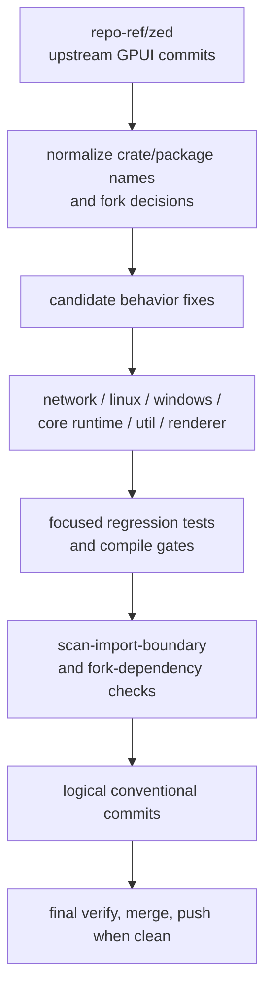

# Zed GPUI Upstream Sync - Plan

## November 5 Continuation

The owner has resumed maintenance in `F:/SourceCodes/Rust/open-gpui`, whose inspected baseline is
`89cb76ba` on `optimize/docking-graph-transaction`. Continue the existing framework and preserve
that branch's unfinished canonical-docking work. The July units below retain their historical
requirements; they are not proof of parity with current Zed.

The November 6-7 owner clarification selects the
[sync skill's official-baseline rule](../../.agents/skills/open-gpui-upstream-sync/SKILL.md#integrate-through-existing-owners):
retain official framework behavior by default, refactor fork-owned adaptations around that base,
and build reusable additions through ordinary public modules. The candidate queue records the
reason and verification for each retained difference; unfinished official mechanisms stay visible.
Module boundaries must keep the framework usable independently of Nara. A fork extension cannot
justify replacing an official subsystem with a reduced local mechanism; reconcile its concrete
consumer against the full baseline and refactor the extension first.

The [candidate queue](../imports/zed-gpui-upstream-sync-candidates.md#november-5-maintained-framework-successor)
now records upstream `635026fabc38440fce5e1767d125026a17b12012` and five complete
correctness units: arena custody, TextSystem lifetime, cached-view dependencies, text layout and
pending-input/blur. The arena unit is implemented with separate allocation, nested cleanup,
App-bound tokens and the fork's native post-borrow maintenance; its
[verification](../verification.md#element-arena-and-native-frame-maintenance) records allocator
Miri, framework and Windows HWND evidence, including the remaining touchpad timing gap.
The TextSystem unit now replaces pooled strong wrapper references with independent character
width caches. Its [lifetime record](../verification.md#textsystem-pool-lifetime) includes the
reproduced reference cycle, reuse/partition tests and complete headless/native reconstruction.
The native consumer also exposed a separate stale WinRT UISettings factory after OLE apartment
recreation; the platform owner now acquires that factory within the current query lifetime.
The cached-dependency unit now isolates nested draw/callback reads, retains paint/deferred
dependencies, preserves deferred journal indices and inherits logical opacity through portals.
Its [qualification](../verification.md#cached-dependencies-deferred-replay-and-opacity) records
the original failures, admitted/rejected-candidate controls, stationary-pointer convergence,
873 Core cases, 2,964 affected consumer cases and 165 selected Windows cases. Four existing
interactive Windows cases remain skipped. The native cache regression proves actual submitted
frames and retirement, while the existing non-view invalidation limitation remains explicit.
The text-layout successor now preserves native tab advances, single-baseline Unicode separators,
default/explicit DirectWrite font features and wrapped hit-test error semantics. Its
[qualification](../verification.md#native-text-layout-and-wrapped-hit-testing) records red
regressions, final Core 877, affected consumers 2,964 and selected Windows 173, including actual
native text paint/submission and exact retirement. Four existing interactive cases remain skipped.
The native upload/mapping successor now shares checked atlas admission across both insertion
APIs, publishes only after upload admission and releases color staging maps through the existing
raster owner. Color targets are cleared to transparent before blending. Its
[qualification](../verification.md#native-atlas-upload-and-color-readback) owns the WARP pixel,
debug-layer, lease/refusal and actual color-emoji evidence. The pending-input successor now
ports recognized-modifier interception/observation, singleton timeout, IME preference and
accepted focus/blur/drop settlement through the existing owners. Its
[qualification](../verification.md#pending-input-modifier-recognition-and-blur) records the
original failures, callback-retarget corrections, exact completed-action observation and native
text-handler consumer. These five initial correctness units precede the wider coherent refresh
and substantial game-engine Editor adaptation.
Reproduce each remaining defect, integrate the owning fix, preserve fork contracts, run focused
and affected regression cohorts serially, and record actual results. Source review and dependency-
consumer checks alone do not qualify a complete framework refresh.

### Maintenance Handoff And Engine Feedback

The November 9 owner clarification, reaffirmed on November 10, keeps this continuation
responsible for the fixed-target refresh and modular engine-integration assessment before a
separate Codex session takes over
ongoing Open-GPUI maintenance. That later session consumes concrete feedback from Nara; it is not
a prerequisite for completing the current work.

After the fixed refresh and first qualified engine-seam consumer, ongoing framework maintenance
moves to that session while Nara continues complete Editor migration and game-runtime acceptance
under its own plan.

That first consumer must establish one device, recording/submission and native-loop arrangement,
with an ordinary standalone GPUI control. Exercise real engine content beneath overlapping UI,
ordered texture sampling, clip/DPI/resize/color, exact View input and independent producer
retirement. Include refused/panicking frames, close and device-loss controls, plus observed
copies, submissions, synchronization and retained-resource costs without steady-state CPU
readback. Record the consumed revision, dependency graph and rerunnable engine commands. These
are the engine-seam handoff gates; the remaining complete Editor migration and game-runtime
selection stay with Nara's own acceptance.

Keep upstream provenance, fork adaptations, reproducible ordinary-consumer gates and unresolved
platform limits in this repository's existing candidate queue, plan and verification record.
The handoff must identify the actual qualified framework revision and fixed upstream target,
remaining differences and their dispositions, compiler/dependency requirements and the commands
that a maintenance session can rerun. Do not treat a bounded residual source pass as an exhaustive
closure audit.

Each engine integration checkpoint records an immutable consumed framework revision and its
resolved dependency graph. Later maintenance can advance independently; adopting it in Nara
requires the affected engine consumer's qualification rather than treating either moving
worktree as the other repository's tested dependency.

Nara owns its engine adapter and complete Editor/game-runtime choice. Open-GPUI owns reusable UI
execution, platform/render extension seams and its components; no Nara document, ECS, history or
GPU owner enters the framework. Assess those seams with an ordinary standalone consumer and a
real engine View, preserving exact input/presentation and resource retirement. Engine-specific
composition stays in Nara; a framework correction motivated by that consumer needs a focused
Open-GPUI regression. The existing source-consumption and renderer tests do not yet qualify that
engine boundary or complete the handoff.

The November 11 owner clarification selects convenient external WGPU application hosting as a
framework development target after the layered comparison. Refactor inherited native coupling
where needed; the official Windows D3D11 backend does not constrain the new interface.
Window/event-loop hosting, GPU source/device sharing, renderer recording and ordered viewport
sampling remain separate responsibilities. First qualify an ordinary non-Nara WGPU application
using its own window/loop/device and normal components; Nara then consumes that same public path.
The external-encoder implementation below is only its first prerequisite. Nara owns its optional
integration and graph placement; no engine dependency, public engine graph or universal widget
description enters the standalone framework. Existing component modules precede another behavior
library. The [framework decision](../adr/0001-open-gpui-fork-strategy.md#independently-hosted-wgpu-applications)
owns this direction; the engine's layered study records alternatives and source evidence.

The November 9 bounded source check identifies concrete adapter work: WgpuContext's private
construction installs device-wide callbacks, WgpuRenderer's private record operation submits
its own encoder, and WindowsWindowInner constructs a concrete DirectXRenderer. Public Arc
Device/Queue fields and selecting the WGPU package do not provide captured-device construction,
Host-owned submission or a replacement Windows renderer. Assess reusable recording/native
attachment seams through the engine consumer, preserving ordinary standalone drawing and the
existing loss, atlas, receipt and shutdown contracts. Retained GPU-image sampling also needs
an actual clipped engine View; the current WGPU Surface branch is not that implementation.
These source facts add no public API or executed engine qualification.

The November 10 Nara `35badad64539` source map confirms concrete consumer owners:
WgpuRenderHost::with_device borrows the existing device, immutable WgpuImageOutput and
producer-local WgpuSubmissionPrefix retain exact image use, and present_window owns encoding/
submission/composite receipts. Prefer a reusable external-device/target recording extension
consumed by a Nara-owned adapter; compare the existing public Platform/PlatformWindow path
without installing a second GPU, device callback or loop. Nara's panel image attachment currently
requires Arc<winit::Window>, while normal Windows GPUI remains coupled to DirectX/DirectWrite.
Nara registry WGPU 30.0.1 and this fork's fixed Git WGPU 30.0.0 have distinct Rust type identities.
Its existing content_window/editor_scene/streams_window consumers are the real-content controls;
headless injection and application-owned atlas tests do not qualify the engine seam. This map
does not alter either graph, select the final native owner or freeze new APIs before the consumer.

### Cached-Dependency Adaptation Requirements

Port `decd2399b1` and `8fa085e397` through existing EntityMap, AnyView and deferred frame journals.
Capture nested access scopes rather than diffing a whole-frame set; combine render/prepaint,
paint and deferred reads, and filter released IDs through reference-count membership. An entity
currently leased remains live even while absent from the storage map. Preserve candidate-frame
commit timing for subscriptions, atlas reuse refusal, presentation/transform/clip validity and
portal/reveal generation ownership.

The fork permits opening a second window synchronously during paint. Isolate and restore the
outer frame's access context on inner success, candidate rejection and unwind; copying an
upstream frame reset would erase active outer scopes. Regress a cached canvas that reads entities
before and after nested window creation, with exact per-window subscription ownership. Port the
upstream accessed-scope, cached/deferred-subscription four-way matrix and inherited-opacity
regressions without changing their promises about non-view entity notification.

Reconcile opacity inheritance through ordinary deferred children and window portals, including
hover changes discovered during paint, before closing this unit. Verify bounded convergence
against the fork's candidate acceptance rather than assuming a follow-up frame is already a
qualified same-frame result. Retain transform/clip/reveal and rejected-candidate controls; source
comparison alone does not qualify cached execution.

### Text-Layout Adaptation Requirements

Port the complete behavior of `0294cfb58e`, `979cd3fdf0`, `ac6818fb2d` and `e71963a599`
through the existing DirectWrite and LineLayout owners. Preserve the source string and native tab
policy: zero-glyph tab runs use the native layout's hit-test advances and retain invisible glyph
entries for byte/caret mapping. Do not replace tabs with spaces or choose a new cross-platform
tab interval. Compare native metrics across fonts, sizes, split font runs, leading/trailing tabs,
multi-byte text and the existing logical-order RTL controls.

Keep Unicode U+2028/U+2029 on a single logical baseline by shaping native segments and rebasing
their original byte indices and glyph positions. Retain source separators, font-run partitions,
zero-width pieces and aggregate ascent/descent. Default empty font-feature configuration must
apply DirectWrite's standard liga/clig/calt features while preserving explicit per-tag disabling.
Use live native typography and layout results for these tests. Adapt the upstream cursor fixture
through the fork's existing `ShapedLine::split_at`; adopting the later forward-cursor optimization
is not required to preserve these piece/text/width assertions.

Wrapped exact hit testing must return `Err` at the current wrapped row's end when floating-point
rounding leaves a position inside that row but outside the unwrapped layout. Keep closest-index,
UTF-8 byte boundaries, nonzero row origins and caret affinity unchanged. A constructed shaper
output regression establishes this consumer boundary; it does not establish a particular native
font's rounding behavior.

Inspect `89e8a4b9ec` prerequisites when adapting DirectWrite callbacks. A mutable renderer context
must originate from a mutable pointer; nullable native arrays must admit null only for zero
length. Reconcile its remaining raster/atlas changes with the fork's admission and resource
owners before calling that broader hardening commit covered. Preserve candidate rejection,
font/style cache identity, native submission and teardown through the affected regression cohorts.

### Pending-Input Adaptation Requirements

Source comparison maps `bc7041c600`, `ba42ab9d98` and `f66ed399cd` to the existing Keystroke,
Window dispatch, pending-input and focus-commit owners. Include direct prerequisites
`dc1e815e47835095748cbb036541992abd9ac826` for pending-chord IME preference,
`a8cae3bd77f6e1c1dde98bb1dcebba0d254dbd71` for multi-modifier recognition, and
`e463c5ab74e016f6a16e02a8b21925b98643f9c7` for dropped-focus settlement. These fixes have their
own pending-input qualification; the earlier text-layout results do not cover them.

Preserve both standalone-modifier timeout/recovery tests and all six interception/observation
regressions: bound/unbound release, raw-listener suppression, pending short/long resolution,
combined shortcut release and consumed-modifier deadline preservation. Retain the complete
pending InputHandler test, including IME preference recovery, completed chords and ordinary
text replay. Distinguish multi-modifier gestures from a later genuine standalone modifier.

Empty focus, repeated blur, disabled-focus blur and released current handles must settle pending
input through their owning accepted transition. Successful sibling focus changes clear it;
unbound/suppressed targets retain it. Refused focus/blur candidates keep both the original chord
deadline and notification state until an admitted retry. Preserve sealed-callback deferred blur,
FocusStable/suppression rules, interaction quiescence and exact-window deferred notification.
Exercise close before notification/timeout and close inside observer/replay callbacks so later
actions or text cannot target a retired/reused window. Do not clear pending state unconditionally
at blur entry or copy upstream frame timing over the fork's provisional-focus authority.

Treat context changes on the same focus as invalidating the old sequence's IME-first override.
Retain the original replay recipient across pending observers and replay listeners; revalidate
after callbacks before further action/raw-key/text delivery. Preserve a completed action's
recognized-keystroke report while its window remains live even when that action changes focus.
Only an entire singleton-modifier prefix introduces the modifier timeout; a modifier later in
an otherwise untimed longer chord must not change its deadline policy.

PendingInputStatus/pause APIs, InputPreference event fields and FocusMap queue optimization are
separate final-target differences, not prerequisites established by these fixes. The pause APIs
are subsequently implemented at `655e9610c77`; the input-preference and queue differences remain
part of the [input/focus successor](#input-priority-and-focus-lifetime-successor), alongside the
focus-lost ancestor query. They require their own coherent API/consumer disposition rather than
a new focus/input owner or scanner.

### Native Upload And Mapped-Readback Safety

Reconcile the remaining `89e8a4b9ec` changes through the existing DirectXAtlas and DirectWrite
raster owners. Atlas source dimensions, pixel stride and complete row-byte length must pass
checked admission before allocation; final destination bounds must fit the resident texture
before UpdateSubresource. Both insertion APIs use the same private path. Malformed input returns
an error without key publication, allocation or instance-generation consumption. A later refusal
releases only the unpublished allocation, retaining existing keys, regions and visual leases.
Creating a native shader view must succeed before reserving a free slot or generation. An
admitted upload call does not establish GPU completion or presentation.

Preserve the fork's retained old-region policy after ordinary key removal. The target's void
upload early-return cannot substitute for a failure result because its caller still publishes
success. Qualify exact/short/extra byte lengths, invalid/max dimensions without giant buffers,
final box bounds, both insertion APIs, same-key valid retry and existing leased content. WARP
tests must read multi-row patterns at nonzero atlas origins for all three texture kinds, using
native RowPitch rather than assuming packed staging rows. Device creation failure is a failed
qualification, not a skipped success.

Color glyph staging readback pairs every successful Map with Unmap before conversion or return.
Extract the existing row-copy owner to reproduce its missing release safely on a repeated read
of the same staging resource; do not execute an unchecked short-source GPU upload just to make
the atlas baseline fail. Allocate output before mapping and retain lexical/RAII cleanup through
post-map error and unwind. Keep existing alpha conversion, UI-thread ownership, device/submission
and resource-lifetime authorities unchanged. Preserve lease/candidate-refusal, native text paint
and teardown regressions alongside the focused WARP evidence.

Clear newly created color render targets to transparent before blending so uncovered and
semitransparent pixels do not depend on undefined initial contents. Qualify transparent padded
borders through the real color-emoji raster path while retaining its visible-content and repeated
byte-equality controls. This output check does not establish a deterministic missing-clear red
baseline without a poisoned initial target.

After those units, compare a coherent text/framework refresh, including dependency/toolchain
changes, before expanding the Editor component implementation. A game-engine rendering adapter
is a legitimate framework extension; the existing D3D11 backend need not remain mandatory.
Keep any concrete engine types above the core UI execution interface. The consuming engine owns
its Editor/game-UI tradeoff and complete rendering/input/lifecycle acceptance; this plan adds no
Nara document, ECS, history or GPU authority to Open GPUI.

### GPU Record And Color-Transfer Successor

The successor to `cde23d44ada` implements `f2817700349` and `b9419ae7281` through the existing
scene, Window and renderer owners. Its
[qualification](../verification.md#gpu-primitive-flags-and-windows-color-transfer) owns the safe
layout red, native old-shader pixel red, corrected cohorts and execution-path limits. These
results extend the maintained framework; they do not complete the wider refresh.

PaddedBool32 provides private initialized four-byte zero/one storage for Underline.wavy and
PolychromeSprite.grayscale. Constructors and public-record migration notes change together;
author-facing style/paint APIs remain bool, with no raw-u32 or Serde compatibility path. The
shared records retain the fork's clip, 40-byte tile generation and terminal transform layout.
DirectX uploads the shared slice, removing its duplicate record and per-frame conversion.
HLSL/WGSL consume the complete flag. Tests check field width, complete values and offsets in
addition to the unchanged 88-byte underline and 128-byte sprite sizes. Metal source/ABI
assertions are updated, but generated-header, shader and native execution on macOS remain open.

Windows now decodes with exponent 2.2 and encodes with its reciprocal. The real HWND/DirectX
scene fixture uses an independent f64 Oklab oracle at non-endpoint physical pixel centers,
sRGB/solid/alpha controls and a changed-color witness in a newer exact Submitted generation.
The same trajectory checks alternating grayscale flags, opacity, straight/wavy/strikethrough,
translated rounded clips and cached/deferred replay, followed by exact native/platform release.
Draw-time cache mode is published through the existing accepted-frame transaction, preserving
legitimate accessibility/inspector cache bypass without weakening pixel assertions.

The verification record distinguishes debug runtime shader compilation from embedded FXC
artifacts and shader optimization from Rust runtime performance. The Windows approximation is
not a complete engine color-management policy or a byte-parity requirement for WGPU's piecewise
transfer. Dependencies and the declared Rust 1.92 floor remain unchanged; Rust 1.95 execution
and independently locked consumption retain their own scope. Linux, macOS, browser, mixed-DPI
migration and measured cost remain separately qualified work.

### Font Resolution, Installation And Reporting Successor

The successor to `871c012c96c` implements `9e6e14160c`, `3389d87577`, `b7d50b95e8` and
`b68add5b37` against the same fixed target. Its
[qualification](../verification.md#runtime-font-installation-and-missing-glyph-reporting) owns
the original three failures and passing rejected-installation control, the final 999 Core/WGPU
and 2,964 affected-consumer cases, native Windows 189 and the independently reviewed ownership
corrections. Four existing interactive Windows cases remain skipped. Broader native font
reselection and the full framework refresh remain open.

Cache Direct/Fallback/Missing outcomes under the existing TextSystem owner, retain only direct
reverse lookup, and warn for the explicitly requested descriptor rather than every absent
fallback candidate. Successful installation clears descriptor resolution, resets missing-glyph
deduplication and advances the font generation. Existing loaded FontIds must remain usable;
backend-specific descriptor reselection need not return the same numeric ID on every platform.
Cosmic must preserve loaded face identity while rebuilding its family/fallback resolution.

Every ordinary, wrapped and actual hash-layout entry point observes the font generation.
Current/previous caches and LineLayoutIndex ranges cannot replay or truncate another generation.
Preserve `abort_frame`: same-generation candidate rejection restores transferred layouts, while
installation prevents an old frame's layouts from returning through that recovery path. Use
the existing atlas-lease refusal to qualify the real Window draw path, not only cache methods.

Missing-glyph reporting is optional per backend. Core/Cosmic/Web retain complete grapheme
clusters and proportional/monospace identity, a bounded nonblocking queue, bounded receiver
deduplication, generation filtering and bounded duplicate-only polling. Default Windows/CoreText
sinks remain unsupported; these changes make no all-platform missing-glyph claim. App owns one
replaceable callback and its receiver task, with subscription replacement/drop, callback reentry,
unwind restoration and App release controls. No application callback runs under shaper locks.

Applications own font fetching and explicit redraw after installation. Use the App's actual
TextSystem instance and notify the text view or refresh the Window; parent-only notification of
a cached child is not font invalidation. HeadlessAppContext and TestAppContext must return that
same App-owned TextSystem through their public accessors, rather than independent descriptor,
generation and reporter caches sharing only the platform backend. Add tracked, licensed deterministic test fonts so
complete source-checkout tests do not depend on ignored `repo-ref` assets. Qualify real Cosmic
fallback-to-direct installation and a native Windows public Render/canvas/shape/paint trajectory
with a newer exact Submitted frame and exact platform retirement. Keep native preconditions,
OS input, other platforms, compiler-floor execution and measured costs explicit.

Font prewarming, available-family name policy, glyph-raster reuse, Unicode wrapping, layered text,
window-local Rc layout state and Taffy/API migration remain their separately queued units.
Do not copy those unrelated final-target changes or report this unit as complete text refresh.
The concrete Cosmic implementation also takes `d0f797a38c`'s retained font-source storage and
`d6358b2d3c`'s fallback-face preservation. These are explicitly included adjacent mechanisms,
not prerequisites of dynamic installation. Qualify actual source pointer ownership and a
no-Latin-measurement-glyph face that remains available for fallback after a failed primary
request; neither establishes a timing or memory-budget improvement. The current Web platform
uses Cosmic directly. Do not add an unregistered wrapper or claim the fixed target's later
Canvas fallback scanning layer, which remains in the Web platform-closure unit.

### Native Font Reselection Successor

The successor to `ed2a55383f4` implements DirectWrite selection generations, same-face identity
reuse, named private fallback and exact native callback face retention. Its
[qualification](../verification.md#native-font-reselection-and-retained-faces) records the
original and corrected red baselines, the cold-cache synthetic-face failure and actual native
submission/release evidence. The fixed target has the same DirectWrite gaps; these are owning
corrections discovered during the comparison. CoreText source and five deterministic tests
are also prepared, with macOS compilation/execution explicitly unqualified.
The corrected focused cohort passes 9/9 and complete Windows passes 197/197 with four existing
interactive cases skipped. The earlier 194/195 run retains the remaining second-shaping defect
and its correction, rather than being replaced by the narrower initial six-case pass.

Use a deterministic regular-then-bold fixture and an already requested descriptor, plus an
installed fallback-family case. Verify the newly selected face after explicit redraw while
retaining old FontId metrics and old-layout paint, existing candidate refusal/retry and exact
native release. Reconcile successful and failed installation semantics without assuming
batch-atomic rollback or clearing loaded font records. macOS source adaptation and execution
retain separate evidence. This is a concrete native font consumer, not a new global font,
asset-fetching or redraw authority.

DirectWrite can synthesize Bold from Regular before installation; effective weight alone
cannot prove reselection. Preserve simulation flags, exact fixture outlines and actual old
metrics in the tests. An unknown callback face must retain its actual native identity and
simulation rather than resolve family/weight/style again. Unchanged descriptor selections
retain their loaded IDs across multiple successful installations, with actual ligature controls
for independent feature configurations. The remaining Mac native qualification, general text/
layout/API refresh, OS input, numeric costs and engine integration keep their existing scope.

### Cosmic Paragraph Shaping Successor

The successor to `b803d542b67` adapts `c214057e086517920b214800725c5d16294ddf0d` against
the same fixed target. Cosmic 0.19.0 asserts when one input line contains BiDi paragraphs with
different directions. Split each `Bidi_Class=B` separator and its neighboring paragraphs for
shaping, then restore original UTF-8 indices, horizontal offsets and aggregate metrics on one
logical baseline. Keep the unmodified source and the existing public newline/wrapping policy.
U+2028 is not `Bidi_Class=B` and retains the unchanged path. Do not infer full UAX #9 caret or
complex-script parity from this bounded correction.

Consume font runs with a monotone private cursor, preserving exact feature/fallback identities
and zero-length boundaries without rescanning every earlier run for each segment. Original
source validity remains the caller's contract. Collect missing raw indices before fallback
output conversion, restore their original offsets and report once against the complete source;
CRLF remains one grapheme rather than two segment reports. The [qualification](../verification.md#cosmic-paragraph-shaping-and-public-paint)
records reproduced direction failures, the corrected separator-width oracle and the additional
CRLF reporting regression.
The public LTR consumer also exposes the fixed target's existing final-glyph closest-hit defect.
Correct that Core terminal-distance comparison under its existing contract, retaining midpoint
affinity, UTF-8 cluster indices and no-glyph behavior. Keep the public assertion and its red
owner regression rather than narrowing the consumer to exact glyph origins.

Use deterministic licensed Hebrew bytes for actual base/combining glyph and software raster
evidence, keeping font priority separate from paragraph shaping. The existing no-Latin-`m`
primary filter can omit that family from the explicit fallback chain; retained database faces
still serve Cosmic's automatic fallback. This unit verifies the actual selected Hebrew face,
not general configured-fallback priority. Keep that loader policy visible for the remaining
font reconciliation rather than changing it implicitly.

Exercise public `HeadlessAppContext`/Render/canvas/shape/paint, explicit notification, changed
canvas layout bounds, repeated frames and different-size window reconstruction. TestPlatform
acceptance/paint-raster observation and Swash raster are distinct from GPU/native presentation.
Existing candidate refusal/retry, observer ownership and independent-consumer compilation retain their
owners. Promote the already resolved `unicode-bidi` 0.3.18 to a direct WGPU dependency in both
lockfiles without incidental package updates. Unicode wrapping, text layers, Rc ownership,
Taffy/API migration, remaining platform execution and numeric costs keep their queued scope.
The complete all-feature Core/WGPU/Windows plus public paragraph consumer passes 1,207/1,207
(943/66/197/1 respectively), with four existing interactive Windows cases skipped. Existing
native DirectWrite/rendering cohorts retain their own backend scope; they do not qualify
native Cosmic output by association.
Affected UI core/components/docking/Canvas passes 2,964/2,964 across 25 binaries with no skips.

### Unicode Wrapping, Indentation And Truncation Successor

Continue from `f48d20d27862e45ff27fcd7ba4f261fd9119d0f7` against the same fixed Zed target.
Reconcile `f0210f1621c6be9df4510a4356fa5049680e1c01`,
`4f70d91bda7ec5f5600a000a0dc34391d9f1e96f` and the inherited omission
`03a8544040ff95ec2e7921ca71c83799ad7f17cd` as one complete text workflow. Unicode line
opportunities must agree across text fragments, inline elements, emergency grapheme wrapping and
shaped-cluster layouts. Preserve the upstream RTL workaround without claiming general UAX #9
caret support. Replace the obsolete script/punctuation heuristic rather than retaining two policies.

Expose the explicit `IndentAdjustment` parameter and migrate public consumers. Preserve ordinary,
extra-column, narrow-row, all-space and saturated indentation behavior. Route Middle truncation
through public style and element measurement, retain both source ends and redistribute complete
TextRuns. Correct the target's grapheme cuts in all truncation directions and wrapped End rather
than importing those defects. Keep existing font-resolution/width generations, independent pooled
width caches, admitted/aborted layout epochs and exact TextSystem lifetime.

Use the target's non-complex-scripts ICU segmenter with compiled data; it does not qualify full
complex-script segmentation. Review both lockfiles for only the necessary dependency closure,
retain the independent application's compatible resolution, and execute the installed Rust 1.92
compiler before qualifying that floor. Regress the actual old slash/grapheme failures, then exercise
public headless shape/paint, style-driven truncation, notified reflow, repeated frames and window
reconstruction. Record native Windows and headless Cosmic evidence separately. Font fallback
priority, later layout/API work, other native platforms and measured budgets remain open.

Consumer/review regressions extend the target adaptation: group actual visual glyphs by original
source grapheme while retaining the first visual glyph's boundary, including marks preceding their
RTL base across runs. Reconcile carried End content, zero-deletion Start candidates, explicit
paragraphs at a one-row limit and CRLF against public unclamped shaping. Start and End now use
one wrapper/paragraph authority rather than retaining the target's duplicate End walk. Candidate
searches remove source before adding an affix and keep exact TextRun coverage. Empty trailing
paragraphs may be omitted without an affix; wrapped Middle keeps the first/last paragraph ends
together. Flat single-row and direct `truncate_line` semantics retain their separate policy.
Bounded overflowing multiline probes are a correctness tradeoff, not a measured speedup. The
[qualification](../verification.md#unicode-wrapping-indentation-and-middle-truncation) owns the
executed source, public-style, native, compiler and dependency results.

### Font Preparation, Inventory And Raster Work Successor

Continue from `b466037e87e17f11e7acce70706b7866edda3ca1` against the same fixed Zed target.
Reconcile `f1d27d545e79f98ffde7ebf3229f8eb8bad791aa`,
`5b4a2153a087055a7f9cb3464f188f1cab9fd678` and
`1ff7cb669b6351eaf2a5b79ccb40f5cd1676b8f8` through existing TextSystem/platform/Cosmic owners.
Keep the upstream application's startup policy outside the extracted framework closure.

Expose explicit `TextSystem::prewarm_fonts(&[Font])` and an optional platform hook. Resolve complete
descriptors through the existing generation-aware cache, deduplicate resolved IDs, and prime
Cosmic's actual primary/fallback match attributes using the same properties as normal shaping.
No new thread, task owner or automatic redraw is required. Callers choose when to prepare and
can use their existing background executor. Successful installation retains its current
invalidation rules; failed installation retains the prior cache and usable layouts.

Return only sorted unique platform-reported families from `all_font_names`, including registered
fonts. Do not inject guessed fallback candidates or virtual aliases. Existing aliases still
resolve; a reported fallback-only family need not pass the backend's Latin-primary eligibility
check. Preserve old face IDs, glyph bytes, paragraph/source geometry and configured FontRuns.

Preparation can load another descriptor for an already observed native face. DirectWrite's
callback identity must retain the first mapping for that physical face, without merging distinct
input descriptors, features or fallbacks. The native installation consumer exposes this defect;
the independent alias regression and correction are committed as `19a4ed3434a`. Keep the actual
source, retained-glyph repaint and exact native retirement assertions in the complete consumer.

Reuse a rendered Cosmic glyph image between bounds measurement and atlas rasterization using its
complete RenderGlyphParams key. The target's unbounded pending-image map needs a bounded local
handoff for measurement-only custom consumers: cap pending entries at 256 and retained image
buffer capacity at 8 MiB. Admission pressure evicts temporary images and later rasterization
recomputes normally; it cannot reject or truncate glyphs. Empty/error results retain no pending
image. Track replacement/consumption accurately and retain direct-raster, interleaved-key,
repeated-raster and post-installation recovery. This bounds the new temporary image storage,
not the existing bounds cache, atlas, total font memory or process retention.

Reproduce the invented-name failure first. Use actual Swash generation attempts, cold pixel
oracles and exact source/size/scale controls to distinguish new reuse from existing atlas hits.
Extend existing public headless shape/paint/reconstruction, Windows installation/Submitted/close
and independently locked consumers. Preserve generation, candidate refusal/retry and old-face
evidence. Count concrete queries/image generation and state the bound without claiming frame-time,
retained-process or cross-platform performance qualification. Run focused regressions, affected
runtime/component/native cohorts and compiler/consumer checks serially before this unit closes.

The [completed qualification](../verification.md#font-preparation-inventory-and-raster-reuse)
records the original inventory/alias failures, bounded-handoff cold pixel/work controls and exact
native installation/retirement. Final Core/WGPU/Windows plus public text passes 1,268/1,268 with
four existing interactive Windows cases skipped; affected UI core/components/docking/Canvas
passes 2,964/2,964 and independently locked public API tests pass 5/5. Locked compilation,
correctness Clippy, formatting and actual Windows Rust 1.92.0 affected-framework/independent
checks pass. This closes the scoped font-work unit without qualifying other platforms, complete
fallback/script support, numeric costs, canonical docking or engine integration.

### Text Split, Layers And Underline Successor

After the font-work qualification, reconcile `2936989f1b`, `f792c2d72d`, `bda9c0bd43` and
`0dea8c63d9` against the same fixed target. A bounded source comparison at fork `19a4ed3434`
identifies missing raw LineLayout split/paint, ShapedLineCursor, public TextLayout background/
foreground passes and underline callbacks/exclusions. Existing ShapedLine split and low-level
background/foreground painting remain the starting owners. Implementation now follows font-work
revision `1d148d66dfd`; the verification record must distinguish each executed checkpoint from
the full unit qualification.

Preserve these complete consumer requirements:

- Shape, split and paint multibyte source with multiple font/decoration runs. Check complete
  source reconstruction, retained glyphs and rebased byte/position geometry. Cursor boundaries
  are monotonic UTF-8 character boundaries; repeated boundaries are valid, while backward,
  out-of-range and interior-byte requests are refused according to the selected public contract.
- Define visually reordered split semantics before porting the fallback. The target's cursor
  falls back to the old split for unordered glyph indices, but that split uses `partition_point`.
  Equality with that implementation is not an independent correctness oracle. Actual Hebrew and
  mixed-direction consumers must check glyph membership, finite geometry and index rebasing;
  retain any unsupported script/caret scope explicitly.
- Let a measured custom element paint opaque text backgrounds, insert its own highlight and
  then paint foreground once. Shared layer footprints must contain every aligned wrapped row,
  including centered/right-aligned text, narrow/wide allocations, empty text and overlapping
  clipped content. Preserve ordinary combined painting, redraw and reconstruction.
- Expose underline byte ranges and the existing zero-advance geometry adjustment through the
  same paint owner. Preserve callback forwarding, style transitions and final range settlement.
  Adapt absolute scaled-device exclusion ranges through the fork's existing underline projection,
  subtree transforms and clip authority. Keep full-line geometry/wave phase while masking visible
  segments; cover unordered, overlapping, adjacent, out-of-range and fully covering exclusions,
  opacity, fractional origins and scales 1, 1.25, 1.5, 2 and 3.

Use the existing public headless/native and independently locked consumers, with actual source/
geometry and pixel oracles where relevant. No Zed diagnostics owner, new layout authority or
separate text renderer is required. Window-local Rc and Taffy migration remain separate units.

The selected split contract partitions glyphs by their original source index, keeps visual order
and rebases suffix indices/coordinates. Painting fragments at successive recorded advances
reconstructs their original glyph geometry; fragments may extend outside that advance. This is
not independent bidi reflow, a caret operation or reshaping across a cluster boundary. The old
`partition_point` implementation reproduces an RTL index-underflow failure. Both raw layouts
and ShapedLine now use the same source partition, while the ordered cursor advances glyphs and
decorations once. Reordered input scans the remaining glyphs rather than claiming linear work.

TextLayout owns an immutable Rc snapshot of its measured lines and releases its RefCell borrow
before calling painting/backend code. Ordinary drawing finishes all backgrounds before all
foregrounds; explicit split passes propagate errors. Shared aligned/wrapped row footprints,
continued decorations and final row endpoints use actual aligned origins. Window underlines
share one prepared snapped/projected primitive. Absolute device exclusions add exact clip
rectangles to the existing transformed/rounded clip stack without shortening the full wave.

Independent review identifies that advance-only batching cannot cover outlying fragment glyphs.
Retain a real emitted-sprite/opaque-cover ordering regression and correct the line batching
condition before closing this unit. The existing platform and complete public consumers keep
their source, reflow, notification, reconstruction and exact retirement checks. These mechanisms
do not establish numeric costs, general visual RTL caret/reflow or execution on other platforms.

The [completed qualification](../verification.md#source-fragments-text-layers-and-underline-exclusions)
retains both reproduced owner defects and their corrections. Unordered, non-increasing-position
or outlying glyphs use actual primitive bounds for ordering; ordinary contained text retains
aligned/wrapped batching. Focused public/native passes 19/19, complete Core/WGPU/Windows plus
public text passes 1,281/1,281 with four existing interactive Windows cases skipped, affected
components/docking/Canvas passes 2,964/2,964 and independent API tests pass 6/6. Locked compilation,
correctness Clippy, formatting and actual Windows Rust 1.92.0 affected-framework/consumer checks
pass. Bounded independent reviews close the ordering P2 without outstanding confirmed findings.
The unit is complete within its recorded scope; existing ink-overhang, complete script/caret,
remaining platforms, numeric costs and the wider refresh remain open.

### Window-Local Text Ownership Successor

After `55ddbcde395`, reconcile official changes `772a8a9100` and `2a74c8dff6` with the
same fixed target. The official implementation makes WindowTextSystem Rc-owned, changes
window cache synchronization to RefCell, moves font-run scratch storage from the global
TextSystem into each window, and deletes the unused hash-only layout APIs. Follow-up official
`dde76a1dca` uses Cell take/set for that scratch buffer in the final target. Adopt that
ownership directly. Materialized source APIs retain complete ShapedLine text; remove the
parallel hash keys, maps, range indices and empty-source placeholder rather than preserving
a fork compatibility wrapper.

Keep provenance explicit. The fork's coherent current/previous font generation and refused
candidate recovery serve existing runtime font installation and atlas-lease admission
consumers. They are fork adaptations, not behavior supplied by these official changes.
Retain their qualified behavior while removing synchronization from the window owner.
The fork also releases local cache borrows before backend calls; after reentry, reuse an already
published canonical result and refuse stale-generation publication. Global TextSystem and
immutable LineLayout results retain Arc ownership.

Qualification must include same/different-key backend reentry and unwind, genuine global
font installation with window-thread cache access, stale ranges/publication, and the
existing real candidate refusal/retry trajectory. Public two-window Cosmic, independently
locked API and native reconstruction consumers must prove distinct local caches, one exact
shared global TextSystem, source-preserving reuse/reflow and lifetime through retained Rc
handles. Existing notification, paint, Submitted and platform-release checks stay in place.
Ownership and removed locks alone do not establish a measured performance improvement.

Independent review also identifies a cache-key defect present in both the starting fork and
official target: wrapped results depend on max_lines, but their key omits it. A fresh-owner
oracle reproduces stale unlimited boundaries after changing to one line. Correct the existing
owned/borrowed content key rather than adding another cache or bypass. Keep this correction
explicitly fork-owned, with both clamp orders and committed/aborted frame reuse qualified.

The [completed qualification](../verification.md#window-local-text-ownership-and-source-cache)
retains the original 29/29 focused result, 5/5 public/native checkpoint, reproduced clamp
failure and notify-fixture correction. Corrected Core/WGPU/Windows plus four public text
trajectories pass 1,292/1,292 with four existing interactive Windows cases skipped; affected
components/docking/Canvas pass 2,964/2,964 and independently locked public API tests pass 7/7.
Locked compilation, affected correctness Clippy and actual Windows Rust 1.92.0 framework/
consumer checks pass. Independent cache and consumer rereviews close their confirmed P2
findings. This closes the selected ownership unit without completing Taffy/platform refresh,
canonical docking, measured costs or engine adoption.

### Taffy, Text Measurement And Root/Grid Successor

After `1f01e811c101`, reconcile official `91fdd55889`, `b05f40c554`, `31ceaf7908`,
`cdf33ac25e`, `b488c4e814`, `b0da438545`, `5ccbbbd88f` and `41d72f6c1d` against the same
fixed target. Treat the dependency and sizing corrections as one consumer unit. Use Taffy
0.15.0 in both qualification lockfiles, retain a compatible 0.15 library requirement and
the independently owned application pin, and adopt the final explicit backend feature set.
Do not pull unrelated dependency updates into this unit.

Adopt the official leaf-layout callback and alignment types while retaining existing logical/
device-pixel conversion, authored stroke rounding, cached bounds and explicit relative
positioning. Text must not answer an unconstrained probe with a previously truncated size;
nonwrapped truncation must use actual shaped overflow before per-character cutting. Unknown
list widths use the official MaxContent probe. The target does not itself implement a general
new word-based MinContent text algorithm; distinguish its executed correction from that wider
capability rather than inventing or claiming it here.

Window and prompt roots fill only auto dimensions. Explicit/percentage dimensions, min/max
constraints and the original anchored/tooltip/drag/deferred shrink-wrap paths retain their
own behavior. Add official row min/max-content methods and rename TemplateColumnMinSize to
GridTemplateMinSize without an alias. Follow the official opt-in stacker policy across Div's
request/prepaint/paint and Taffy's measured callbacks; qualify both feature configurations.
Do not describe removal of mandatory stack growth as an unlimited-depth guarantee.

Use same-element constrained/unconstrained/final measurement regressions, actual kerning-width
and all three text-overflow directions, complete list/grid consumers, root auto/explicit sizing,
shared font/source/candidate custody and public/custom Element paint. Real Cosmic headless,
independent-lockfile API and actual Windows Submitted/reconstruction evidence remain distinct.
Retain original notification/teardown assertions and observe notified successors before any
forced refresh. Existing pixel snapping, clips, candidate admission and atlas ownership remain
under their current owners. Run affected Core/platform/component/docking/Canvas suites, locked
workspace and independent checks, correctness Clippy, actual Rust 1.92 checks, both formatting
checks and existing import/document/release/API scans. Numeric speedup, other native platforms,
canonical docking and engine adoption remain separate open scope.

Independent review reproduces a further untruncated-cache defect in both the starting fork
and official target: a finite wrapped result answers a later MaxContent probe. The existing
cache now requires exact wrap-width equality alongside both official truncation guards.
Keep that correction explicitly fork-owned. The native exact-fit consumer installs the
bundled font with explicit kerning and requires the existing per-character wrapper to cut
all three exact-fit strings before actual StyledText is allowed to prove full-source paint.
This avoids borrowing Cosmic's kerning evidence for a native descriptor with no such effect.

The [qualification](../verification.md#taffy-text-measurement-and-rootgrid-sizing) records
corrected Core/WGPU/Windows plus five public text/layout trajectories at 1,312/1,312 with four
existing interactive Windows cases skipped; the stacker-disabled owner/portal cohort passes
33/33. Affected components/docking/Canvas pass 2,964/2,964 and independently locked public
text/grid tests pass 9/9 without skips. Locked workspace/consumer compilation, correctness
Clippy and actual Windows Rust 1.92.0 framework/consumer checks pass. The record retains
the inherited-cache red result and fixture corrections; bounded independent reviews close
confirmed findings. This completes the selected layout unit, not complete framework refresh,
other platform execution, measured costs, canonical docking or engine adoption.

### Shared Image Decoding Successor

After `11d9a96033ea`, reconcile official `9552acc2bc242d45342fa9b5a987d43868aee1ec`
and fixed target `635026fabc38440fce5e1767d125026a17b12012` as one complete image
consumer unit. Adopt the final official shared static/GIF/WebP decoder functions in the
existing platform owner. Remove duplicated element-loader decoding. Static images read and
apply decoder orientation before BGRA conversion; animated GIF/WebP preserve original frame
delays, transparent WebP background, and the official successful-frame/error policy. SVG
retains its existing renderer. Keep the image dependency's required orientation API explicit;
the already locked version is distinct from the manifest minimum and compiler floor.

Preserve the two official regressions and qualify both encoded Image and resource-loader
entry points, static dimensions, orientation, BGRA/alpha, GIF/WebP delays and malformed input.
Additional fork tests must be labeled as qualification, not official implementation. Use the
existing window/asset/candidate/atlas owners for animation progression, notification, cache
replay and native retirement. Do not infer playback from a decoder frame count, GPU completion
from an atlas upload, or native pixels from a headless frame. Independently locked public API,
affected framework/component suites, compiler-floor/build/Clippy/format and existing document/
import checks complete the bounded unit. Other platforms, numeric costs, external-loop,
renderer-lifetime reconciliation, canonical docking and engine adoption remain separate scope.

Source comparison confirms these decoder blocks are inherited official code, unchanged from
the import anchor, rather than a fork-specific abstraction. The final shared helpers change
loader decoder errors from `ImageCacheError::Image` to contextual `ImageCacheError::Other`;
record that observable official behavior in migration notes. The official EXIF commit message
claims an `image` minimum increase but its actual manifest and final target still declare
0.25.1. The fork explicitly declares 0.25.4 after inspecting that exact crate archive's
`ImageDecoder::orientation`, `DynamicImage::apply_orientation` and WebP background APIs.
Both existing lockfiles retain 0.25.10; source-confirmed API availability does not imply an
executed full-workspace 0.25.4 qualification. This manifest correction is fork-owned.

The fork also uses the App's existing executor clock for Img frame progression and loading
delay checks. Its asynchronous timer already belongs to that clock; the native scheduler
continues to supply monotonic time while headless tests can now advance the same authority.
This small testability adaptation is separate from the official shared decoder implementation.
Review reproduces a strict-deadline defect after clock unification: the once-only loading timer
notifies at exactly 200 ms while `>` prevents placeholder paint and schedules no successor.
The fork changes that existing comparison to `>=`, with a public notify-only 199/200 ms
regression. It also strengthens the eight-orientation oracle with a two-axis-asymmetric JPEG
and requires eight distinct results; the original official JPEG has identical pixels across
each row and cannot distinguish four mirrored pairs. Keep both corrections distinct from
the official decoder adoption.

The [qualification](../verification.md#shared-image-decoding-and-animation) records final
Core/WGPU/Windows plus six public consumer binaries at 1,328/1,328, with four existing
interactive Windows cases skipped. Affected components/docking/Canvas pass 2,964/2,964;
independently locked public consumers pass 12/12 without skips. Isolated loaders each notify
their own root without clock advancement or compensating draw, and static images have no
animation callback or idle revision change. Actual Windows encoded/embedded Img instances
complete 0/1/0 with exact Submitted/GPU-readback generation, source replacement and complete
retirement/reconstruction. Both bounded independent rereviews close confirmed findings.
Locked workspace/consumer compilation, correctness Clippy, both formatting checks and existing
import/document/release/API scans pass on Rust 1.95.0. Actual Windows Rust 1.92.0 framework/
consumer all-target/all-feature checks pass. The image minimum is source-confirmed, not an
executed 0.25.4 workspace matrix. The separate AVIF feature-policy difference remains queued;
other platform execution, numeric costs, external-loop/API/renderer lifetime, canonical docking
and engine acceptance remain open. This completes the selected decoder unit, not the refresh.

### Externally Driven Application Successor

After `995ac857636`, reconcile official `74798c68d5c63d31e2ccca5c8f5ec0a02c90679c`
and final target `635026fabc38440fce5e1767d125026a17b12012` ApplicationHandle/run_embedded.
The handle owns one strong AppCell; AsyncApp remains weak. Both launch paths use the existing
platform-run owner. The API does not turn a blocking Platform::run into a returning loop,
create a shared renderer or replace native retirement. Preserve existing Wasm run retention;
run_embedded relies on the returned owner instead. Respect delayed launch and nonreentrant
same-App entry. An external host must finish shutdown/native retirement before dropping its
last handle; handle drop itself neither pumps events nor initiates asynchronous shutdown.

Integrate handle updates with the fork's existing App update transaction and AppCell post-borrow
convergence. Official direct callback invocation must not leave fork notifications/deferred
effects stranded. Test and VisualTest platforms invoke the launch callback and return, allowing
normal public lifecycle consumers without a second application or Host owner. Qualify launch
count, host updates, effects, async/background task custody, native callbacks across App borrows,
reentry/unwind recovery and exact release. Real Windows submission through the returning visual
test platform is distinct from production Windows externally driven-loop support: stock Windows
Platform::run remains blocking and process-owning. Include independently locked public API
consumption, affected library/component/native regressions, compiler-floor/build/Clippy/format
and existing import/document/API checks. Other native targets, engine GPU integration, numeric
costs, remaining closure differences and complete R11/R12 remain open.

The direct official update body reproduces both defer-only and nested-batch failures (0/2)
before the transaction adaptation. Corrected owner tests pass 10/10; the selected actual Windows
visual-test consumer plus owners passes 11/11. Review catches no confirmed P1/P2. The record
keeps two fixture corrections for active transaction depth/nonterminal shutdown and the public
Pixels conversion compile correction. Native evidence binds four stateful text/quad submissions
and GPU captures to exact generations, with effects observed before polling, background await,
visual timer, typed busy-input refusal, queued frame delivery and complete observed owner
retirement. It does not qualify all GPU/vsync resources, real OS input/timing or production
Windows externally driven-loop support.
The final affected runtime/public cohort passes 1,339/1,339, with four existing interactive
Windows cases skipped; affected components/docking/Canvas pass 2,964/2,964 and independently
locked public consumers pass 14/14 without skips. Locked workspace/consumer checks, affected
correctness Clippy and actual Windows Rust 1.92.0 framework/consumer all-target/all-feature
checks pass. Root/consumer formatting and existing import/document/release/API scans complete
the unit. The candidate queue retains the distinct display/hot-reload and owning-asset-load
successors; this is not full closure refresh or engine external-loop integration.

### Owning Asset-Load Successor

After `e4364085634`, reconcile official `5896274168e06663568f42b5bae142162936e0a6`
and its final-target cleanup against `635026fabc38440fce5e1767d125026a17b12012`.
Adopt the official owning `CachedLoad`: one background load, one foreground publication task,
deduplicated interested entity identities and cached success/error. Entries own cancellation;
eviction must prevent an old completion from publishing into a replacement. Results become
visible only after foreground publication. Replace the old public shared-future tuple and
`ImageLoadingTask` rather than preserving compatibility handles. Migrate App, Window,
ImageCacheItem, retain-all and the gallery's real LRU consumer together.

The fork's AppCell permits native modal loops to poll foreground tasks while an App update is
borrowed. Reuse its borrow-release waiting and complete update transaction for publication;
do not add another cache, executor or notification owner. Preserve accepted-candidate dependency
tracking and refusal/recovery. Plain fetch/get must not subscribe a view. Every pending use
must register its interested view, even when another window began the load. Cache replacement,
pending cancellation and foreground notification must retain exact entry identity.

Retain the official owner regressions and add the fork's active-borrow, released-App and actual
multi-window consumption controls. Qualify image-entry removal/disposal, custom image-cache API
consumption, automatic accepted successors, native Submitted generations and exact retirement.
Run focused tests before affected framework/public/component/native consumers, independently
locked API checks, compilation, correctness Clippy, actual Windows compiler-floor checks,
formatting and existing import/document/API scans. Official browser contention motivation is
not a locally measured performance result. Other platforms, numeric costs, full upstream refresh,
canonical docking, Nara integration and complete R11/R12 remain open.

The direct official publication reproduces the fork's borrowed-App panic (2/3); waiting through
the existing AppCell release mechanism corrects that boundary. The expanded final focused
selection passes 22/22, including unwind/terminal shutdown, exact pending replacement, real
retain-all/LRU disposal, cached candidate refusal/retry and actual Windows two-view automatic
Submitted frames. The native no-redraw oracle retains the initial failed count and the existing
native-cache fixture's initialization/input isolation correction. Core's disabled automatic
examples had hidden the migrated gallery from compilation; the actual source is now an explicit
platform example with bounded dev dependencies and tests, preserving the core dependency
direction. The [verification record](../verification.md#owning-asset-loads-and-view-completion)
owns executed results and their limits.

Complete affected runtime/public/gallery passes 1,361/1,361 with four existing interactive
Windows cases skipped; components/docking/Canvas pass 2,964/2,964 and independently locked
public consumers pass 16/16 without skips. Locked workspace/consumer checks and affected
correctness Clippy pass on Rust 1.95.0. Actual Windows Rust 1.92.0 affected-framework and
independent-consumer all-target/all-feature checks pass. The root lockfile adds only existing
gallery dev-dependency names; the independent lockfile and all dependency versions stay unchanged.
No complete refresh, browser contention, numeric cost or engine integration claim follows.

### Connected Displays And Window Association Successor

After `1855a94c5eeb7e0a97e69479232211827efc3942`, adopt the complete official mechanism
introduced by `f495dd0f77b69e287ed72c1168dc02965f08be7d` and retained by fixed target
`635026fabc38440fce5e1767d125026a17b12012`. App owns connected-display bounds and refresh
interval observation; Window owns its display association. Platform hints reread the collection,
deduplicate spurious changes and publish ready App state before observers. Both launch paths
initialize the collection after platform connection. Preserve the official public DisplayEvent,
DisplayChanges, refresh getter and App/Window/Context subscription interfaces.

Reconcile the fork's exact immutable display topology and committed window facts through their
existing owners. Use the ordered native ingress for busy-App callbacks and window retirement;
do not introduce another topology registry or native callback path. Earlier bounds/terminal-facts
publication must not swallow a display association notification. Windows uses a hidden top-level
platform HWND so global topology and session-end notifications also arrive without app windows.
Map final-target macOS and Wayland support to the existing platform owners; X11/Web retain unknown
refresh intervals and Linux headless reports no displays. Unexecuted backend source is not native
qualification.

Retain official add/remove/property-change and unknown-destination regressions. Exercise exact
callback readiness, subscriptions/entity release, no-display and launch population, busy-App
ordering/unwind and closed-window retirement through deterministic provider and real Windows
ingress consumers. Synthetic WM_DISPLAYCHANGE does not establish actual OS hotplug or a changed
physical refresh mode. Run focused and complete affected framework/public/component consumers,
locked checks, correctness Clippy, actual Windows compiler-floor checks, formatting and existing
document/import/API scans. Numeric frame/input costs, other native platforms, engine adaptation
and canonical docking remain separate scope.

Official `4f6d97b9de7d9f167da8b7832eeecea22c5a9efa` adds refresh-aware frame-pacing
telemetry and its application consumers. Queue that complete owner separately; introducing the
display getter does not adopt or qualify the telemetry mechanism.

The complete focused owner/provider/topology/native selection passes 36/36 without skips
(`e605a3ad-fb9d-4204-b8c6-5aafe621fae8`). It retains the original official tracking scenario,
ready complete App state, prior bounds facts, observer unwind, unknown-target App-driven window
replacement, native zero-window broadcasts, actual Submitted frames and exact retirement.
The [verification record](../verification.md#connected-displays-and-window-association) retains
the initial new-fixture compile/drain failures and the reproduced official reciprocal-overflow
correction. Bounded Core/Windows, foreign-backend and acceptance reviews leave no confirmed
P1/P2. Complete affected consumer/build/compiler-floor qualification follows separately.

The first full runtime run exposes a fork-specific deferred-close reentry loop and an initial
geometry-wake fixture that discarded new platform notifications. Both reproduce before correction.
Native queries now consult the existing Window close-handler slot across asynchronous delivery;
the geometry fixture settles startup through real message dispatch before its unchanged exact
wake assertions. All 18 App/Window scenarios, the two display native/provider consumers and
both previously failing native cases pass 22/22 after correction. The follow-up review leaves
no confirmed P1/P2; the full affected cohorts are rerun against that corrected owner.

Corrected complete runtime/public/gallery passes 1,388/1,388 with four existing interactive
Windows skips; components/docking/Canvas pass 2,964/2,964 without skips. The independent
consumer exposes bitflags still being optional under Wayland in the fork; the official target
requires it for shared public display types. Core now adopts that required dependency and retires
the optional feature, with no version/lockfile change or changed dependency union in the already
qualified cohorts. Independent public consumers then pass 18/18 without test-support or skips.

Locked workspace/independent compilation and affected correctness Clippy pass on Rust 1.95.0.
Actual Windows Rust 1.92.0 framework/consumer all-target/all-feature checks pass, together with
root and independent-consumer formatting checks. Compiler-floor and declaration changes remain
explicit rather than inferred from the upstream workspace. The record distinguishes foreign
backend source adaptation from executed native scope; no physical monitor configuration changed.

An additional wasm32-unknown-unknown production-library check passes for Web and its Core/WGPU
closure. The test-target check stops in unchanged wait-timeout test-support dependency before
the backend. Retain that concrete dependency/platform gap, including the fork's proptest 1.10.0
pin versus fixed-target 1.12.0, in the remaining audit; production compilation is not browser or
test-support qualification. Existing import/document/release/API scans pass.

### Unified Profiler Foundation Successor

After `e5ad73a24a69274378264f792f4efb4d6d892ac6`, the refresh-aware telemetry audit
finds inherited prerequisites absent from the fork: official feature gating `48511e0b9c`,
last-reference collection safety `c16d19c94d` and unified per-window ownership
`a21007b7a948e46afbe719150f5e9968bfcd1078`. Reconcile this complete common profiler owner
before layering foreground journal/hang detection and refresh-aware reporting. The fixed target
remains `635026fabc38440fce5e1767d125026a17b12012`; this prerequisite is not a declaration
that its complete telemetry chain is synchronized.

Use the official `profiler` feature for task/action collection, aggregate input/draw/present
histograms and bounded trace buffers. Runtime trace controls and reference-counted scopes govern
retained events without disabling another active measurement. Release the global registry lock
before locking/copying/dropping upgraded per-thread owners. Replace the fork's parallel
InputLatencyTracker with one WindowProfiler and migrate actual public consumers rather than
retaining a feature/API alias. Preserve concrete Submitted/Deferred/RepaintRequired/Rejected
diagnostics and direct refresh-callsite observation within that owner. Existing Criterion
benchmark-context consumers remain explicit inputs when mapping upstream benchmark APIs.

Fork candidate admission and exact native presentation remain authoritative. Draw refusal,
unwind, deferred presentation, same-scene retry and reconstruction must not fabricate input
completion, associate work with an older scene or strand profiler activity state. Measure
submission start/end around the platform operation and retain its actual outcome. Native and
independent public consumers must verify the successor, both with and without instrumentation;
profiling-disabled builds must not initialize timing buffers or collect aggregate work.

Focused execution exposes a retained fork candidate after a real Render unwind. Repair the
existing Window rejection/rollback path and interrupted drawing context rather than resetting
state in the fixture. Render, prepaint and paint failures must preserve the last accepted scene
and permit a later real Submitted frame with the profiler enabled or disabled. This is an
explicit fork transaction adaptation, distinct from the official profiler mechanism. Review also
requires trace disable/cleanup/re-enable serialization and authoritative input resets through
draw rollback. These private owner corrections introduce neither another scene identity nor a
new framework-wide state owner. Their functional qualification does not measure added overhead.

Keep the official foreground journal, hang monitor, power/visibility boundaries, first platform
frame-signal provenance and refresh-aware reporting as dependency-ordered successors. Do not
replace those mechanisms with fixed-budget counters, claim complete `4f6d97b9de` adoption from
this foundation, import Zed product telemetry, or infer numerical overhead from functional tests.
Run focused regressions, affected framework/component/native and independent consumers, locked
checks, correctness Clippy, actual Windows compiler-floor checks and formatting. Preserve the
known Web test-support dependency gap and unexecuted native-platform scope.

### Sleep, Wake And Presentation Visibility Successor

After unified-profiler implementation `3e5a907775e9f22d0a092a0f9f27c6f1696ade0e` and its
qualification record `a536b1d93380cc9247a7cc9576ac6b81cdb65489`, adopt official multi-subscriber
wake `7a7c3e1d2f03195c5fa19bc890da330ad7f3abef` and sleep/window visibility
`3db02c2c77659ad29810594e6249287ea1e791f7` against the unchanged fixed target. App owns
independent, lifetime-bound sleep/wake subscriptions. Remove the replaced Application singleton
wake API and its handler slot. Keep the fork's existing thread-safe native notification ingress,
post-borrow App transaction, callback ordering and shutdown discard rules.

WindowVisibility and Window/Context observers follow the official complete mechanism. Read the
initial platform value and publish each delivered transition before observers run. Keep it
separate from the existing native shown/mapped query and exact presentation receipts. A callback
already emitted into native ingress must retain its ordered Hidden/Visible boundaries, including
while App is busy. Platform-specific deferred state sampling may collapse native message bursts
as the official backend does. Visibility observation alone must not fabricate a refresh request,
Submitted frame, hide/reveal command or render-owner decision.

Implement the mandatory platform methods across Test/VisualTest, Windows, macOS, Wayland, X11,
headless and Web. Preserve official signal sources and their documented limits: Windows cannot
observe general occlusion/display sleep, older Wayland compositors lack suspended state, X11
compositors can hide obscuration, and Web reports Page Visibility. Map macOS source to the fork's
existing objc runtime rather than silently omitting its behavior. Handle callbacks outside
native state borrows, retirement and queued weak-owner lifetimes through existing ownership.

Qualify ordinary API consumers, multi-subscription drop/reentry/unwind, busy/cross-thread and
shutdown ordering, initial visibility, duplicate hints, Window/Context lifetimes and frame-wake
controls. The native Windows consumer uses actual HWND state/renderer receipts and synthetic
power-broadcast ingress without suspending the machine. Record compile, deterministic and native
scope separately; foreign native OS execution and physical power/occlusion claims remain explicit
limits. The later journal/hang and refresh-aware owners consume this foundation in their own units.

### Foreground Journal And Hang Monitor Successor

After lifecycle implementation `8b283cb151b070d7d5851a531a86e6d6d67196cb` and its
qualification `8554f9e765b4fe3369480fcba2d0580ec008bd18`, adopt the complete official
foreground journal, detector and background monitor through coherent checkpoint
`d284cbbc87b55d659303106ced627c8612369827`. It includes the introduction `1861e58f98`,
benchmark-consumer journal support `7316cf7745`, trigger rules `97b1e64a17`, lifecycle
filtering `f0fb48c71a`, unnotified-suspend detection `7232ba04ef`, monitor `0f9c923e67`
and both monitor/test corrections `4c0ead4a3e` and `d284cbbc87`. The cycle target remains
`635026fabc38440fce5e1767d125026a17b12012`. Later frame-signal/skip and refresh-aware
measurement changes retain their queued owners; this unit does not claim final measurement-v3
parity from the checkpoint's complete measurement-v2 mechanism.

Preserve the official bounded writer/ring, independent collector cursors and discontinuity
reporting, short-poll aggregation, explicit presentation/idle/power boundaries, frame-demand
deadlines, suspend clocks and drop rules. App construction installs the foreground-thread stream;
Window/Context and platform scheduler hooks feed the existing owners. An opt-in monitor owns its
dedicated thread and callback. Its shutdown flush joins the existing bounded quit-observer work,
including panic recovery, without another shutdown, job or telemetry manager. Ordinary public
consumers remain independent of Nara documents, history, ECS and private Host interfaces.

Restore the inherited official foreground idle API and Web idle callbacks through their existing
executor/dispatcher owners, including timeout fallback and scoped deadline state. Keep the
deterministic scheduler exclusion explicit: it does not invoke native task hooks. Real native,
Web, delayed and background runnable wrappers use the shared profiler's scoped task guard;
only queued foreground work contributes to foreground-busy accounting. No new scheduler or
cross-platform idle policy replaces the official backend contract.

Native closed-queue late wakes require explicit admission from the existing dispatcher methods.
Settle the captured originating count only on refusal; accepting work and failing its wake remains
admission. Web asynchronous callback registration settles a later rejection on the foreground
thread. Preserve native !Send fallback custody and never reset shared counts to hide outstanding
work. This correction does not establish full accepted-backlog retirement or lossless final
publisher drain. Those remaining platform/publisher boundaries retain their explicit qualification
limits and later owning work.

Reconcile the fork's exact accepted and Submitted lifecycle rather than restoring the official
backend's implicit-success assumption. Input names, action/task work, candidate refusal and
unwind, old-scene retry, visibility/power interruption and final callback release need concrete
controls. Already qualified input reset, latency, native receipts and reconstruction assertions
remain intact. Balance turn/runnable custody on library unwind and reentry; official bare
begin/end assumptions cannot silently disable idle boundaries after a caught panic.

Run the original official unit/property/integration scenarios, complete public consumers,
profiling-enabled/disabled framework and independently locked consumers, and the extended actual
Windows Submitted trajectory. Record source/compile/deterministic/native distinctions, initial
failures, independent review, actual Windows compiler-floor checks and unchanged foreign native,
browser/test-support, physical-suspend, numerical-cost and engine-adoption limits. Detection is
post-hoc and observes completed work; it does not detect a task that never returns.

### Platform Frame Signals And Completed Skips Successor

After journal implementation `8493e9eb1cad7c3336fa99b4b8749c5be1d6c7c5` and its
qualification `84407f27ffacac0f2f5945c61220eb7567e7ac54`, adopt the complete official
platform-signal and completed-skip mechanism from `cd4fc8de4c` and `36b6d0951f`.
The fixed cycle target remains `635026fabc38440fce5e1767d125026a17b12012`.
Keep refresh-aware measurement v3 and later power/cadence policies in their dependency-ordered
successors. Official mechanisms are the baseline; reconcile fork modifications first and retain
an adaptation only for its concrete public/platform contract and verification.

Preserve the atomic earliest timestamp/source pair, feature-disabled zero capture/storage,
backend clock provenance, raw callback-arrival markers and nonempty completed-skip boundaries.
Native/local source labels describe the actual scheduling path. Raw signals and reentrant
deferrals are neither foreground work nor interval boundaries. A completed no-render or throttle
decision may seal retained work but must not satisfy pending frame demand or flush folded-only
polls on every idle refresh.

Use the existing Window callback and native ingress owners. Record arrival before borrowing App;
coalescing combines required/force flags without separating the first known timestamp from its
source. The fork queues reentrant requests until borrow release, preserving force/presentation
requirements instead of dropping them. Existing arena scope state can identify an arrival during
a draw without another draw or scheduler owner. Recovery bypasses, refused/unwound candidates,
old-scene retries and exact Submitted outcomes retain their current qualification contracts.
Reconcile the inherited throttle helper with the official required-presentation bypass and
high-rate-input exemption from inactive throttling; high-rate input still permits thermal limits.
Keep later configurable power/cadence policy outside this prerequisite.

Windows signals belong to the exact registered HWND generation; hiding, minimizing and retirement
drain stale observations. Preserve the registered-window authority rather than replacing it with
an upstream registry lacking the fork's lifetime contract. Other backend adaptations keep their
existing leases and post-borrow ordering. Clock conversion is bounded and falls back explicitly
when its platform timestamp cannot be used. Later Metal/power policy is not part of this unit.

The source audit also exposes official demand-driven prerequisite
`eb354c8d504071bdb79110a7a5c9d374c2864113`, including Wayland FrameLoop, queued ping time,
scheduled retry deadlines, related Core scheduling and Web completion-hook removal. Complete that mechanism
through existing owners before claiming cross-platform refresh-aware telemetry; current clock
capture does not approve a permanent fork divergence. Reconcile X11's direct Expose/recovery
delivery against `ae99a867d7` and `f25434f3c5` in the same platform-loop successor. This unit's
Core/Windows qualification and source-only clock adaptation do not close those backend loops.

Qualify official writer/sealer scenarios, ingress coalescing, actual callback/draw/skip behavior,
pending demand, enabled/disabled public and independently locked consumers, and the Windows
Submitted/retirement trajectory. Run affected runtime/component/platform cohorts, compiler-floor
and portable production checks serially. Record initial failures, independent review and actual
scope separately from source-only foreign backends, browser execution and numerical timing costs.

### Demand-Driven Platform Loop Prerequisite

The frame-signal audit identifies an inherited mechanism missing before the fixed-target refresh:
official `eb354c8d504071bdb79110a7a5c9d374c2864113` replaces the continuous Wayland completion
pump with explicit schedule/wake/park and retries. Adopt this complete prerequisite, its
`cd4fc8de4c` timestamp additions and relevant fixes through `635026fabc` before advancing the
cross-platform refresh-aware measurement claim. Reconcile X11 direct Expose dispatch
`ae99a867d7` and recovery handling `f25434f3c5` in the same owner comparison.

Use official `PlatformWindow::schedule_frame`, App effect-flush demand and Window callback
rescheduling through the existing owners. Dirty state, accepted scenes awaiting presentation and
next-frame callbacks independently create demand; callbacks queued during a frame must schedule
a successor before parking. Preserve refused candidates, deferred force, mandatory presentation,
visibility and shutdown. Distinguish frame scheduling from the fork's post-borrow native
maintenance command; adopting the official scheduler hook must not drop exact native callback
retirement or introduce a second command/queue owner. Remove the superseded completion-driven
scheduling hook once its consumers are migrated rather than retain an alias for convenience.

Wayland must retain the full FrameLoop state machine, source-bound enqueue/deadline timestamps,
compositor callback admission, presentation failure/retry and stopped/parked behavior. Keep its
native leases and structured teardown. X11 should process an Expose after draining native events,
outside the client borrow, preserve forced scene reconstruction after GPU recovery and distinguish
that native callback from its local refresh timer. Web's removal of the old no-op completion hook
does not alone establish a new RAF parking policy; compare its actual final-target behavior.

Retain the original official public TestWindow parked-loop regressions and async refresh test.
Add fork refusal/reentry/retirement controls through the existing test platform, then independent
public consumers without Nara types. Run affected enabled/disabled Core, component and native
Windows workflows, portable production and compiler-floor checks. Source-only Linux/macOS and
unexecuted browser scope remain explicit until native evidence is available. The complete
implementation now follows below; its qualification does not establish a numeric power result.

The execution starts at `c7fb5ccd8a81ee8221fb90711b02649516b4c4fa`. Source comparison also
finds the missing official `PlatformWindow::frame_waker`/WindowInvalidator wake path. Include its
complete `417d03305a` weak wakeup mechanism, dirty-transition delivery outside the invalidator borrow and
next-frame demand, using the fixed target's actual backend implementations. Ordinary schedule
hooks and weak wakeups share the existing platform owner; neither may borrow App or draw
synchronously from a wakeup, or retain App/Window through a callback cycle. Keep the
Windows post-borrow maintenance command separate from the removed completion-driven hook.
TestPlatform callbacks model a scheduled request, actual Submitted scene and outstanding
compositor callback before parking; Deferred/Rejected attempts retain demand. Public consumers
must demonstrate the complete behavior, including async refresh after parking and held-terminal
retirement. Existing native Windows VSync stays continuous; its execution does not qualify
Wayland or browser parking. Later power/cadence remains outside this prerequisite. The qualified
local implementation is `b6506b48efca022c13256ef17d5ecfa26787b2ae`; the
[verification record](../verification.md#demand-driven-platform-frame-loops) owns its results,
review corrections and explicit native/portable limits.

### Refresh-Aware Measurement V3 Successor

After the complete platform-loop prerequisite, adopt official
`4f6d97b9de7d9f167da8b7832eeecea22c5a9efa` and relevant fixed-target follow-ups through the
existing profiler, journal, hang detector, Window and view owners. Preserve the official
framework mechanism and regression scenarios. Zed's application telemetry/report consumers
are comparison sources; ordinary Open-GPUI consumers must remain usable without Zed or Nara
product dependencies. Retain generic report semantics through public consumer coverage rather
than importing an application owner or adding a second timing authority.

Frame work starts at the later of the actual frame signal and first invalidation, and ends when
platform submission begins. Keep unavailable timing explicitly unmeasured. The late-frame budget
uses the window refresh interval with the official 120-Hz lower bound and unknown-refresh
fallback; missed refreshes still use the actual interval. Preserve per-window/refresh grouping,
input-response distinction, work/draw distributions and the supported CPU/GPU observations.
View request-layout, prepaint and paint contributors measure their own work excluding nested
views, retaining actual view type attribution through erased and weak handles. Nested work,
unwind and cache reuse must not corrupt the existing scope or candidate authority.

Retain measurement-version-3 threshold, late-frame and blocking-work trigger rules, overlapping
contributors, active-use windows and accumulated totals. Preserve suspend, visibility, power
epochs, discontinuities, raw signal versus completed-skip semantics and bounded monitor shutdown.
Only the exact successful Submitted frame can complete its covered frame/input measurement;
rejected candidates, failed submissions and old-scene retries retain their explicit fork contracts.

Qualify official module scenarios and public report consumers, deterministic known/unknown and
changed-refresh controls, actual callback-to-Submitted native execution, refusal/unwind/retry and
profiling-disabled behavior. Separate numeric overhead/latency measurements from synthetic
correctness controls and source-only foreign backends. Existing benchmark/report/debug-overlay
comparison remains an explicit consumer audit. Later power/cadence and MetalFrameSource keep
their own successor; none is implicitly complete because measurement version 3 is implemented.
Execution starts at `9901ed0bcc6272a647bccfb73016f3f22206a013`. The profiler, journal/detector,
Window/view integration, public consumers and native trajectory have disjoint implementation
lanes, with main-owned serial verification. Preserve the existing fork checkpoint, pending-input,
refusal and presentation tests while adopting the official API and regression scenarios. Frame
signals are scoped to callback delivery and cannot overwrite a pending accepted scene's timing
or leak from a skipped callback into a later direct draw. View phase scopes unwind through their
existing Window owner; rejected work remains actual work without a presentation completion.
Executed red controls also require correcting inherited sealer completion-order clipping and
active-use history/pruning/interpolation defects. The existing input lifecycle supplies raw
activity controls for exact chronological accounting, including nested dispatch and unwind;
the guard closes before its foreground turn. They do not represent work or seal an interval.
Preserve per-input completed events and accepted input/frame authority. Qualify the 61-second
disjoint-window union, cap/repeated consumption, suspend/loss and lifecycle properties rather
than impose an undocumented short-poll requirement. Publisher-tail/backlog drain remains a
separate explicit lifetime qualification; this extension does not silently close it.
The [qualification record](../verification.md#refresh-aware-frame-and-hang-measurement-v3)
separates implementation, executed results and remaining platform/cost scope. This unit changes
no engine default. Its qualified local implementation is
`411895475e9e51a9f06954d5d676333d597b991f`; power/cadence remains the following successor.

### Power And Cadence Successor

After measurement-v3 qualification, reconcile complete official `fdcb198110`, `2580a00264` and
`7c8dbadcb5` through the existing Platform/App lifecycle, Window frame-pump and backend owners.
Public PowerMode observations and configurable inactive/low-power/thermal intervals must agree
with actual platform state. Unknown state remains unknown. Preserve stable pacing and callback
signal custody, queued demand, mandatory presentation/recovery bypass and exact native retirement.
Use the final target's complete limit composition and late-callback scheduling, rather than
adding a low-power flag to the fork's earlier fixed thermal throttle.

macOS MetalFrameSource `0373366f43` and its backend/dependency prerequisites need a complete
source owner before their behavior is claimed. Adopt the official source without introducing
another scheduler/render owner or letting a source-only migration count as macOS execution.
Retain Windows and portable production consumers separately from physical power transitions,
native foreign-platform execution and numerical energy/frame-pacing evidence. Keep measurement
and journal skip reasons consistent with actual applied limits, without treating a skip as
successful presentation. Execution starts at `110f9c88084227eb526515167c204af3555f22a8`, after
measurement-v3 qualification. Platform/App observation, Windows power notifications, Linux
providers, macOS process/frame sources and public consumers have disjoint implementation lanes;
the main lane owns options, frame-pump integration and serial verification. Preserve all official
pacer/limit scenarios and the fork's recovery/Submitted/retirement consumers. A source-only
foreign backend remains distinct from native execution. The
[qualification record](../verification.md#power-modes-and-stable-frame-cadence) owns actual
results and limits. No engine default is selected by the plan alone.

Local implementation is `2ceb09aa4590388b8e2d73ac1406caddc5b6c470`. Focused Core/public,
portable production-state and native power/signal/retirement consumers pass. The qualification
record retains the complete framework result and subsequent Windows fixture/activation failures,
with exact unchanged focused rechecks. Components/docking/Canvas 2,966, independent enabled/
disabled 51/36 and disabled Core/public 1,162 pass. Locked checks, correctness Clippy, formatting,
actual Windows Rust 1.92.0 and stable/nightly production wasm pass. Diagnostics are committed at
`1a6d90bdaac5256c36064be9824459de74ea91bf`; final Windows selection passes 220/221 and its
bounded image/activation recheck passes 3/3. The complete Windows gate and foreign native
qualification remain open; successful rechecks do not resolve earlier capture/activation failures.
The inherited fork detached-retirement-task defect is corrected at
its transport owner; native callbacks and exact weak release remain required. Preserve official
View/ViewElement as the next complete interface reconciliation, alongside explicit report/hot-reload
and engine-adapter work; no focused result closes those owners.

### Generic View And Component Interface Successor

Execution starts at `a89a7200c80fc40eb073dbad37789f17153ec7b8`. Reconcile official
`74b5207744ef95505fd75c56bf2c9d4736e931ee` and its final-target changes through
`635026fabc38440fce5e1767d125026a17b12012`. Render and RenderOnce remain public; generic
View/ViewElement supplies their common embedding mechanism. Remove the old Component owner and
direct AnyView Element implementation instead of retaining parallel compatibility paths.

Preserve the complete typed/erased/weak conversion and render-type attribution path, entity-backed
caching and stateless type-scoped layout/prepaint/paint. Parent-supplied props can compose with an
existing entity identity through an ordinary manual View implementation. The same entity cannot
back two siblings at the same element-tree position; retain the official identity contract rather
than inventing another allocator. Only Entity/AnyView expose caching. Stateless components need
no cache-invalidation authority and must not acquire a public frozen-cache shortcut.

Keep the fork's exact clip/transform/presentation/resource admission, candidate rollback,
accessed-entity subscriptions, opacity, accessibility/inspector bypass, reveal/portal aliases and
scoped profiler unwind through their existing owners. Generic code should use the official shared
phase helpers rather than duplicate the cache machinery per component type. Every rendering path
uses one private render_view boundary; conditional Subsecond/build/runtime selection remains its
separate complete successor, not an implied capability of this API migration.

An independently reproduced final-review correction propagates debug caller metadata through
explicit Entity/AnyView conversion and erased cached embedding. Record this as a fork diagnostic
adaptation to the target's internal-location behavior. Both macro conversion entry points execute
through actual public workflows; file/line assertions cover typed/erased/cached/upgraded-weak
conversion without changing render or cache ownership.

Implement the core owner locally while disjoint lanes migrate the derive macro/public and
independently locked consumers and a complete native typed/erased/props/stateless composition.
Preserve original cache, source, reentrant/unwind, notify and exact Submitted/retirement assertions.
Qualify actual props changes, identity-local state, pointer/keyboard callbacks, notify/rebuild,
cache reuse/invalidation, weak release and reconstruction; typed unexecuted closures establish
only signatures. Cargo remains serial. Current-host, foreign native, browser and measured-cost
scope stays explicit. Preserve the preceding power unit's Windows failures alongside later
complete passing observations rather than treating focused checks as their resolution.

Implemented locally at `652122a4e118ff2d213ae0d9392c71f49c44553b`; the
[View qualification](../verification.md#generic-views-and-reusable-component-interfaces) records
complete framework/public/Gallery/native 1,856, components/docking/Canvas 2,966, disabled Core/public
1,167 and independent enabled/disabled 53/38 passing within their exact scope. Five existing skips
remain in the framework cohort. All 222 current Windows cases pass without an isolated retry;
earlier failures remain recorded rather than attributed or erased. The final source-location and
macro-entry correction has separate public enabled/disabled 5/5, native 1/1 and affected compiler/
Clippy/fmt results. Locked workspace/consumer checks, actual Rust 1.92, production wasm and existing
static scans pass. Seven threads close. No dependency/default, numeric-cost, hot-reload or complete
fixed-target-refresh claim follows.

The following accessibility successor is a complete owner rather than a View field patch.
Official `2268045a11` supplies capture/provenance/JSON and product consumers; the GPUI portion of
`83d4847462` supplies synthetic-child callbacks/builders and Div forwarding despite that commit's
Settings product scope. The [candidate mapping](../imports/zed-gpui-upstream-sync-candidates.md#accessibility-publication-diagnostics-and-synthetic-children)
records its accepted-publication/rollback dependency and ADR 0023 diagnostic-redaction contract.
Preserve official framework mechanisms while explicitly reconciling those fork contracts through
the existing A11y owner and an actual public reader/example consumer. No runtime qualification or
complete accessibility/debug parity follows from this source-only mapping.

A bounded follow-up to the same disposition audit also identifies framework slices in seven
product-labeled commits. The [source mapping](../imports/zed-gpui-upstream-sync-candidates.md#framework-slices-in-product-labeled-commits)
queues List autoscroll normalization, measured TextLayout queries, Rems helpers, os-release parsing
and existing shell/path/key regressions. Parameterized benchmark/context/dispatcher changes join
the existing complete benchmark/report successor. Product consumers remain outside the closure.
These source findings change the remaining queue rather than the current View unit's acceptance;
their implementations and independent consumers still require separate verification.

### Framework Queries And List Correctness Successor

Start at `18e5f46e87f919049628cd9fd1be782c0fbaf49a` against the unchanged fixed Zed target.
Reconcile framework slices `10628c3d2c` (upward List autoscroll), `c7ad65e468` (measured
TextLayout queries), `ccf4058b7a` (Rems helpers and key-dispatch regressions), `479bce0995`
(os-release parsing), `a923597341` and `362035d52a` (existing shell/path regressions).
Keep product consumers outside the closure. Parameterized benchmarks retain their complete
threaded-harness successor and are not reduced to this utility/API unit.

Use the complete official List normalization, measuring preceding rows as needed and clamping
at the beginning. Preserve fork PendingAutoscroll, source validity and admitted-frame commit;
normalization's speculative measurements and a refused source must not publish an autoscroll
change. Retain the
official fixed-height regression and add variable-height/unmeasured/start-clamp controls plus
an actual public rejection/recovery trajectory. Public TextLayout consumers must read measured
line layouts before prepaint, preserve source order and then paint the same layouts. Rems must
follow the owning Window's current rem size and compose through ordinary layout. Utility parser
and shell/path/key tests retain exact official behavior without extra product dependencies.

Implement through disjoint existing owners and actual public/independently locked consumers.
Keep source inspection, API compilation, software/TestPlatform paint, native Submitted behavior
and measured costs separate. Serialize Cargo after worker production-stable checkpoints; reproduce
the List defect before its correction, then run focused and affected complete owners, public text/
component consumers, relevant native controls, compiler-floor/fmt/static gates. Update the existing
queue and verification record with exact results and limits. No engine default or complete-refresh
claim follows from this unit.

Implemented locally through utility `787ab55a8f68daab1dc48e2c80d12f4109028bdb` and UI
`e58b8b7687aadc91408657b4e550a1b7d723c0a9`; the
[query/List qualification](../verification.md#measured-text-queries-rem-units-and-list-autoscroll)
records three executed List red cases, the fixture-generation and cache/link failures, and the
corrected outcomes. Final focused 54, complete Core/public 1,390, utility 115, WGPU 89,
components/docking/Canvas 2,966, disabled Core/public 1,181 and independent enabled/disabled 56/41
pass. Affected native five and locked checks, correctness Clippy, actual Rust 1.92, production wasm,
formatting and existing static scans pass. The original cache policy remains; finite unchanged/
reflow shaping observations are 0/3, with no general budget claim. All seven threads close. No
dependency/default or complete fixed-target-refresh change follows. Continue with the complete
accessibility/synthetic-child publication and benchmark/report/hot-reload owners in their recorded
prerequisite order, alongside unqualified platform/cost/engine/docking work.

### Synthetic Accessibility And Explicit Tree Inspection Successor

Start at `aef505a3ba9c1d2e6b4fcf079f2298aa1e239235` against fixed Zed
`635026fabc38440fce5e1767d125026a17b12012`. Reconcile the complete framework synthetic-child
mechanism from `83d4847462` and explicit tree inspection from `2268045a11`, including Element,
Drawable, Div/Stateful forwarding, builder identities/parent mutation, provenance, serialization,
Window reader and an actual Gallery copy consumer. Keep unrelated Settings/Zed product consumers
outside the framework closure. Source mapping alone does not close other accessibility differences.

Preserve complete raw developer inspection through the existing A11y publication owner.
[ADR 0023](../adr/0023-open-gpui-live-region-announcement-authority.md#explicit-published-tree-inspection)
now separates that explicit capability from automatic redacted announcement/DevTools diagnostics.
Capture only the accepted tree actually published to the platform, with frame/activation identity;
do not capture a speculative end_frame or fabricate Submitted authority. Clear inspection state at
the existing deactivation/replacement/quiescence/close boundaries. Debug provenance must follow
node geometry, modal/hidden filtering and prepaint rollback. Shared entity-view attribution should
cover typed/erased/manual backing identities as an explicit fork adaptation to the target's AnyView
write point. Synthetic children inherit source validity, parentage and existing final-tree repair;
arbitrary parent mutations require rollback through the same owner.

Build actual custom Element, Div/Stateful and source-built Gallery consumers, ordinary independently
locked signature/value controls, failed-candidate/lifecycle/privacy tests and debug/release output
checks. Keep explicit clipboard content separate from automatic artifacts; preserve all existing
announcement and password controls. Serialize Cargo and qualify affected Core/public, component,
Gallery/DevTools and native regressions, Rust 1.92, wasm, formatting and static scans. No second
semantic, focus, history, state or renderer owner is introduced. Full refresh, numerical budgets,
hot reload, canonical docking and Nara GPU/View adoption remain open.

The same source commits also contain separate official focus/keyboard mechanisms. Keep the
candidate queue's bounded remainder explicit: descendant-side active focus with ancestor gating,
KeyDown/KeyUp continuity across focus generations, tab-group container insertion, missing-node
diagnostic dedup, missing keyboard-shortcut/numeric-step properties, initial activation title
delivery, enabled/active distinction and author identifiers. The fork's existing grouped property
owner is responsibility-equivalent; similarly named focus APIs are not. Continue the complete
composite-widget focus/keyboard consumer unit before benchmark/report/hot reload where its
prerequisites permit. Do not close those official mechanisms with this synthetic/inspection unit.

### Composite Focus And Keyboard Continuity Successor

Start at `156d0b8c1835108223bcf9fdd1f7d7c39a396013`, against unchanged fixed Zed
`635026fabc38440fce5e1767d125026a17b12012`. Complete the remaining composite-focus framework
mechanisms of `83d4847462` and `2268045a11`: descendant-side active accessibility focus,
uninterrupted keyboard activation, tab-group container ordering and missing-focus-node diagnostics.
Keep the official focused-ancestor gate, self/multiple-claim diagnostics, focus ABA invalidation
and regression scenarios. The fork's explicit accessibility-only focus binding remains a different
capability; it must not supply the real keyboard ancestor required by active descendants.

Use the existing final candidate focus, semantic tree, source validity, deferred parentage and
accepted publication. Resolve active descendants from surviving final topology and actual keyboard
focus after late paint validity, so discarded/filtered nodes and alternate accessibility focus
cannot override it. Preserve the original GPUI focus separately from active-descendant focus in
explicit inspection. Missing-ID/role diagnostics follow accepted publications and retain official
per-focus dedup/reset without retaining authored content. No parallel focus or semantic owner is
introduced.

Keyboard activation uses actual focus transitions rather than the fork's all-claims revision.
Same-focus reassertion is not a focus move. Successful input-time focus ABA cancels a held key;
rejected candidate focus does not become an accepted transition. Existing input revisions can
establish uninterrupted dispatch even when a different event is intercepted. Retained input state
must remain tied to its admitted frame and element identity. Tab insertion moves inside the
existing group scope while preserving subtree interactivity and geometry validity.

Build actual public menu/listbox and native Windows consumers for navigation, activation, focus
return, notification, reconstruction and exact owner release. Preserve source/candidate/atlas
refusal, prepaint rollback, late geometry, hidden/modal/deferred and two-window controls. Qualify
the ordinary independent consumer, instrumentation-off execution, affected component/Gallery/
native cohorts, current compiler floor, wasm, formatting and static scans. Property/configuration,
initial activation-tree, benchmark/report, hot reload, engine adoption, numerical costs and full
fixed-target refresh keep their own complete units. Record actual failures and qualification
before creating precise local commits.

The [qualification](../verification.md#composite-focus-and-keyboard-continuity) records two
executed owner failures before their fixes: failed local prepaint rollback resurrected quiesced
focus, and an atlas-refused Inert candidate prematurely cleared the accepted keyboard arm.
The corrected focused owner/public cohort passes 104/104. The fork retains the official shared
Enter/Space marker, adds accepted publication for arm retirement, and counts actual focus through
private Window metadata without changing App-deferred cleanup timing. Independent bounded review
closes the direct/deferred quiescence and arm-admission findings. Complete Core/public/WGPU/
Windows passes 1,770/1,770 with four existing interactive skips; UI core/components/docking/
Canvas passes 2,966/2,966, disabled affected owners/public pass 111/111, independent type-only
targets pass 4/4 in both modes and the Gallery selection passes 13/13. Locked compilation,
affected correctness Clippy, actual Windows Rust 1.92 and stable production wasm in both profiling
modes pass. Root/independent formatting and existing static scans pass; no whole-refresh
completion follows.

### Accessibility Properties, Configuration And Initial-Tree Successor

After composite-focus qualification, finish the remaining framework slices of `83d4847462`,
`2268045a11`, `9183ba4c5579c083b005d7f4c248d90c914fb46f` and
`cc053a4a6fa2fd0e8793201ed9099466af1be0b1` against the same fixed target. Extend the existing
property owner with official shortcut, numeric-step and author-identifier builders and writers;
do not introduce a second `AriaProperties` alongside the fork's equivalent grouped owner.
Preserve the official identifier's distinction from element identity and its documented platform
exposure. Public final-tree and ordinary independent consumers must exercise these properties.

Restore official enabled-versus-active queries and TestApp controls through the current activation
owner. A force-disabled application stays disabled across activation requests; merely querying
configuration must not activate a tree, subscribe, draw or change focus. Preserve official
regressions and build real composite consumers that gate accessibility-only subscriptions using
configuration rather than current AT attachment.

Trace the complete fixed-target initial activation-tree callback and its follow-ups before
changing the fork's sequenced-refresh adaptation. Reconcile synchronous initial response with
exact native Window identity, checked-out App borrows, activation replacement, candidate refusal,
title updates and retirement. Preserve a complete supported initial-tree mechanism; any retained
timing difference needs a concrete lifecycle contract and native/public evidence. Keep initial
response, accepted publication, Submitted frames and real AT consumption distinct.

Complete that coherent property/configuration/activation unit before the independent benchmark/
report and conditional hot-reload owners. It does not choose the engine renderer, Editor/game
toolkit, canonical docking completion or numerical budgets.

Implemented locally at `d9608b1a3174f17df270d6b92894539ec32654a8`, starting at
`37ceac021fec7efb5091334bc60877ba36ab75d6`. The official root is an immutable creation-title
snapshot; existing ordered ingress still owns the complete tree. Shared original admission,
native-close facts and the existing shutdown fence protect retained callbacks while preserving
exact queued command settlement. The [qualification](../verification.md#accessibility-properties-configuration-and-initial-trees)
retains fixture corrections and an actual early-revocation regression before its owning fix.
Complete Core/public/WGPU/Windows 1,787, components/docking/Canvas 2,966, disabled affected 182,
ordinary type-only controls 6/6 in each mode and Gallery 13 pass. Four existing interactive
skips and an earlier undiagnosed extra native mouse event remain recorded. The original native
trajectory executes the installed Send callback on a real worker while App/Window are borrowed;
property updates/removal and actual Submitted/release facts retain their own scope. Locked
checks, affected correctness Clippy, actual Windows Rust 1.92, production wasm, formatting and
static gates pass. This completes the scoped unit rather than the fixed-target refresh.

### Complete Benchmark Harness And Report Successor

After property/configuration/initial-tree qualification, continue the existing benchmark/report
owner against the unchanged fixed target. The November 8 source audit maps `297c4a4d78`,
`1722fe63bc`, `8886dcb0d4`, `3135cdf8dc`, the surviving `1f7eae7fb7` split and seeded
benchmark follow-up `2440236055`. Existing similarly named context, dispatcher, text cache and
Criterion entry points are incomplete equivalents. The [candidate mapping](../imports/zed-gpui-upstream-sync-candidates.md#framework-slices-in-product-labeled-commits)
records the missing mechanisms; this is planned work, without executed qualification.

Implement dependencies through their existing owners in order:

1. Restore independent `bench-support`, blocked HTTP and immediate cancellation of unanswerable
   benchmark prompts. Preserve ordinary consumers without test-support.
2. Import complete final-sender wake/receiver-close and Linux timer-loop shutdown behavior, then
   the official concrete `ThreadedDispatcher` through `PlatformDispatcher`. Preserve the fork's
   admission result, scoped task timing and App shutdown fence. Execute official worker/main,
   timer, no-lost-wake, ready-batch and cancellation regressions.
3. Reuse the dispatcher and native text system per thread while constructing a separate platform,
   executors, App and windows for each routine. Inject the real text system through the existing
   TestPlatform seam. Do not cache an entire platform or equate Noop text with actual shaping.
4. Complete final-target context, frame-callback driving, activation/resize and teardown. Query
   bounds before a mutable App borrow. Release timers outside their lock, wake/drain their waiters,
   then cancel/drain after App and foreground release, including timers created during cancellation.
   The official 100-round diagnostic bounds cancellation rounds, not wall-clock duration.
5. Reconcile the complete Bencher/measurement interface, parameterized and seeded macros, shared
   seed calculation and final headless renderer interfaces. Preserve report/allocator mechanisms
   through the existing profiler/benchmark owner; a plain Criterion adapter is not the final
   `BenchMeasurement`. Keep actual renderer submission and creation-error propagation distinct
   from configured TestWindow outcomes.
6. Migrate the actual Canvas benchmark and add an independently consumed benchmark binary using
   ordinary benchmark features. Execute parameter/seed/input validation, real text shaping,
   platform isolation, exact App/foreground release and successive-routine controls. Preserve setup
   exclusion, nested/unwind traces and accepted-versus-Submitted authority. Qualify real GPU and
   foreign-platform paths only where executed.

Qualify coherent prerequisites separately while keeping the complete benchmark/report owner open
until its supported mechanisms and real consumers pass. Report aggregation, foreground-journal
consumption, allocation metrics and debug overlay keep explicit acceptance; macro expansion or
dispatcher compilation alone does not establish their behavior, numerical budgets or full refresh.

#### Threaded Dispatcher And Queue Closure Prerequisite

Start at `1670c373e34751ac520237b7d04a480b06ab7b4a` against the unchanged fixed target.
Import the complete concrete dispatcher from `8886dcb0d4` and its final-target follow-ups,
including `1722fe63bc` timer cancellation, `38df25d54c` readiness checks between polls,
`82878540b5` count-bounded ready turns and `1a89a92e7e` frame-service hooks. Preserve all
official worker/main, timer, cancellation, external-wake and requeued-work regressions.
The queue and Linux timer-loop closure correction from `3135cdf8dc` is a dependency of this
owner rather than an optional benchmark optimization. Reproduce the original blocked-receiver
failure before fixing the existing queue; queued values must remain consumable after closure.

Use the existing `PlatformDispatcher` boundary and executors, retaining the fork's admission
result and scoped task timing. Background/timer polls must not consume another foreground
task's queue count. Preserve official worker sizing, priority and process-lifetime timer-thread
semantics rather than introducing a new scheduler or teardown policy. Expose the concrete
dispatcher through the current test-support gate; the independent benchmark-feature split
and replacement of the old virtual benchmark context remain subsequent work in the complete
owner above. Ensure queue compilation and reexports follow that support gate on every supported
platform, including the fork's existing scheduler tests on macOS.

Add an actual crate-external executor consumer covering handoff, thread-affine state release,
real timers and cancellation. Test enabled and disabled instrumentation, relevant queue/executor/
journal owners and the original complete consumers. Native backend scheduling is unchanged;
Linux active-source compilation/execution requires its own platform evidence. Ordinary independent
dependencies must retain their existing feature graphs and lockfiles. No real benchmark context,
font injection, renderer submission, report aggregation, numerical budget or full-refresh claim
follows from this prerequisite.

Implemented locally at `018fbdc5f708d91f0ae16a7fb43ac04280ebb680`. The
[qualification](../verification.md#threaded-dispatcher-and-queue-closure) retains the original
blocked-receiver failure, test-channel correction and reviewed cancellation-fixture race before
their fixes. Focused 182, complete Core/public/WGPU/Windows 1,810, components/docking/Canvas
2,966, disabled affected 35 and independent enabled/disabled 62/47 pass. Four preexisting
interactive Windows cases remain skipped. Actual public handoff, timer, cancellation and Rc/
Task release controls execute through existing executors. Locked checks, affected correctness
Clippy, actual Windows Rust 1.92, stable and existing nightly production wasm, formatting and
static gates pass. Five threads close. Linux source is reviewed without active Linux execution;
benchmark feature/context/report and the remaining owners above retain their complete acceptance.

#### Complete Benchmark Context, Measurements And Consumers

Continue from `916c7cb2d2fffcaa95199598655b5cef97fb9bda` against the unchanged fixed
target. Complete the existing owner above through the official independent `bench-support`
feature, threaded per-routine platforms, real text-system reuse, frame-driven context, teardown,
measurements/reporting and parameterized/seeded macro APIs. Replace the old virtual context
and Criterion-forwarding macros; retain their setup-exclusion, nested tracing and unwind
regressions through the complete successor. Do not add a compatibility context or reduce the
official report to plain Criterion wall-time forwarding.

Import the Apache-2.0 `bench_metrics` closure as an independent Open-GPUI package. Criterion
0.8.2 and `perf-event2` 0.7.4 are the fixed target's direct prerequisites; resolve only their
necessary closure and qualify the declared compiler floor rather than copying the upstream
toolchain. Preserve platform-specific counter availability instead of reporting unsupported
counters as zero. Hardware/allocator metrics, frame events and foreground journal work retain
their distinct scopes and setup exclusion.

Keep accepted scene publication and actual submission separate while adding the official
fallible optional headless renderer and no-readback render seam. Extend existing renderer/
context owners and preserve lease/refusal/device-loss behavior. The default Windows factory
retains the official unavailable result; a supplied real renderer must have an actual public
submission consumer. Linux/macOS active execution and hardware measurements require their
own evidence. Complete independent benchmark-only consumption without test-support, real
font shaping, exact state release and successive-routine isolation before claiming the owner
qualified. Canonical docking, hot reload and Nara GPU/View adoption remain separate.

Independent source review identifies two inherited official edge defects, reproduced before the
corrections: the attribute macro drops wrapper visibility, blocking cross-module registration;
the shared seed range overflows when a valid final seed is `u64::MAX`. Preserve the original
visibility on the registered wrapper, and validate the final seed before generating a sequence
by count. Keep complete official mechanisms and tests. Add an actual module-qualified independent
benchmark, maximum-seed controls and an explicit pre-iteration overflow error. Record these as
official inherited corrections, separately from fork renderer/candidate adaptations.

Integrated review adds three reproduced official context edge corrections: drain tasks queued
by App destruction before deciding timer cancellation is complete; accept convergence on the
100th permitted cancellation without an extra cancellation; and end the trace scope before input
destruction during unwind. Keep explicit benchmark App lifetime across per-iteration window closes
and completed terminal shutdown idempotent through the existing App owner. Canvas deterministic
test support is explicit so normal benchmark measurements exclude entity leak-detection overhead.
Retain refused-candidate, rejected-present, final-submission and original teardown regressions.

Local implementation is `5f3a99fad9284c17a8eaac508ab8b4f47018be44`. The
[qualification record](../verification.md#complete-benchmark-context-and-measurements) owns actual
focused context/renderer execution, independently locked benchmark and maintained Canvas smoke
cases, full runtime/native results, compiler gates and their limits. The complete scoped unit
does not establish numeric budgets or close the following official mechanisms.

### Additive Test Support And Leak-Detection Successor

The final target also contains official `95cd535a5fad96d649513f96c5784ceefd379e47`:
test support no longer implies entity-handle leak tracking, build-time `GPUI_LEAK_DETECTION`
and the explicit feature select that instrumentation, and runtime `is_test` queries identify the
deterministic executor rather than the compiled feature. The starting fork at
`7c7a1411009a07afbcbd70340256adf55161491b` still couples test support to leak detection.
Excluding both from the benchmark graph qualifies benchmark isolation;
it does not implement this broader official mechanism.

Reconcile the complete framework, extracted scheduler/util and native renderer closure through
their existing owners before the hot-reload build-script change. Preserve real native behavior
when test support is compiled in, explicit leak-enabled acceptance, live weak-handle release
assertions and the fork's native ingress/candidate contracts. Keep no-op snapshot behavior
explicit when tracking is absent. Verify ordinary native execution, deterministic contexts,
benchmark-only isolation, feature/environment selection, enabled and disabled leak controls,
independent consumption and actual compiler-floor builds. Product-only agent skill changes stay
outside the framework closure. These requirements define the complete mechanism; passing their
functional gates does not establish a measured build-time improvement.

The complete November 8 implementation follows that source through the existing App/entity-map,
scheduler/executor, util and Metal owners. `backtrace` is available for environment-selected
instrumentation; the feature graph alone cannot prove tracking is disabled. Preserve own-crate
test instrumentation, explicit feature and nonempty-environment selection, including the official
nonempty `0` behavior. Snapshot no-op behavior never replaces live weak-handle liveness checks.

Keep the existing independently locked ordinary consumer free of test-support. A separate minimal
test-support consumer owns actual feature-only and explicitly tracked public workflows, without
adding engine types or a second test framework. The native View trajectory must retain notified
new Submitted output and exact teardown while proving real App/AsyncApp/executors stay native
after a deterministic scheduler has existed in the same process. Run both tracked and untracked
variants, preserve explicit leak-enabled component/native acceptance, and keep benchmark-only
graphs plus build-time tracking disabled for their normal execution.

Keep per-executor runtime detection distinct from the official process-level
`test_scheduler_created` hint. A process may host both a deterministic test context and a
real-time benchmark or native context; constructing the former must not change the latter's
`is_test` result. Source inspection maps both to the existing extracted scheduler and GPUI
executor wrappers. Native Metal screenshot access must retain the target's debug-only gate;
compiling test support into an optimized application must not silently change presentation policy.

Local implementation is `c6ffb32bd1499c9e8fb46783a3d1a4de626707a0`; the separate
mouse-leave fixture correction is `2daf8412170540f7e2e586687bc25d5eadf4f2fa`. The
[qualification](../verification.md#additive-test-support-and-explicit-leak-tracking) retains
actual inherited release/home-directory failures and their corrections, reviewed native
observation correction and the complete feature/environment/public matrix. Focused owners 130,
util 116, the selected framework 1,918-case union, complete Windows 224 and components 2,966 pass
within their documented scopes. Ordinary enabled/disabled 62/47, actual Windows Rust 1.92,
locked checks, correctness Clippy, production wasm, formatting and existing static gates pass.
The original native extra-pair source stays unproven; foreign native/browser execution and
numeric costs remain open. Continue conditional hot reload without claiming full refresh.

### Conditional Hot Reload Successor

After complete benchmark qualification and additive test-support reconciliation, reconcile official
`670a779a5ed9e7161c97aa4f998d395c207d5631` against the same fixed target. The inspected
target includes more than launch initialization: optional native transport, a per-App owned task,
build/process-matched jump tables, foreground update application, window refresh, `HotFn`
redirection for stored AnyView render pointers, and the common View/RenderOnce render boundary.
Preserve the complete mechanism and official regressions through the existing App/View owners;
do not add an engine reload manager or a second render scheduler.

The target pins `dioxus-cli-config`, `dioxus-devtools-types` and `subsecond` to 0.7.10, with
async-tungstenite 0.33 and smol transport. Its build script enables `gpui_hot_reload` only for
feature-enabled debug builds on the enumerated native targets. Reconcile dependencies, license
closure, compiler/build-driver requirements and actual supported backends explicitly; ordinary
and release consumers retain their exclusion. Do not infer an executable patch from a successful
feature build or silently raise the framework's compiler floor to the monorepo toolchain.

The official websocket test proves build/process filtering and the cached-view test proves
refresh without recreating model state. Neither loads a newly compiled patch. Add a complete
independent stateful custom-panel edit/build/apply trajectory, including stored/erased render
pointers, retained state, exact accepted/submitted replacement, invalid or mismatched patch,
required full restart, disconnect and retirement. Preserve fork callback/candidate/lease authority
at the patch boundary. Measure edit-to-visible latency only after that real compiler/runtime
consumer passes; body patching does not establish arbitrary state-layout migration or a complete
engine Editor reload workflow. These source-grounded requirements preceded execution; the
implementation and scoped qualification follow below.

Execution begins from clean framework `da1b1fdecbd5bb57a17e8898650cf5592958085b` and
Nara `37b3089aae4d6247ad3074f0e46fea3ece436fe9` on November 8. Retain the official mechanism
as the baseline, placing fork adaptations in the existing App/View owners. The installed
default `dx` is 0.7.9, so initial attempts use a separately downloaded official 0.7.10 executable
with its published SHA-256 verified, without replacing the developer's installed tool. Keep
the actual custom-panel consumer independently locked and run edits in a temporary fixture
copy. Compile and execute through the real driver before recording successful patching;
transport tests and refresh-only tests retain their narrower claims.

The official mechanism is implemented at `ad70ac9230892ca4e4d47840b93215596b8c60e0`,
with ten focused regressions and an independently locked native edit/build/apply consumer.
Its typed cached Entity, startup-stored AnyView and
stateful RenderOnce component retain mutated state, identities and initialization counts while
generation 3 advances to generation 4 with the changed recipe values and actual DX11 pixels.
The final observed duration is 3,419.7 ms in one run, including compilation and sampling; it is
not a latency distribution. All five wrong-build/wrong-PID/invalid-DLL/full-restart/disconnect
controls pass an unchanged rerun with normal retirement, shutdown/quit and process exit zero.
The [qualification](../verification.md#conditional-native-hot-reload) preserves an earlier
unexplained extra-refresh failure rather than attributing it to the passing rerun.

The published dx 0.7.10 x64 tool corrupts the RAX stack-probe argument in an unresolved-function
stub. Actual successful patching uses the narrowly backported upstream Dioxus fix, whose source
patch and binary hash are recorded separately from GPUI's official implementation. The existing
fork's duplicate native-terminal diagnostic is reproduced without a patch and corrected through
AppCell's existing exact retirement authority at `28eebf0e8dcd0c8a71f1064bf9f66052b5d3a55c`.
It is not an upstream GPUI defect. Three owning regressions and ordinary parallel libtest pass
after independent review.

The final affected lifecycle/Windows run passes 310 of 313 cases; an unchanged selected rerun
passes two of the three failures. The remaining foreground-activation restoration case still
fails while an external Steam game owns the foreground. That desktop observation is not a proof
that the source has no defect. Preserve the failure, avoid changing activation semantics to
accommodate it, and leave this native qualification gate open. The successful patch trajectory
does not establish arbitrary state-layout migration, foreign native/browser execution, numerical
budgets or a complete Nara Editor reload workflow.

### Shared Atlas Ownership And Renderer Lifetime Successor

Continue from `480430f02aecc3bdcf78bed8126ef6b871974770` against the unchanged fixed
target. Official `0ef92145ff87aab5f19f6b44c9c55a486f4f064f` changes insertion to an
owned AtlasKey and moves key lookup/publication into shared AtlasState/AtlasBackend. Preserve
its Entry-based successful-insert-only publication, builder/backend error recovery, clear/reset
ordering and original regression scenarios. Replace the fork's duplicated key maps through the
complete DirectX, WGPU, Metal, TestWindow and Linux headless closure. The official shared
HeadlessAtlas replaces both old headless implementations, with existing exact texture-instance
leases, diagnostics and epoch refusal adapted through the same concrete owner.

Reconcile official `96e95edac45` and the fixed-target WGPU generation/bind-group cache in the
existing renderers. Inspect introduction/follow-ups rather than treating similar identifiers as
equivalent. Resource access must not panic after release. Preserve the fork's complete-candidate
and exact accepted/Submitted contracts: an unavailable texture cannot become a successful partial
frame. Adapt fork preflight/receipt ownership where necessary while retaining actual GPU objects
until their admitted use completes. Avoid a second atlas, resource registry or render scheduler.

The WGPU prerequisite chain includes instance preupload and separated texture bindings
`be8c6f9fb356dcd40a7ff06149568753e64ee171`, the cache
`a434bb7ee275cefa348a2bfaf27dc30280bf38f7`, and shared window/headless renderer ownership
`e91b82c106817f2419207ebf81f1da766698ac95`. Reconcile that complete chain rather than adding a
map around the fork's old combined instance/texture bindings. Cache identity comes from the
existing exact AtlasTextureInstanceId, with frozen presentation views and device-owned cache
reset; no independent generation clock is needed. Preserve current clip/transform/generation
shader ABI while updating actual storage/WebGL binding paths. Later sprite packing/sort changes
remain an explicit closure-audit item rather than an implicit rejection or part of this unit's
qualification.

Two actual backend consumers expose an owned-data seam: capturing one sprite from a Window
scene loses its frame-local clip arena. Provide ordinary complete Scene value cloning for
backend recording, including its paint journal and owned spatial data. Spatial-tree cloning
must clear reusable pointer scratch rather than copying NonNull addresses into the original
allocation. This fork addition carries no atlas lease, geometry-scope replacement, accepted
frame or submission authority. Verify source-clear/independent-mutation and complete real
Window-generated clipping through the backend consumers; do not introduce a clip-arena
mutator or weaken shader rejection for test fixtures.

Qualify success, unavailable/error/retry, removal while leased, slot reuse, epoch reset and
clear/reconstruction through actual owners. Preserve malformed-upload refusal and unpublished
allocation cleanup. Public and independently locked consumers must exercise the owned API and
shared headless/backend extension without engine-private dependencies. Real WGPU/DX resource and
render tests must distinguish unchanged binding reuse from generation/device replacement, and
retain actual submitted/readback and teardown controls. A cache lookup test alone establishes
neither GPU execution nor numerical performance. Metal/Linux source review, compiler checks and
foreign native execution retain distinct scopes. Record breaking API migration, actual failures
and final gates before claiming this successor qualified; full fixed-target refresh, canonical
docking, measured budgets and Nara adoption remain open.

Implementation is committed locally at `67e1360709ca48be74bf986f116b9c004ff5bd59`, with
the independent Scene prerequisite `186deca5a46f9e5ed48614b3e631a051b305e96a`. The
[qualification](../verification.md#shared-atlas-ownership-and-retained-renderer-bindings)
records the official mechanism chain, concrete fork contracts, inherited source-admission
correction and actual red/green local prepared-region regression. Complete WGPU/public
110, final owner/renderer 21, components/docking/Canvas 2,966 and independent enabled/disabled
63/48 pass. Locked checks, correctness Clippy, actual Windows Rust 1.92, stable/nightly
production wasm, four formatting and existing static gates pass on November 9.
The earlier complete framework/public/Gallery 1,934/1,935 retains the previously recorded
foreground failure and four interactive skips; it precedes the receipt correction, whose
affected WGPU suite follows. Metal's thirteen tests remain unexecuted on macOS. Foreign
native/browser execution, actual WGPU replacement-Device/fractional-DPI/subpixel coverage,
numerical costs, complete refresh and engine adoption retain separate scope.

### Image Dependency Feature Policy Successor

After the atlas/renderer unit, adopt complete official
`8e06c323ae063f3d245ea5c283d4bf373ad51db2` and the unchanged fixed-target policy through
the root image dependency. Disable image defaults and explicitly retain bmp, dds, exr, ff,
gif, hdr, ico, jpeg, png, pnm, qoi, rayon, tga, tiff and webp. Preserve the qualified 0.25.4
API minimum and compatible resolved versions. Do not narrow the official format set, restore
`default-formats`, duplicate the list in platform manifests or add a GPUI codec-selection owner.
WGPU's optional dependency policy is a separate closure difference.

Distinguish AVIF encoding from decoding. The removed default `avif` feature supplies an
encoder and its ravif/rav1e chain; it does not supply the separate avif-native decoder.
Retain the official extension inventory, whose AVIF entry predates this policy, without
advertising a default decoder. Correct the earlier verification explanation that conflates
those capabilities. Existing TGA resource guessing also has an independent limitation;
a dependency feature or extension label alone is not executed format support.

Verify shared image decoding, actual WGPU resource/encoded-image consumers and independently
locked ordinary consumption. Add narrow missing-decoder and retained-format controls where
the changed capability needs evidence. Demonstrate that an ordinary downstream image dependency
can explicitly restore AVIF encoding through Cargo feature unification without a GPUI wrapper
or feature. Inspect the resolved default/test/platform/downstream graphs, not just lockfile text:
optional codec packages can remain locked without being built. Review all affected fixture
locks without unrelated upgrades. Record actual compiler, feature and execution scope; this
dependency unit does not qualify AVIF native decoding, foreign runtime execution or a speedup.

Local implementation is `b4355a36824f0709f1b73f7480ec88a884a489bc` on November 9.
The [qualification](../verification.md#image-dependency-feature-policy) records exact
three-platform before/after graphs, complete retained formats, actual resource controls and
ordinary application-owned encoding. Final Core/public/native image consumers pass 25/25;
independent encoding off/on passes 3/3 and 4/4. Locked workspace/consumer compilation,
affected correctness Clippy, actual Windows Rust 1.92 framework/ordinary-consumer checks and
stable production wasm pass. The separately refreshed smoke lock at
`015863c085dbcd845658cfb97c289c3ac4433aad` reconciles inherited stale dependencies and passes
its own locked production wasm check without unrelated compatible upgrades. Independent
source review closes without P1/P2 findings. Remaining renderer/API/platform closure,
native foreground restoration, foreign execution, numerical costs, canonical docking and
Nara GPU/View adoption retain separate scope.

### WGPU Dependency, Shader And WebGL Successor

After `eebfbd2241e9da03125cc86353ee67b31de5131d`, reconcile the complete official
WebGL backend `4601ead416`, dependency-feature cleanup `d544470d1d3770f0024651dbf121525564a2657c`,
WGPU correction `402675e8058b6b21771be2004fff0977e3b0a79e` and WebGL reconfiguration
follow-up `24a2823456f16e36bf32df510fb5c43fee7a2565`, including native configure-once
`e20d19d32f25734616243f15b7bfecefc633b8d7`, against the unchanged fixed target.
The target pins upstream gfx-rs WGPU/Naga to
`cddb2f5d80dc0009b2ef6767635140cacf90a007`, including Vulkan live-surface-texture teardown
`3b3506ea31154edc04de64debda0e780cba2639c` and the wasm wait-timeout correction at that pin.
At initial inspection the framework resolves registry WGPU 30.0.0; the ordinary consumer
selects 30.0.1.
Neither registry selection proves those corrections.

Adopt the official pinned upstream dependency as one coherent source, including matching
shader validation, target backend features and image's optional WGPU edge. Its declared
minimum compiler is Rust 1.93. Explicitly update the maintained framework floor, current
consumer declarations, CI and migration guidance, then qualify the actual minimum compiler.
Earlier Rust 1.92 records retain their original revisions and scope. Do not edit the upstream
compiler contract or silently substitute a partial patch. Nara already declares Rust 1.95;
its separate registry WGPU source identity remains an engine-integration decision to qualify
through the actual shared-GPU consumer rather than an implied compatible device.

Complete the official storage/WebGL shader split and packed-data WebGL rendering path.
Preserve fork exact clip ancestry, local transforms, primitive ABI, source validity, atlas
leases and complete-frame admission. Added clip/transform data needs an actual packed
representation and shader decoding; dropping it to match official record strides is not a
replacement. Capacity exhaustion refuses the whole frame through the existing owner.
Native storage rendering, dual-source capability selection, path compositing, texture-binding
reuse and headless consumers retain complete behavior. Reuse current surface/recovery and
submission owners; dependency fixes do not replace the fork's exact native lifetime contract.

Verify ordinary default/optional dependency graphs across Windows, Linux, macOS and wasm,
including native backend selection and real WebGL activation. Port official shader validation
controls using the renderer's complete composed sources and the matching Naga revision.
Exercise existing headless/native pixels, atlas lifetime/refusal and surface/recovery controls
under the pinned dependency. Add an independently locked ordinary renderer consumer that
actually uses the backend's public types; a direct Cargo version pin alone is not execution.
Qualify the actual browser WebGL rendering/fallback trajectory where the available browser
permits it, preserving existing public input/retirement controls. Keep forced backend
unavailability, software adapters, physical device-loss coverage and foreign-native execution
explicit. Production wasm compilation cannot substitute for a browser-rendering claim.

Run focused regressions before affected runtime/component consumers, locked checks, correctness
Clippy, actual Rust 1.93 checks, formatting and existing import/API/document/release gates.
Record actual dependency provenance, compiler migration, API/source-identity changes, executed
backend scope and remaining gaps. This complete renderer unit remains open until those
mechanisms and consumers are qualified; optionalizing one dependency does not close it.

Implemented at `38d3041acab90cc01cbc9984a8b738a8b2c3a194`. The
[qualification](../verification.md#wgpu-dependency-shaders-and-webgl) records the actual
registry Vulkan failure/restored-source controls and the fork-only downlevel uniform
alignment correction. Complete WGPU/public 123, real native Vulkan/renderer 3,
components/docking/Canvas 2,966 and independent enabled/disabled 65/48 pass. Native context
initialization, exact sharing and shutdown remain in the existing owners; zero-size evidence
targets the renderer request rather than a physically zero-size HWND.

Final actual Edge WebGPU/WebGL/Auto-fallback cases pass 22 fixed samples at both sizes,
text, resize and complete interaction controls. Forced-policy failures remain explicit,
and independent review closes their negative-control gap. Locked checks, native/wasm
correctness Clippy, actual Windows Rust 1.93 framework and three independent-consumer checks,
stable production wasm profiling off/on, existing nightly shared-memory compilation,
formatting and static gates pass. Four-target graphs preserve official feature policy and
the optional image edge. Foreign execution, physical loss, DPI, numeric costs, existing
native foreground restoration, complete refresh, canonical docking and engine adoption
retain their separate scope. This scoped unit is complete; the parent plan remains active.

### Frame-Time Debug Overlay Successor

Continue from `7cd732eda7f8c5c80e0d08b737504f720f6fa6f5` against the unchanged fixed
target. Official `07a0bd1220` supplies a complete Apache-2.0 framework consumer that is still
absent from the maintained fork: the public three-mode overlay, per-window sample history,
bitmap glyph drawing and Window controls. The existing draw-duration profiler is a prerequisite,
not an equivalent overlay implementation. This unit closes that consumer's scope while the
parent benchmark/report and complete fixed-target comparisons remain explicit.

Preserve the complete final-target Hidden/Minimal/Full cycle, 1,000-sample rolling window,
current/P99/P90/max duration readouts, lifetime frame-count formatting, reset semantics and
all six official regressions. Paint the official bitmap glyphs and translucent panel directly
through the existing Scene primitive owner, with viewport clipping and the fork's primitive/
transform ABI. Do not introduce layout/text/view invalidation, a font dependency, a timer or a
second diagnostics/measurement owner. Profiling-disabled builds retain no overlay state/API.

Attach drawing after the root view and outside cached view ranges, before candidate completion.
Use the existing draw checkpoint's duration and count completed accepted draws, including hidden
history, without recording refused or unwinding attempts. A retained scene presented again
does not create a draw sample. Preserve accepted-versus-Submitted distinction, whole-frame
refusal, exact clips/leases, focus/input/accessibility and cleanup behavior. Overlay drawing and
recording must not schedule a fresh frame; explicit mode/reset controls keep the official refresh.

Exercise ordinary public controls and independently locked consumption, actual Scene output,
mode/reset/resize/reconstruction and exact owner release. Extend native Windows qualification
with real accepted/Submitted frames and framework GPU capture proving overlay appearance and
removal, while preserving the existing profiler/input/retirement trajectory. Internal ownership
tests cover cache reuse, refusal, unwind and idle/old-scene behavior; no test-only public statistics
API or alternate acceptance mechanism is needed.

The ordinary same-App close/reconstruct consumer exposes existing TestPlatform retention:
historical window state keeps the configured renderer and atlas after logical/native removal.
Keep diagnostic window metadata, but release those resources through the prepared quiescence
operation, outside its state lock and before acknowledgement. Blocked retries must retain the
same resources and exact ticket. Qualify release/reentry with the owning test and the unchanged
public consumer; this correction extends the existing retirement owner rather than adding one.

Run focused owner/public/native regressions, relevant complete consumers, profiling-disabled
controls, locked checks, correctness Clippy, actual declared compiler-floor checks, production
wasm and existing format/import/API/document gates. Record official source, fork candidate/clip
adaptations, numerical/OS limits and actual results before scoped qualification. The overlay's
readouts and a passing fixture do not establish overhead, budgets, full refresh or engine adoption.

### Animation Control And Clock Successor

A November 9 bounded source pass after the overlay identifies the next complete Core consumer
against fixed Zed `635026fabc38440fce5e1767d125026a17b12012`. Its final
`elements/animation.rs` blob is `70613f38c5afee3f40430e010e3848e4cd5767ee`.
Official `d06ebb7c033365a427b5cc8a3e2a2651bcb0c267`,
`4ed3738c4068495e12d4d78044b005e5ed9d3b8c`,
`dd04a229dd22700ff43815b8514453e197c333b7` and
`99e70ee4a02d8dcf1b72f487f81aaf0d3be74f76` supply reduced motion, synchronized repeats,
per-animation FPS limits and executor time. At this unit's entry the fork had only duration/oneshot/easing,
wall-clock progression and unconditional next-frame requests. Its qualified global power/cadence
and separate motion policy do not implement these public animation controls.

Port the complete final-target builders, shared epoch, deduplicated delayed frame requests and
App reduced-motion behavior, including image animation. Use existing executor, Window and
candidate/state owners. Preserve official synchronized-phase, limited-rate timer and static
single-frame regression scenarios, plus ordinary public composition. Qualify window release,
refused-candidate retry and interaction with existing global cadence without adding a scheduler
or independent animation authority.

Local implementation `4ed461f2b591d6e44d84abc742094740fbd607af` and its
[qualification](../verification.md#generic-animation-controls-and-clock) preserve all five
official non-Spring regressions. A reproduced rejected-first-mount timer uses a weak exact-state
reference; App-borrow notification and invalid FPS intervals adapt through existing owners.
Focused 26, final strengthened image 3, actual Windows Submitted/pixels/retirement 1, complete
framework/public/Gallery 2,138, components/docking/Canvas 2,966, profiling-disabled Core/public
animation 1,310 and independent enabled/disabled 68/52 pass. Seven aggregate skips retain their
separate scope. Locked checks, correctness Clippy, actual Windows Rust 1.93, stable production
wasm profiling off/on, existing nightly shared-memory compilation, formatting and static gates
pass. Both bounded reviews close without remaining P1/P2; all six implementation/review/analysis
threads close. This completes the non-Spring scheduling unit without an engine animation-policy
decision, a numerical performance result or foreign-platform runtime qualification.

### Stateful Spring And Element Successor

Follow the animation-clock prerequisite with official
`8b1497dbd22fb06f5838a7c0b84a1e54fafa71bc` and its executor-clock correction. Fixed-target
`spring.rs` blob `efc878061be7c6996993a629c9917034842fc420` supplies typed targets and playback;
`elements/animation.rs` supplies `with_spring` and Element-ID position/velocity state.
At preparation time the fork provided `MotionSpringPhysics` and `MotionScalarRun` in its
separate motion crate. The missing mechanism was the complete official public/state/playback
integration. The completed reconciliation below supersedes that implementation snapshot.

Reconcile fork implementation and policy against the official baseline before selecting a
shared owner or retiring duplication. Preserve ordinary typed targets and child composition,
velocity-continuous retargeting, pause/stop/resume, cancellation/completion endpoints and
reduced-motion scenarios. Qualify retained Element state and candidate refusal through existing
owners. No public compatibility layer or second animation owner follows merely from keeping
both old implementations. This records the preparation requirements; the implementation and
executed qualification below own the current state.

The November 9 bounded successor analysis selects the following implementation direction.
Reconcile [ADR 0018](../adr/0018-open-gpui-motion-crate-boundary.md), including the applicable
ADR 0016/0017 decisions, before changing that contract; this analysis does not implement Spring:

- Keep the complete official `SpringAnimation`, typed `SpringTarget`/interpolation, playback
  and `with_spring` Element-ID state in GPUI. First mount defaults to the target unless `from`
  specifies an initial value. Advance existing state under its old target/configuration before
  applying a new one. Ordinary public consumers retain the official interface.
- Place the official pure `SpringConfig`/`SpringState` solver in a narrow module of the existing
  renderer-neutral motion crate and expose those same types through GPUI. GPUI already depends
  on motion for bring-into-view. No reverse dependency or new package is justified by the current
  consumer set. Replace the fork's duplicate damping formulas with that solver.
- Preserve actual domain owners: Splitter fractions/content retention, keyed list-indicator
  geometry, docking final-layout/reveal projection and Window bring-into-view interruption.
  These consumers may sample the shared solver from explicit elapsed time; one property must
  not be driven simultaneously by a domain run and an element Spring. Frame demand remains
  data aggregated into the existing Window, without a second timer or scheduler.
  GPUI adapters pass the App reduced-motion preference into domain policy as a floor; the
  neutral sampler does not query an App or introduce another preference singleton.
- Migrate semantic differences explicitly. Fork constructor order is mass/stiffness/damping;
  official order is stiffness/damping/mass. Official settling derives its velocity threshold
  from epsilon and natural frequency, while the fork has independent rest thresholds. Official
  cancellation restores the initial value, unlike the fork's freeze-at-cancel operation.
  Preserve raw official overshoot and leave any reveal/progress clamp with its domain owner.
  Fork bounce/review-duration metadata is not measured bounce or settling time.
- Require complete official math/playback/element regressions, ordinary custom typed targets,
  identity/configuration changes, candidate rejection/unwind and all four domain workflows.
  Existing Splitter/list paths often recreate controllers with zero initial velocity; do not
  describe their current behavior as universally velocity-continuous. General run/sequence APIs
  with only self-tests do not justify retaining a duplicate implementation or public alias.
  A game simulation retains its own clock, state and pause authority; sharing pure mathematics
  establishes neither UI lifecycle reuse nor cross-platform bitwise deterministic simulation.

Implementation begins from local `af682e37f36f8fc5de575ef485c1d247509a9d22`. The owning
ADR 0018 refinement, with ADR 0016/0017 references, replaces the duplicate solver and overbroad
public ownership. `MotionSpringOptions` uses the official configuration and one epsilon;
policy hints remain separate. Import all eight official math tests and all six official Spring
element tests, plus ordinary typed target/interpolation and real public/native consumers.
Use actual atlas refusal, paint unwind, changed target/config/playback and first-mount retry
to qualify the fork's existing candidate transaction. An unaccepted frame cannot commit a new
Spring input; the accepted retry accounts for elapsed time under the prior accepted state.
Keep any required staging local to the Spring element and existing accepted-frame publication
owner rather than adding a generic cloned-state or animation transaction framework.
App reduced motion must finish active domain transitions and override explicit Animated policy
in Splitter/list/docking/bring-into-view, without mutating domain layout, selection or preferences.
The neutral solver remains App-free.

The scoped unit is implemented at `ecbbfa361ae4489b2de4121c5f0ca8b2a1d7aebb`; the
[qualification](../verification.md#official-spring-and-shared-domain-sampling) preserves all
official cases, the reproduced numeric/candidate defects and the corrected fixtures. Complete
framework/public/Gallery 2,171 and components/docking/Canvas 2,974 pass before the final
numeric refinements. Final motion 94, affected public/domain paths 43, actual native Spring 1,
disabled Core/public 1,340 and independent Spring 6/6 in both profiler selections pass after
those corrections; the broader ordinary consumers pass 74/58 at their recorded prior checkpoint.
Locked workspace/independent checks, expanded correctness Clippy, actual Windows Rust 1.93
all-target/all-feature checks, production wasm profiling off/on, existing nightly shared-memory
compilation, doctests, formatting and static/YAML gates pass. Thirteen implementation/review/
inventory threads close. Canonical f64 intermediates, representable settling endpoints and final
position accumulation have separate executed regressions; the official decay, velocity and
ramp paths retain their scope. No arbitrary-range, bitwise-parity or measured cost claim follows.
Continue notifications and the bounded residual inventory below; engine integration, full
refresh, canonical docking and the parent foundation goal remain open.

### System Notification Successor

Official `de827bce2ff1cbb40040bea0ef57c8ac56afd726` supplies the fixed-target Core notification
types, Platform/App identity, show/dismiss/response methods and TestPlatform observation and
simulation. The fork has no equivalent public chain; existing macOS system-event observation
does not implement user notifications. Import the complete framework contract and map its
supported backend closure, with ordinary public consumers and existing App ingress for callbacks.
Preserve identity prerequisites, same-tag replacement, body/action responses, callback replacement
and reentry. Deterministic Core controls do not prove actual OS delivery; qualify each supported
backend separately and retain explicit unavailable behavior. This independent queued unit does
not require or create a product notification service.

The November 9 bounded source pass confirms that the three native notification modules are
unchanged between the introduction and fixed target. Use final-target wiring and feature
conditions, including test-support gating and example font initialization. Preserve the
official best-effort `()` APIs and platform-specific identity prerequisites: explicit test
identity, Windows package identity or AUMID, a real macOS bundle, and optional Linux app name.
The target Linux implementation neither replaces matching tags nor implements dismiss; do
not claim a cross-platform guarantee stronger than its supported mechanism.

Core response delivery must use the fork's existing ordered native-App ingress and callback
checkout/replacement owner, with a full App update transaction. A response queued during an
active borrow must run exactly once in order; reentrant dismiss, entity notification and
handler replacement must survive without restoring an obsolete callback. Preserve all four
official TestApp notification regressions and Linux transport/caller action-ID separation.
The ordinary example and independent consumer must exercise identity, show, replacement,
response and dismiss with the relevant platform limits visible. Windows XML/response/tag
controls are separate from actual OS delivery. Add only required Windows API features,
`notify-rust` and objc2 UserNotifications dependencies, checking the existing lock/compiler
closure before changing dependency versions. No second App callback or notification service
owner is required.

Implementation starts at local `b14967342f2665c1c23d1c6a41d24108cf0fc62d`. Keep the official
Core value/Platform/App contract and every backend's supported behavior. The fork installs
its weak App ingress wrapper lazily when the user registers a response handler, preserving
macOS's lazy notification-center/authorization boundary. Registration updates the existing
generation-aware native-App handler slot. Responses are non-coalescing ordered events, delivered
through complete App updates after active borrows, with handler replacement/unwind and shutdown
retirement retaining their existing owners. No new notification broker, callback scheduler or
application identity singleton is required.

Preserve all four official TestApp regressions, then qualify busy-App order/effect flushing,
reentrant replacement, unwind restoration, shutdown rejection and weak App/handler release.
Ordinary crate-external and independently locked consumers remain separate from platform
transport tests. Windows XML/tag/activation-channel controls and Linux response-channel/action
IDs do not prove real notification-center delivery or physical action clicks. Source-only
macOS/Linux integration and default unsupported Web behavior keep their platform limits explicit.
Root and independent locks may add only the required native notification closure; inspect
resolution before accepting unrelated package changes.

Implementation `26639a9715aff09ffbc61b92af45014728f02f94` completes this scoped successor.
The [qualification](../verification.md#system-notifications-and-ordered-app-responses) records
the actual helper borrow failure and terminal-shutdown fixture correction, with no change to
recoverable App shutdown. Corrected Core/public 12, Windows 11 including actual Submitted pixels
and retirement, complete framework/public/Gallery 2,194, ordinary independent enabled 77 and
disabled notification 3, and disabled Core/public notification 12 pass. Eight existing complete-
cohort skips remain explicit. Locked checks, expanded correctness Clippy, actual Windows Rust
1.93 framework/consumer checks, stable production wasm profiling off/on, existing nightly
shared-memory and independent wasm smoke compilation, formatting and import/API checks pass.
Existing document-link/release checks and verification-workflow YAML parsing also pass.
All eight implementation/review/next-unit-analysis lanes close without remaining scoped P1/P2.
Actual OS delivery, foreign native execution, numeric costs and complete refresh remain open;
continue the complete sendable foreground/Web Fetch successor below.

### Bounded Core Residual Inventory

The November 9 public-module/export pass compares local `af682e37f36` plus the Spring worktree
with fixed target `635026fabc38440fce5e1767d125026a17b12012`. It identifies these additional
concrete successors; this is source evidence, not implementation, complete API equivalence or
platform qualification. They refine the candidate queue's existing API/platform closure.

| Successor | Fixed-target source and required complete scope |
| --- | --- |
| Gesture recognition and scroll-axis locking | `crates/gpui/src/gestures.rs`, `interactive.rs` and Window routing add raw touch, long press, touch drag and locking. Preserve official locking/cancel/momentum controls and ordinary interaction consumers; an iOS backend remains a separate decision. |
| Randomized element-tree workloads | `crates/gpui/src/randomized_element_tree.rs` supplies seeded topology, mutation, entity-local notifications/work counters and `randomized_element_tree_matches_full_render`. Reuse the qualified benchmark owners rather than reopening the harness. |
| Sendable foreground submission | `crates/gpui/src/executor.rs` and `crates/scheduler/src/executor.rs` add `SendForegroundExecutor` / `SendLocalExecutor`. Preserve worker submission, wake and scheduler-lifetime regressions through the existing admission/retirement owners. This is not a prerequisite for system notifications. |
| Async clipboard and error classification | Core App/Platform and `crates/gpui_web/src/platform.rs` add `ClipboardReadError`, a default ready task and actual browser permission/content handling. Complete public and input consumers; compilation alone does not qualify browser clipboard behavior. |
| macOS add-only credentials and backend correctness | Core App/Platform expose macOS-only `write_credentials_if_not_exists`; the Apple Keychain helper distinguishes user cancellation from absence. Its default is unsupported, without a cross-platform atomic fallback. Preserve full official status controls and qualify each actual backend under the complete credential successor below. |

Finish notifications before selecting the next dependency-ordered residual unit. Each successor
must retain official behavior, adapt proven fork ownership and record independent/public plus
affected platform evidence. A root export comparison is not a full semantic or dependency audit.

### Sendable Foreground Submission And Web Fetch Successor

The bounded November 9 successor analysis selects official
`2c2f737ab2f3db793b7a313bc8e5307f1708d2e8` after notification qualification. Fixed-target
`crates/scheduler/src/executor.rs` adds `LocalExecutor::to_send` and `SendLocalExecutor`;
`crates/gpui/src/executor.rs` supplies the thin `ForegroundExecutor::to_send` and
`SendForegroundExecutor` facade. A Send future and Send output may be submitted from another
thread, while polling remains on the captured dispatch destination. Preserve Clone and the
original `Cell` output regression; do not add an unnecessary Sync output bound.

Reuse the existing PlatformScheduler, dispatch authority, admission bool and profiler counters.
Each enqueue/inline refusal must settle exactly once; queued task timing and nested/unwinding
poll guards retain their current owners. Clone the originating executor's captured accounting
instead of rebuilding a foreground/TLS owner on the worker. The existing !Send local-future
poll/drop contract remains unchanged. A Send handle retaining scheduler/dispatch authority
does not retain an App, window or running event loop. Existing erased-runnable refusal can
forget its task; admission rejection is not proof that an awaitable Task has settled.

Preserve upstream `test_send_local_executor_worker_submission_and_wakeup`,
`test_send_local_executor_retains_scheduler` and `send_foreground_executor_submits_from_worker`.
Add ordinary independently locked feature-on/off consumers and an actual worker-to-Windows-
dispatcher-to-App-update-to-Submitted-frame workflow, including wake/re-poll, cancellation,
refusal accounting and exact native retirement. Retain existing stalled-scheduler, closed-queue
reconstruction and dispatch-authority release controls. No second universal task queue follows.

The official Web consumer also requires the complete Fetch chain: worker-to-main routing
`b2131e9df8aa16d7d287f0b098df3088310d00d6`, streaming/backpressure/body-drop cancellation
`45ae0572c422e5e8dcf73157730d747152d0be52` and nonblocking browser submission
`b0048cde742ecdef36b36d4a18eec97af99254df`, then the shared Send executor. The current fork's
executor-free Fetch constructor, AssertSend and whole-response buffering are not equivalent.
Close WebPlatform factories, image examples and request consumers, with the official eight-worker,
32,768-chunk-per-response browser regression and cancellation controls. Core/native execution
and Web execution keep separate results; wasm compilation alone does not qualify this workflow.

Assess actual dependency differences before implementation. The fixed target selects async-task
Git `015845a19fc31752c02367567d3b8900a406f9da` for the waker-vtable identity correction;
Zed `67b41bf97607f2dd86319b385040a1310cf24f45` selects that dependency. The fork's crates.io 4.7.1 has the API but is
not thereby equivalent. The Web channel path needs async-channel with default features disabled
across the actual feature union; changing only its Web declaration does not remove Core's std
activation. No compiler-floor change is inferred: retain the fork's existing cfg branches
instead of the unrelated target `cfg_select!` change. Do not import the separate DedicatedExecutor
state machine merely because it shares a file. This section is source-backed planning, not an
implemented or qualified successor.

Execution starts after local `7d2c071b9550b93654a7ac2cc19a76f49a5b7a31`. Four disjoint
implementation lanes cover scheduler/Core, Web Fetch/public factories/examples, ordinary public
consumers and the actual Windows workflow. Main owns manifests/locks, remaining callsites,
browser execution and serial Cargo verification. Source inspection confirms the async-task fix
uses the task header's stored raw-waker vtable and preserves original/clone identity in both
directions and across polls. Its manifest retains Apache-2.0 OR MIT and Rust 1.57. The separately
observed upstream PR 108 remains open; a same-version registry dependency is not evidence of
that fix. Qualify the owning regression before selecting the exact source. Keep Core/macOS/
scheduler direct task types on the same declared workspace dependency, without a root-only
patch that disappears for independently locked consumers. Web async-channel must exclude std
in the actual production graph; native Core explicitly retains std. Preserve the existing
hello_web UI while adding the complete official auxiliary HTTP browser consumer.

Actual browser execution identifies another complete prerequisite: official
`5c9efb75cf73fc56f6316455983e4f04e9330860` changes queue Mutex/Condvar and mailbox locking.
Spinning for acquisition alone does not prevent parking_lot's unlock/notification from waiting
on the browser main thread. Adopt the full standard-library synchronization path with poison
recovery, preserving weighted/FIFO behavior, fork last-sender close/notification and private
length observations. Preserve all existing native queue tests, add actual poison recovery,
and import the complete official eight-/sixteen-worker, 524,288-item, 128-round browser stress
and forbidden-main-wait control. Worker thread epilogues must be joined asynchronously.
This is the official owning fix, not a second task queue or an increased timeout.

The first two Fetch browser runs time out at the unchanged 120-second deadline; phase tracing
shows successful missing-waitAsync fallback followed by a stuck eight-worker stream. The same
complete Fetch workflow passes after the queue prerequisite, still using registry wasm_thread.
The separately inspected fixed `wasm_thread` revision `0cf96c7708dfb97ccf3da50347e25edcf75d6937`
keeps its Rust files identical to registry 0.3.3 and changes JavaScript initialization to the
current object-form wasm-bindgen API. Adopt that exact official source without attributing the
earlier timeout correction to it. Repeat final browser/native/public/compiler qualification
against this final source graph. Separate MAIN Trunk entries retain the original hello_web UI
and avoid the automatic default-MAIN build inserted for a worker-only page.

The final-source browser HTTP and 8/16-worker queue matrix pass within their recorded scope.
The complete runtime/public cohort executes 2,235 tests: 2,233 pass, two native window-creation
cases fail during topology changes and nine declared cases are skipped. The unchanged failures
and both native Send workflows then pass together 4/4, including the explicit ignored GPU case.
The original aggregate remains failed and native topology/focus variability is not repaired.
Independent compilation initially stops with disk-full error 112 before execution; after capacity
recovers, complete ordinary enabled/disabled consumers pass 83/67, disabled Core/public Send
1,351 and UI core/components/docking/Canvas 2,974 pass. Locked Rust 1.95 checks, expanded
correctness Clippy, actual Windows Rust 1.93 framework/three-consumer checks, stable production
wasm profiler off/on and wasm Clippy pass. Stable browser smoke passes after cache-path loss
interrupts its first packaging attempt. Actual WebGL/WebGPU/Auto, both PNG sizes and the original
interaction/fallback/refusal controls retain their assertions. Profiler-enabled nightly/shared-memory
production compilation and final formatting/static gates pass. The Send/Fetch implementation is
`ff4b3f4b95d48410c7c1d3820e2b2a98444aacab`; the separate std queue prerequisite is committed at
`72676731163c1da1534f7b30b984444924a3353e`. All ten threads and the HTTP/queue fixture
servers are closed. The [verification record](../verification.md#sendable-foreground-submission-and-web-fetch)
qualifies this complete unit and preserves every aggregate failure and subsequent scoped pass.
Full refresh, engine adoption and maintenance handoff remain open.

### Randomized Tree And Platform Workload Successor

The complete cached-mixed smoke additionally reproduces an existing fork scheduling defect:
post-borrow frame delivery drains its queued native work synchronously, but enqueue has already
created a foreground wake. Polling that obsolete wake schedules another animation frame and
another wake, preventing the official benchmark's idle drain from returning. Task-location
diagnostics confirm the native-ingress runnable. Correct ordinary wake creation at its existing
owner: a live tracked App borrow or active post-borrow convergence already guarantees a drain.
The reviewed correction and finite-frame regression are separately committed at `1756e8f79aa`.
Track only successful `AppRef`/`AppRefMut` custody, retaining the dedicated unwind/convergence
wakes, deferred delivery without custody and shared drain budgets. Prove the idle contract with
a finite eight-frame continuation, then rerun the unchanged complete cached-mixed workload.
Do not cap task polls, omit animation, weaken workloads or infer custody from any raw RefCell
borrow. Temporary diagnostic output must be removed before qualification.

After the Send/Web Fetch qualification and commit, the next source-backed unit is the complete
fixed-target randomized tree and its actual platform tree benchmarks. Introduction
`3135cdf8dc8e6800d2b7ad89d62ea4994d892fb6` supplies topology, mutation, notification and six
regressions; `26abd1c9590827ffc5cca3058ff2a94ea9a34715` adds cached/hover/animation, stable
scrolling, richer drawing and the final workload families. Module documentation follows
`dde76a1dca5305607a940309ada0568350d1aac6`. The test's `global_id.last()` adaptation from
`1dd9bbfd71cdb1eed32e3451d661de48a68493fd` already works through the fork's Deref; it does
not require importing unrelated ID hash optimizations. Earlier harness qualification at
`5f3a99fad92` did not include this missing module or platform workload. Shallow fork history
does not prove it was never present earlier.

Import the complete final Config/Bounds/Topology, stable identities/path index, Snapshot, all
sixteen mutations including RemoveLeaf, nearest-entity notification, deduplicated recolor and
entity synchronization. Preserve weak entity-table references and removed-subtree scroll-handle
cleanup. Root exposure follows `cfg(any(test, feature = "bench-support"))`; rendered-ID history
and counter getter/reset remain test-only instead of growing during ordinary benchmarks.
Add the missing official BoxShadow builders from
`34cd17ff5e29b8eef9c48c69c2c56d24a770addc` and bench-only `Window::rendered_scene` over the
already accepted rendered frame. Reuse existing View/cache, TestApp, benchmark and candidate
owners, without a new renderer, telemetry or snapshot authority.

Retain all six official regressions:

- `localized_recoloring_notifies_one_entity_until_its_subtree_is_exhausted`;
- `bounds_sample_within_range_and_reproduce_from_the_seed`;
- `generated_topologies_include_wide_deep_narrow_and_empty_trees`;
- `randomized_element_ids_are_unique_and_stable`;
- `randomized_entities_and_work_counters_support_incremental_benchmarks`;
- `randomized_element_tree_matches_full_render`.

Adapt scene comparisons to actual fork ClipEnvelope/clip ancestry and transforms, comparing
draw order, complete effective clipping, geometry, colors and transforms while normalizing only
cross-window resource identities. Quad counts or clip bounding boxes cannot establish scene
equivalence. Add deterministic coverage of all sixteen mutations, cached zero-size/reordering/
hidden/restored boundaries, deletion/entity/scroll release, and refused-candidate retention
followed by accepted retry against a fresh reference. Preserve existing committed-dependency
and rejected-presentation regressions. The official property test uses four cases, four 64-node
topologies plus empty, and 32 mutations; default cached/hover/animation are disabled and random
selection does not guarantee every mutation. Snapshot excludes live focus/hover/scroll/animation
time, so their controls need explicit inputs and clocks. Cached mixed excludes RootVisibility;
that exclusion does not qualify hidden-root behavior.

Port the actual seventeen tree groups: nine ordinary, seven cached and changing-share, retaining
five families, family-mixed seeds, two warmups, per-iteration mixed reconstruction/close,
setup/drop outside timing, allocation/scene/family reports and the non-stacker tall cap of 256.
Register the platform target with `harness = false` and required bench-support, using existing
Criterion/bench-metrics dependencies and the existing independently locked benchmark consumer.
Execute tree-group smoke and real build/mutate/draw/close consumption; verify the bench-only
graph does not activate Core test-support or leak-detection. No gesture/clipboard/credential
prerequisite or additional measurement framework follows. TestApp scene equality, actual platform
Submitted/GPU pixels and numeric performance remain separate evidence.

The same upstream file's five TextPanels/LayoutChurn/Scroll groups are independent queued
workloads, as are primitives and two-revision comparison tooling. A completed tree unit does
not complete that entire file, fixed-target refresh, measured engine costs or Nara adoption.
The reproduced dev/non-stacker overflow also requires a separate optimized release smoke
without stacker under the official default's build assumptions. Keep the unchanged tall cap,
overflowing seed and complete workload matrix. Record the sampled inputs rather than claiming
all bounds or arbitrary-depth capacity; functional smoke still establishes no numeric budget.
Execution starts from qualified Send/Fetch `f6f3d98d156cd2ada88253ff4e4606a0ee50664d`.
Four disjoint lanes own the complete production tree, official/fork render-equivalence tests,
platform tree workloads and ordinary independent consumers. Main owns root exposure, official
BoxShadow builders, the bench-only accepted-Scene accessor, manifests/lock edges, CI and serial
qualification. Keep production code separate from test-only history and preserve ordinary
bench-support consumption without enabling Core test-support or leak detection. Implementation
and results remain pending; the source-backed scope above is unchanged.

The first production compile exposes the absent official `.invisible()` binding and a missing
Scene import in the new accessor. An initial macro-only restoration fails because the fork
deliberately removed the entire `Style::visibility` mechanism at `112798a1d13` under Accepted
[ADR 0022](../adr/0022-open-gpui-subtree-presentation-authority.md). Reconcile that contract
instead of restoring its known late-paint input/focus/accessibility leak. Remove the temporary
macro additions and map the official tree's two render declarations through the existing
`SubtreePresentation` scope. Preserve the complete official model and all sixteen mutations,
including cached RootVisibility; this explicit stronger-channel binding is neither source parity
nor an omitted mechanism. The getter uses `crate::Scene`. Independent workload review also finds
and corrects the fork-specific `remove_window(cx)` call in MixedRun teardown, preserving its
outside-measurement position. Compile/runtime qualification follows these corrections.

Platform compilation also maps the benchmark's default pointer scroll to the current
`ScrollWheelEvent`/`PlatformInput::ScrollWheel` binding. The complete renamed gesture/source
mechanism remains its own queued unit; this does not claim that consumer already exists.
The first property-test compilation reproduces the old proptest 1.10 pin/quoted-path mismatch.
Adopt official proptest 1.12 and the actual path parameter, preserving four cases, all topologies
and mutation count; qualify independent reexport/context/shutdown consumers and Rust 1.93.
The initial executed run passes 14/17 with all six official regressions. One new rejected-Hidden
mouse control reproduces a fork shared-state cleanup defect; fix it in Div's existing accepted
publication/discard owner and retain input quiescence. Spinner scale and final root-effect-flush
fixture corrections preserve their original checks. Exact runs and corrected results belong to
the [verification record](../verification.md#randomized-trees-and-platform-tree-workloads).

### Asynchronous Clipboard And Web Paste Successor

After the randomized-tree unit, port the complete official asynchronous clipboard and Web paste
mechanism from `d70c45e5bb1d8b7b3926fba5a6d1c69c23bbc405`, including earlier Web text writing/
paste `084b5d21f67cdbe06edd2822ce34e58b3cd774f7` and consumed-only key-default suppression
`5d447d4223f8455db4811ed332c4ad744bb13e40`. The existing WebEventListener already owns
callback removal before retirement, matching `c97b7c0ea41acf56e9726964eca10c2078e921b0`.
Bounded fixed-target history inspection finds no later correction/revert of the asynchronous
read/error/image mechanism. The November 10 implementation is qualified at
`5209f4e82c7cef3c095807fcf13cd16fe860b5c6`; the
[record](../verification.md#asynchronous-clipboard-and-web-paste) retains actual consumer execution,
initial fixture failures and final corrections rather than treating compilation as acceptance.

Preserve synchronous Platform/App methods and add the official Task-returning read with its
ready desktop default. Reuse AsyncApp::update to obtain the owned Task; do not add a parallel
AsyncApp clipboard service. Keep Unavailable, Denied and UnsupportedContent distinct. Desktop
None remains Ok(None), without inventing a general OS-failure/cancellation variant. Start the
browser read synchronously within the triggering user-activation stack before spawning its wait.

Complete the paste path through PlatformInputHandler, InputHandler, ElementInputHandler and
EntityInputHandler. Default handling inserts text; overrides receive the complete ClipboardItem.
Reuse exact handler-generation, input-transaction, accepted-candidate and retirement owners,
adding the corresponding native input diagnostic operation. DOM text paste stays synchronous;
capture an image File synchronously, read it asynchronously and reacquire the currently admitted
handler only at delivery. Never hold a handler checkout or App borrow across await. Preserve
task cancellation versus browser-request abortion as different facts. Text/Image/ExternalPaths
remain the content model; skipping HTML/custom formats does not qualify rich-text paste.

Migrate the real TextInputController and ordinary input example. Web key handling must permit
browser paste when unconsumed and avoid inserting once through the action and again through DOM
paste. Retain enabled/editable checks at actual delivery and weak entity/window release. Add only
required existing web-sys Clipboard/ClipboardEvent/ClipboardItem/Blob/DataTransfer features.
Test ready snapshots, pending/refused reads, cancellation, text/default versus complete-item
override, handler replacement, focus change, failed candidate recovery and terminal windows.
Qualify ordinary independent public consumers, actual browser text/image/permission/user-activation
paths and exact Windows async-read-to-text-to-Submitted consumption separately. Stubbed promises
prove classifications, not real browser permission behavior; wasm compilation is not execution.

Retain two separately evidenced clipboard differences in the remaining inventory: Windows NUL
normalization `decbf641b18f1982b3475c037e7c5c554471574f`, and macOS pasteboard ownership
`914e1c9873b6b85bfeedc5b58e8270885bdd532e` followed by fixed-target Retained conversion
`e83f1c949512bab023f2f82446ffb4b0e4173fef`. Do not report these as covered by the async adapter.
Foreign-native execution and the complete engine seam remain separate qualification owners.

### Desktop Clipboard Normalization And Owned Pasteboard Successor

After asynchronous clipboard qualification, finish the two separate desktop differences already
identified above. Fixed-target Windows `clipboard.rs` matches
`decbf641b18f1982b3475c037e7c5c554471574f`: replace embedded NULs with spaces before both UTF-16
encoding and metadata hashing. Preserve optional custom-format registration and HGLOBAL transfer.
Keep the official `before\0after` plus JSON metadata regression, Unicode/empty/boundary controls,
external-text metadata invalidation and the existing native async-read/text/Submitted consumer.
The native fixture must distinguish original input from its exact normalized expectation without
weakening clipboard sequence/restoration or presentation/retirement assertions.

For macOS, adopt the complete final `pasteboard.rs` from
`e83f1c949512bab023f2f82446ffb4b0e4173fef`, including the retained-object correction introduced
by `914e1c9873b6b85bfeedc5b58e8270885bdd532e`. Typed Retained pasteboard/NSString/UTType ownership,
owned NSData bytes, property-list type/null checks and complete string/metadata/path/image tests
belong together. The Rust ClipboardItem boundary permits this module to migrate independently;
existing raw window drag/drop compatibility remains with its current owner. Add the required
NSPasteboard feature to existing AppKit dependencies and only its lock edges, without upgrading
objc2 or introducing a parallel Apple platform owner. Preserve the fork's private metadata type
namespace explicitly rather than claiming Zed-private-format interoperability.

Test autorelease-pool exit before later write/read and retain the resulting Rust item after its
read pool drains. macOS preserves embedded NULs; Windows normalization is not a shared text rule.
Actual Mac compilation, main-thread behavior and native execution require the Apple environment;
Windows gates and source preparation cannot substitute. Existing native/backend CI owns these
tests. The bounded mapping is not implemented qualification or an exhaustive refresh audit.

The November 10 Windows correction is qualified at `a7e47b311aa6a721c5dd0991c36893694db13043`;
the complete typed Mac source is prepared at `fe5bb458f2ef23c0def7f8e19aa2327e404504b4`.
The [record](../verification.md#desktop-clipboard-normalization-and-owned-pasteboard) preserves
the upstream red baseline, corrected focused/native 3, complete Windows 244, public 7 and
independent 5 passes, exact lock edges and final Windows/compiler/static gates. The actual
foreign-host Darwin attempt fails earlier in media binding generation. Mac native compilation
and all twelve pasteboard tests remain open; do not turn source review into execution evidence.

### Credential Storage And Add-Only Keychain Successor

After the desktop clipboard successor, port the complete fixed-target credential owner.
`95d35c6efddfa6dc34f99bb1873620bd74af806a` extracts typed Apple Keychain operations;
`abd9b3cbd2b11292358d740b9c6ab3eae7d1ab36` separates cancellation from absence, and
`79fe6a645f68f8c9230578f154bf99852d9f716f` adds system add-only insertion. Final Keychain blob
`a40eafcf2032a3cae4282e822a0354fb63aaf51c` matches the fixed target. Keep reusable operation/status
errors nameable independently from the MacPlatform adapter; the existing Mac package can own
this module without importing an unrelated Apple rendering or engine service.

The framework's `write_credentials_if_not_exists` is macOS-only. Its Platform default returns an
unsupported error; it is not a cross-platform read-then-write fallback. MacPlatform delegates to
one SecItemAdd: the same server/account returns true on creation, false on a duplicate and never
replaces the existing secret. Ordinary write still updates an existing server item. Read maps only
item-not-found to None; user cancellation remains a typed error. Preserve delete-missing errors,
validated Copy results, CFRetained ownership, the four official status/error tests and downcasting
through anyhow. The application-level CredentialsProvider fallback is outside the Apache
framework closure and provides no atomicity guarantee; do not import those GPL provider crates
or copy their policy into Platform.

Complete Windows credential corrections from `8720fd1d093963be0aeb36954c15fd1aca1b94d2` and the
credential portion of `a0f8fa7bdbbf0269aaf5d5ebfac3ad9adfb576dd`: background I/O, null username/
blob handling and freeing native storage before propagating UTF-16 conversion failure. Preserve
the fork namespace, actual missing-item HRESULT handling, size preflight and secret-free errors.
Keep both official real round trips and actual App/Platform read/write/delete consumers, not
only helper signatures. Linux's `91d3b962ae32aa725f351c621c6169e1e1a1e881` selects the fixed oo7
`731c1215edb6905876c6137ab300428c7b8d7c13` correction for a prompt stream ending before Completed;
fetch and inspect that exact permissive dependency before adopting it. Preserve current label,
unlock/error and first-match behavior. Web's empty read and unsupported write/delete remain its
declared capability. No universal credential provider or new secret-storage owner follows.

Add only the required objc2-security/SecBase/SecItem and existing thiserror dependency closure,
without broad objc2 upgrades. Review every affected maintained lock independently; hello_web's
ignored generated lock is a local example artifact, not a fourth maintained lock. Use dedicated
test items and metadata-only diagnostics. Real Apple competing-process insertion and cancellation,
Windows background execution and system persistence, and Linux Secret Service/prompt termination
need their actual platform evidence. TestPlatform stubs and status-classification tests cannot
qualify storage or interprocess atomicity.

Implementation is `3f943ea373f4da87a4c8b0f7d5a84e7101874824`, after the independent fork
clipboard-fixture correction `510cfc5613dd02d38d30f2497587cf6abb2995d9`. The
[qualification](../verification.md#credential-storage-and-add-only-keychain) retains the safe
native red 0/1, focused Windows 10/10, final complete Windows 255/255 with nine skips, public
enabled/disabled 2/2 each and ordinary independent 2/2. Actual native storage, updates, missing
items, background thread IDs, six status publications and exact Submitted/GPU/readback/retirement
execute. Locked workspace/ordinary/smoke checks, correctness Clippy, actual Windows Rust 1.93,
formatting and static gates pass. Original full clipboard failures and the bounded fixture
admission correction remain recorded; no product retry is added. Eight implementation,
research and review threads close. Mac source and eight tests are prepared, while actual Apple
compilation/storage/cancellation/interprocess atomicity and Unix prompt-termination execution
remain open. Continue the runtime-platform successor and remaining dispositions before the
real engine seam; this does not complete the fixed-target refresh.

### Runtime Platform Identity And Secondary Keybindings Successor

After credential qualification, adopt the complete public mechanism introduced by
`389c22e1c747d1a433c3b51c176936166c9cc1cf`, using the unchanged fixed target's
`platform/platform_info.rs` and all keybinding consumers. The bounded public Platform/App/export
audit identifies this as missing: Web host detection exists locally, but Core secondary parsing
and interaction policy still depend on the compile target. A wasm build in a Mac browser must
use the host's command semantics rather than inherit non-Mac Ctrl semantics.

Carry official runtime identity through backend/TestPlatform reporting, App access, binding
construction/parsing, modifier matching, display formatting, dispatch and Div secondary
interactions. Preserve explicit modifiers, multi-stroke ordering, physical input normalization,
focus and accepted-candidate authority. Adapt fork callsites to the official mechanism rather
than retaining a second compile-target interpretation. Do not create an engine-owned identity
service, shortcut router or another input queue. A new identity type alone is not a complete
replacement while real components still parse or dispatch with the old policy.

Preserve the target's static/dynamic distinction: Keystroke::parse and KeyBinding::new take
static input and reject secondary; parse_with_os handles dynamic strings, while KeyBinding::load
receives App to obtain both actual keyboard mapping and runtime OS. Keystroke and
KeybindingKeystroke display/unparse receive OperatingSystem explicitly, replacing their direct
Display implementations. Modifiers secondary helpers, default KeyContext and window shortcut
labels receive the corresponding App/OS facts. Update fork command adapters, shortcut capture,
component projections and examples coherently; keep renderer-neutral command data independent
of App and do not preserve the old DummyKeyboardMapper loading workaround.

PlatformInfo contains OperatingSystem and Native/Web target, including all official enum
variants without adding an iOS backend. Only Mac uses the secondary platform modifier;
Option-text-input detection still treats Mac and iOS together. Keep these two rules distinct.
Web detection preserves Android, iOS/iPadOS, Mac, Windows, FreeBSD, Linux/CrOS and Unknown
classification in official priority order. TestPlatform supports explicit identity injection,
and wrapped visual platforms delegate it. The fixed-target identity files match the introducing
commit; adjacent modifier-only and executor corrections already have their qualified owners.
The upstream introduction adds no dedicated runtime-identity tests, so existing parser/keymap/
context/dispatch regressions must be preserved and supplemented with actual identity cases.

Qualify actual public/ordinary consumers and component usage, together with Web host-identity
controls that distinguish Mac, Windows and Linux semantics. Observe the registered binding's
label and actual routed result, not only a parser model or uncalled API closure. Preserve
pending-prefix, focus/retirement and existing native input assertions. Keep actual native OS,
controlled browser identity and source-only foreign-platform evidence separate. Record API
migration and default/test platform behavior; changing the build host is not runtime identity.

The same bounded audit also identifies official windowing-mode switching, scoped idle-sleep
prevention, restart arguments and App-wide native appearance override. Their exact sources,
consumer consequences and dispositions are in the existing
[remaining public-platform queue](../imports/zed-gpui-upstream-sync-candidates.md#remaining-public-platform-mechanisms).
Windowing needs its own complete platform-lifecycle unit; the other three do not require it as
an artificial prerequisite. Continue the already registered gesture and other framework owners
as their dependencies permit. These five entries neither exhaust every backend difference nor
qualify the fixed refresh or Nara's GPU/Host/View seam. The separate framework-maintenance
session follows the fixed refresh and first real engine consumer, as defined above.

Execution starts after `6613f6b0075c7df818518687f06128c7b19b1619`. Disjoint lanes implement
Core identity/keystrokes, backend reporting, fork command/components, ordinary/native consumers
and the existing browser-smoke consumer. Main owns Window/Div/input simulation, remaining
callers and serial verification. The actual Div source-label capture needs runtime secondary
and displayed text bounds, while pure serialization fixtures select an explicit OS. Dynamic
loading uses the real App mapper; static explicit binding construction retains its official
DummyKeyboardMapper implementation. DevTools sampling remains an owned-facts boundary rather
than moving App onto a sampler thread. No qualification is inferred from this execution map.

Review separates three fork correction areas from official runtime identity: debug source-label
callbacks must capture incoming secondary state and projected-text entry/exit after a clean frame; debug
modifier changes refresh through the existing Window input owner even with sibling focus;
and command binding-syntax preflight uses the actual App mapper while normalized event input
remains unmapped. DevTools converts the App-owned projection to an owned DTO before publishing
to its existing thread-safe sampler, and updates the same long-lived Gallery workbench.
The [qualification record](../verification.md#runtime-platform-identity-and-keybindings)
retains original fixture errors, a valid sibling-focus red-to-green oracle and exact headless
fixture changes. Native captures re-render accepted scenes rather than reading earlier
swapchain submissions. Actual browser, timeout-retirement and complete-cohort results still
own their separate qualification; no complete refresh or engine handoff follows from this unit.

Implementation is `70b993c9660772b157546f46c4a65c0ebd4375e6`. Final focused Core/public
92, complete framework/public/Windows 2,130, command/components/DevTools/Gallery 1,230 and
UI core/docking/Canvas 2,077 pass. Independent all-feature/profiler-only/feature-free cohorts
pass 102/88/72, plus the actual bench-platform activation/mapper selection 4 and disabled
Core/public 1,393. The native identity trajectory passes after a real timeout-start/retirement
barrier, preserving exact input/text/accepted-scene/Submitted/readback/lifetime assertions.
The complete browser matrix passes original/controlled identity, trusted shortcuts and cached
host reads alongside existing renderer/input/docking/clipboard coverage. Original fixture and
driver failures remain recorded. Locked workspace/consumer checks, expanded correctness
Clippy, actual Windows Rust 1.93 framework/three-consumer checks, production wasm profiler
off/on, formatting/YAML and existing static gates pass. Thirteen lanes close. Mac/Linux native
execution, numeric costs, full fixed-target closure and the engine consumer remain open.
Continue the restart-arguments successor and other remaining platform dispositions.

### Restart Arguments Successor

After runtime-identity qualification, adopt the complete argument path from
`715076597926d566d560b30b806749e1a2166080` and the fixed target's Windows corrections
`4c6c4750d3f87f0b93c937c9bda7b50639c0d07d` and
`bcf6582ce3500df93a8a39366640173e6786cea6`. This unit does not depend on live windowing-mode
switching. Application::with_restart_arguments configures the existing App with Vec<OsString>;
App::restart delivers the selected executable and arguments through each Platform owner.
Preserve native bytes/code units, empty arguments and ordered argv. The application chooses
which arguments and resolved paths to retain; Zed's updater and data-directory policy stay
outside the framework closure.

Windows must select PowerShell explicitly, encode arguments with the official UTF-16 quoting
algorithm, and pass executable/PID/argv through child-scoped environment rather than interpolate
paths into script source. Preserve fixed-target PowerShell discovery, including custom SCOOP.
Keep the existing foreground executor's deferred process spawn and native shutdown/retirement
owners. Linux retains independent positional arguments and its process-group/PID wait;
Mac retains bundle/executable selection, open --args and asynchronous quit. TestPlatform records
the exact request; VisualTest and Web keep their non-restarting behavior. No new dependency,
restart transaction or process-lifecycle authority is justified by the source audit.

Qualify Core builder/default/observer/one-shot/isolation cases, Windows native encoding and
missing-shell/spawn failures, then a dedicated ordinary worker-to-recorder executable. The test
must explicitly choose its own restart target, compare native argv, observe restart-before-quit,
confirm worker exit and avoid leaking the temporary transport environment. Own and retire its
process descendants through the existing native platform facilities; never restart the test
runner or a user's application. Unit encoding equality does not qualify the actual launcher.
Mac and Linux need their own execution gates rather than inheriting Windows evidence.

The current void API consumes the request before backend launch. Missing PowerShell or failed
shell spawn keeps the current process alive without restoring consumed options; successful
launcher spawn does not prove the final target started. Preserve that official distinction
instead of adding retries implicitly. The separate Restart Manager/on_quit return-contract
change must be reconciled against the fork's existing ingress and native-retirement contracts
in its own lifecycle disposition. The implementation and scoped qualification below own the
executed restart evidence; they do not close that separate lifecycle successor.

Execution starts after `7ead5105e56b29255ece592e62fd5f2250542131`. Core owns configuration,
one-shot delivery and TestPlatform/public consumers; Windows owns its private launch/encoding
module and existing utility discovery; the other backend lane owns its direct forwarding.
Main owns the independently locked worker/recorder fixture and serial qualification. The
Windows fixture uses its existing windows dependency's JobObjects/Threading/Security features,
blocks worker startup until parent Job assignment and uses only a dedicated explicit target.
It qualifies complex UTF-16 argv and the no-argument launcher branch, requiring recorder output,
normal worker exit, restart-before-quit and zero remaining test descendants. Native argv data
is never inserted into script source. Hiding the background launcher/recorder is a bounded fork
presentation adaptation; it does not alter the official argument or restart ownership contract.
Review and actual results remain separate from this execution map.

Actual worker/recorder execution exposes an existing fork lifecycle gap: Windows stops its
message loop before the App's queued native Quit can run, then calls ExitProcess. The correction
must keep the existing loop alive after the first request until AppCell's terminal shutdown
fence calls quit_after_terminal_shutdown. Preserve ordered native ingress, exactly-once quit
observers, asynchronous observer completion, retryable HWND retirement and the retained-panic
path. A second restart-specific shutdown authority or a synchronous App borrow is not justified.
The ordinary fixture marks quit only after its asynchronous observer completes; the returning
native App control also requires repeated requests to invoke observers once and a failed first
DestroyWindow to settle before return. This is a fork adaptation exposed by the official restart
consumer, separate from the queued Restart Manager/on_quit return-contract successor.

The strict transport check also reproduces an inherited official script defect on PowerShell
7.6.9/.NET 10.0.14: SetEnvironmentVariable(name, $null) retains an empty variable. Remove the
three exact Env: entries after taking local snapshots and before waiting/launching. The argv
algorithm and process-wait policy remain official. Independent PowerShell 7 and Windows
PowerShell 5.1 child probes distinguish absent from empty variables; the full relaunch trajectory
still owns qualification. Job active-process accounting is not the worker's signaled process
handle: cleanup must observe the latter within its own bounded deadline.

## Scoped Idle-Sleep Prevention Successor

After restart qualification, adopt the complete fixed-target ActivityGuard and
App/Platform::prevent_idle_sleep mechanism. Provenance starts at
`450775244fade36db70af2447be24e74edb43368`, includes Windows handle/reason lifetime correction
`d2074f4e15d289345a9583ef973470b8bdfad74a` and Apple activity extraction
`40180d9c40e2d20eb63d388bff920818f2910b53`. Read the final target rather than retain the
introduction's superseded thread-execution-state counter. Keep the official Send release
closure and one-shot RAII behavior; application AI/play/build policy remains outside GPUI.

The same official unit also adds BackgroundExecutor/PlatformDispatcher::prevent_app_nap.
Preserve its separate contract: Apple UserInitiatedAllowingIdleSystemSleep avoids App Nap
throttling without inhibiting idle system sleep; non-Apple dispatchers inherit a no-op guard.
Port this complete companion path and public consumers alongside explicit sleep inhibition.

Windows owns the native power-request handle and UTF-16 reason for the same lifetime, releases
the request before its reason storage and closes partial acquisitions on error. Mac uses one
activity owner with the official typed options. The fork currently keeps MacDispatcher locally;
adapt the final AppleActivity semantics there without replacing its fork dispatch/retirement
contracts. The complete shared gpui_apple dispatcher/Metal extraction remains a separately
queued topology successor, including its remaining native dependencies and regressions, rather
than being declared implemented by an activity helper. Linux needs the complete asynchronous
portal acquisition/cancellation/release path, including a dropped response receiver and retained
background release custody; adding only an Inhibit call is incomplete. Headless Linux and Web
retain explicit unsupported results. TestPlatform observes guard lifetimes through its existing
executor, while ordinary consumers can use the public guard without engine or test dependencies.

Qualify nested acquisition, independent App requests, cancellation before/after acquisition,
drop/unwind and cross-thread release, native Windows handle retirement and the reason's actual
storage lifetime. Use a dedicated ordinary consumer and observe native request resources without
changing user power settings or forcing sleep. Keep missing portal/foreign native execution
explicit. Reconcile dependency/features in the existing locks without broad upgrades. These are
preparation requirements; the execution and qualification below own the current implementation
state. Guard/resource evidence does not establish power-policy enforcement or engine integration.

Execution starts after `0b7024f86af0beed8fde92887eb1c1387997085c`. Core owns guard and
App/executor/dispatcher/TestPlatform/public contracts; Linux owns portal acquisition and
release; Mac/Web own typed activity and unsupported behavior. Main owns Windows power requests,
actual ordinary consumers, dependency reconciliation and serial qualification. The current
generic Linux backend needs a typed headless predicate for guard and power-listener policy;
compositor display strings do not supply that capability. Native request observations must
stay separate from model-counting and foreign source-only tests.

## Native Appearance Successor

After activity qualification, port official App/Platform::set_window_appearance from
`8e4e5a39eed932d943cb7a3e7078885b75d1ea54` and its final AppKit binding form at
`d86aa6e6b9f52046fb299ab57ec884b300190813`, retaining fixed target
`635026fabc38440fce5e1767d125026a17b12012`. Some selects Aqua, DarkAqua, VibrantLight or
VibrantDark through NSApplication appearance; None clears the override and restores system
following. Other platforms keep the official no-op. Do not synthesize cross-platform state
or turn a framework setter into an application theme policy.

Use the current Mac native owner and typed NSAppearance bindings while preserving ordered
native ingress and existing AppKit lifecycle. The larger typed AppKit/shared Apple topology
remains explicitly queued; implementing this setter does not qualify it. Native setter calls
can synchronously produce appearance notifications, so retain busy-App/post-borrow behavior
and avoid locking the same platform state across a callback. Respect existing per-window
appearance observers and the actual getter instead of creating a second appearance service.

Qualify public App forwarding, all four variants, repeated override/clear and non-Mac no-op
through ordinary consumers. On Mac, observe actual NSApplication/native-window inheritance,
clear-to-system behavior and notification/lifetime correctness; restore the original global
appearance after each isolated test. Source mapping, a fake enum round trip or Windows no-op
execution cannot qualify titlebar pixels or OS appearance following. Keep that platform gate
separate from UI token/color policy and the real Nara consumer. These preparation requirements
are followed by the implementation and qualification below, without an engine default or
completed framework-refresh claim.

Execution starts after `633b3fced1f442d021eec7591df6f20dca403ece`. Main owns Core forwarding,
private cfg(test) request observation, serial qualification and the existing evidence owners.
The Mac lane owns the official typed appearance bridge/setter, actual getter callers and
source-prepared native controls; the public-consumer lane owns root and independently locked
consumers. Preserve the TestPlatform/non-Mac no-op rather than invent a theme override service.
Core request observation is test-only and records forwarding, not native appearance effects.
The introduction's example is absent from the fixed target; public consumers and Mac native
inheritance/notification controls own this unit's executable acceptance. The fork adds the
small `native_window_appearance` example as a runnable platform probe with a real main-thread
entry, rather than putting AppKit application/window work on a libtest worker. It retains the
original global appearance, exercises existing/new window inheritance and callback reentry,
then closes and drains its native windows. It is not a Core App or titlebar-pixel qualification.
The typed conversion has a separate ordinary Mac unit gate. Foreign-host compiler limits and
unexecuted native scope remain explicit in the qualification record.

## Startup And Live Windowing Successor

After appearance, adopt the complete `f37989fbdf840b308892af66516c2b9c3ef3853a` mechanism
and fixed-target follow-ups, including `f495dd0f77b69e287ed72c1168dc02965f08be7d` display
refresh, `d86aa6e6b9f52046fb299ab57ec884b300190813` Mac activation and
`4d847859f5506471bd80ca78ee6ced161b19a4e8` Wayland activation context. The fixed target stays
`635026fabc38440fce5e1767d125026a17b12012`. Port WindowingRequest, GraphicalEnvironment,
application ActivationPolicy and Linux/FreeBSD WindowingModes, plus Application::with_windowing,
App::request_windowing/graphical_environment/set_activation_policy and the public Linux factory.
Application activation policy is distinct from the existing per-window WindowActivationPolicy.
Keep official default unsupported/no-op behavior on backends without runtime switching.

Linux replaces the generic per-client platform/loop with one persistent runtime and a replaceable
DisplayConnection. Preserve App, executors, text system and common callbacks. Validate allowed,
compiled and current modes, reject a duplicate pending transition, and recheck windows at apply
time between loop iterations. Failed attach keeps the previous connection usable; successful
replace drops the old connection outside its borrow, publishes keyboard/display changes and
settles the waiter. Graphical-to-graphical replacement requires an intervening headless state;
dropping the returned task does not cancel an admitted request. Migrate the existing direct
HeadlessClient power/idle-sleep consumers instead of keeping two platform ownership models.

Carry the official environment custody through startup and live attach: supplied display/runtime
variables, one-shot startup activation token and inherited WAYLAND_SOCKET, child command
propagation, all X11 clipboard connections, activation-context selection, source deregistration,
portal-listener cancellation and final clipboard handover joining. Qualify process-environment
capture/removal before workers start and its safety for an already-running external Host; a
local mutex does not make process-global environment mutation safe. GraphicalEnvironment omits
XAUTHORITY and a D-Bus session address, so broader cross-session behavior needs evidence.
Compare registry calloop (declared 0.14.3, currently locked 0.14.4) with official
`3759371fee14c40066d64777e2a36b6ffcc22590` for wake/source semantics before choosing dependency
changes. No compiler-floor increase is proved.

Windows is a substantive lifecycle port: defer GPU acquisition, retain optional DirectWrite GPU
state, validate the current interactive station/session, release and reacquire through the
existing owners, and refuse window creation while headless. Fixed-headless constructors remain
unswitchable. Existing native/VisualTest consumers that open before Platform::run need explicit
initialization through the owning contract; preserve their HWND, text, actual Submitted/readback
and retirement assertions. Fence old vsync/recovery work across switching and preserve terminal
quit completion. Mac stores application policy, applies Accessory before launch and Regular at
did_finish_launching, and releases platform locks before AppKit calls. Runtime mode switching
does not implicitly activate the app; fixed-headless Mac remains unswitchable. Shared Apple
extraction retains its separate successor.

Core readiness must include retained native-window retirements, capture/presentation release and
shutdown custody, beyond an empty App.windows collection. Revalidate at apply time without
clearing windows to bypass retirement. Reuse ordered native app/display/keyboard ingress rather
than direct App borrows or another event queue. Resolve quit during a pending transition and
observer reentry/unwind. This runtime mode API does not provide external event pumping or a
shared Nara GPU; qualify standalone behavior before selecting the separate engine adapter.

Acceptance preserves all three official display-mode regressions and existing launch/display,
embedded owner, retirement, activation-generation, power, portal and native rendering controls:

1. Qualify ordinary/fixed-headless startup, explicit mode, backend masks, unavailable connection
   and launch-time display freshness through public consumers without test support.
2. Retain one App/entity/executor/text system through headless mutation, actual Wayland/X11
   rendering/input, complete close/retirement, headless and another admitted display connection.
3. Exercise same/forbidden mode, duplicate transition, open windows, windows opened between
   admission/apply and partial failure, requiring a usable old state and successful later retry.
4. Observe selected child/clipboard environments, unset fields, startup socket/token custody and
   independent activation requests without rewriting live process display variables.
5. Prove busy-App order, observer unwind/reentry, retained GPU retirement and pending-switch quit
   cannot admit stale input or destroy the connection before native completion.
6. Execute Windows detach/reattach/session refusal and stale recovery controls, plus Mac policy,
   explicit activation, fixed-headless refusal and callback lifetime on their actual hosts.

This is source preparation for a complete lifecycle unit. Linux/FreeBSD/Mac native execution,
calloop equivalence, native harness initialization and terminal request settlement are not
qualified by this source packet or by appearance tests.

Execution starts after `07851e88984e8091ce9a79357d44ea5aafe5020d`. Main owns the official Core
values/APIs, existing AppCell custody checks, dependencies and serial qualification. One Linux
lane owns its complete persistent runtime and connections together; Windows, Mac and public
facade/consumer lanes have disjoint ownership. The fork's concrete delayed-application seam is
Platform::request_windowing_with_validation: ordinary synchronous backends validate and delegate
to the official request; Linux retains that callback and checks it again immediately before
apply. It reads existing reserved/committed window authority, capture/retirement barriers and
shutdown generation without borrowing App. A completed nonterminating shutdown also invalidates
the old request through that existing generation. This is a narrow custody adaptation consumed
by the actual deferred backend, not another windowing/lifecycle manager. Direct Platform callers
retain the official request interface and each backend's own native-window checks.

Qualification now includes the reviewed retirement-preparation unwind path: the existing queue
must retain an unprepared native owner, retry preparation, publish its actual ticket and wait
for dependencies/terminal completion before admitting mode changes or finishing shutdown.
Core owners/public controls pass 126, strengthened Windows native controls pass 8, and the final
Windows owner passes 283 with ten explicit skips. The original full 2,221-case aggregate retains
its clipboard-restoration failure; bounded fixture correction and the final owner pass do not
prove its original trigger. Linux runtime/protocol passes 62 after fixed-target stale URI-read
invalidation (`87a1ea30e8`), run-boundary foreground cleanup, headless socket selection and
explicit timer shutdown around the official calloop pin. Configured Lavapipe native controls pass
4 with actual X11/Wayland Submitted, keyboard and owned-socket/clipboard lifecycle evidence.
The default WSLg path still crashes in native thread-specific-data destruction after test-body
completion; its responsible library is unproved and it remains unqualified. Do not weaken
connection leases, native exit checks or substitute empty window maps for resource completion. The
[qualification record](../verification.md#startup-and-live-windowing-lifecycle) retains exact
runs, failures and remaining native/compiler gates.

## Native Quit And Forced Session Successor

Verification follows the November 10 maintenance direction: trust unchanged official behavior,
compile affected owners/consumers and concentrate regressions and review on fork adaptations.
For this unit, qualify callback completion against the existing asynchronous retirement fence
and Windows session routing through the existing native harness. Components, docking, fonts,
rendering and unrelated compiler/platform matrices do not need another acceptance cycle.
Expand only for an observed failure or a changed contract. This rule also governs later sync
units; earlier exhaustive qualification records remain historical evidence.

After live-windowing qualification, implementation `10f14f08be8572eaa802e4fb1cfcaf2d05e268c3`
reconciles complete official
`7f2a2c3c3ee2f23f28772dee7661fb98d3910990` against the same fixed target. Platform::on_quit
returns whether shutdown actually completed synchronously; a busy App cannot report success
merely because its Quit event was queued. Missing App is settled, while live App readiness must
use the existing shutdown fence, prepared presentation authorities, native-window retirement
and observer/task completion. Retain the current ordinary Windows loop's queued-Quit progress;
do not replace it with the official implementation's simpler empty-borrow assumption.

Windows carries WM_QUERYENDSESSION/WM_ENDSESSION from actual application windows to the
validated platform owner. Preserve the official canceled-session no-op, synchronous completed
shutdown/flush path and best-effort queued fallback when Windows may terminate the process.
Distinguish forced OS termination from graceful native retirement: an uncompleted asynchronous
fence must never become a successful lifecycle receipt. Any process-exit control runs only in
an isolated child with exact expected exit/cleanup markers. Cover the fork's busy/deferred
completion and existing native retirement through focused regressions; inspect unchanged
official cancellation and message-validation logic rather than duplicating its full test space.
Do not send session broadcasts or terminate unrelated processes.

Migrate the callback signature through Linux, Mac, Web, TestPlatform, VisualTest and ordinary
public consumers. Linux post-loop and Mac applicationWillTerminate callbacks need explicit
readiness/dispatch scope; merely ignoring the new bool cannot prove useful shutdown completed.
Keep actual Apple execution separate from source preparation. Compile the existing independently
locked consumer and retain relevant native restart, shutdown/panic and terminal-request tests.
This successor does not add a second quit queue or lifecycle manager.

The [qualification](../verification.md#native-quit-completion-and-restart-manager) records
Core 7/7, corrected Windows 6/6 and independently locked all-target compilation. The initial
Windows 4/6 exposes a fork callback-unwind regression and a new fixture's filtered-message
assumption; the owning corrections preserve the original observer-panic assertions. Independent
bounded review finds no outstanding P1/P2 and all three lanes close. Foreign callback signatures
are migrated without claiming a new termination wait policy or native execution. Continue
shared Apple topology and the final fixed-target audit before the actual Nara consumer.

## Shared Apple Framework Successor

After native quit qualification, adopt the fixed target's shared Apple package topology from
`40180d9c40e2d20eb63d388bff920818f2910b53` and `95d35c6efddfa6dc34f99bb1873620bd74af806a`,
including its typed bindings, main-thread marker, color-space, font-size, shader-path and
offscreen-capture follow-ups. Open-GPUI owns one open-gpui-apple package for the dispatcher,
Metal/atlas/shaders, CoreText/OpenType, Keychain and process information. Mac retains AppKit
application/window/input ownership; iOS cfgs prepare the official shared substrate without
claiming an implemented iOS backend.

Move existing service consumers and tests to the owning package and remove displaced Mac
implementations/build dependencies. Preserve complete source/fallback selection, dispatcher
admission and RAII task timing, exact clip/transform preparation, atlas leases, accepted frame
receipts and presentation shutdown. These are concrete fork seams around the official owner
topology. Use the target's typed interfaces instead of keeping an obsolete compatibility layer
solely to reduce the diff. CoreVideo surfaces and retained buffer types cover Mac/iOS through
Core; shader SDK selection follows Cargo target OS/environment and keeps checkout paths out
of compiled artifacts.

Verification follows the upstream-trust rule: compile affected packages and an ordinary
consumer, exercise relocated portable controls and review the actual fork adaptations. Native
Metal/CoreText/AppKit execution needs an Apple host and stays distinct from host/cross-target
compilation. Do not repeat unrelated Windows/component/docking acceptance or resurrect a known
unavailable foreign toolchain matrix. Record any compiler/dependency prerequisite actually
encountered; keep dependencies and package inventories consistent without a new scanner.

Implementation `8bd39cef78dbb7c477df08f8fc2e1ee386f22851` completes this owner migration.
The [record](../verification.md#shared-apple-framework-topology) qualifies affected host/public
compilation, portable frame-state 2/2, actual Apple/Mac production compilation and all-target
foreign correctness Clippy, plus the independently locked Apple Keychain consumer. The initial
benchmark/alloca host-toolchain failure and subsequently reached fork type errors remain
recorded; narrowed production/test-support selections establish actual native-owner type
checking without claiming native execution. Typed renderer, moved service tests, main-thread
probes and package/dependency checks preserve their distinct scope. All three lanes close with
no outstanding reviewed P1/P2. Continue final fixed-target residual dispositions and then the
real Nara GPU/Host/View consumer; Apple runtime, iOS and numeric-cost qualification remain open.

## Final Fixed-Target Residual Reconciliation

After shared Apple qualification, compare the full imported closure from its content-verified
anchor to the fixed target, then map each residual to its current fork owner. Separate names,
relocations, product exclusions and already qualified adaptations from missing mechanisms.
Use bounded parallel source reviews for text/layout, backends and supporting crates while the
main lane handles App/Window/Core interfaces. This is a source reconciliation, not a new
synchronization tool or another full acceptance matrix.

The initial Core pass confirms three unported official units: cached/prefix GlobalElementId
hashing (`1dd9bbfd71cdb1eed32e3451d661de48a68493fd`), borrow/window diagnostics
(`d94887e08e` with `c408f8efc41e51099a031d98190be773d7a5e713`) and the already queued complete
gesture/source/axis-locking path. Implement the first two through existing element/AppCell
owners while retaining full-path equality, exact candidate state and bounded post-borrow
convergence. Caller-origin diagnostics must not change scheduling or borrow admission.
Include official non-generic logging/caller diagnostics (`fc952d52da`, `20fa2fa809`), Debug-based
AssetLogger (`dc682ef120`) and the complete uniform-list precision correction (`679ad7c304`).
Import their existing regression scenarios without adding duplicate verification frameworks.
The gesture successor needs complete touch recognition, timers/momentum, element listeners,
source-aware scroll routing and existing backend/public consumers; type declarations alone
do not implement it. Keep it queued until its complete path is integrated.

The three bounded source reviews also find earlier omissions in text/layout, supporting owners
and backends. The [residual source inventory](../imports/zed-gpui-upstream-sync-candidates.md#november-10-residual-source-reconciliation)
records their exact sources and boundaries. The prior public-Platform inventory was not the
complete remaining scope. Execute coherent dependency groups:

1. Finish the element-ID, borrow/log diagnostics and uniform-list precision unit through affected
   owners, ordinary consumers and existing fork cache/deferred/unwind/scroll controls.
2. Adopt complete element/layout consumers: image geometry, SVG parse/raster, ContainerQuery,
   attached anchoring and the List measurement/anchor successor. Integrate source-aware gestures
   with their full platform/listener path; do not replace them with declarations or demo-only hooks.
3. Reconcile supporting dependencies and public owners: Darwin's actual async-process reaper
   selection, archive parser, HTTP/TLS/release downloads, portable paths, executor and utilities.
   Preserve independently selected roots and remove superseded fork implementations.
4. Complete backend/render groups with their Core/API prerequisites: Web text/viewport, native
   popup/drag/regions/attention/restoration, Windows dialogs/host/alpha/layering/batching, and Mac
   typed AppKit/input/capture. Keep exact admission, native generation and lease custody.

This is dependency ordering, not a requirement to serialize unrelated source ports. Bounded
parallel implementation may use disjoint owners; Cargo remains serial. The official September
relicense (`ac5af8b9e1`) is source-verified: zlog/ztracing/ztracing_macro at the fixed target are
Apache-2.0. Reconcile historical ADR/import wording before changing their dependency disposition;
the existing ordinary tracing adaptation is not automatically obsolete or an upstream rejection.

Trust unchanged official implementations and regression cases. Compile affected owners and
ordinary consumers; execute relevant existing regressions and any concrete fork adaptation
control. Record actual residual dispositions before declaring the fixed-target framework
closed. The real Nara GPU/Host/View consumer remains the next dependency before maintenance
handoff, with numerical costs and platform execution qualified only in their recorded scope.

The [cached-ID/diagnostic/list qualification](../verification.md#cached-element-identity-diagnostics-and-list-precision)
records implementation `1a14b2076edce2dbbf097cbc8ed84a961c0f9826`. Complete official mechanisms
retain fork deferred/candidate paths, public borrow-group origin and admitted scrolling. Final
Core/public 32 and official logging 1 pass; independent all-target compilation, affected
correctness Clippy, formatting and existing static/document gates pass. Earlier semantic 74
retains its checkpoint scope. The raw-shared borrow adaptation is independently rereviewed
without outstanding P1/P2; all six lanes close. Continue the recorded complete residual units
with targeted verification, then the real engine consumer. No whole-refresh, native/performance
or engine/default completion follows.

### Element Layout And Drawing Successor

Continue from `e169708da0f882f25f7ca266d6a6963688a1b4f3` against the same fixed target. Adopt
complete official image geometry (`59b2ebf103`, `58df5a14ce`), SVG data/parse/raster
(`ff9f114cd3`, `00cba838ad`, `03c9c4e707`, `fbd911ed3e`), ContainerQuery (`49ad06c1b4`), attached
Anchored placement (`ce6c5413f1`) and provisional List measurements/anchors (`f41ac64812`,
`d9e35975c2`, `00cba838ad`) through their current owners.

Image painting takes the element box and image layout box separately. Preserve the official
visible intersection, cropped atlas coordinates and visible-box corner limits. The fork keeps
its existing primitive transform, exact clip envelope, texture-instance generation/lease and
admitted frame diagnostics; cropping does not allocate a second image or establish a new atlas
owner. Migrate ordinary low-level paint consumers to the full official signature without an alias.
SVG bytes reuse the existing paint/cache path. Parsed reuse, ExactSize and the dimension cap
retain bundled-font/emoji selection; Accepted ADR 0021 still excludes SVG-only arbitrary rotation.

ContainerQuery constructs its child from the actual same-frame allocation, with the child's
intrinsic size unable to resize that container. Attached placement preserves target and element
corners, flipped offsets and client-inset overflow comparison. List readiness/provisional and
pending-end anchors must not consume placeholder measurements; indexed reveal, uniform height
hints/reset and pause-following-tail share the existing state owner. Retain fork admitted
autoscroll, direct-mutation revisions, candidate refusal and current event types until the separate
complete gesture/source successor is integrated.

Implementation uses disjoint element owners with main-owned public wiring/Window consumers.
Trust unchanged official cases, compile the affected public closure and run focused owner/fork
seam regressions. The cropped-image adaptation additionally exercises actual WGPU pixels with
rounded clips, transforms and removed-region leases. Native/backend claims remain limited to
their executed scope; no unrelated component/compiler/platform matrix or speedup claim is needed.

The [layout/drawing qualification](../verification.md#element-layout-svg-and-provisional-list-measurement)
records implementation `ae10ff73c3e6cb5d12ab1d607c17df8934746278`. Final Core/public 90, actual
WGPU 3, existing native Windows 1 and ordinary independent 1 pass. Affected all-target correctness
Clippy with test/benchmark consumers, independently locked all-target compilation, formatting,
YAML and existing static/document gates pass. Two ContainerQuery fixture-semantic failures and
one WGPU fixture error-conversion compile failure are retained with corrections; official
production code does not change in response. Scoped image/List review finds no outstanding
P1/P2 and all five lanes close. Numeric costs, foreign execution, remaining fixed-target owners
and the real engine consumer remain open; no engine/default selection follows.

### Gestures, Scroll Sources And Hover Successor

Continue from `a3155206fae6be0ae02ee30da39ddd5e58ea448c` against the fixed target. Integrate the
complete official portable touch/gesture owner and selected-platform source path from
`9c3273201c`, `79cc17c216`, `956a49e4ca`, `76b1096cbd`, `5e28272c14`, `0855410ccd`, `a85cf449ec`,
`b3326e13c1`, `7699cb8bb8`, `e39fb7c2e0` and the final BackGesture vocabulary. Include complete
device-snapped padding (`b1a7ef0cf6`) and listener-only HoverListenerMode (`f0d8b0b0cd`).

Preserve official OngoingScroll, tuning/physics, touch prediction correction, tap/pan/long-press/
drag/momentum and phase/source rules. Core uses canonical ScrollEvent/ScrollSource and
PlatformInput::Scroll; retain the official deprecated ScrollWheelEvent type alias while migrating
workspace callers to the canonical name. It adds no second implementation or authority.
Platform::gestures defaults to None; Web uses its official tuning service. Independent iOS backend
selection remains outside this unit, without excluding the shared Core/Web contracts.

Use existing Window input transactions, persistent interceptors, admitted FrameOutput listeners,
pointer cleanup and native ingress. Timer deadlines and recognizer updates must use the same
executor clock. On close, quiescence or deactivation, cancel active gesture output and pending
timers, invalidate queued momentum callbacks and finish terminal phases through the existing
Window listener custody. A Started callback may retire its own Window before claim resolution;
retain that offered phase only until dispatch returns so it can receive cancellation after the
checked-out listeners are restored. A terminal callback must not admit fresh user interaction.

Div/InteractiveText gestures and tooltips preserve target-local geometry, committed hitbox source,
presentation and candidate refusal. Axis locking modifies the existing scroll path; hover listener
modality choice does not change visual hover or tooltip policy. Keep Web touch capture/default
suppression and keyboard user-gesture handling in the actual input/DOM owners rather than adding
an independent IME or event queue.

The Web producer needs the official input-handler element bounds query. Give ordinary custom
handlers the official None default and project ElementInputHandler bounds through the existing
committed transform and native handler lease. A reentrant touch cancellation retains the exact
checked-out input callback generation and original Window through existing ingress ordering.
It cannot acquire or promote an unrelated captured-mouse cancellation. Complete Web text/IME
mirroring remains a separate owner; these prerequisites do not claim that path is synchronized.

Trust official recognizer math and existing regressions. Compile affected public/platform
consumers and run focused fork clock, lifecycle, routing, scroll and tooltip controls. Qualify the
changed Web producer on its actual browser path where available; source/wasm compilation does
not establish trusted OS touch or native platform execution. No unrelated component/compiler/
platform matrix or measured latency/performance claim follows from this unit.

### Cursor And Complete External Drag Successor

Continue from `d1de3e3800784b28bbab2ae8dcf0e1192ec2f3ff` against the unchanged fixed target.
Adopt complete official `c7bea34383`, `693962917b`, `1a84d5d92b`, `f52fd9ac44b`,
`a8491e63b54`, `72c53bf0aae` and `c7aea6cbbd4`: post-listener active-drag cursor resolution,
mouse/file exit listeners, lazy outbound file payload, platform-owned suspension/source reentry,
and complete Mac/Wayland native source completion/cancellation.

Preserve the official public payload/listener behavior and use the current App/Window/native
ingress owners. The fork adds one concrete PlatformExternalDragSession argument to the native
start method. It captures the original WindowId and existing non-forgeable drag generation;
backend source callbacks retain that session instead of delivering an unqualified Ended into
whatever drag is current later. The session forwards into existing ingress, not a new queue.
Suspend and restore the complete AnyDrag only for its exact source/generation, never replacing
an unrelated active drag. Native completion, source quiescence and close must retire only that
session. Promotion runs after leave listeners, resolves the payload once, revalidates authority
after arbitrary resolver code, and releases local pointer bookkeeping only on accepted handoff.
Per-window cursor output, committed geometry, candidate-owned listeners and native release
contracts remain authoritative.

Trust unchanged official platform/URI algorithms and regression coverage. Compile affected
owners and ordinary consumers; exercise fork identity, resolver reentry/close, source reentry,
terminal ordering and admitted listener geometry. Preserve official scenarios. Native Mac/
Wayland execution and numeric costs require their own actual evidence; do not repeat unrelated
framework, component, renderer or compiler matrices.

### Process Reaping, Dedicated Execution And Shared String Successor

Continue from `e314339a3adbc3d4f52b3596990ebf1fbf27eeaa` against the unchanged fixed target.
Adopt the complete Darwin process owner from `e1bfcf85db`, `60ed56b372` and `d4cc8d2409`, the
DedicatedExecutor/native blocking/wasm successor from `2040e0de59`, `98c6c1403b` and its target
prerequisites, and SharedString `47825fe00a`/`9dd6993e2e`. These are independent public support
owners, not a new application scheduler or an engine-default selection.

Darwin stdio uses owned File cleanup and Async<File>; spawned PIDs enter the actual async-process
reaper shared with smol. Select official async-process revision
`0b6d6713570af61806e1e5cb40e0f757cb93fd9d` through root patches and every independent framework
consumer root, and verify the resolved target graph. A direct but unused Git dependency or two
independent reapers is not equivalent. Remove the old custom child/wait implementation while
retaining current Windows process-tree ownership and established restart/argument contracts.

Dedicated execution retains complete official task/session lifetime, queue/cancellation and
nonblocking rendezvous behavior. Preserve existing fork dispatcher admission, foreground work
accounting, deterministic scheduling and scoped-future destruction. Native-only blocking APIs
must be absent on wasm; optional wasm threads use their declared feature and configured runtime,
not RUSTC_BOOTSTRAP. Web quit-observer futures follow the official asynchronous best-effort
path while native shutdown keeps the existing bounded wait, panic and release-fence behavior.
SharedString adopts its exact official character/SmolStr serde path without an allocation or
performance claim.

The first focused run reproduces a real pre-poll DedicatedExecutor queued-task retention
cycle in the official source. Its narrowly scoped correction uses WeakSender for each task's
dispatch closure, leaving the executor as the strong sender owner. Queued cancellation and
late wakes must release task captures and the scheduler, while detached pending work must
still complete after an external wake with the executor alive. Keep this evidenced divergence
separate from imported official code and from the corrected test-fixture delivery/drop races.

Trust unchanged official implementations and coverage. Qualify affected package/public consumers,
fork cancellation/admission/shutdown seams and actual dependency identity. Darwin runtime process
execution, browser lifecycle, numeric budgets and the remaining fixed-target groups retain
separate evidence; do not repeat unrelated Editor/component/native renderer/compiler matrices.

### HTTP Deadlines, Release Downloads And Archive Parser Successor

Continue from `b04321bac869e50fc80f6c0e2b70f85901587fa2` against the unchanged fixed target.
Adopt complete official request/read deadlines (`992c7d469c`, `865318723e`), fallible platform
TLS verification with bundled-root fallback (`c595091b0a`), independent github_releases
(`ead2d9eac0`, `02d47bf64f` and target follow-ups), and the actual async-tar PAX parser
dependency (`87324045be`, revision `bd3ad6f89df9a9da7a8535958756d6bf465936a0`).

Keep HTTP request/body abstractions independent of Core, native utilities and downloads. Move
GitHub metadata, digest normalization, status checks, temporary staging and archive/raw Task
workflows to the official separate package; remove superseded HTTP module exports. Preserve
concrete fork writer/Windows handle-release behavior where the official path still needs it,
with source provenance and focused regression evidence rather than a compatibility facade.
Product-specific Zed Cloud/API endpoint routing remains outside the framework closure.

Adopt the fixed target's actual MIT OR Apache-2.0 `zed-reqwest`
`33bc764aa15ff7b200bf7c93bd96e24878d53e14`. Its request-local redirect override preserves the
original client's proxy, headers, TLS and read timeout. Remove the fork's client reconstruction
cache and refusal workaround: a registry-only constraint has no current consumer requirement
and would lose imported-client behavior. Reconcile ADR 0001 and the historical import exclusion
with this evidenced dependency choice. Platform-verifier initialization may fail; follow the
official logged WebPKI-root fallback. Select the exact futures-based async-tar dependency,
retiring the old Tokio compatibility path.

Trust unchanged official algorithms and regression coverage. Compile affected owners and ordinary
public consumers; execute actual registry adaptation, download replacement/cleanup and PAX
dependency scenarios. Use local fixtures/loopback rather than external GitHub/certificate
services. Cargo remains serial. Foreign TLS/process/browser execution, native performance,
remaining framework groups and the real Nara GPU/Host/View consumer retain separate scope.

### Portable Path Owner Successor

Continue with the complete Apache-2.0 `crates/path` owner from the fixed target, including
`f181a2f47b`, `2610332077`, `a84689073d`, `51a3a0e971`, `f929b3f7ce`, `a4a3a968d1` and
`9521840152`. Register the prepared open-gpui-path sources with their actual consumers and
remove the duplicate utility owner before qualification. This is the singular framework path crate, not the GPL product
paths package. Keep complete PathStyle, normalized relative paths, local absolute paths, native
byte/WTF-8 conversion and optional serde; do not reduce it to an unused exported type set.

Replace util's duplicate RelPath/RelPathBuf and PathStyle mechanisms through actual utility
and external callsites. Account for Posix -> Unix, checked from_unix_str construction,
join/prefix return types, serde validation and changed error representation. Existing
SanitizedPath, home-directory/compaction and application-facing path matching remain with their
real utility/native-dialog consumers unless the official target provides a complete successor.
Do not restore the old path behavior or leave parallel normalization authorities. Official
ergonomic reexports may forward the canonical package without introducing another type owner. Qualified
restart/command and platform custody remain in their owning modules.

The target's verbatim-join `&Path::is_empty` spelling uses the exact stable OsStr empty
equivalent to preserve the declared compiler floor; merely importing the target's toolchain
does not qualify a floor change. Add the actual Windows tendril feature closure at the package
owner. Trust unchanged official algorithms and coverage, compiling the
affected utility/native consumers and independently locked public path composition. Test the
actual changed normalization/serde/consumer seams and preserve platform execution limits.

The complete utility source in this same owner includes official path-position parsing
(`a51d23c93d`, `72d073d642`, `347f171a3f`, `e21ff1b368`), lenient glob construction
(`887149bbdd`) and extension sorting (`d7adf3e7e2`). Adopt these mechanisms and their existing
regressions together instead of keeping a half-migrated file. Keep the utility policies for
local normalization and strict lexical validation distinct from PathStyle's portable lexical
operation; the target deliberately exposes those different contracts. Reuse canonical types
and byte decoding, not parallel type or parser implementations. Product-specific existence
fallback remains outside this framework closure.

### Utility Composition And Native Command Successor

Continue after qualified portable paths at `a4e6fd03642` against the same fixed target. Adopt
complete official shell construction and environment capture (`ce48461eaa`, `c578f4d12b`,
`7ca96c2a58`, `18f9d7e731`, `b41a8b60a4`, `4c6c4750d3`), JSON replacement/separate array union
(`d61edb0825`, `b47d8ac455`), runtime development assets/embedded mode (`ee6badf4b0`,
`d3e54c97f4`, `2551721adb`), Markdown fragment positions (`54f2b5df1d`, `1102219f81`),
environment-name validation (`1057c2cf3d`) and explicit Unix soft-file-limit setup
(`d12e456be7`). Preserve complete official algorithms and regressions. Import shared helpers
into their actual low-level owner and remove superseded utility definitions.

Core utilities own native command construction, Windows shell discovery and portable UTF-8/
bounded-sort helpers. Higher utility shell builders/capture consume that owner. Retain current
qualified shell discovery/restart behavior only where it supplies an actual consumer contract;
record each difference from the official source. Keep Darwin's shared process reaper and
Windows Job/callback custody in their existing owners. The framework does not apply process
file-limit policy implicitly; applications call the official Unix setup function explicitly.

Use the complete official native/wasm module boundaries. JSON merge replaces colliding arrays;
deduplicating union remains a distinct API. Canonical path reexports retain the official
ergonomic surface without restoring the removed duplicate types or old unchecked behavior.
Development assets use the official runtime repository lookup and include/exclude matcher,
with compile-time embedding under release or debug-embed. Do not bake the framework checkout
into downstream artifacts or create another asset/virtual-filesystem owner. Update the derive
crate path to the extracted crate's name and carry the required compression feature at its
actual dependency owner.

The actual independently locked consumer exposes rust-embed 8.13's new required compressed
method. Require that interface family at the resource macro owner, reexport its compressed
symbols and preserve its own dynamic compressed(None) policy. Keep one implementation rather
than pins of proc-macro internals or version-specific macro branches. The original root asset
assertions qualify embedding/release; the isolated ordinary consumer owns actual development
reads under the shared external target arrangement.

Qualify affected utility/platform and ordinary public compilation plus relevant official
regressions and actual extraction seams. Exercise settings composition, Markdown/path
navigation, environment-name validation and external macro get/iter/trait composition. Since
the build target is shared outside this framework checkout, asset qualification must establish
the actual executable/repository root instead of changing production lookup to fit a fixture.
Distinguish runtime development reads, debug embedding and release embedding. Cargo remains
serial; unrelated UI/component/native-renderer matrices do not repeat. Actual foreign shell/
file-limit execution, numerical costs, remaining backend/render owners and the real Nara
GPU/Host/View consumer retain their own scope.

### Source-Over Alpha And Native Child Composition Successor

Continue after the qualified utility owner at `8e0517f5650` against the same fixed target.
Complete official `e18de65b75901f8720ff9c9320bb013395de54e5` across its renderer owners:
DirectX uses inverse-source-alpha destination alpha for ordinary and path-sprite pipelines;
WGPU uses its standard premultiplied source-over state for path sprites. The shared Apple
owner already contains both official source-over settings. Do not treat the earlier DirectX
inventory row as the complete remaining scope of this cross-backend change.

Adopt official `bc6fc117403dd6dc872072626fbc8269c0c06cf1` in the existing DirectComposition
constructor so the GPUI composition tree sits below native child HWNDs, including ordinary
device reconstruction. Child windows consequently remain above GPUI menus/popovers; this is
the native child-window composition model, not a new embedded-UI integration or layer owner.
Preserve current clip envelopes, atlas/resource leases, candidate/submission receipts and
native generation/retirement. There is no fork-specific production adaptation in these settings.

Trust the official configuration changes and source evidence. Compile affected Windows/WGPU
owners and run existing actual scene-pixel/submission consumers that cover their current fork
render paths. Do not add tests that merely repeat blend constants. Distinguish those existing
consumer regressions from unexecuted translucent-desktop, child-HWND/WebView and real device-
loss scenarios; native readback of a GPUI Scene alone does not observe desktop child composition.
Record those limits without repeating unrelated whole-platform/component/compiler matrices.

### Windows Dialog Threads And Native Host Safety Successor

Continue after `37d211ea030388e2c413bcb7301cb8588d779919` against the same fixed target.
Adopt complete official `a0f8fa7bdbbf0269aaf5d5ebfac3ad9adfb576dd`: one per-owner
serialization mutex, dedicated STA dialog threads, caller/owner cancellation and native
cancellation timers. Preserve the six official policy tests. File-open/save errors report
actual failures separately from user cancellation; message prompts retain their button and
internal-cancellation policy. Credential I/O already uses the background executor.

Integrate the dialog completion barrier through the existing exact native retirement
coordinator and presentation shutdown ticket. Close the dialog owner before retirement and
defer `DestroyWindow` while its serialization lock is held; keep the same registered identity,
child-first ordering and existing bounded retry wake. Do not add another destruction queue,
pending counter or dialog-lifetime registry. The native HWND must outlive active dialog work.

Adopt official `9cb5f90e3c493fb273230b14b95047fb41c5eab6`,
`e462f873c622f6265736bf8468e7a017f4ba99de` and `23c0080d1dd` through their current owners:
stationary no-button client mouse moves do not dispatch duplicate input, accelerator routing
resolves an exact registered GPUI window without sending private messages to foreign HWNDs,
private messages retain validation and generation custody, and optional composition lookup
checks for a missing function before conversion. Preserve pointer physical-frame/hover
reentry and held-button behavior, provisional/quiesced input gates and callback panic custody.

Compile the affected Windows owner and ordinary public consumers. Trust unchanged official
implementations and tests; exercise actual fork seams for active/queued dialog retirement,
foreground progress and registered/foreign/quiesced accelerator routing, plus affected pointer
controls. Native file-picker focus, Alt+Tab, ownerless dialogs and nested overwrite prompts
remain separate manual scenarios unless actually executed. Reuse installed LLVM 22.1.6 only
in the validation process to finish the earlier higher-util wasm compilation; record the
original missing-clang result and the actual rerun without changing compression semantics.

### Native Window State And Attention Successor

Continue after `34e6b6a963df3b775661dbf13bdd374cd4be509e` against the same fixed target.
Adopt complete official `33c6212b055fa8a97b17c8653311c9ccab7fb3b6`, including the final target's
archiver delegate, unarchiver subclass, workspace-default and fullscreen restrictions. The
framework exposes the official opaque-byte state query/restore facade; unsupported backends
return None and ignore restoration. Product workspace persistence stays outside GPUI.

Preserve the official public facade while restoring through the existing post-borrow native
command owner. The queued command owns an Arc byte slice rather than borrowing caller data;
the closed command enum becomes Clone rather than Copy. Exact target/close dispatch and
ordered callback ingress retain their owners. No second restoration queue or portable window
state schema is introduced. Opaque restoration is an OS request, not a new typed placement
capability or a fabricated mutation/activation success. Document that distinction in ADR 0029.
Live noninteractive windows retain restoration admission; irreversible native teardown quiescence
rejects it at actual execution, including after native callback reentry.

Adopt official `905e955a702707cd81a2e5bae9b381a7a9c7f614`,
`50e399332c120cc67a616fd637888bffc70e7906` and
`4d1935b8d00320841da476ec38c7b7747abf6f09`: Windows requests one flash, Mac requests
informational attention, X11 raises urgency and clears it on the inactive-to-active edge while
preserving unrelated hints; Wayland keeps its official no-op. Queued native work must retain
the current window's exact lifetime rather than act on a reused native handle.

Trust unchanged official native algorithms. Compile affected owners and ordinary consumers;
exercise actual fork byte ownership, post-borrow ordering/reentry, close refusal and Windows
native lifetime seams. Qualify Mac/Linux source compilation separately from actual desktop
state restoration, Space changes or attention indicators. Existing foreign toolchain failures
do not justify repeating unavailable benchmark matrices or claiming native execution.

### Native Regions, Layer Shell, Fullscreen And Popup Successor

Continue after `9b671ed5148ec8de27aab4ffa0f55971142c621d` against the same fixed target.
Adopt complete official input regions (`a29c0d41f4787d7cd268d4f8ad1a706af86042c7`), runtime
layer-shell zone/edge and creation validation (`166f044fd046e0de73cd64a027505db90f523b97`),
simple fullscreen (`2893b86b048a6e5877eb2f61dac97c172460ba07`, `242fe31a399` and target
follow-ups), and parent-anchored native popups (`546a16d64fa589c737a9e33dff02a129a673b21d`
with target follow-ups). Types, facade methods or transient parenting alone do not complete
these owners.

Preserve the official None/empty/rect input-region semantics. The Wayland native effective
region must compose with its existing interaction/retirement gate; region changes cannot
reacquire revoked input. Runtime layer-shell changes reuse the current surface and validate
the anchored exclusive edge, including creation, without inventing a portable placement result.

Simple fullscreen retains the official saved frame/style/bounds, multi-window application
presentation options, close cleanup and native-fullscreen exclusions. The existing post-borrow
command queue owns this native presentation action, as it already owns interactive move/resize.
It requires interaction admission, retains exact native liveness and releases state locks before
AppKit reentry. Mac still advertises no typed live placement support; simple fullscreen does
not add a portable placement capability or fabricate a mutation/activation ticket. Its saved
normal bounds and current native geometry retain their separate official meanings. Amend
ADR 0029 rather than silently bypass its boundary.

Adopt the complete official popup description, positioner and Wayland role lifecycle: XDG,
layer-shell and nested parents; anchor geometry; configure/reposition; press-only grabs;
dismissal; and child-before-parent destruction. Keep explicit fork transient-dialog ownership
intact. Popup parents are exact live handles resolved within the opening App; reject mixed
transient and popup parents. Preserve current sequenced callback, native source and retirement
owners. Unsupported native backends return the official typed error before publication.

Preserve ordinary downcasts to that backend error through App::open_window, while the detailed
API retains its stage. Backend-owned kind validation precedes generic capability checks so a
passive request does not mask typed unsupported behavior. A non-grabbing popup's native role
is always nonactivating: normalize its effective first-appearance request to false, including
the generic default true, and declare that exact supported policy for Wayland passive popups.
Grabbing popups keep their separate explicit protocol semantics.

Native dismissal and required child closure enter the existing FIFO as required logical close
requests, retaining the original WindowId and bypassing user veto. They do not report native
destruction. Each child completes its existing presentation shutdown before actual role/surface
destruction; only that destruction emits the terminal callback. Parent retirement waits for its
live child surfaces. Preserve the complete actual popup-to-headless transition as the regression
for this fork lifecycle seam, including its original failure.

Compile affected owners/public consumers and test actual fork command ordering, parent/lifetime,
gate and callback seams. Trust unchanged official algorithms rather than repeat component or
whole-framework matrices. Actual compositor popup/region behavior and Apple fullscreen/Space
effects remain distinct from source compilation and TestPlatform controls. Preserve prior
foreign/runtime failures without treating them as reasons to omit a complete official owner.

### Web Text Sessions And Viewport Successor

Continue after `77b56a6af1b2a80ab05c11c42def3522077fd8da` against the same fixed target.
Adopt complete official `224373ab888`, `8fc1a8a0c6f`, `d84e5d4992b` and `6ad3c7f278e`,
including the final `e773a56d6c` keyboard/activity and `5a773a406e` autoscroll corrections.
The missing WindowInsets, editable-range, selection and text-configuration interfaces are
prerequisites rather than optional facade-only declarations. Canvas font fallback and its
selected-face prerequisite remain a separate complete unit.

Preserve official textarea mirroring, bounded UTF-16 context, editable-region limits, selection
direction, beforeinput/edit intent, composition and duplicate-commit behavior, configuration
mapping and virtual-keyboard policy. The native input handler remains the sole text mutation
owner. The DOM mirror is browser context, not a second document or history model. Preserve
fork callback/input-handler generation leases, per-window focus, pointer/touch terminal custody,
trusted tap rules, existing paste routing and irreversible interaction/renderer retirement.

Only an accepted candidate may publish new text configuration or focused-input state. Refused
or unwound rendering must keep the accepted platform session and retained handler. Text/selection
notifications validate the accepted focused handler; configuration changes are deduplicated so
ordinary paint does not restart a live IME. App-borrow reentry uses existing input/foreground
owners instead of a second dispatch queue. New handler queries keep exact native diagnostic and
geometry projection contracts. Preserve public EntityInputHandler composition.

Accepted effects are local to their acceptance attempt before any callback runs. Query focus,
claim revision and accepted generation must remain current; panic or staleness authorizes no
publication. Newer committed keyboard requests supersede older staged requests. A nested
refused draw cannot erase an outer accepted record or invalidate an outstanding input-handler
checkout; a nested accepted draw keeps its newer session. Candidate handler capture therefore
uses take_input_handler_for_frame/take_for_frame, while explicit replacement and termination
retain their generation invalidation.

Adopt official visual viewport and CSS safe-area snapshots in canvas coordinates. Browser
viewport callbacks enter the existing ordered native event owner and request a frame; the
pre-draw sample invalidates view caches when it changes. Getters do not force DOM layout or
change the full layout viewport when the software keyboard changes the visible area. A
request/dismiss keyboard operation changes neither component focus nor layout size.

Compile affected Core/Web owners and independently locked consumers. Retain the official
configuration/focus regressions and add concrete candidate refusal/unwind, generation, range,
retirement and viewport controls. Execute the public browser smoke workflow for actual DOM
input, selection, synthetic composition, focus and resize where available, preserving existing
touch/clipboard routes. Label synthetic events separately from trusted input and real OS IME;
desktop browser results do not qualify mobile keyboard hardware or numerical performance.
Trust unchanged official mirror/viewport algorithms and avoid unrelated full-framework matrices.

### Web Canvas Font Fallback Successor

Continue after `7a79a113733e8f4aad1fb6ed2232e66ec171c26a` against the same fixed target.
Adopt complete official `7960b2a7c9568e90fbe0727332149e5b2a5fd57a` and text-default emoji
follow-up `87f65de697`. Preserve final-target Canvas eligibility, measurement/raster, glyph
identity/cache, in-place run replacement, post-fallback missing reporting and selected-face
weight/style reporting through the existing Web/Cosmic TextSystem and atlas owners. Retain
all original portable regressions. Official example-gallery packaging is separate from this
framework mechanism; the existing public smoke App provides its real browser consumer.

The policy is immutable at platform construction: Emoji by default, Disabled or conservative
EmojiAndCjk explicitly. Bundled glyphs remain preferred except for requested emoji presentation.
Whole eligible graphemes retain source indices; browser ink affects raster bounds while primary
baseline/line metrics remain stable. CJK independently rendered graphemes are an approximation,
not general script shaping or a Unicode coverage promise. Preserve the official eligibility and
ID/cache limits rather than add a second shaper or atlas authority.

Expose the official backend/fallback constructors through the existing options constructor.
The fork's stock Inter Variable/JetBrains bootstrap has concrete existing browser consumers; keep that
font-loading choice distinct from the wrapper and ordinary App-provided font installation.
Existing Web App retention and input-without-keydown use the already qualified App/input owners;
do not reintroduce a second lifetime holder or document-edit path. Missing-glyph callbacks and
sink destruction must remain outside backend locks. Font installation, old font/glyph identities,
candidate refusal/retry and public TextSystem ownership retain their current contracts.

The first actual browser run reproduces an existing bootstrap mismatch: the bundled face's
family is Inter Variable while the platform requests Inter, silently selecting a mono fallback.
Use the font's actual family in platform bootstrap and stock consumers; retain strict direct-
selection/real-italic assertions rather than loosen the consumer. This correction changes no
official Canvas algorithm or font alias table.

Actual trusted emoji replacement also reproduces a fixed-target input-diff defect. Keep one
import algorithm, extracted privately for native tests: common-prefix/suffix cuts contain the
old mirror selection and cannot split UTF-16 scalar pairs. Fresh handler selection still owns
document coordinates. The browser driver waits for select-all agreement and proves complete
replacement/deletion; no input model or queue is duplicated. Existing textarea-blur smoke
expectations must follow official e773a56d6c browser activity, with actual external DOM focus
qualifying application deactivation and unchanged cancellation/retirement assertions.

Compile affected Web/WGPU and independently locked consumers; execute original portable tests
and focused fork font/lifetime regressions. Use the existing browser smoke driver for actual
Canvas measure/raster/cache and accepted App paint, policy controls, residual missing reporting,
font installation and trusted emoji input/deletion where available. Distinguish actual Canvas
calls and accepted model output from pixel proof, OS IME and numeric performance. Trust unchanged
official algorithms; do not repeat unrelated framework/component/compiler matrices. Record
dependency resolution and source-specific adaptations without unrelated lockfile churn.

### Linux IME, Effects And XKB Successor

Continue after `f2526df594ae975bf8e234cc2e8ed0e36a871dfd` against the same fixed target.
Adopt complete official `5079b33d657` cursor-rectangle/serial deduplication, `14b7b0ef376`
background effects, `c43e2d97348`/`a7c7219d5bf` XKB creation, `afc13dc8e05` feature separation,
`5dd0666dfb6` X11 class termination and `dd68454633a` Wayland backend API minimum.

IME cursor updates retain the native protocol's integer coordinates and submit only changed
committed rectangles. Preserve initial enable and Done/serial behavior, the original tests,
and fork input-handler leases, exact focused-window identity and irreversible quiescence.
The state belongs to the existing protocol/seat owner and resets across its lifecycle; no
second IME document, dispatch queue or keyboard registry is introduced.

Prefer ext-background-effect when bound, retaining the official KDE fallback, complete rounded
regions, independent corners, tiling/insets, resize/configure refresh and native destruction.
Extend existing requested/observed appearance projection to actual ext-or-KDE support without
widening capability facts. Core Pixels::to_i32 and client-corner forwarding follow the official
metadata seam alongside set_client_inset; optional desktop backends retain their default no-op.
Preserve fork renderer/surface retirement, popup roles and the separate native input region.

One shared XKB context validates null and uses NO_DEFAULT_INCLUDES for resolved server maps.
Named-layout test fixtures retain local includes. Preserve null/absent keyboard guards and
the complete existing keyboard scenarios. Wayland-only must not activate XKB's X11 feature;
X11-only must not activate its Wayland feature. Raise the manifest's wayland-backend floor to
0.3.15 even though current locks already select it. The background-effect module exists in
wayland-protocols 0.32.9, but its Blur flag is zero. Capability-aware integration requires the
corrected flag in 0.32.10, with no change to the selected 0.32.13 lock.

Use affected Linux compilation, original portable tests and focused fork lifecycle/projection
controls. Extend ordinary public consumers for the metadata API and the existing actual native
round trip for complete WM_CLASS bytes through the real X server, preserving keyboard-driven
Submitted output and full retirement. Run meaningful single-backend feature checks and the
existing native X11/Wayland trajectories where available. Do not build a compositor simulator
or repeat unrelated component/browser/compiler matrices. Actual KWin/Fcitx feedback behavior,
ext/KDE blur visual effects and numerical costs remain separately qualified claims.

Independent review requires an additional fork fact adaptation: ext binding alone does not
establish its advertised Blur capability. Keep that flag in the existing protocol owner,
retain requested versus effective appearance in the existing window state and reproject
live windows after capability changes. Switch and retire effect objects through the same
surface owner, dropping the client borrow before existing state callbacks. Preserve the
official geometry and priority when Blur is actually available. The backend can report an
effective background change without gaining live alpha mutation support; use the existing
WindowStateChanged observation path and preserve CreationOnly command admission. The stock
window-shadow example is now an explicit platform target; migrate its stale targeted-event
accessors alongside the actual corner forwarding.

### macOS Native Input, AppKit And Capture Successor

Continue after `cf4bd2c6db1fb97ce5d77a201212f988052b17d2` against the same fixed target.
Adopt the complete typed keyboard/event (`0a9eb81e6c`), application/menu (`d86aa6e6b9`),
window/appearance (`10cfb45944`) and ScreenCaptureKit (`4b47ceb9d3`) mechanisms and their
fixed-target follow-ups. The predecessor `86b2cf9662` supplies typed capture enumeration.
Include Delete/Backspace masks (`d01f1258376`), Spanish-ISO (`41126668013`), normal window
tracking and inactive hover (`db7f9ceed7`, `f6838a7c4a`), physical-button drag stop
(`382ff7a64b`), macOS 27 blur (`90d8514059`) and typed/null-safe panels (`9f305aaf88`).
Reconcile native window Fill margins, fullscreen traffic lights, accessibility release and
UTType drag icons through the same window owner. Keep the existing macOS 12 deployment
floor and the separate 12.3 ScreenCaptureKit availability check.

Follow the target's typed AppKit, explicit retain/release and cached main-thread marker.
Keep fork launch/admission, App event ordering, exact window/callback identities, input leases,
display publication, power/frame cadence, renderer completion and native retirement. Display
collection retains `NSScreen` for the operation; immutable committed topology remains detached
data. Remove the handwritten Cocoa compatibility surface and the generated Media package once
their consumers use the typed bindings. Core's existing retained CoreVideo buffer is already the
capture and surface type; the migration needs no second frame carrier. Optional ScreenCaptureKit
and CoreMedia dependencies stay confined to the Mac capture feature.

Qualify the actual Apple-target sources and test targets with the existing cross toolchain, and
compile the independently locked ordinary capture-to-surface consumer. Keep ordinary Mac use
without capture, non-Mac locks and shared APIs buildable. Trust unchanged official algorithms;
review and verify adapted fork lifetimes and behavior. Native AppKit/menu/input, desktop blur,
real screen permission/capture and macOS linking/execution require their own Apple evidence.

### Renderer Batching And Border Overdraw Successor

Continue after the typed Mac qualification at `60b7e61d9b52baab0846e31457b05f4898eed485` against
the same fixed target. Reconcile `be8c6f9fb356dcd40a7ff06149568753e64ee171` (instance resources),
`b4ecc454225fc1819e37e890b62df5473b2ba95b` (texture grouping and record layout), and
`0c51c7fd2481859e9da5c490ef8e41ddbcf1a341` (border strips and capture diagnostics).

- Use the official DirectX instance offset constant and reusable whole-buffer views. Keep path
  raster and copy independent of that offset, and use the existing atlas preflight, clip arena,
  submission and recovery owners. Check sizes before allocating and ranges against this frame's
  uploads. Keep the ordinary bulk upload already present in Metal and WGPU. Complete Metal video
  surface bounds upload without changing plane leases, and skip WGPU path composites when a batch
  did not rasterize. Use the acquired WGPU texture extent from `e91b82c106` during encoding.
  The separate `e20d19d32f` configure-once mechanism already uses the actual configuration and
  has no further import in this unit.
- Co-locate the tile with the sprite sort key and group by the exact atlas texture identity.
  Preserve equal-order paint dependencies in explicitly forced layers. Reconcile the shared
  Rust records, HLSL, WGSL, WebGL word access, and generated Metal layout together.
- Omit the unpainted interior of a hollow border while keeping the original quad's local bounds,
  rounded distances and dash phase. Use the existing conservative envelope to restrict raster
  coverage and share the inherited exact clip range. Preserve projected geometry, order and
  candidate replay; keep the single-quad path when splitting cannot preserve coverage.

Use focused Scene, Windows WARP and WGPU gates for the affected fork seams. Read back actual
pixels at nonzero instance offsets, compare split border pixels with the unsplit geometry, and
retain stale-resource/recovery controls. Qualify WebGL word access in a browser and distinguish
Apple foreign compile/generated-layout evidence from native Metal execution. Only report a
numerical rendering gain if it is measured on this fork.

### Logging, Window API And Windows Dispatch Successor

Continue from `be215e2d4fdc6cc90b7138e8da44a9b49ffbe4e2` against the same fixed target.
Restore the Apache logger, tracing facade and disabled attribute macro relicensed by
`ac5af8b9e1`; keep Zed's GPL application settings integration outside the framework. The
actual framework edge is SumTree's instrumentation and test logger. Adopt the complete native
Tracy and browser performance-layer implementations as explicit Cargo choices. A standalone
application selects and installs its logger, subscriber and any profiled allocator. Never
install an allocator from a reusable library: the benchmark harness and the Nara Editor already
have application-owned allocator selection. Existing GPUI frame and task profiling remains a
different responsibility and needs no logger or subscriber installed by the framework.

Reconcile the remaining Window, geometry and Inspector functions by actual behavior, including
the existing prompt, key dispatch, lifecycle and geometry owners. Record already-equivalent or
internal/product-only behavior separately; preserve accepted admission and cancellation rules.
For Windows, adopt the Win32 thread-pool and one-shot timer mechanism (`72656afa6d`) in place
of the WinRT worker and timer path. Keep the main-thread message queue, priority semantics,
dispatcher admission and the existing profiler scope. Verify native callback ownership and
timing boundaries rather than repeating unrelated scheduler and platform suites.

Use ordinary locked Cargo consumers and focused framework tests for the changed seams. For
logging, retain the upstream filtering/sink regressions, compile explicit Tracy and browser
choices, and check that a downstream binary can own its allocator and logging lifecycle.
Record remaining native and instrumentation scope without treating feature compilation as a
capture result. The real Nara GPU/Host/View trajectory and separate maintenance handoff still
follow the fixed-target dispositions.

The November 11 deferred-candidate check confirms one remaining Wayland omission:
`137e677a05` and the fixed target return before an inactive window queries or updates IME
enablement. The current leased-handler adaptation lacks that check. Add it through the current
Wayland owner and compile that backend after the Window successor; preserve post-callback
quiescence and exact handler custody. The typed Mac successor already includes `138139f830`'s
traffic-light container/button frames and tracking-area refreshes. Keep native Apple hitbox
execution separate from that source disposition. These findings prevent a whole-refresh claim
from this final-method inventory alone.

### Wayland Active Window IME Successor

Continue from `655e9610c77299e7704b0513f1bd77bf815b662c` and restore the fixed target's
`137e677a05` gate before an inactive window queries or changes shared IME enablement. Keep
the existing handler slot, current native window and post-callback quiescence rules. No new
input owner, compatibility API or alternate focus model is needed.

Extend the existing native Wayland surface lifecycle with a narrow shared-client cache control:
enable the client state, let its actual inactive window update IME, and verify that enablement
is retained. Keep the original background, resize, late-callback and native retirement controls.
Compile the affected Linux backend and run its existing cursor-cache and surface controls on
the configured WSLg/Lavapipe environment. This proves native-window/cache behavior separately
from real text-input protocol delivery or a physical IME session.

Implementation `c0a36ddce01d3992134fd2ed4691a1b1a8c42f4a` passes the affected Linux
13/13, including the actual surface lifecycle and client enablement control. The
[record](../verification.md#wayland-inactive-window-ime) preserves the first missing-cache
metadata attempt, locked retry and physical IME/protocol limits.

### Input Priority And Focus Lifetime Successor

The final bounded source check confirms three remaining mechanisms after the Window successor:
public `InputPreference` (`86c20cc911`), queued FocusMap release (`e463c5ab74`) and
`Window::focus_lost_restore_target` (`b2d9c2e122`). Adopt these complete official mechanisms;
the fork's existing text-first binding choice is not an equivalent public keystroke event API.
Keep input preference observable before interception and recompute after replay/interceptor
effects before binding dispatch. Preserve exact handler checkout, admission and callback
retirement behavior.

Extract the current public focus types into one private focus module with the official map and
dropped-handle queue. App drains that queue and returns when it is empty; window cleanup must
still cover pending, provisional, fallback and candidate references after releasing the map
lock. The ancestor query uses the previous committed path only during focus-lost notification
and checks the new accepted dispatch tree. Nested callbacks and unwinding must restore the
original callback scope. No second focus manager, compatibility map or speculative public
abstraction is needed.

Trust unchanged official cases and reuse focused input/focus/candidate regressions. Exercise
the public interceptor/observer event and a real focused-child removal with ancestor recovery,
plus exact retirement/refusal seams affected by these additions. Keep structural avoidance of
full-map scans distinct from measured performance. Zed product integrations remain excluded.

Implementation `571484691eaf56cbf3e67d2c497274be12d38db0` carries all three official
mechanisms. Its [qualification](../verification.md#input-priority-and-focus-lifetime) records
final affected 113/113 both with and without profiler, native input/retirement 3/3 and explicit
native profiler reconstruction 1/1. Earlier aggregate failures identify the separate hover
adaptation below and a corrected retired-slot fixture expectation. Independent review finds
no P1/P2 in the handler, drop-queue or callback-scope seams. Numeric costs and real engine
adoption remain separate.

### Presentation Hover Readmission

The input/focus qualification exposes two pre-existing failures, also reproduced in the
retained pre-change test binary: Hidden/Inert restoration re-enters hover without new pointer
input. Official stationary-layout hover reconciliation remains the baseline for continuously
participating elements; Accepted ADR 0022 separately requires withdrawn interaction to wait
for fresh input. No architecture decision changes.

Keep a readmission bit beside the existing shared Div listener state. Only accepted withdrawal
arms it, geometry reconciliation cannot clear it, and the existing admitted MouseMove handler
allows the next pointer event to recompute hover. Default and modality-independent listeners
share this lifecycle rule. User callbacks run after the shared state is updated and unlocked.
Preserve the original failing assertions, actual cached replay and non-replayed scroll checks;
extend them through repeated refresh and same-position pointer input. An actual failed
suppression draw must retain the old admitted hover. Existing ordinary stationary geometry,
keyboard modality, mouse press, drag and MouseExit controls remain authoritative.

Implementation `8ff031e95f299a284738c722aa43e6b918fc5835` passes the complete affected
113/113 with and without profiler, including actual restored cache reuse. The
[qualification](../verification.md#presentation-hover-readmission) retains both baseline
failures and their pre-input/focus reproduction; no suppression assertion is removed.

## Maintained Baseline Before Engine Adaptation

### Fixed-Cycle Source Adoption Exit

The bounded final review at `424a3a0f7c2e71f6ce5a933de00138919c50893d` finds no remaining
undisposed framework mechanisms in the recorded inventory against fixed Zed
`635026fabc38440fce5e1767d125026a17b12012` and the content-verified import reconstruction
`6e9465a4288c332208643892e23b9d35d7be5c79`. This closes that source-adoption phase. It does
not establish exact monorepo ancestry, complete macro/API parity or a final all-platform
aggregate pass. Existing unit records own deliberate fork adaptations and actual qualification.
The declared compiler floor is Rust 1.93; Taffy is 0.15 and WGPU retains the exact official
Git source recorded in the candidate queue. Historical aggregate failures, foreign native
execution, replacement-device/DPI/dual-source evidence and numerical costs remain explicit.

### Shared-Device Scene Recording Prerequisite

Begin the real engine consumer from the existing WGPU scene/pipeline/atlas owner. Expose a
surface-independent renderer constructed from the host's existing adapter, device and queue.
It creates no device, installs no global device callbacks, acquires no surface and performs
no queue submission, presentation or event-loop work. Recording targets a validated complete
single-layer, single-sample 2D texture and supports explicit Clear or Load.

The existing renderer uploads reusable storage through queue writes. Merely exposing its
private record function would let two recorded scenes overwrite one another before the host's
first submit. Queue per-scene instance, clip and uniform uploads in the host's encoder before
their draws, including complete path passes. Preserve storage and packed transports for the
existing backends; the new native recording path uses ordinary storage. Prepare required atlas
instances and retain their exact lease in the returned recording until the host submission
completes. A recording is not a native submission or presentation receipt. A failed recording
requires the caller to discard the encoder; target/schema rejection happens before recording.

An ordinary public GPU consumer must record distinct GPUI scenes into host-owned targets
before one host-owned submit, preserve preexisting pixels under Load, exercise clips/path/image
data and retained resources, and recover from an invalid target. This qualifies the reusable
recording prerequisite, not the subsequent Nara View or input mapping. Align concrete WGPU
source identity through that consumer before freezing an engine dependency choice; retain one
device/encoder/submission owner and keep Nara's immutable outputs and original retirement.

### External WGPU Application Hosting Successor

Complete scene recording, generic retained-image import and the production external-host driver
as separately testable responsibilities. Keep the existing core/platform/WGPU packages; add a
package only when its independently consumable dependency closure requires one. Do not use the
test/bench headless platform as the production host or rewrite mature primitive/text/path shaders
in an engine-specific renderer to avoid an ownership correction.

The first implementation sequence completes retained texture composition, then separates
Win32 native services from concrete renderer creation, and finally qualifies application-owned
window/loop driving. A backend-injection checkpoint remains a prerequisite, not external HWND
support. Reuse the original `WindowsWindowInner`, registration generations and retirement
coordinator when attaching native services; do not overwrite the host's window userdata or
destroy an application-owned HWND during UI detachment. Preserve host message processing,
keyboard translation, IME and bounded foreground scheduling.

The current Window commits candidate focus/text/accessibility work before its synchronous
renderer call. A deferred Scene handoff therefore needs an explicit extension of the original
admission and frame lifecycle, including first-window presentation and close. Merely adding a
`Pending` renderer enum or acknowledging the newest generation later is insufficient.
Use a complete synchronous application-owned encode/submit callback as an intermediate consumer
only with its actual submission evidence; it cannot qualify delayed delivery. Keep the complete
external-host target below until those original owners support the real consumer.

The host declares required GPU features/limits before device creation, supplies its actual
device/queue/target/encoder, and owns final submit/present and resource-completion observation.
The framework driver accepts native events/text/geometry and exposes its existing foreground
work, wakeups and frame demand. Accepted Scene identity must survive deferred encoding and join
the actual host submission before Window input/presentation admission. Refusal, panic, stale
resources, device loss and close settle through their original owners. Encoded commands alone
are never a submission receipt.

Imported images need ordinary painter ordering, placement, UVs, sampling, nested clips/transforms,
color/alpha and retained exact native resources. This is distinct from copying CPU images into
the atlas. A custom canvas/Element and an imported GPU viewport must both compose with normal
controls. Break concrete Win32 renderer/DirectWrite-device coupling behind the owning platform
and renderer seams as required; the current D3D11 path remains a qualified reference until a
replacement's complete native consumer passes, not a permanent compatibility requirement.

The retained-image prerequisite uses the original atlas instance/epoch and shader sprite ABI,
with explicit one-mip/layer views and bounded texel regions. Reuse normal painter order and
clip/transform authority; preserve both filtering modes, automatic sRGB view decode and explicit
sampled-domain alpha. Host-produced GPU patterns, midtones and translucent pixels must establish
those semantics, not just opaque primary colors. Retain arbitrary pooled-allocation owners
through both external recordings and built-in submission completion, including resets before
completion. Refuse unsupported formats, subresources and stale/foreign images without admission.

Use one normal standalone application without Nara or test-support runtime. It owns a native
window, device and event loop, drives text/keyboard/pointer/IME and repaint demand, and draws
real changing external textures beneath clipped/overlapping UI. Verify pause/idle behavior,
resize/DPI, exact submission/refusal and close with in-flight resources. Then consume those same
interfaces from Nara's existing Host/View owners. Reuse Nara's actual typed graph/program only
where a declared intermediate dependency needs it; the framework's internals require no second
public render graph. Record work/memory and copies/submissions for the matched workloads.

Record accessibility state in cache and cost workloads. The inherited View path intentionally
bypasses cached rendering while accessibility is active; a cache-only test must establish the
inactive/disabled precondition explicitly, while the normal accessible consumer remains qualified.
Do not report inactive-cache work counts as accessible production performance.

The [retained-image and supplied-renderer qualification](../verification.md#retained-gpu-images-and-supplied-win32-renderers)
records implementations `a5d7dea101c` and `f0a51dd041b`, focused 13/13, complete changed
WGPU/public 125/125, final affected native 18/18 and
ordinary independently locked consumption 1/1. The normal `open-gpui-wgpu-native` application
submits a changing imported image and quiesces its original prefix before normal shutdown.
The cache-only fixture correction and preconnected-observer accessibility failure retain
separate baseline evidence. These implement the image and synchronous renderer-selection
prerequisites, preserving GPUI-owned HWNDs/loop. Application-owned HWND/loop driving, delayed
Scene/input publication and the real Nara consumer remain the next complete responsibilities.

The next production checkpoint uses an application-created Win32 window and application-owned
message loop with synchronous renderer submission. App reserves the original full WindowId and
passes its resolved `WindowParams` and exact display snapshot to an explicit platform-window
factory inside the same creation/rollback transaction. The ordinary open path delegates to the
existing platform factory. Do not use a global or next-window attachment slot, bypass reservation
validation, lose typed creation failure stages, or make the root builder own native retirement.

The Windows adapter attaches its existing native services without replacing host userdata or
claiming ownership of HWND destruction. Host message translation/dispatch, foreground wakeups,
close policy and bounded service progress remain explicit. Detachment first revokes input and
quiesces the original GPU prefix, then unregisters the exact attachment and restores the host
message chain; the host remains alive and can continue or reattach. Failed initialization and
quiescence must leave the host and unrelated windows intact. The ordinary supplied-renderer
composition stays qualified through the same native owners.

The non-Nara application must exercise real controls/text, host-produced GPU images, native
geometry and input, refusal and successful detach with in-flight resources, including preserved
host userdata/message handling and application control after GPUI shutdown. This qualifies the
synchronous external-window/loop checkpoint only. The later asynchronous Scene path still needs
one original pending-candidate transaction and last-submitted interaction/publication custody;
it cannot reuse the synchronous checkpoint as evidence of delayed acknowledgement.

Further reuse must distinguish a logical UI root/surface from an OS window. Screen regions,
offscreen targets and multiple roots in one application must not require an extra native HWND
merely to obtain layout, controls and text. Qualify that capability through a named ordinary
consumer after the hosting prerequisites; do not simulate native submission with TestPlatform
or publish a speculative second Window state machine. Keep coherent state, layout/text caches,
hit testing and semantics under one executor per root. Component behavior/skin separation is
an independent module interface and does not by itself establish this runtime capability.

The synchronous checkpoint is implemented at `6ad133d3662` (App factory/detachment) and
`911e628c0e9` (native adapter/ordinary application). Its
[qualification](../verification.md#supplied-platform-windows-and-external-win32-driving)
records final Core/public 27/27, affected native 22/22, independent consumers 1/1 and 2/2,
and both real-GPU ordinary host smoke modes. Preserve the actual failed fixtures, native COM
lifetime diagnosis and owning corrections in that record. Delayed Scene/last-submitted
publication, logical roots, physical IME/DPI, numeric budgets and the Nara consumer remain open.

The delayed-submission successor keeps a single pending candidate in the original Window.
Separate candidate preparation from the common publication/previous-state-release operation;
carry the candidate's exact original attempt, geometry/resource basis and completion state.
Retain last-submitted hit/focus/text/accessibility authority while delivery is pending. Cached
move-only listeners and handlers must remain available to that authority, and unpublished
candidate callbacks, subscriptions and focus results must not leak. Actual host submission may
admit only that original candidate; refusal, superseding work, resize/device invalidation and
shutdown settle it without manufacturing submission or committing stale publications. Keep
ordinary synchronous consumers on the same candidate lifecycle and qualify a normal external
GPU application which delays actual submission. A typed ticket or a Scene clone alone does not
complete this unit. Logical-root and engine adoption consumers remain separate subsequent work.

The [implemented deferred checkpoint](../verification.md#deferred-scene-submission-and-submitted-publications)
is `797372013ab` for Core and `69d0992f2a0` for native/ordinary consumers. Exact hidden
initial submission, last-submitted input/text/accessibility, dirty/dependency demand, callback
unwind, target/resource invalidation and original shutdown custody use the original owners.
Focused Core/public 57/57, affected shared controls 626/626, native 22/22 and independent
interfaces 1/1 pass; all three ordinary GPU smoke modes and original A/B producer pixel
readbacks pass. Correctness Clippy, production wasm and existing static gates pass. Preserve
the actual failed fixtures and review fixes in that record. Continue the logical-root and
actual engine dependency/GPU/Host/View consumers; complete game, cost and maintenance handoff
acceptance does not follow from the desktop hosting checkpoint.

The next fork-owned unit supplies a production hosted surface with no native window. Its logical
root remains an ordinary App/Window with the original reservation, candidate, input/text,
accessibility, frame-demand and retirement owners. The hosted adapter supplies truthful local
geometry and capabilities, explicit host-driven input/frame delivery, an application renderer
and exact presentation shutdown. Native handles and desktop mutations remain unsupported rather
than being fabricated. Reuse the existing deferred-submission token and renderer resource leases;
there is no second UI executor, GPU device owner or scheduling loop.

Keep desktop opening validated against its original platform. A hosted opening captures the
adapter's own creation/mutation capabilities so a desktop platform's unrelated capabilities do
not decide a logical root's lifecycle. Qualify independent roots, text/control interaction,
pending submission, geometry/visibility invalidation, refusal, callback unwind and close through
the public production interface. A normal application must record real root output into a
host-owned offscreen WGPU texture on its existing device and retain that recording through the
original GPU completion. Test-only Scene production and discarded headless draws are separate
controls, not evidence of that workflow. Do not infer player/gamepad, world-space/depth, physical
IME, Nara integration or numerical performance support from this prerequisite.

This hosted unit is implemented at `2910b52424e` (Core/public interfaces) and `8809f12929e`
(ordinary GPU consumers). The [record](../verification.md#host-driven-logical-surfaces-without-native-windows)
preserves the actual composition and source-snapshot defects, fixes and review results. Final
affected CPU/public controls pass 45/45, profiler-disabled capture 1/1 and independent interfaces
5/5. All four normal Windows GPU trajectories pass, including original offscreen UI-output
readbacks, isolated wake progress and both close orders. Affected native lifecycle 14/14,
correctness Clippy, production wasm, formatting and document checks pass, with exact scope
in that record. Actual engine GPU-source/Host/View, complete control skins,
authored game-runtime selection and numerical costs remain subsequent consumers.

The [standalone logger](../verification.md#standalone-logging-and-tracing) at
`9e7b9c3a36fb0266ef68ec7ee7280b2eb8646554` and the
[Window/Win32 successor](../verification.md#window-controls-lazy-inspector-and-win32-dispatch)
at `655e9610c77299e7704b0513f1bd77bf815b662c` and
`9d9602bb46d5a66fc70ef1108073433fc7ce0e12` complete those scoped mechanisms. Application
globals, exact foreground/native custody and admitted Inspector geometry remain in their
existing owners. Logger/SumTree 27/27, final Core/public/Windows 53/53, final Inspector
Gallery 2/2 and ordinary consumer selections pass. Actual native Rust 1.93, Web instrumentation,
Inspector-disabled release compilation and correctness Clippy retain their recorded scopes.
Subsequent `c0a36ddce01` closes the Wayland gate, `571484691ea` closes input priority and
focus lifetime, and `8ff031e95f2` corrects fork hover readmission. Their scoped records above
own the actual tests and platform limits. Complete final source dispositions before the real
Nara GPU/Host/View consumer; those implementation rows alone do not prove whole-refresh or
engine acceptance.

The [renderer batching and hollow-border record](../verification.md#renderer-batching-and-hollow-borders)
qualifies `36362708133c300cd7a04f35c7ac36ee1a0f1791`. Official whole-buffer DirectX offsets,
Metal surface bounds, atlas grouping, sprite layout and border strips use the current rendering
owners. WGPU also adopts the acquired extent and empty-path disposition; configure-once was
already covered. Precision review and pixel comparisons preserve the original shape, clip range,
dash phase and necessary sprite order. The record separates the 99/99 Core/WGPU/Windows checkpoint
from the final 25/25 WGPU rerun, independent native consumers and Apple compile-only evidence.
Continue logging and the remaining API/dispatch dispositions before the actual Nara GPU/Host/View
consumer. Native Metal execution and numerical budgets remain separate.

The [Mac AppKit and capture record](../verification.md#macos-native-input-appkit-and-screen-capture)
qualifies `0c1118e2f1a63f0a91e5e7c2ebf33fb884707953`. Complete official typed input, menu,
window/display and ScreenCaptureKit paths remove the obsolete Cocoa shim and generated Media
package. The existing fork retains admission, display and retirement authority; nullable child
and content paths and retained blur attachment receive bounded fixes. Final Apple-target
all-target correctness Clippy, capture-disabled compilation, the independently locked public
capture-to-surface consumer, the Windows selector build and format/static gates pass. All six
lanes close. Actual AppKit behavior, older-system weak-linked startup and screen recording
still require an Apple host. Continue renderer batching, logging and final API/dispatch
dispositions before the actual Nara GPU/Host/View consumer and separate maintenance.

The [Linux IME and background-effects record](../verification.md#linux-ime-background-effects-and-keyboard-contexts)
qualifies `cf4bd2c6db1fb97ce5d77a201212f988052b17d2`. Complete official Wayland cursor
deduplication, ext/KDE effects, XKB and X11 metadata use the existing protocol, input and
surface owners. Scoped review corrects the advertised Blur flag, Core fact observation and
dependency floor without widening alpha mutation. Affected Linux passes 48/48 and final
observation/native passes 4/4. Core/public 5/5, independent 1/1 and 2/2, the window-shadow
example check, single-backend builds/feature graphs, correctness Clippy and format/static checks
pass. Configured WSLg proves X11 readback/submission and Wayland fallback/retirement; real IME
feedback and effect visuals remain unqualified. Continue Mac native input/AppKit, renderer
batching, logging and final API/dispatch dispositions before the real Nara GPU/Host/View
consumer and separate maintenance.

The [Canvas fallback record](../verification.md#web-canvas-font-fallback) qualifies
`f2526df594ae975bf8e234cc2e8ed0e36a871dfd`: complete official policy/eligibility/measurement/
raster/cache/replacement and actual selected-face APIs use existing TextSystem/atlas owners.
Concrete bundled-family and UTF-16 input defects receive owning fixes; old blur expectations
follow official browser activity instead of reverting it. Cosmic 52/52, final Web 47/47 and
ordinary independent 1/1 pass. The complete real Edge WebGL/WebGPU/Auto workflow passes all
original renderer/resize PNG, input/capture/docking/activation and identity/clipboard/text/
Canvas/touch controls. Affected host/wasm correctness Clippy, optional shared-memory production
wasm and format/static gates pass. Five lanes close without reviewed P1/P2. Actual OS IME,
mobile/browser font coverage elsewhere, general CJK shaping and numeric costs remain
unqualified. Continue remaining Wayland/X11/Mac, renderer/logging and final API/dispatch
dispositions before the real Nara GPU/Host/View consumer and separate maintenance handoff.

The [Web text/viewport record](../verification.md#web-text-sessions-and-viewport) qualifies
`7a79a113733e8f4aad1fb6ed2232e66ec171c26a`: complete official text mirroring/configuration,
editable UTF-16 context, keyboard controls and viewport/inset snapshots use accepted sessions,
leased handler capture and the existing post-borrow FIFO. Reproduced query/reentry/handler and
candidate-effect ordering defects receive owning corrections; fixture failures remain explicit.
Final focused Core 16/16, affected Core/public/Windows 53/53 and independent default/runtime
1/1 and 2/2 pass. Complete actual text, clipboard, identity and touch browser workflows pass,
as do affected correctness Clippy, Linux production/independent all-target compilation and
format/static gates. All nine lanes close without remaining reviewed P1/P2. Actual OS IME,
mobile keyboard/safe areas, Apple execution and numeric costs remain unqualified. Continue
Canvas fallback/selected-face, remaining Wayland/X11/Mac, render/logging and final API/dispatch
dispositions before the real Nara GPU/Host/View consumer and separate maintenance handoff.

The [native control/popup record](../verification.md#native-regions-layer-shell-fullscreen-and-popups)
qualifies `77b56a6af1b2a80ab05c11c42def3522077fd8da`: complete official input regions,
layer-shell controls, simple fullscreen and native anchored-popup roles preserve the current
post-borrow commands and presentation/native retirement owners. A real premature-terminal
resource-retention defect and two reviewed ordering defects are corrected without another
shutdown queue: required closure revokes creation admission, requests logical removal through
the existing FIFO and emits native terminal only after actual destruction. Final Core/public
124/124, profiler-disabled close 6/6, Linux focused 26/26, Windows native 3/3, actual expanded
nested-Wayland popup 1/1 and existing X11/Wayland windowing 2/2 pass. Independent ordinary
default/runtime 2/2 and 4/4, affected host/consumer checks, host/Linux correctness Clippy,
headless compilation, earlier Mac foreign/Web compilation and format/static gates pass.
All nine scoped lanes close without P1/P2; original failures and the earlier default-WSLg
exit result remain explicit. The exact owned compositor is stopped. Unexecuted grabs, actual
compositor dismissal, input-region/layer-shell behavior, Apple fullscreen/Space effects and
numeric costs stay open. Continue remaining Web/Wayland/Mac input, render/font/logging and
public-method/dispatch dispositions before the real Nara GPU/Host/View consumer and separate
maintenance. No full fixed-target or foundation gate closes here.

The [native state/attention record](../verification.md#native-window-state-and-attention)
qualifies `9b671ed5148ec8de27aab4ffa0f55971142c621d`: complete official restoration, attention
and urgency mechanisms retain the current post-borrow command and exact native lifetime owners.
Owned archive bytes, non-Copy commands, live noninteractive admission and native teardown refusal
introduce no parallel persistence, placement or scheduler authority. Corrected Core/public 25/25,
actual Windows 5/5 and independent default/runtime 1/1 and 2/2 pass. Affected host/consumer checks,
host correctness Clippy, Mac selected all-target foreign correctness Clippy, Linux X11/Wayland
and Web production compilation pass, with original failures and toolchain corrections recorded.
LLVM plus verified Zig Darwin headers supplies the C compression prerequisite without dependency
changes. All four lanes close without remaining P1/P2. Actual archive/Space/attention behavior,
the existing WSLg exit failure, numeric costs, remaining backend/render owners and the real Nara
GPU/Host/View consumer remain open before maintenance handoff. No full fixed-target or foundation
gate closes here.

The [Windows dialog/host safety record](../verification.md#windows-dialog-threads-and-native-host-safety)
qualifies `34e6b6a963df3b775661dbf13bdd374cd4be509e`: complete official STA/per-owner dialogs,
cancellation/error policy, registered accelerator routing, stationary-input correction and
nullable composition lookup share existing owners. Fork adaptations preserve exact native
generation/pointer frames, panic custody and the current presentation-ticket retirement path.
Affected cases pass 66/67, followed by the corrected complete recovery consumer 1/1; actual
worker/STA/foreground/retirement and input controls pass. Affected compilation/Clippy,
corrected independent all-feature compilation and format/static gates pass. The consumer's
allocator binding edge matches the root/official Windows 0.62.2 selection without package or
source changes. Four scoped lanes close without P1/P2. Live modal focus, nested overwrite and
automatic native timer cancellation remain manual gates; numeric costs, remaining framework
owners and the real Nara GPU/Host/View consumer still precede separate maintenance. No full
fixed-target or foundation gate closes here.

The [source-over/native child composition record](../verification.md#source-over-alpha-and-native-child-composition)
qualifies `37d211ea030388e2c413bcb7301cb8588d779919`: complete official DirectX/WGPU blend
settings and the DirectComposition startup/recreation setting below child HWNDs replace old
configuration without changing fork clip/lease/submission owners. Existing actual native and
WGPU consumers pass 2/2; affected all-target/all-feature compilation and format/static gates
pass. One bounded reviewer closes without P1/P2. Apple settings were already adopted. No
independent translucent-destination alpha oracle, desktop child/WebView or real device-loss
visual qualification follows. Continue remaining backend/render owners and logging disposition,
then the actual Nara GPU/Host/View consumer before maintenance handoff. Full target/foundation
closure and numeric costs remain open.

The [utility composition/native helper record](../verification.md#utility-composition-shells-and-development-assets)
qualifies `8e0517f56506706f1c40a76fd8ed84f6643deb55`: complete official shell/capture, JSON
replacement/union, development assets, fragment/redaction and explicit Unix file-limit setup
share canonical owners. Final focused 47/47, independent dev/embedded 4/4 each, release 1/1
and existing Windows restart 11/11 pass. A concrete downstream rust-embed 8.13 trait error is
fixed at the actual dependency/macro seam; actual compression advisories receive targeted
patched dependencies, with root health and five independent audits passing without ignores.
Affected compilation/correctness Clippy, core-util wasm and format/static gates pass. Four
lanes close without P1/P2; the initial higher-utility wasm missing-clang failure is resolved by
process-local installed LLVM 22.1.6 and the complete locked compression build passes. Foreign
shell/file-limit execution remains unqualified. Continue remaining backend/render owners and the
logging disposition, then the real Nara GPU/Host/View consumer before separate maintenance.
No full target, numerical budget or foundation gate closes here.

The [portable-path record](../verification.md#portable-paths-and-utility-consumers) qualifies
`a4e6fd03642fdcdc25b507271682a6d1dbfeb26c`: the complete official Apache path owner replaces
duplicate utility types through actual utility/native-dialog and independent public consumers.
The same complete utility source adopts UNC/position parsing, lenient globs and extension
sorting. Focused 89/89, independent public 5/5 and downstream real-home 1/1 pass; affected
path/util/Windows compilation/correctness Clippy, actual package Rust 1.93/wasm compilation and
format/static gates pass. Three scoped lanes close without P1/P2. Source differences are
limited to aliases/retained home controls, Rustdoc links and one stable empty-Path equivalent;
no external package version/source changes or unrelated matrices follow. Continue remaining
utility/backend/render owners, then the real Nara GPU/Host/View consumer before separate
maintenance. Foreign filesystem/browser execution and numeric costs remain unqualified.

The [HTTP/download/archive record](../verification.md#http-deadlines-release-downloads-and-pax-archives)
qualifies `8223d68d89bd2a012dee3f279297266dc97b2d0e`: official request-local reqwest redirects,
read/request deadlines, platform verifier fallback and separate release Task downloads replace
the registry cache/lower-HTTP download owner. Exact permissive sources and complete Windows
archive features are selected. Release 10/10, final native transport 9/9 and independent public
4/4 pass; affected correctness Clippy, stable wasm, format/static gates and repaired actual
dependency-health pass. The record retains compile/fixture failures, security findings and
targeted patched closure rather than advisory ignores. Five unit lanes close without P1/P2.
The separate next-path preparation lane closes with an unregistered source draft at that
checkpoint; the complete path/utility consumer successor above subsequently qualifies it.
Actual TLS fallback/foreign execution,
download Task-drop cancellation, numeric costs, remaining target owners and the real Nara
GPU/Host/View consumer remain open before separate maintenance.

The [support-primitives record](../verification.md#process-reaping-dedicated-execution-and-shared-strings)
qualifies `5b1810abbcc867486c21cba530f2bfec63de6414`: complete official Darwin shared reaping,
dedicated execution/nonblocking delivery, native/wasm API gates and SharedString helpers retain
current fork admission, scoped destruction and shutdown behavior. Focused 35/35, dedicated
follow-up 12/12 with eleven overlapping cases, and independent public 3/3 pass. One exact
process implementation resolves across six roots; affected Darwin/wasm production compilation,
correctness Clippy, formatting and static gates pass. One concretely reproduced official sender
cycle receives a bounded weak-dispatch fix, independently reviewed without remaining P1/P2.
Fixture API/race and missing-xcrun corrections remain recorded. Five lanes close; no unrelated
runtime/component/compiler matrix repeats. Actual Darwin/browser execution, numeric costs,
remaining framework owners and the real Nara GPU/Host/View consumer stay open before separate
maintenance. Continue HTTP/download/archive and the remaining utility/backend/render groups.

The [cursor/native-file-drag record](../verification.md#cursor-and-complete-native-file-drag)
qualifies `fc6c9dc4403a8839b84528236075ca4ae70ab8ec`: complete official cursor, exit/lazy payload,
source restoration and selected native mechanisms share current App/Window/ingress owners.
Final Core 18, Linux URI 5 and ordinary independent API 3 pass. Affected host/Mac all-target
compilation/correctness Clippy, actual Wayland-only Linux production compilation, formatting and
existing static gates pass. Five lanes close without reviewed P1/P2. The record keeps the
reproduced A-to-B-to-A defect, exact-cancellation correction and fixture failures explicit.
Real Mac/Wayland cross-application input and numeric costs remain unqualified. Continue the
supporting utility/dependency and remaining backend/render owners, including native popup,
before the real Nara GPU/Host/View consumer and separate framework maintenance. Full fixed-target
closure and whole foundation gates remain open.

The [gesture/scroll/hover record](../verification.md#gestures-scroll-sources-and-hover) qualifies
`1b0aee8b4006acc23a13294646d809297cd3b2ab`: complete official portable recognition and selected
backend producers retain existing fork clock, input/terminal and committed geometry custody.
Final focused Core 33, portable Web 4, independent API 6 and one actual WebGL browser trajectory
pass. Affected all-target compilation/correctness Clippy, locked wasm, formatting and existing
static gates pass. The record distinguishes fixture failures from reproduced fork defects and
DOM observations from actual Core consumers. All six lanes close without reviewed P1/P2;
unchanged official algorithms and coverage are trusted. Continue cursor/external drag, supporting
dependencies/utilities and remaining backend/render units, then the real Nara GPU/Host/View
consumer. Complete Web IME, device feel, foreign execution and numerical budgets retain their
own scope; no full-refresh/default or maintenance-handoff gate closes here.

The [element layout/drawing record](../verification.md#element-layout-svg-and-provisional-list-measurement)
qualifies `ae10ff73c3e6cb5d12ab1d607c17df8934746278` through affected official/fork consumers.
Continue remaining padding/hover, gestures, supporting dependencies/utilities and backend/render
groups from the residual inventory. The actual Nara GPU/Host/View consumer still precedes the
separate maintenance handoff; this unit does not close the fixed-target cycle.

The [cached-ID/diagnostic/list record](../verification.md#cached-element-identity-diagnostics-and-list-precision)
qualifies `1a14b2076edce2dbbf097cbc8ed84a961c0f9826` through affected owner/public tests and
compilation. The expanded residual source inventory above replaces the assumption that only
public-Platform/gesture gaps remained. Complete its coherent official units before the real
Nara GPU/Host/View consumer and separate framework-maintenance handoff.

The [shared Apple record](../verification.md#shared-apple-framework-topology) qualifies
`8bd39cef78dbb7c477df08f8fc2e1ee386f22851` through the actual affected owner/consumer paths.
Final fixed-target residual dispositions and the real engine consumer still precede maintenance
handoff. Trust unchanged official coverage and keep later native product acceptance scoped to
the consumer adopting the maintained revision.

The [native-quit record](../verification.md#native-quit-completion-and-restart-manager) qualifies
`10f14f08be8572eaa802e4fb1cfcaf2d05e268c3` through affected Core/Windows regressions and public
compilation. The upstream-trust rule above governs remaining ports. Shared Apple topology,
final residual dispositions and the real Nara GPU/Host/View consumer still precede handoff.

The [startup/live-windowing record](../verification.md#startup-and-live-windowing-lifecycle)
qualifies implementation `c1d8204f2da7069f40ea8e0420a37a5c0f210474`, following separate fixture
correction `1c33677716c`. Core/public enabled/disabled 126 each, final Windows 283, Linux library
162, configured Lavapipe native 4, components/Canvas/docking 2,990 and independent all/off
115/83 pass. Locked checks, host/Linux correctness Clippy, actual Windows Rust 1.93 affected
framework/three-consumer checks, production wasm, fmt/static gates pass. Preserve the failed
2,221-case aggregate and default WSLg native thread-exit SIGSEGV; neither cause is proved by
subsequent scoped passes. Apple native remains open after the foreign attempt stops at the
host C toolchain's unsupported Apple flags. Sixteen lanes close. Continue shared Apple topology
and remaining fixed-target audit, then
the actual Nara consumer. This lifecycle unit selects no engine renderer, loop or UI default.

The [appearance record](../verification.md#native-window-appearance-and-platform-no-op)
qualifies Core/default behavior at `0b0ea5416656c2c43c242c01e2a665e21d3814ba`. Official
Some/None and non-Mac no-op semantics retain existing platform/notification owners, with a
bounded retained native-window getter bridge. Windows focused/disabled 4 each, affected
callbacks 23, corrected App-owner cohort 43, independent all/off 3/2 and actual Linux 4 pass.
Locked workspace/consumer checks, host Clippy, Windows Rust 1.93, production wasm and final
fmt/static gates pass. The foreign Apple attempt still stops at inherited media binding
generation; native compilation, GUI probe, titlebar pixels and actual system-theme tracking
remain open. Four lanes close. Continue complete live windowing, native quit/Restart Manager,
shared Apple topology and remaining closure, then qualify the real Nara GPU/Host/View consumer.

The [activity record](../verification.md#scoped-activity-and-idle-sleep-prevention) qualifies
`2459aebecc90fb2bd2d5fefd04b7b4548f3652bc`, following separate Linux input migration
`467dc18a169`. Official idle-sleep and distinct App Nap use existing platform/task owners;
Windows native request/reason custody and Linux portal cancellation/actual Close have their
own controls. Focused 31, ordinary all/off 108/78, native follow-up 8, disabled Core/public 24,
actual Linux protocol 11, final headless 1, Core/input 22 and public 9 pass. Both Linux windowing
features compile. Preserve the 2,064/2,065 Windows aggregate topology refusal and Linux
all-feature screen-capture prerequisite failure. Windows compiler-floor/Clippy, production wasm,
fmt/static gates pass; Mac native, shared Apple topology and power-policy effects remain open.
Continue native appearance/windowing/lifecycle and the remaining fixed-target closure, then
the real Nara consumer before maintenance handoff. No engine runtime/default changes follow.

The [restart record](../verification.md#restart-arguments-and-native-relaunch) qualifies the
scoped mechanism at `175a82b47f10b0bc2bb4b5920d54e1be5d70f977`. Native parameters and official
PowerShell/Unix forwarding use the existing owners; the inherited environment defect and fork
queued-quit completion gap have distinct executed corrections. Core/public 1,765, utility 127,
ordinary all/off 105/75, disabled selected 59 and final native follow-up 10 pass. Preserve the
complete framework 2,160/2,161 and Windows 268/269 failures on unchanged clipboard/keyboard
controls; scoped follow-ups do not make them green or explain their causes. Locked checks,
correctness Clippy, actual Windows Rust 1.93, production wasm profiler off/on and formatting
pass. Nine lanes close. Continue the prepared idle-sleep successor, native appearance, live
windowing and native-quit/Restart Manager reconciliation. The real Nara consumer still needs
external-target recording, retained texture use and one device/loop arrangement identified
above; no source map or successful standalone test completes maintenance handoff.

Runtime identity/keybindings are qualified at `70b993c9660772b157546f46c4a65c0ebd4375e6`,
with the exact official source and fork adaptations above. Final complete framework 2,130,
command/components/DevTools/Gallery 1,230, other UI consumers 2,077 and ordinary all/profiler/
off 102/88/72 pass. Actual native and full browser workflows execute, and Windows Rust 1.93,
production wasm and static gates pass. Restart's scoped successor is recorded above;
continue scoped idle-sleep guards,
native appearance, live windowing and remaining fixed-target reconciliation before the real
Nara GPU/Host/View consumer. This does not qualify foreign native execution or maintenance handoff.

The [credential record](../verification.md#credential-storage-and-add-only-keychain) qualifies
Windows and ordinary consumers at `3f943ea373f4da87a4c8b0f7d5a84e7101874824`, with the
separate clipboard-fixture correction `510cfc5613d`. Complete Windows 255, focused 10, public
enabled/disabled 2 each and independent 2 pass. Actual Windows/compiler/static gates pass;
Mac native and Linux Secret Service execution remain open. The bounded public-platform audit
adds five explicit residual dispositions, beginning with runtime identity and secondary
keybindings. The fixed refresh and first real Nara consumer still precede maintenance handoff.

The [desktop clipboard record](../verification.md#desktop-clipboard-normalization-and-owned-pasteboard)
separates qualified Windows `a7e47b311aa` from source-prepared Mac `fe5bb458f2e`. Complete Windows
244, public clipboard 7 and independent clipboard 5 pass after the reproduced upstream NUL bug.
Mac typed ownership and all original tests are migrated, while actual Apple compilation/native
execution remains open after the foreign-host media build failure. Locked checks, Windows
correctness Clippy/Rust 1.93, independent wasm, formatting and static gates pass. All three lanes
close. Continue credential correctness, the remaining fixed-target differences and unresolved
native qualification before the real Nara consumer and maintenance handoff.

The [asynchronous clipboard qualification](../verification.md#asynchronous-clipboard-and-web-paste)
records implementation `5209f4e82c7cef3c095807fcf13cd16fe860b5c6`, after `770463485ac9`.
Complete official ready/error/full-item hooks and Web text/image paste reuse admitted input and
retirement owners. Focused 34, complete framework/public/Gallery 2,028, components 2,985, complete
Windows 243, ordinary consumers 96/69 and disabled Core/public clipboard 1,379 pass. Real native
snapshot/text/Submitted/reconstruction and complete browser permissions/trusted-paste/focus/
cancellation workflows execute. Locked checks, correctness Clippy, actual Windows Rust 1.93,
production wasm, formatting and existing static gates pass. Nine lanes close. Continue the
desktop clipboard successor and remaining fixed-target dispositions before the real Nara
GPU/Host/View seam; no complete-refresh, numeric-budget or maintenance-handoff claim follows.

The [randomized-tree qualification](../verification.md#randomized-trees-and-platform-tree-workloads)
records implementation `b42295d0e535e4105470e80873a6ad7832e81863`, after independent wake
correction `1756e8f79aa` and native-fixture corrections `515e4d77c16`/`36e2567b16c`. Complete
official model, six regressions, sixteen mutations and seventeen tree groups retain the fixed
target. Focused 181, complete framework/public/Gallery 2,014, components/docking/Canvas 2,974,
dev/stacker and release/non-stacker platform 115 each, independent benchmark 64, final native
tree/animation 2, complete Windows 242, ordinary consumers 91/67, additive consumers 6 and
disabled Core/public 1,383 pass. Initial failures retain their own records. Actual Windows
Rust 1.93, locked checks, correctness Clippy, production wasm, exact feature graphs, formatting
and existing static gates pass. All eighteen lanes close. Continue complete async clipboard/
Web paste and remaining fixed-target dispositions before the real Nara GPU/Host/View seam;
this qualified unit does not complete framework refresh, engine adoption or numeric budgets.

The [Send/Fetch qualification](../verification.md#sendable-foreground-submission-and-web-fetch)
records implementation `ff4b3f4b95d48410c7c1d3820e2b2a98444aacab`, after separately
qualified notifications and Spring/motion. Existing dispatch/admission/profiler and App/native
owners remain authoritative. Its randomized-tree successor is qualified above; continue the
bounded residual inventory before the real Nara GPU/Host/View consumer and maintenance handoff.
The original all-feature aggregate failures remain recorded beside unchanged scoped passes;
no complete-refresh, engine-default or numerical-cost claim follows.

The [generic-animation qualification](../verification.md#generic-animation-controls-and-clock)
records implementation `4ed461f2b591d6e44d84abc742094740fbd607af` after the overlay baseline.
Complete official scheduling and image policy preserve existing candidate, cached-view, App and
Window owners; independent reviews and the affected runtime/native/component/public/compiler
matrix above pass. The plan also records the owner's subsequent separate maintenance session,
immutable consumed revision and actual engine-feedback boundary. Spring/motion and system
notifications now have their separate qualifications above; remaining fixed-target closure
still precedes the concrete engine seam. No complete-refresh, engine-default or
performance-budget claim follows.

The [frame-time overlay qualification](../verification.md#frame-time-debug-overlay) records
implementation `73472ca230bac117f8cb417d0cd6b0c1364c980e` on November 9, with the separate fork
resource correction `d928c5459a8ed174d1a6835abd096b3e7a996b5a`. Complete official recipes,
accepted-draw history and existing Scene/candidate/retirement owners pass focused 20, framework/
public 1,970, final native 5, components 2,966, disabled Core/public 1,350, ordinary enabled/
disabled 67/48 and additive 4. Locked checks, correctness Clippy, actual Windows Rust 1.93,
production/shared-memory wasm, formatting and static gates pass. The historical foreground
case passes unchanged this run; its earlier variability is not proven resolved. All six threads
close. Continue the source-confirmed animation/clock, spring and independent notification units
above, then remaining platform/API reconciliation. This bounded inventory is not complete
fixed-target parity. Numerical budgets, canonical docking and Nara GPU/View/Editor/game-runtime
selection remain open; no engine UI default follows.

The [conditional hot-reload qualification](../verification.md#conditional-native-hot-reload)
records the actual native compiler/patch/pixel/state consumer and rejection controls above.
At that checkpoint one native foreground-restoration gate was unqualified. The atlas/renderer and
image-feature successors above have scoped qualification; continue remaining API/platform
reconciliation. Final hot-reload-disabled
owners/public 68, ordinary independently locked enabled/disabled 62/47, locked workspace
all-target compilation, correctness Clippy and actual Windows Rust 1.92 affected-framework/native
consumer checks pass. Feature-selected non-debug Core excludes the reload cfg, and stable
production wasm compiles with profiling off/on. Full refresh, measured costs, canonical docking
and Nara GPU/View adoption remain open.

The [additive test-support qualification](../verification.md#additive-test-support-and-explicit-leak-tracking)
records local implementation `c6ffb32bd1499c9e8fb46783a3d1a4de626707a0` on November 8.
Complete official runtime queries, explicit handle instrumentation, real downstream utilities
and native debug capture policy reuse existing owners. Reproduced inherited corrections and
the separately committed native fixture correction retain their source and executed evidence.
The complete public/independent mode matrix and scoped runtime/native/component/compiler gates
pass. The conditional hot-reload successor above follows it; full refresh, measured costs,
canonical docking and Nara GPU/View adoption remain open.

The [complete benchmark qualification](../verification.md#complete-benchmark-context-and-measurements)
records local implementation `5f3a99fad9284c17a8eaac508ab8b4f47018be44` on November 8.
It replaces the old virtual context and parameter forwarders through complete official owners,
with independent measurements and actual benchmark-only/font/GPU consumers. Complete runtime/
native 2,040, the previous 2,966-case component union, disabled affected 112 and independent
enabled/disabled 62/47 pass. Locked checks, correctness Clippy, actual Windows Rust 1.92,
stable/nightly production wasm, formatting and existing static gates pass. Continue additive
test support and conditional hot reload. Numerical budgets, foreign native execution, full
refresh, canonical docking and Nara GPU/View adoption remain open.

The [threaded/queue prerequisite](../verification.md#threaded-dispatcher-and-queue-closure)
records local implementation `018fbdc5f708d91f0ae16a7fb43ac04280ebb680`, finishing on
November 8. Complete official concrete dispatch, ready turns and timer/queue closure reuse
existing platform/executor/profiler owners. Its complete scoped consumers and compiler gates
pass; Linux active execution and other foreign-platform gates remain separate. The complete
benchmark/context/real-text/render/measurement/report successor is implemented above. Continue
conditional hot reload after the additive test-support qualification above. Full refresh,
numerical budgets, canonical docking and Nara GPU/View adoption remain open; no engine UI default
follows.

The [property/configuration/initial-tree qualification](../verification.md#accessibility-properties-configuration-and-initial-trees)
records local implementation `d9608b1a3174f17df270d6b92894539ec32654a8`, finishing on
November 8. Remaining official properties, enabled/active configuration and synchronous initial
roots now pass their complete scoped runtime, ordinary-consumer and compiler gates. The source
audit above maps the next complete benchmark harness/report owner, including queue/timer closure,
real text-system injection, isolated platforms and seeded measurement interfaces. Hot reload,
numerical budgets, foreign native/AT/browser execution, canonical docking and Nara GPU/View
adoption remain open; no engine UI default follows.

The [composite-focus qualification](../verification.md#composite-focus-and-keyboard-continuity)
records local implementation `53decdc64a2d182fad1fbf00ababcd2b55a906e7`, finishing on
November 8. Official composite focus, keyboard activation, Tab ordering and missing-node
diagnostics are implemented through existing owners. Executed rollback/atlas-refusal failures
precede their corrections. Complete Core/public/WGPU/Windows 1,770, components/docking/Canvas
2,966, disabled affected 111, Gallery 13 and independent type-only 4/4 in each mode pass;
four original interactive Windows cases remain skipped. Locked checks, affected correctness
Clippy, actual Windows Rust 1.92, production wasm, formatting and existing static scans pass.
Its remaining property/configuration/initial-tree mechanisms are qualified by the successor above.
Benchmark/report and hot reload remain queued.
Full refresh, numerical budgets,
canonical docking and Nara GPU/View adoption remain open.

The [synthetic/inspection qualification](../verification.md#synthetic-accessibility-and-explicit-published-tree-inspection)
now records local implementation `751e563eb89eeb373dac41cf734bfe372b81d0e4`, finishing on
November 8. Four concrete red boundaries precede the owner fixes. Final Core/public 1,412,
components/docking/Canvas 2,966, WGPU/affected native 96, disabled Core/public 1,203 and Gallery
13 pass; independent type-only checks pass 2/2 per feature mode and the non-debug serializer
slice passes six. Locked checks, correctness Clippy, actual Windows Rust 1.92, production wasm,
formatting and existing static scans pass. These gates preserve ordinary consumers and separate
accepted publication from Submitted/AT consumption. Continue the official composite focus/
keyboard/tab-group and remaining property/configuration mechanisms, then the complete benchmark/
report/hot-reload owners. Full fixed-target refresh, numerical budgets, canonical docking and
Nara GPU/View adoption remain open; this prerequisite selects no engine UI default.

The [unified-profiler qualification](../verification.md#unified-profiler-foundation) now records
local implementation `3e5a907775e9f22d0a092a0f9f27c6f1696ade0e`, its complete scoped
foundation, official provenance and fork corrections. Corrected full
runtime/public/gallery 1,426 and all-feature UI/component/docking/Canvas 2,966 pass; disabled
Core 1,095 and independent enabled/disabled 20/18 keep their distinct scope. Actual native
Submitted/reconstruction and both full-size Criterion smoke configurations execute. Locked
compilation, correctness Clippy, formatting and actual Windows Rust 1.92.0 framework/Canvas/
independent checks pass. Production wasm compiles with and without profiling; browser/native
foreign-platform and numeric-cost qualification remain open. This common owner alone does not
establish refresh-aware telemetry or complete benchmark/report parity.

The following [lifecycle observation qualification](../verification.md#sleep-wake-and-presentation-visibility)
records local implementation `8b283cb151b070d7d5851a531a86e6d6d67196cb`. Official
multi-subscriber power and WindowVisibility owners replace the singleton wake path. Fork ingress,
post-borrow ordering and Windows SetWindowPos sampling retain their explicit consumer and tests.
Complete framework/public/gallery/native 1,446, component/docking/Canvas 2,966, disabled
Core/public 1,113 and independent enabled/disabled 28/26 pass. Four existing interactive Windows
cases remain skipped in the full runtime cohort. Actual native hide/show/minimize/restore,
strictly newer Submitted recovery and exact retirement execute without suspending the machine.
Locked checks, correctness Clippy, formatting and actual Windows Rust 1.92.0 framework/Canvas/
consumer checks pass. Production wasm compilation remains separate from browser/test-support
and native foreign-platform execution. The following journal/monitor owner has its complete
qualification below. Numeric costs, canonical docking, complete fixed-target refresh and engine
adoption remain open.

The [foreground journal/monitor qualification](../verification.md#foreground-journal-and-hang-monitor)
records local implementation `8493e9eb1cad7c3336fa99b4b8749c5be1d6c7c5`, through official
checkpoint `d284cbbc87`. It retains the bounded writer, independent cursors, explicit boundaries,
short-poll aggregation, lifecycle/suspend filtering and opt-in background monitor with bounded
shutdown flush. Scoped unwind, exact Submitted/failed work, canceled demand and native/Web
admission corrections remain explicit fork adaptations. Complete runtime/public/gallery/native
1,531, components/docking/Canvas 2,966, disabled Core/public 1,114 and independent enabled/
disabled 32/26 pass. Four existing interactive Windows cases remain skipped in the runtime
cohort. Locked checks, correctness Clippy, formatting and actual Windows Rust 1.92.0 framework/
Canvas/consumer checks pass. Stable wasm profiling on/off and the existing nightly shared-memory
production configuration compile. Browser/native foreign-platform execution, physical suspend,
numeric costs and complete backlog/publisher retirement retain separate unqualified scope.
Continue at official frame-signal/completed-skip, refresh-aware v3 and power/cadence owners;
complete benchmark/report/debug-overlay comparison and conditional hot reload remain queued.
This prerequisite changes no engine default and does not complete the fixed-target refresh.

The following [platform-signal/completed-skip qualification](../verification.md#platform-frame-signals-and-completed-skips)
records local implementation `5811543bebe10657b9f99b42bfadb214e7dad999`, adopting official
`cd4fc8de4c` and `36b6d0951f`. Atomic capture, raw arrivals and nonempty completed skips retain
their separate meaning; fork ingress, exact native registration/retirement and required-presentation
adaptations have public and native evidence. Final Core/Windows library/public passes 1,482/1,482
with four existing interactive skips; earlier WGPU/gallery contributes 228 passing cases and one
fixture-regeneration skip. The record preserves the initial clipboard failure, unchanged isolated
pass, interrupted final run and later complete Windows success. Components/docking/Canvas
2,966, disabled Core/public 1,122 and independent enabled/disabled 38/29 pass without skips.
Locked checks, correctness Clippy, formatting, actual Windows Rust 1.92.0 and stable wasm on/off
plus the existing nightly shared-memory production configuration pass. Source-only foreign clocks
do not qualify native Linux/macOS or browser execution; numerical costs remain unmeasured.
The complete official demand-driven platform-loop prerequisite and X11 Expose/recovery now have
their scoped qualification below. Continue with refresh-aware v3, power/cadence and later
MetalFrameSource. Publisher-tail and accepted-backlog lifetime gaps, benchmark/report/debug-overlay
evolution, hot reload, canonical
docking and engine GPU/View adoption remain open. This unit changes no engine default or full
refresh completion state.

The [demand-driven platform-loop qualification](../verification.md#demand-driven-platform-frame-loops)
records local implementation `b6506b48efca022c13256ef17d5ecfa26787b2ae`. Official weak
wakeups, Core scheduling, Wayland FrameLoop/ping/retry, Web RAF parking and X11 Expose/recovery
use existing owners; the old completion-driven hook is removed. Fork post-borrow native
maintenance, exact candidate/Submitted authority and accepted-publication unwind recovery retain
real consumer coverage. Focused Core/public 62, actual production-state 27 and affected native
five pass. The full runtime/public/gallery/state/native run passes 1,748 of 1,749, with one
unchanged image-animation timeout passing its unchanged isolated rerun; the cause is undiagnosed.
Five preexisting skips remain explicit. Components/docking/Canvas 2,966, disabled Core/public
1,134 and independent enabled/disabled 40/31 pass without skips. Locked checks, correctness
Clippy, formatting, actual Windows Rust 1.92.0 and stable/nightly production wasm compilation
pass. Native foreign-platform/browser execution and numeric costs remain unqualified. The
following complete refresh-aware v3 unit now has its scoped qualification; power/cadence and
MetalFrameSource remain next.
This unit changes no engine default or full-refresh completion state.

The [refresh-aware measurement-v3 qualification](../verification.md#refresh-aware-frame-and-hang-measurement-v3)
records local implementation `411895475e9e51a9f06954d5d676333d597b991f`, adopting official
`4f6d97b9de` and relevant final cleanup through existing owners. Signal/dirty-to-submission work,
per-refresh reports, nested view self-time and all three hang rules retain complete mechanism
scope. Fork accepted-frame/input custody and four reproduced inherited sealer/active-use fixes
have public, property and native consumers. Corrected focused Core/public 208 and expanded
native two pass; complete runtime/public/Gallery/state/native 1,809 passes with five preexisting
skips. Components/docking/Canvas 2,966, disabled Core/public 1,134 and independent enabled/
disabled 46/32 pass without skips. Locked checks, correctness Clippy, formatting, actual Windows
Rust 1.92.0 and stable/nightly production wasm compilation pass. The record preserves initial
test migrations, executed red cases, corrected native fixture and interrupted first broad build.
No dependency or engine-default changes follow. Continue with complete power/cadence, later
MetalFrameSource and the queued generic View/interface/report/hot-reload differences; publisher-
tail/backlog retirement, numerical costs, foreign native/browser execution, canonical docking
and engine GPU/View adoption remain open. This unit does not complete the fixed-target refresh.

Finish a bounded framework refresh against the recorded November 5 Zed revision before expanding
Nara-specific UI implementation. The five correctness units are the first dependency-ordered
part of that refresh, not its completion criterion. Follow them with the coherent text, input,
layout and dependency/API comparison recorded in the candidate queue. Classify relevant framework
differences as ported, already equivalent or intentionally divergent with a reason and verification
scope. A newly observed upstream HEAD starts a later maintenance cycle rather than silently
moving this cycle's target.

Port complete mechanisms and their prerequisites within the extracted framework closure under
the skill's official-baseline rule. Respect the Zed application boundary and reconcile relocated
owners semantically. Package renaming, independent dependencies and unfinished docking work remain
explicit integration inputs rather than reasons to preserve an obsolete fork mechanism.

The exit record must identify the upstream target, resulting fork revision, remaining deliberate
differences, actual compiler/dependency requirements, independent-consumer result and affected
core/component/native regression results. Source parity is distinct from platform execution:
unexecuted Linux/macOS, OS input and touchpad cases remain visible limits. Only after this record
should the engine rendering adapter and complete Editor workflow comparison expand. The consuming
engine still decides Editor/game execution from its own lifecycle and cost evidence.

The maintenance handoff follows three dependency-ordered gates. First finish this fixed-target
framework reconciliation and its exit record. Then qualify an ordinary Nara GPU/Host/View
consumer: source-aligned GPU types, external target/encoder recording, retained clipped texture
sampling, one submission/event-loop authority and exact input/retirement custody. An independently
maintained Open GPUI must remain usable without Nara document, ECS, history or build dependencies.
Only after those gates does a separate Codex session take over framework maintenance. Its starting
record is this existing plan, the candidate queue, import provenance, current-state entry and
executed consumer/native gates; no new snapshot registry is needed. Later engine feedback should
become a bounded framework contract change with a public regression and an affected Nara consumer
check. Keep engine policy in Nara, general UI behavior in Open GPUI, and inspect the complete
official mechanism before retaining or replacing a fork adaptation. A standalone native window,
run_embedded launch, proposed adapter or source map alone does not satisfy the handoff.

## Goal Capsule

| Field | Decision |
|---|---|
| Objective | Reconcile Open GPUI's extracted framework closure against the fixed Zed target, preserving complete official mechanisms and recording verified equivalence or justified fork adaptations within the package, license and dependency boundary. |
| Authority | `docs/imports/zed-gpui-import.md`, `docs/imports/zed-fork-dependency-audit.md`, and ADR 0001 define the import boundary. `repo-ref/zed` is reference input, not a source tree to overwrite from. |
| Execution profile | Breaking changes are allowed when they simplify the framework API or delete obsolete compatibility code. Do not preserve dead fork shims, stale TODO stubs, or Zed-product assumptions when a cleaner Open GPUI boundary exists. |
| Priority order | Correctness fixes first: HTTP request bodies, Linux clipboard/IME/headless behavior, Windows platform correctness, core runtime leaks and scroll state, then renderer/dependency updates. |
| Stop conditions | Stop only for a blocker that contradicts the import boundary, needs product scope beyond GPUI framework behavior, requires a platform runtime that cannot be approximated locally, or would require deleting unrelated user work. |
| Tail ownership | `ce-work` owns implementation, focused verification, simplification, review, logical conventional commits, and final integration. |

---

## Product Contract

### Summary

Open GPUI is a source fork of Zed's GPUI framework closure, but it is now an independent workspace with renamed packages, Open GPUI-owned fork dependencies, and additional framework/product crates.
The next sync should not attempt a monorepo merge.
It should port targeted upstream GPUI fixes by semantic change, preserve Open GPUI's independent crate graph, and delete obsolete local compatibility surfaces when upstream fixes make them unnecessary.

### Problem Frame

The current workspace already absorbed many high-level GPUI updates and resolved major fork dependency debt, including public `reqwest`, Open GPUI-owned `font-kit`, Open GPUI-owned `scap`, and crates.io `wgpu`.
The remaining upstream gap is concentrated in bug-fix commits that are easy to miss with file-level diffing because Open GPUI renamed packages and deliberately excluded Zed editor crates.

The plan must therefore compare behavior, not just filenames.
Each migration unit should start from the upstream commit intent, map Zed crate names back to Open GPUI package names, keep local fork decisions intact, and add or adapt tests that prove the behavior inside this workspace.

### Requirements

**Import boundary**

- R1. Only port code from the Apache-2.0 GPUI framework closure that belongs in this workspace's imported crate set.
- R2. Do not import Zed editor, assistant, project, telemetry, GPL tracing, or product-specific crates as dependencies.
- R3. Preserve Open GPUI package names, workspace dependency aliases, `open-gpui-scap`, the Open GPUI-owned `font-kit` fork, and the crates.io `wgpu` migration unless a focused behavior test proves a replacement is necessary.

**Correctness ports**

- R4. HTTP request streaming must not truncate bodies when the producer returns `Poll::Pending`, and the reqwest client should include upstream keepalive and stale-connection handling that reduces failed reused connections.
- R5. Linux platform behavior must include upstream fixes for Wayland clipboard reads that can stall, IME candidate positioning during composition, headless window creation, and actionable errors for missing Linux feature combinations.
- R6. Windows platform behavior must include upstream fixes for caption-button hit testing on immovable windows and Credential Manager blob-size prechecks.
- R7. System wake notifications must be exposed as a coherent GPUI framework API, with Windows OS event plumbing and deterministic test-platform coverage.
- R8. Utility process and command behavior must include upstream Windows Job Object process-tree cleanup and macOS custom `PATH` resolution where those APIs exist in the extracted `util` crate.
- R9. GPUI runtime state must include upstream fixes for pending `ListState` scroll rebasing and scheduler dedicated-task leak cleanup.
- R10. Renderer/dependency updates such as `resvg`/`usvg` should be adopted only with the upstream regression tests or equivalent Open GPUI tests that prove the bug being fixed.

**Refactor posture**

- R11. Delete or replace local TODO stubs, unreachable branches, compatibility helpers, and duplicated adapter code when an upstream implementation provides the correct owner.
- R12. Keep public API breakage intentional: if a trait or crate API changes, update all local backends and examples in the same unit.
- R13. Record verification evidence in code, tests, or existing verification docs when a platform cannot be exercised on the current host.

**Delivery**

- R14. Make logical conventional commits after coherent slices pass their focused gates, staging only files changed by this work.
- R15. Run the final import-boundary scan and broad verification gate before merging or pushing to `main`.

### Scope Boundaries

- In scope: `collections`, `gpui`, `gpui_linux`, `gpui_macos`, `gpui_platform`, `gpui_web`, `gpui_wgpu`, `gpui_windows`, `http_client`, `reqwest_client`, `scheduler`, `sum_tree`, `util`, import-boundary tooling, tests, and verification docs directly affected by the sync.
- In scope: trait/API changes inside Open GPUI's framework crates when required by upstream behavior.
- In scope: deleting stale compatibility code that exists only because an upstream fix was missing locally.
- Out of scope: wholesale Zed monorepo merging, Zed editor UI/application crates, Zed product-specific assets, unrelated Open GPUI UI component productization, and a blanket dependency bump sweep.
- Deferred: upstream feature families that are not primarily bug fixes, such as broad renderer architecture rewrites, `gpui_tokio` adoption, or new Zed editor-facing abstractions.

### Acceptance Examples

- AE1. A streamed request body that temporarily returns `Poll::Pending` still uploads all chunks in order and reports the correct frame size.
- AE2. A Wayland clipboard pipe that never completes returns a timeout error instead of blocking the platform forever, while normally chunked clipboard data still reads successfully.
- AE3. An immovable Windows window still exposes hit targets for close, maximize, minimize, and system menu behavior without allowing frame drag hit tests.
- AE4. A `ListState` pending scroll survives a remeasure/rebase cycle without snapping back to an obsolete logical offset.
- AE5. Linux headless mode can create a platform window and drive the same headless scene path that tests expect instead of returning an unconditional unsupported error.
- AE6. Dropping a scheduler before a dedicated task is first polled does not leave the dedicated worker parked forever.
- AE7. The SVG renderer includes the upstream text split-glyph regression or an equivalent test before the `resvg`/`usvg` update is considered complete.
- AE8. A macOS command launched with a custom `PATH` resolves the program through that supplied path instead of silently falling back to the process environment.
- AE9. Oversized Windows Credential Manager failures report safe metadata such as byte length and limit, without logging or returning credential contents.
- AE10. `scan-import-boundary` rejects any attempt to reintroduce retired Zed fork dependencies or GPL tracing stack dependencies.

### Sources

- `docs/imports/zed-gpui-import.md`
- `docs/imports/zed-fork-dependency-audit.md`
- `docs/verification.md`
- `repo-ref/zed/crates/gpui`
- `repo-ref/zed/crates/gpui_linux`
- `repo-ref/zed/crates/gpui_windows`
- `repo-ref/zed/crates/reqwest_client`
- `repo-ref/zed/crates/scheduler`
- `repo-ref/zed/crates/util`

---

## Planning Contract

### Key Technical Decisions

- KTD1. Port by upstream commit intent, not by directory overwrite.
  Open GPUI has package renames, local fork decisions, and additional crates, so raw file copying would reintroduce old dependency and naming debt.
- KTD2. Treat tests as the migration boundary.
  Every behavior port should add or adapt the upstream regression test when possible; platform-only changes need at least compile coverage and documented runtime limits.
- KTD3. Batch by failure domain.
  Network, Linux, Windows, core runtime, process utilities, and renderer dependencies have different owners and verification gates, so they should land as separate reviewable slices.
- KTD4. Let upstream fixes replace local stubs.
  Windows process-tree cleanup, Linux headless windows, missing feature diagnostics, and other previously stubbed paths should become owned implementations or be deleted if the public surface no longer needs them.
- KTD5. Keep dependency updates behavior-gated.
  `resvg`, `usvg`, Windows API features, and platform crates should move only when the migrated code or tests require them.
- KTD6. Do not use `repo-ref/zed` as a dependency source.
  It is a comparison fixture. The workspace must keep `repo-ref/*` excluded and keep source-of-truth files under Open GPUI crates.
- KTD7. Prefer focused platform checks over broad cross-target claims.
  This run is hosted on Windows. Linux behavior needs WSL, CI, or a Linux host with the required system headers; macOS behavior needs a macOS runner or an explicit host-limited note. A Windows-host `cargo check --workspace` is not evidence that target-gated Linux, macOS, or Web backend code compiled.
- KTD8. Freeze the upstream candidate list before implementation.
  U1 must record the `repo-ref/zed` SHA, upstream commit SHAs, touched files, Open GPUI mappings, and accept/reject/defer decisions. U2-U8 consume that list instead of expanding scope opportunistically.

### High-Level Technical Design

### Sequencing

Start with network correctness because it is cross-platform, high impact, and low dependency on platform backends.
Then move through Linux platform fixes and Windows window/credential fixes.
System wake owns the shared platform trait/API as one unit, while utility process and command behavior owns Windows Job Object cleanup and Darwin command resolution.
Core runtime fixes follow once platform edits settle, then renderer dependency updates.
Finish with import-boundary scans, broad verification, and documentation updates.

### System-Wide Impact

- `Platform` trait additions for wake notifications require every backend and test platform to implement the new hook.
- Linux headless window support may change assumptions in visual tests that previously used an unsupported backend as a guard.
- Windows process management may add Windows API feature requirements in `Cargo.toml` and lockfile changes.
- Reqwest body streaming changes affect all HTTP callers and upload paths, including redirected requests that use the local client cache.
- Renderer dependency changes can alter SVG parsing and text behavior, so the migration must be paired with concrete renderer tests.
- Web backend trait changes require explicit `wasm32-unknown-unknown` compile coverage or an implementation note that the target is unavailable locally.
- Import-boundary tooling must continue to reject retired Zed dependencies after any manifest or lockfile churn.

### Risks and Mitigations

| Risk | Mitigation |
|---|---|
| Upstream code depends on Zed-only crates or package names. | Normalize imports to Open GPUI workspace dependencies and run `scan-import-boundary` after every manifest-changing unit. |
| Platform code appears to pass on Windows while target-gated Linux, macOS, or Web code did not compile. | Use WSL/Linux, macOS CI, and wasm target gates where available; otherwise document the exact unavailable target instead of implying coverage. |
| A broad dependency bump hides behavior changes. | Keep renderer/dependency work as its own unit and require a bug-specific regression test before accepting the bump. |
| Public API breakage leaks into examples or UI crates late. | Run workspace checks after trait-level changes and update examples in the same unit as the API change. |
| Concurrent user edits overlap with migrated files. | Inspect `git status` before each commit, stage only this work, and stop before any action that would discard unrelated changes. |

---

## Implementation Units

### U1. Baseline Diff and Candidate Lock-In

- **Goal:** Reconfirm the upstream candidate set against the current worktree and prevent broad, accidental Zed imports.
- **Requirements:** R1-R3, R14, R15.
- **Files:** `docs/imports/zed-gpui-import.md`, `docs/imports/zed-fork-dependency-audit.md`, `docs/imports/zed-gpui-upstream-sync-candidates.md`, `docs/verification.md`, `xtask/src/import_boundary.rs`, `Cargo.toml`, `Cargo.lock`.
- **Patterns:** Existing import-boundary scan and fork-dependency audit evidence.
- **Approach:** Re-run a normalized diff and commit-log pass over the imported GPUI closure, then write an immutable candidate list with the current `repo-ref/zed` SHA, upstream commit SHAs, touched files, Open GPUI mappings, accept/reject/defer decisions, and test-source notes. Newly discovered upstream commits are classified into that list; they do not enter U2-U8 unless they map to R4-R10 and the plan is explicitly updated.
- **Test Scenarios:** Import-boundary scan still passes before code migration; candidate list excludes Zed editor crates and already-retired fork dependencies; package-name normalization maps Zed crate names to Open GPUI workspace aliases; every accepted candidate has a target unit and every rejected/deferred candidate has a reason.
- **Verification:** `cargo run -p xtask -- scan-import-boundary`; `git diff --check`.

### U2. Reqwest Client Streaming and Connection Correctness

This July unit records the historical registry/cache implementation. The November
[HTTP/download/archive successor](#http-deadlines-release-downloads-and-archive-parser-successor)
supersedes that dependency disposition and removes the client reconstruction cache in favor of
the official request-local redirect owner. Its original streaming regressions remain relevant.

- **Goal:** Port upstream HTTP streaming fixes and client connection configuration without disturbing Open GPUI's public `reqwest` migration.
- **Requirements:** R3, R4, R14.
- **Files:** `crates/reqwest_client/src/reqwest_client.rs`, `crates/reqwest_client/Cargo.toml`, `Cargo.toml`, `Cargo.lock`.
- **Patterns:** Local redirect-policy client cache, upstream streamed-body regression tests, and existing `open-gpui-reqwest-client` package structure.
- **Approach:** Adapt the upstream `AsyncBody` polling behavior so pending reads preserve buffered data and later chunks. Add keepalive/stale connection configuration only through APIs available in the public `reqwest` line already chosen by Open GPUI.
- **Test Scenarios:** A pending-first stream uploads full content; interleaved pending/chunk reads do not truncate frame sizes; redirect-policy clients still reuse equivalent cached clients; default client construction includes the intended connection settings; non-replayable streamed bodies are not resent after partial consumption; sensitive bodies and auth-related headers are not forwarded to a different origin unless the configured redirect policy explicitly permits it.
- **Verification:** `cargo nextest run -p open-gpui-reqwest-client`; `cargo check -p open-gpui-reqwest-client`; `cargo run -p xtask -- scan-import-boundary` if manifests or lockfile change.

### U3. Linux Clipboard, IME, Headless Window, and Feature Diagnostics

- **Goal:** Port Linux platform fixes for blocking clipboard reads, Wayland IME candidate placement, headless window creation, and clearer missing-feature errors.
- **Requirements:** R5, R11, R13, R14.
- **Files:** `crates/gpui_linux/src/linux/platform.rs`, `crates/gpui_linux/src/linux/wayland/client.rs`, `crates/gpui_linux/src/linux/wayland/clipboard.rs`, `crates/gpui_linux/src/linux/headless.rs`, `crates/gpui_linux/src/linux/headless/client.rs`, `crates/gpui_linux/src/linux/headless/window.rs`, `crates/gpui_linux/src/linux.rs`, `crates/gpui_linux/Cargo.toml`, `docs/verification.md`.
- **Patterns:** Upstream Linux headless `PlatformWindow` implementation, existing Wayland clipboard pipe helpers, and local feature-gated backend selection.
- **Approach:** Replace blocking pipe reads with a timeout-aware read path that still accepts slow valid data, move candidate-window positioning to the upstream composing-aware path, add a real headless window backend, and replace unreachable feature branches with actionable errors.
- **Test Scenarios:** A stalled clipboard read times out; chunked clipboard data succeeds; IME candidate position updates while composing; headless `open_window` returns a usable platform window; missing Linux backend features produce a named error under no-default, Wayland-only, X11-only, default, and all-feature combinations.
- **Verification:** On Linux, WSL, or CI with the required Wayland, X11, fontconfig, freetype, and pkg-config headers, run the `open-gpui-linux` feature matrix: `--no-default-features`, `--features wayland`, `--features x11`, default features, and `--all-features --locked`. If this host cannot run that matrix, record the exact unavailable target/runtime gate in `docs/verification.md`.

### U4. Windows Window and Credential Correctness

- **Goal:** Port upstream Windows fixes for non-movable window caption hit testing and Credential Manager blob-size prechecks.
- **Requirements:** R6, R11, R13, R14.
- **Files:** `crates/gpui_windows/src/events.rs`, `crates/gpui_windows/src/platform.rs`, `crates/gpui_windows/Cargo.toml`, `Cargo.toml`, `Cargo.lock`.
- **Patterns:** Upstream Windows message handling and existing Windows credential storage helpers.
- **Approach:** Split immovable-window drag suppression from caption-button hit testing, and preflight credential blobs before calling Windows Credential Manager. Keep system wake plumbing in U5 and process-tree cleanup in U7.
- **Test Scenarios:** Immoveable windows still hit titlebar buttons; oversized credentials fail before unsafe platform calls; credential-size failures report only safe metadata such as byte length and limit and never include passwords, tokens, credential blob contents, or raw secret bytes in errors or logs.
- **Verification:** `cargo check -p open-gpui-windows --all-features --locked`; `cargo run -p xtask -- scan-import-boundary` if manifests or lockfile change.

### U5. Cross-Platform Wake Callback Integration

- **Goal:** Make the system wake callback a coherent GPUI framework API across all platform backends.
- **Requirements:** R7, R12-R14.
- **Files:** `crates/gpui/src/app.rs`, `crates/gpui/src/platform.rs`, `crates/gpui/src/platform/test/platform.rs`, `crates/gpui/src/platform/visual_test.rs`, `crates/gpui/Cargo.toml`, `crates/gpui_linux/src/linux/platform.rs`, `crates/gpui_linux/src/linux/headless/client.rs`, `crates/gpui_linux/src/linux/wayland/client.rs`, `crates/gpui_linux/src/linux/x11/client.rs`, `crates/gpui_macos/src/platform.rs`, `crates/gpui_web/src/platform.rs`, `crates/gpui_windows/src/platform.rs`, `crates/gpui_windows/Cargo.toml`, `Cargo.toml`, `Cargo.lock`, `docs/verification.md`.
- **Patterns:** Existing `Platform` lifecycle callback methods and test platform callback storage.
- **Approach:** Add the shared callback method once, implement no-op or platform-specific behavior in every backend, and test through the deterministic test platform before relying on OS-specific events. Windows owns the OS wake event registration in this unit because the shared callback is the public GPUI API being exercised.
- **Test Scenarios:** Multiple wake callbacks can be registered and cleared with application lifetime; the test platform can trigger wake notifications; Windows power events route into the shared callback; platform backends compile after implementing the trait method.
- **Verification:** `cargo nextest run -p open-gpui on_system_wake`; `cargo check -p open-gpui-windows --all-features --locked`; Linux, macOS, and Web backend compile gates are run on their target platforms or recorded as unavailable in `docs/verification.md`; `cargo run -p xtask -- scan-import-boundary` if manifests or lockfile change.

### U6. Core Runtime Scroll and Scheduler Fixes

- **Goal:** Port upstream fixes for `ListState` pending-scroll rebasing and dedicated scheduler task leaks.
- **Requirements:** R9, R11, R14.
- **Files:** `crates/gpui/src/elements/list.rs`, `crates/scheduler/src/test_scheduler.rs`.
- **Patterns:** Existing list measurement tests, upstream `rebase_pending_scroll` behavior, and scheduler test harness leak checks.
- **Approach:** Make pending scroll state resilient to item height and viewport remeasurement, then update scheduler dedicated-task lifecycle so an unpolled dedicated task does not hold scheduler resources indefinitely.
- **Test Scenarios:** Pending scroll rebases after rows before the anchor change height; shrinking content clamps scroll without restoring stale offsets; dropped schedulers clean up dedicated tasks before first poll; existing scheduler concurrency tests still pass.
- **Verification:** `cargo nextest run -p open-gpui list`; `cargo nextest run -p open-gpui-scheduler`.

### U7. Utility Process and macOS Command Behavior

- **Goal:** Port upstream utility fixes that belong to the extracted framework closure without forcing untestable platform promises.
- **Requirements:** R8, R11, R13, R14.
- **Files:** `crates/util/src/process.rs`, `crates/util/src/command/darwin.rs`, `crates/util/Cargo.toml`, `Cargo.toml`, `Cargo.lock`, `docs/verification.md`.
- **Patterns:** Existing local process wrapper, upstream Windows Job Object process management, and upstream Darwin `PATH` resolution around `posix_spawnp`.
- **Approach:** Keep Windows process-tree behavior in `util` because the public process API owns child-process lifetime, and port the Darwin command-path resolution logic as a separate platform-specific utility fix. Do not duplicate process-tree work in U4.
- **Test Scenarios:** Windows process wrapper cleans up child trees when the owner exits; the job handle is not inheritable or leaked; grandchildren remain inside the owned job; cleanup targets only spawned descendants and does not affect unrelated processes; Darwin command resolution uses the intended custom `PATH` behavior by construction; non-Darwin command behavior is unchanged.
- **Verification:** `cargo nextest run -p open-gpui-util`; `cargo check -p open-gpui-util`; `cargo run -p xtask -- scan-import-boundary` if manifests or lockfile change; macOS runtime verification is documented as unavailable on this host unless a macOS runner is used.

### U8. SVG Renderer and Dependency Regression Gate

- **Goal:** Adopt renderer dependency updates only where they close a known upstream GPUI regression and keep Open GPUI's fork-dependency decisions intact.
- **Requirements:** R3, R10, R13-R15.
- **Files:** `Cargo.toml`, `Cargo.lock`, `crates/gpui/Cargo.toml`, `crates/gpui/src/svg_renderer.rs`, `crates/gpui_wgpu/Cargo.toml`, `crates/gpui_wgpu/src/wgpu_renderer.rs`.
- **Patterns:** Existing renderer smoke gate and upstream SVG text split-glyph regression test.
- **Approach:** The current workspace uses `resvg`/`usvg` 0.45.0 and `repo-ref/zed` uses 0.46.0. Upgrade to 0.46.0 only if the split-glyph regression or required upstream code needs it, and limit lockfile churn to necessary dependencies. If the regression can be fixed on 0.45.0, keep 0.45.0 and record the rationale.
- **Test Scenarios:** Mixed-font SVG text with split glyph clusters does not panic; existing SVG renderer tests still pass; native renderer smoke still creates core pipelines; import-boundary scan still rejects retired forks; dependency advisory/license scan or an equivalent review is recorded for any renderer dependency change.
- **Verification:** `cargo nextest run -p open-gpui svg_renderer`; `cargo run -p xtask -- renderer-smoke`; `cargo run -p xtask -- scan-import-boundary`; run `cargo audit`, `cargo deny`, or a documented equivalent advisory/license review when dependency versions change.

### U9. Final Boundary Cleanup and Integration

- **Goal:** Finish the upstream sync with a clean Open GPUI boundary, coherent docs, and broad verification evidence.
- **Requirements:** R1-R15.
- **Files:** `docs/imports/zed-gpui-import.md`, `docs/imports/zed-fork-dependency-audit.md`, `docs/verification.md`, `xtask/src/import_boundary.rs`, all files touched by U2-U8.
- **Patterns:** Existing verification documentation and import-boundary scan diagnostics.
- **Approach:** Remove any temporary compatibility helpers, stale comments, or Zed naming residue introduced during migration. Update verification docs only with durable gates and platform limitations, then run the final gate before merging or pushing.
- **Test Scenarios:** No retired Zed fork dependencies appear in manifests or lockfile; no Zed GPL tracing stack appears in dependencies; all touched crates pass focused tests; broad workspace verification passes or has an explicitly unrelated environment-only failure.
- **Verification:** `cargo fmt --all -- --check`; `cargo run -p xtask -- verify`; `git diff --check`.

---

## Verification Contract

The July U1-U9 entries below retain their original acceptance scope. For the November maintained-
framework continuation, the targeted upstream-trust rule above governs each port: compile affected
owners/public consumers and exercise changed fork seams. Reuse official coverage for unchanged
implementations. Run broader gates only for an affected contract, a failure or an integration/
release checkpoint; this historical table does not require another full matrix for every port.
Any unit that changes `Cargo.toml` or `Cargo.lock` must run `cargo run -p xtask -- scan-import-boundary` before its commit.
Platform-gated checks must name the target host or target triple; a Windows-host check is not evidence for Linux, macOS, or Web target-gated backend code.

| Gate | Units | Evidence |
|---|---|---|
| `cargo run -p xtask -- scan-import-boundary` | U1, U2, U4, U5, U7, U8, U9 when manifests or lockfile change | Open GPUI does not reintroduce retired Zed forks, GPL tracing stack dependencies, or Zed monorepo Cargo sources. |
| `cargo nextest run -p open-gpui-reqwest-client` | U2 | Streamed body and client-cache behavior remain correct. |
| Linux/WSL/CI `open-gpui-linux` feature matrix | U3 | No-default, Wayland-only, X11-only, default, and all-feature Linux backend combinations compile and missing-feature diagnostics are exercised. |
| `cargo check -p open-gpui-windows --all-features --locked` | U4 | Windows platform changes compile with the locked dependency graph. |
| `cargo nextest run -p open-gpui on_system_wake` | U5 | Shared wake callback registration and test-platform triggering pass. |
| `cargo check -p open-gpui-web --target wasm32-unknown-unknown` | U5 | Web backend trait implementation compiles after platform API changes, or the unavailable target is recorded. |
| `cargo check -p open-gpui-macos --features font-kit --locked` | U5, U7 | macOS backend and Darwin utility changes compile on a macOS runner, or the unavailable target is recorded. |
| `cargo nextest run -p open-gpui` | U5, U6, U8 | Core GPUI tests, including platform/test-platform and list behavior, pass. |
| `cargo nextest run -p open-gpui-scheduler` | U6 | Dedicated scheduler lifecycle fixes are covered. |
| `cargo nextest run -p open-gpui-util` | U7 | Process and command utility changes preserve local behavior. |
| `cargo run -p xtask -- renderer-smoke` | U8 | Native WGPU renderer can still create core pipelines on the local host. |
| `cargo audit`, `cargo deny`, or documented equivalent | U8, U9 when dependency versions change | Dependency advisory and license posture are reviewed alongside renderer dependency churn. |
| `cargo run -p xtask -- verify` | U9 | Workspace formatting, checks, UI gates, theme scans, import-boundary scan, and component contract scan pass together. |
| `git diff --check` | U1-U9 | No whitespace or patch-format drift remains. |

---

## Definition of Done

- All accepted upstream candidates are either ported, explicitly rejected with repo-grounded rationale, or moved to a documented deferred follow-up.
- Focused regression tests exist for behavior changes that can be tested on the host.
- Platform-only changes at least compile locally, and unavailable runtime checks are documented rather than implied.
- No retired Zed dependency, GPL tracing stack dependency, or Zed monorepo Cargo source appears in `Cargo.toml`, `Cargo.lock`, or crate manifests.
- Stale TODO stubs and compatibility helpers touched by this work are removed when superseded by real implementations.
- Logical conventional commits exist for the implemented slices, with only this work staged.
- Final broad verification passes, or any failure is recorded with exact unrelated/environmental evidence and all focused gates for this plan pass.
