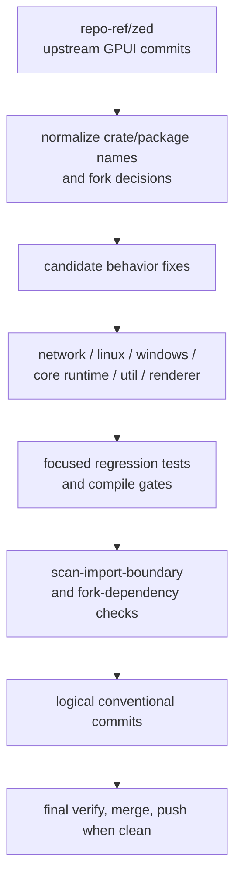

# Zed GPUI Upstream Sync - Plan

## November 5 Continuation

The owner has resumed maintenance in `F:/SourceCodes/Rust/open-gpui`, whose inspected baseline is
`89cb76ba` on `optimize/docking-graph-transaction`. Continue the existing framework and preserve
that branch's unfinished canonical-docking work. The July units below retain their historical
requirements; they are not proof of parity with current Zed.

The November 6 owner clarification selects the
[sync skill's official-baseline rule](../../.agents/skills/open-gpui-upstream-sync/SKILL.md#integrate-through-existing-owners):
retain official framework behavior by default, refactor fork-owned adaptations around that base,
and build reusable additions through ordinary public modules. The candidate queue records the
reason and verification for each retained difference; unfinished official mechanisms stay visible.

The [candidate queue](../imports/zed-gpui-upstream-sync-candidates.md#november-5-maintained-framework-successor)
now records upstream `635026fabc38440fce5e1767d125026a17b12012` and five complete
correctness units: arena custody, TextSystem lifetime, cached-view dependencies, text layout and
pending-input/blur. The arena unit is implemented with separate allocation, nested cleanup,
App-bound tokens and the fork's native post-borrow maintenance; its
[verification](../verification.md#element-arena-and-native-frame-maintenance) records allocator
Miri, framework and Windows HWND evidence, including the remaining touchpad timing gap.
The TextSystem unit now replaces pooled strong wrapper references with independent character
width caches. Its [lifetime record](../verification.md#textsystem-pool-lifetime) includes the
reproduced reference cycle, reuse/partition tests and complete headless/native reconstruction.
The native consumer also exposed a separate stale WinRT UISettings factory after OLE apartment
recreation; the platform owner now acquires that factory within the current query lifetime.
The cached-dependency unit now isolates nested draw/callback reads, retains paint/deferred
dependencies, preserves deferred journal indices and inherits logical opacity through portals.
Its [qualification](../verification.md#cached-dependencies-deferred-replay-and-opacity) records
the original failures, admitted/rejected-candidate controls, stationary-pointer convergence,
873 Core cases, 2,964 affected consumer cases and 165 selected Windows cases. Four existing
interactive Windows cases remain skipped. The native cache regression proves actual submitted
frames and retirement, while the existing non-view invalidation limitation remains explicit.
The text-layout successor now preserves native tab advances, single-baseline Unicode separators,
default/explicit DirectWrite font features and wrapped hit-test error semantics. Its
[qualification](../verification.md#native-text-layout-and-wrapped-hit-testing) records red
regressions, final Core 877, affected consumers 2,964 and selected Windows 173, including actual
native text paint/submission and exact retirement. Four existing interactive cases remain skipped.
The native upload/mapping successor now shares checked atlas admission across both insertion
APIs, publishes only after upload admission and releases color staging maps through the existing
raster owner. Color targets are cleared to transparent before blending. Its
[qualification](../verification.md#native-atlas-upload-and-color-readback) owns the WARP pixel,
debug-layer, lease/refusal and actual color-emoji evidence. The pending-input successor now
ports recognized-modifier interception/observation, singleton timeout, IME preference and
accepted focus/blur/drop settlement through the existing owners. Its
[qualification](../verification.md#pending-input-modifier-recognition-and-blur) records the
original failures, callback-retarget corrections, exact completed-action observation and native
text-handler consumer. These five initial correctness units precede the wider coherent refresh
and substantial game-engine Editor adaptation.
Reproduce each remaining defect, integrate the owning fix, preserve fork contracts, run focused
and affected regression cohorts serially, and record actual results. Source review and dependency-
consumer checks alone do not qualify a complete framework refresh.

### Cached-Dependency Adaptation Requirements

Port `decd2399b1` and `8fa085e397` through existing EntityMap, AnyView and deferred frame journals.
Capture nested access scopes rather than diffing a whole-frame set; combine render/prepaint,
paint and deferred reads, and filter released IDs through reference-count membership. An entity
currently leased remains live even while absent from the storage map. Preserve candidate-frame
commit timing for subscriptions, atlas reuse refusal, presentation/transform/clip validity and
portal/reveal generation ownership.

The fork permits opening a second window synchronously during paint. Isolate and restore the
outer frame's access context on inner success, candidate rejection and unwind; copying an
upstream frame reset would erase active outer scopes. Regress a cached canvas that reads entities
before and after nested window creation, with exact per-window subscription ownership. Port the
upstream accessed-scope, cached/deferred-subscription four-way matrix and inherited-opacity
regressions without changing their promises about non-view entity notification.

Reconcile opacity inheritance through ordinary deferred children and window portals, including
hover changes discovered during paint, before closing this unit. Verify bounded convergence
against the fork's candidate acceptance rather than assuming a follow-up frame is already a
qualified same-frame result. Retain transform/clip/reveal and rejected-candidate controls; source
comparison alone does not qualify cached execution.

### Text-Layout Adaptation Requirements

Port the complete behavior of `0294cfb58e`, `979cd3fdf0`, `ac6818fb2d` and `e71963a599`
through the existing DirectWrite and LineLayout owners. Preserve the source string and native tab
policy: zero-glyph tab runs use the native layout's hit-test advances and retain invisible glyph
entries for byte/caret mapping. Do not replace tabs with spaces or choose a new cross-platform
tab interval. Compare native metrics across fonts, sizes, split font runs, leading/trailing tabs,
multi-byte text and the existing logical-order RTL controls.

Keep Unicode U+2028/U+2029 on a single logical baseline by shaping native segments and rebasing
their original byte indices and glyph positions. Retain source separators, font-run partitions,
zero-width pieces and aggregate ascent/descent. Default empty font-feature configuration must
apply DirectWrite's standard liga/clig/calt features while preserving explicit per-tag disabling.
Use live native typography and layout results for these tests. Adapt the upstream cursor fixture
through the fork's existing `ShapedLine::split_at`; adopting the later forward-cursor optimization
is not required to preserve these piece/text/width assertions.

Wrapped exact hit testing must return `Err` at the current wrapped row's end when floating-point
rounding leaves a position inside that row but outside the unwrapped layout. Keep closest-index,
UTF-8 byte boundaries, nonzero row origins and caret affinity unchanged. A constructed shaper
output regression establishes this consumer boundary; it does not establish a particular native
font's rounding behavior.

Inspect `89e8a4b9ec` prerequisites when adapting DirectWrite callbacks. A mutable renderer context
must originate from a mutable pointer; nullable native arrays must admit null only for zero
length. Reconcile its remaining raster/atlas changes with the fork's admission and resource
owners before calling that broader hardening commit covered. Preserve candidate rejection,
font/style cache identity, native submission and teardown through the affected regression cohorts.

### Pending-Input Adaptation Requirements

Source comparison maps `bc7041c600`, `ba42ab9d98` and `f66ed399cd` to the existing Keystroke,
Window dispatch, pending-input and focus-commit owners. Include direct prerequisites
`dc1e815e47835095748cbb036541992abd9ac826` for pending-chord IME preference,
`a8cae3bd77f6e1c1dde98bb1dcebba0d254dbd71` for multi-modifier recognition, and
`e463c5ab74e016f6a16e02a8b21925b98643f9c7` for dropped-focus settlement. These fixes have their
own pending-input qualification; the earlier text-layout results do not cover them.

Preserve both standalone-modifier timeout/recovery tests and all six interception/observation
regressions: bound/unbound release, raw-listener suppression, pending short/long resolution,
combined shortcut release and consumed-modifier deadline preservation. Retain the complete
pending InputHandler test, including IME preference recovery, completed chords and ordinary
text replay. Distinguish multi-modifier gestures from a later genuine standalone modifier.

Empty focus, repeated blur, disabled-focus blur and released current handles must settle pending
input through their owning accepted transition. Successful sibling focus changes clear it;
unbound/suppressed targets retain it. Refused focus/blur candidates keep both the original chord
deadline and notification state until an admitted retry. Preserve sealed-callback deferred blur,
FocusStable/suppression rules, interaction quiescence and exact-window deferred notification.
Exercise close before notification/timeout and close inside observer/replay callbacks so later
actions or text cannot target a retired/reused window. Do not clear pending state unconditionally
at blur entry or copy upstream frame timing over the fork's provisional-focus authority.

Treat context changes on the same focus as invalidating the old sequence's IME-first override.
Retain the original replay recipient across pending observers and replay listeners; revalidate
after callbacks before further action/raw-key/text delivery. Preserve a completed action's
recognized-keystroke report while its window remains live even when that action changes focus.
Only an entire singleton-modifier prefix introduces the modifier timeout; a modifier later in
an otherwise untimed longer chord must not change its deadline policy.

PendingInputStatus/pause APIs, InputPreference event fields and FocusMap queue optimization are
separate final-target differences, not prerequisites established by these fixes. They require
their own coherent API/consumer disposition rather than a new focus/input owner or scanner.

### Native Upload And Mapped-Readback Safety

Reconcile the remaining `89e8a4b9ec` changes through the existing DirectXAtlas and DirectWrite
raster owners. Atlas source dimensions, pixel stride and complete row-byte length must pass
checked admission before allocation; final destination bounds must fit the resident texture
before UpdateSubresource. Both insertion APIs use the same private path. Malformed input returns
an error without key publication, allocation or instance-generation consumption. A later refusal
releases only the unpublished allocation, retaining existing keys, regions and visual leases.
Creating a native shader view must succeed before reserving a free slot or generation. An
admitted upload call does not establish GPU completion or presentation.

Preserve the fork's retained old-region policy after ordinary key removal. The target's void
upload early-return cannot substitute for a failure result because its caller still publishes
success. Qualify exact/short/extra byte lengths, invalid/max dimensions without giant buffers,
final box bounds, both insertion APIs, same-key valid retry and existing leased content. WARP
tests must read multi-row patterns at nonzero atlas origins for all three texture kinds, using
native RowPitch rather than assuming packed staging rows. Device creation failure is a failed
qualification, not a skipped success.

Color glyph staging readback pairs every successful Map with Unmap before conversion or return.
Extract the existing row-copy owner to reproduce its missing release safely on a repeated read
of the same staging resource; do not execute an unchecked short-source GPU upload just to make
the atlas baseline fail. Allocate output before mapping and retain lexical/RAII cleanup through
post-map error and unwind. Keep existing alpha conversion, UI-thread ownership, device/submission
and resource-lifetime authorities unchanged. Preserve lease/candidate-refusal, native text paint
and teardown regressions alongside the focused WARP evidence.

Clear newly created color render targets to transparent before blending so uncovered and
semitransparent pixels do not depend on undefined initial contents. Qualify transparent padded
borders through the real color-emoji raster path while retaining its visible-content and repeated
byte-equality controls. This output check does not establish a deterministic missing-clear red
baseline without a poisoned initial target.

After those units, compare a coherent text/framework refresh, including dependency/toolchain
changes, before expanding the Editor component implementation. A game-engine rendering adapter
is a legitimate framework extension; the existing D3D11 backend need not remain mandatory.
Keep any concrete engine types above the core UI execution interface. The consuming engine owns
its Editor/game-UI tradeoff and complete rendering/input/lifecycle acceptance; this plan adds no
Nara document, ECS, history or GPU authority to Open GPUI.

### GPU Record And Color-Transfer Successor

The successor to `cde23d44ada` implements `f2817700349` and `b9419ae7281` through the existing
scene, Window and renderer owners. Its
[qualification](../verification.md#gpu-primitive-flags-and-windows-color-transfer) owns the safe
layout red, native old-shader pixel red, corrected cohorts and execution-path limits. These
results extend the maintained framework; they do not complete the wider refresh.

PaddedBool32 provides private initialized four-byte zero/one storage for Underline.wavy and
PolychromeSprite.grayscale. Constructors and public-record migration notes change together;
author-facing style/paint APIs remain bool, with no raw-u32 or Serde compatibility path. The
shared records retain the fork's clip, 40-byte tile generation and terminal transform layout.
DirectX uploads the shared slice, removing its duplicate record and per-frame conversion.
HLSL/WGSL consume the complete flag. Tests check field width, complete values and offsets in
addition to the unchanged 88-byte underline and 128-byte sprite sizes. Metal source/ABI
assertions are updated, but generated-header, shader and native execution on macOS remain open.

Windows now decodes with exponent 2.2 and encodes with its reciprocal. The real HWND/DirectX
scene fixture uses an independent f64 Oklab oracle at non-endpoint physical pixel centers,
sRGB/solid/alpha controls and a changed-color witness in a newer exact Submitted generation.
The same trajectory checks alternating grayscale flags, opacity, straight/wavy/strikethrough,
translated rounded clips and cached/deferred replay, followed by exact native/platform release.
Draw-time cache mode is published through the existing accepted-frame transaction, preserving
legitimate accessibility/inspector cache bypass without weakening pixel assertions.

The verification record distinguishes debug runtime shader compilation from embedded FXC
artifacts and shader optimization from Rust runtime performance. The Windows approximation is
not a complete engine color-management policy or a byte-parity requirement for WGPU's piecewise
transfer. Dependencies and the declared Rust 1.92 floor remain unchanged; Rust 1.95 execution
and independently locked consumption retain their own scope. Linux, macOS, browser, mixed-DPI
migration and measured cost remain separately qualified work.

### Font Resolution, Installation And Reporting Successor

The successor to `871c012c96c` implements `9e6e14160c`, `3389d87577`, `b7d50b95e8` and
`b68add5b37` against the same fixed target. Its
[qualification](../verification.md#runtime-font-installation-and-missing-glyph-reporting) owns
the original three failures and passing rejected-installation control, the final 999 Core/WGPU
and 2,964 affected-consumer cases, native Windows 189 and the independently reviewed ownership
corrections. Four existing interactive Windows cases remain skipped. Broader native font
reselection and the full framework refresh remain open.

Cache Direct/Fallback/Missing outcomes under the existing TextSystem owner, retain only direct
reverse lookup, and warn for the explicitly requested descriptor rather than every absent
fallback candidate. Successful installation clears descriptor resolution, resets missing-glyph
deduplication and advances the font generation. Existing loaded FontIds must remain usable;
backend-specific descriptor reselection need not return the same numeric ID on every platform.
Cosmic must preserve loaded face identity while rebuilding its family/fallback resolution.

Every ordinary, wrapped and actual hash-layout entry point observes the font generation.
Current/previous caches and LineLayoutIndex ranges cannot replay or truncate another generation.
Preserve `abort_frame`: same-generation candidate rejection restores transferred layouts, while
installation prevents an old frame's layouts from returning through that recovery path. Use
the existing atlas-lease refusal to qualify the real Window draw path, not only cache methods.

Missing-glyph reporting is optional per backend. Core/Cosmic/Web retain complete grapheme
clusters and proportional/monospace identity, a bounded nonblocking queue, bounded receiver
deduplication, generation filtering and bounded duplicate-only polling. Default Windows/CoreText
sinks remain unsupported; these changes make no all-platform missing-glyph claim. App owns one
replaceable callback and its receiver task, with subscription replacement/drop, callback reentry,
unwind restoration and App release controls. No application callback runs under shaper locks.

Applications own font fetching and explicit redraw after installation. Use the App's actual
TextSystem instance and notify the text view or refresh the Window; parent-only notification of
a cached child is not font invalidation. HeadlessAppContext and TestAppContext must return that
same App-owned TextSystem through their public accessors, rather than independent descriptor,
generation and reporter caches sharing only the platform backend. Add tracked, licensed deterministic test fonts so
complete source-checkout tests do not depend on ignored `repo-ref` assets. Qualify real Cosmic
fallback-to-direct installation and a native Windows public Render/canvas/shape/paint trajectory
with a newer exact Submitted frame and exact platform retirement. Keep native preconditions,
OS input, other platforms, compiler-floor execution and measured costs explicit.

Font prewarming, available-family name policy, glyph-raster reuse, Unicode wrapping, layered text,
window-local Rc layout state and Taffy/API migration remain their separately queued units.
Do not copy those unrelated final-target changes or report this unit as complete text refresh.
The concrete Cosmic implementation also takes `d0f797a38c`'s retained font-source storage and
`d6358b2d3c`'s fallback-face preservation. These are explicitly included adjacent mechanisms,
not prerequisites of dynamic installation. Qualify actual source pointer ownership and a
no-Latin-measurement-glyph face that remains available for fallback after a failed primary
request; neither establishes a timing or memory-budget improvement. The current Web platform
uses Cosmic directly. Do not add an unregistered wrapper or claim the fixed target's later
Canvas fallback scanning layer, which remains in the Web platform-closure unit.

### Native Font Reselection Successor

The successor to `ed2a55383f4` implements DirectWrite selection generations, same-face identity
reuse, named private fallback and exact native callback face retention. Its
[qualification](../verification.md#native-font-reselection-and-retained-faces) records the
original and corrected red baselines, the cold-cache synthetic-face failure and actual native
submission/release evidence. The fixed target has the same DirectWrite gaps; these are owning
corrections discovered during the comparison. CoreText source and five deterministic tests
are also prepared, with macOS compilation/execution explicitly unqualified.
The corrected focused cohort passes 9/9 and complete Windows passes 197/197 with four existing
interactive cases skipped. The earlier 194/195 run retains the remaining second-shaping defect
and its correction, rather than being replaced by the narrower initial six-case pass.

Use a deterministic regular-then-bold fixture and an already requested descriptor, plus an
installed fallback-family case. Verify the newly selected face after explicit redraw while
retaining old FontId metrics and old-layout paint, existing candidate refusal/retry and exact
native release. Reconcile successful and failed installation semantics without assuming
batch-atomic rollback or clearing loaded font records. macOS source adaptation and execution
retain separate evidence. This is a concrete native font consumer, not a new global font,
asset-fetching or redraw authority.

DirectWrite can synthesize Bold from Regular before installation; effective weight alone
cannot prove reselection. Preserve simulation flags, exact fixture outlines and actual old
metrics in the tests. An unknown callback face must retain its actual native identity and
simulation rather than resolve family/weight/style again. Unchanged descriptor selections
retain their loaded IDs across multiple successful installations, with actual ligature controls
for independent feature configurations. The remaining Mac native qualification, general text/
layout/API refresh, OS input, numeric costs and engine integration keep their existing scope.

### Cosmic Paragraph Shaping Successor

The successor to `b803d542b67` adapts `c214057e086517920b214800725c5d16294ddf0d` against
the same fixed target. Cosmic 0.19.0 asserts when one input line contains BiDi paragraphs with
different directions. Split each `Bidi_Class=B` separator and its neighboring paragraphs for
shaping, then restore original UTF-8 indices, horizontal offsets and aggregate metrics on one
logical baseline. Keep the unmodified source and the existing public newline/wrapping policy.
U+2028 is not `Bidi_Class=B` and retains the unchanged path. Do not infer full UAX #9 caret or
complex-script parity from this bounded correction.

Consume font runs with a monotone private cursor, preserving exact feature/fallback identities
and zero-length boundaries without rescanning every earlier run for each segment. Original
source validity remains the caller's contract. Collect missing raw indices before fallback
output conversion, restore their original offsets and report once against the complete source;
CRLF remains one grapheme rather than two segment reports. The [qualification](../verification.md#cosmic-paragraph-shaping-and-public-paint)
records reproduced direction failures, the corrected separator-width oracle and the additional
CRLF reporting regression.
The public LTR consumer also exposes the fixed target's existing final-glyph closest-hit defect.
Correct that Core terminal-distance comparison under its existing contract, retaining midpoint
affinity, UTF-8 cluster indices and no-glyph behavior. Keep the public assertion and its red
owner regression rather than narrowing the consumer to exact glyph origins.

Use deterministic licensed Hebrew bytes for actual base/combining glyph and software raster
evidence, keeping font priority separate from paragraph shaping. The existing no-Latin-`m`
primary filter can omit that family from the explicit fallback chain; retained database faces
still serve Cosmic's automatic fallback. This unit verifies the actual selected Hebrew face,
not general configured-fallback priority. Keep that loader policy visible for the remaining
font reconciliation rather than changing it implicitly.

Exercise public `HeadlessAppContext`/Render/canvas/shape/paint, explicit notification, changed
canvas layout bounds, repeated frames and different-size window reconstruction. TestPlatform
acceptance/paint-raster observation and Swash raster are distinct from GPU/native presentation.
Existing candidate refusal/retry, observer ownership and independent-consumer compilation retain their
owners. Promote the already resolved `unicode-bidi` 0.3.18 to a direct WGPU dependency in both
lockfiles without incidental package updates. Unicode wrapping, text layers, Rc ownership,
Taffy/API migration, remaining platform execution and numeric costs keep their queued scope.
The complete all-feature Core/WGPU/Windows plus public paragraph consumer passes 1,207/1,207
(943/66/197/1 respectively), with four existing interactive Windows cases skipped. Existing
native DirectWrite/rendering cohorts retain their own backend scope; they do not qualify
native Cosmic output by association.
Affected UI core/components/docking/Canvas passes 2,964/2,964 across 25 binaries with no skips.

### Unicode Wrapping, Indentation And Truncation Successor

Continue from `f48d20d27862e45ff27fcd7ba4f261fd9119d0f7` against the same fixed Zed target.
Reconcile `f0210f1621c6be9df4510a4356fa5049680e1c01`,
`4f70d91bda7ec5f5600a000a0dc34391d9f1e96f` and the inherited omission
`03a8544040ff95ec2e7921ca71c83799ad7f17cd` as one complete text workflow. Unicode line
opportunities must agree across text fragments, inline elements, emergency grapheme wrapping and
shaped-cluster layouts. Preserve the upstream RTL workaround without claiming general UAX #9
caret support. Replace the obsolete script/punctuation heuristic rather than retaining two policies.

Expose the explicit `IndentAdjustment` parameter and migrate public consumers. Preserve ordinary,
extra-column, narrow-row, all-space and saturated indentation behavior. Route Middle truncation
through public style and element measurement, retain both source ends and redistribute complete
TextRuns. Correct the target's grapheme cuts in all truncation directions and wrapped End rather
than importing those defects. Keep existing font-resolution/width generations, independent pooled
width caches, admitted/aborted layout epochs and exact TextSystem lifetime.

Use the target's non-complex-scripts ICU segmenter with compiled data; it does not qualify full
complex-script segmentation. Review both lockfiles for only the necessary dependency closure,
retain the independent application's compatible resolution, and execute the installed Rust 1.92
compiler before qualifying that floor. Regress the actual old slash/grapheme failures, then exercise
public headless shape/paint, style-driven truncation, notified reflow, repeated frames and window
reconstruction. Record native Windows and headless Cosmic evidence separately. Font fallback
priority, later layout/API work, other native platforms and measured budgets remain open.

Consumer/review regressions extend the target adaptation: group actual visual glyphs by original
source grapheme while retaining the first visual glyph's boundary, including marks preceding their
RTL base across runs. Reconcile carried End content, zero-deletion Start candidates, explicit
paragraphs at a one-row limit and CRLF against public unclamped shaping. Start and End now use
one wrapper/paragraph authority rather than retaining the target's duplicate End walk. Candidate
searches remove source before adding an affix and keep exact TextRun coverage. Empty trailing
paragraphs may be omitted without an affix; wrapped Middle keeps the first/last paragraph ends
together. Flat single-row and direct `truncate_line` semantics retain their separate policy.
Bounded overflowing multiline probes are a correctness tradeoff, not a measured speedup. The
[qualification](../verification.md#unicode-wrapping-indentation-and-middle-truncation) owns the
executed source, public-style, native, compiler and dependency results.

### Font Preparation, Inventory And Raster Work Successor

Continue from `b466037e87e17f11e7acce70706b7866edda3ca1` against the same fixed Zed target.
Reconcile `f1d27d545e79f98ffde7ebf3229f8eb8bad791aa`,
`5b4a2153a087055a7f9cb3464f188f1cab9fd678` and
`1ff7cb669b6351eaf2a5b79ccb40f5cd1676b8f8` through existing TextSystem/platform/Cosmic owners.
Keep the upstream application's startup policy outside the extracted framework closure.

Expose explicit `TextSystem::prewarm_fonts(&[Font])` and an optional platform hook. Resolve complete
descriptors through the existing generation-aware cache, deduplicate resolved IDs, and prime
Cosmic's actual primary/fallback match attributes using the same properties as normal shaping.
No new thread, task owner or automatic redraw is required. Callers choose when to prepare and
can use their existing background executor. Successful installation retains its current
invalidation rules; failed installation retains the prior cache and usable layouts.

Return only sorted unique platform-reported families from `all_font_names`, including registered
fonts. Do not inject guessed fallback candidates or virtual aliases. Existing aliases still
resolve; a reported fallback-only family need not pass the backend's Latin-primary eligibility
check. Preserve old face IDs, glyph bytes, paragraph/source geometry and configured FontRuns.

Preparation can load another descriptor for an already observed native face. DirectWrite's
callback identity must retain the first mapping for that physical face, without merging distinct
input descriptors, features or fallbacks. The native installation consumer exposes this defect;
the independent alias regression and correction are committed as `19a4ed3434a`. Keep the actual
source, retained-glyph repaint and exact native retirement assertions in the complete consumer.

Reuse a rendered Cosmic glyph image between bounds measurement and atlas rasterization using its
complete RenderGlyphParams key. The target's unbounded pending-image map needs a bounded local
handoff for measurement-only custom consumers: cap pending entries at 256 and retained image
buffer capacity at 8 MiB. Admission pressure evicts temporary images and later rasterization
recomputes normally; it cannot reject or truncate glyphs. Empty/error results retain no pending
image. Track replacement/consumption accurately and retain direct-raster, interleaved-key,
repeated-raster and post-installation recovery. This bounds the new temporary image storage,
not the existing bounds cache, atlas, total font memory or process retention.

Reproduce the invented-name failure first. Use actual Swash generation attempts, cold pixel
oracles and exact source/size/scale controls to distinguish new reuse from existing atlas hits.
Extend existing public headless shape/paint/reconstruction, Windows installation/Submitted/close
and independently locked consumers. Preserve generation, candidate refusal/retry and old-face
evidence. Count concrete queries/image generation and state the bound without claiming frame-time,
retained-process or cross-platform performance qualification. Run focused regressions, affected
runtime/component/native cohorts and compiler/consumer checks serially before this unit closes.

The [completed qualification](../verification.md#font-preparation-inventory-and-raster-reuse)
records the original inventory/alias failures, bounded-handoff cold pixel/work controls and exact
native installation/retirement. Final Core/WGPU/Windows plus public text passes 1,268/1,268 with
four existing interactive Windows cases skipped; affected UI core/components/docking/Canvas
passes 2,964/2,964 and independently locked public API tests pass 5/5. Locked compilation,
correctness Clippy, formatting and actual Windows Rust 1.92.0 affected-framework/independent
checks pass. This closes the scoped font-work unit without qualifying other platforms, complete
fallback/script support, numeric costs, canonical docking or engine integration.

### Text Split, Layers And Underline Successor

After the font-work qualification, reconcile `2936989f1b`, `f792c2d72d`, `bda9c0bd43` and
`0dea8c63d9` against the same fixed target. A bounded source comparison at fork `19a4ed3434`
identifies missing raw LineLayout split/paint, ShapedLineCursor, public TextLayout background/
foreground passes and underline callbacks/exclusions. Existing ShapedLine split and low-level
background/foreground painting remain the starting owners. Implementation now follows font-work
revision `1d148d66dfd`; the verification record must distinguish each executed checkpoint from
the full unit qualification.

Preserve these complete consumer requirements:

- Shape, split and paint multibyte source with multiple font/decoration runs. Check complete
  source reconstruction, retained glyphs and rebased byte/position geometry. Cursor boundaries
  are monotonic UTF-8 character boundaries; repeated boundaries are valid, while backward,
  out-of-range and interior-byte requests are refused according to the selected public contract.
- Define visually reordered split semantics before porting the fallback. The target's cursor
  falls back to the old split for unordered glyph indices, but that split uses `partition_point`.
  Equality with that implementation is not an independent correctness oracle. Actual Hebrew and
  mixed-direction consumers must check glyph membership, finite geometry and index rebasing;
  retain any unsupported script/caret scope explicitly.
- Let a measured custom element paint opaque text backgrounds, insert its own highlight and
  then paint foreground once. Shared layer footprints must contain every aligned wrapped row,
  including centered/right-aligned text, narrow/wide allocations, empty text and overlapping
  clipped content. Preserve ordinary combined painting, redraw and reconstruction.
- Expose underline byte ranges and the existing zero-advance geometry adjustment through the
  same paint owner. Preserve callback forwarding, style transitions and final range settlement.
  Adapt absolute scaled-device exclusion ranges through the fork's existing underline projection,
  subtree transforms and clip authority. Keep full-line geometry/wave phase while masking visible
  segments; cover unordered, overlapping, adjacent, out-of-range and fully covering exclusions,
  opacity, fractional origins and scales 1, 1.25, 1.5, 2 and 3.

Use the existing public headless/native and independently locked consumers, with actual source/
geometry and pixel oracles where relevant. No Zed diagnostics owner, new layout authority or
separate text renderer is required. Window-local Rc and Taffy migration remain separate units.

The selected split contract partitions glyphs by their original source index, keeps visual order
and rebases suffix indices/coordinates. Painting fragments at successive recorded advances
reconstructs their original glyph geometry; fragments may extend outside that advance. This is
not independent bidi reflow, a caret operation or reshaping across a cluster boundary. The old
`partition_point` implementation reproduces an RTL index-underflow failure. Both raw layouts
and ShapedLine now use the same source partition, while the ordered cursor advances glyphs and
decorations once. Reordered input scans the remaining glyphs rather than claiming linear work.

TextLayout owns an immutable Rc snapshot of its measured lines and releases its RefCell borrow
before calling painting/backend code. Ordinary drawing finishes all backgrounds before all
foregrounds; explicit split passes propagate errors. Shared aligned/wrapped row footprints,
continued decorations and final row endpoints use actual aligned origins. Window underlines
share one prepared snapped/projected primitive. Absolute device exclusions add exact clip
rectangles to the existing transformed/rounded clip stack without shortening the full wave.

Independent review identifies that advance-only batching cannot cover outlying fragment glyphs.
Retain a real emitted-sprite/opaque-cover ordering regression and correct the line batching
condition before closing this unit. The existing platform and complete public consumers keep
their source, reflow, notification, reconstruction and exact retirement checks. These mechanisms
do not establish numeric costs, general visual RTL caret/reflow or execution on other platforms.

The [completed qualification](../verification.md#source-fragments-text-layers-and-underline-exclusions)
retains both reproduced owner defects and their corrections. Unordered, non-increasing-position
or outlying glyphs use actual primitive bounds for ordering; ordinary contained text retains
aligned/wrapped batching. Focused public/native passes 19/19, complete Core/WGPU/Windows plus
public text passes 1,281/1,281 with four existing interactive Windows cases skipped, affected
components/docking/Canvas passes 2,964/2,964 and independent API tests pass 6/6. Locked compilation,
correctness Clippy, formatting and actual Windows Rust 1.92.0 affected-framework/consumer checks
pass. Bounded independent reviews close the ordering P2 without outstanding confirmed findings.
The unit is complete within its recorded scope; existing ink-overhang, complete script/caret,
remaining platforms, numeric costs and the wider refresh remain open.

### Window-Local Text Ownership Successor

After `55ddbcde395`, reconcile official changes `772a8a9100` and `2a74c8dff6` with the
same fixed target. The official implementation makes WindowTextSystem Rc-owned, changes
window cache synchronization to RefCell, moves font-run scratch storage from the global
TextSystem into each window, and deletes the unused hash-only layout APIs. Follow-up official
`dde76a1dca` uses Cell take/set for that scratch buffer in the final target. Adopt that
ownership directly. Materialized source APIs retain complete ShapedLine text; remove the
parallel hash keys, maps, range indices and empty-source placeholder rather than preserving
a fork compatibility wrapper.

Keep provenance explicit. The fork's coherent current/previous font generation and refused
candidate recovery serve existing runtime font installation and atlas-lease admission
consumers. They are fork adaptations, not behavior supplied by these official changes.
Retain their qualified behavior while removing synchronization from the window owner.
The fork also releases local cache borrows before backend calls; after reentry, reuse an already
published canonical result and refuse stale-generation publication. Global TextSystem and
immutable LineLayout results retain Arc ownership.

Qualification must include same/different-key backend reentry and unwind, genuine global
font installation with window-thread cache access, stale ranges/publication, and the
existing real candidate refusal/retry trajectory. Public two-window Cosmic, independently
locked API and native reconstruction consumers must prove distinct local caches, one exact
shared global TextSystem, source-preserving reuse/reflow and lifetime through retained Rc
handles. Existing notification, paint, Submitted and platform-release checks stay in place.
Ownership and removed locks alone do not establish a measured performance improvement.

Independent review also identifies a cache-key defect present in both the starting fork and
official target: wrapped results depend on max_lines, but their key omits it. A fresh-owner
oracle reproduces stale unlimited boundaries after changing to one line. Correct the existing
owned/borrowed content key rather than adding another cache or bypass. Keep this correction
explicitly fork-owned, with both clamp orders and committed/aborted frame reuse qualified.

The [completed qualification](../verification.md#window-local-text-ownership-and-source-cache)
retains the original 29/29 focused result, 5/5 public/native checkpoint, reproduced clamp
failure and notify-fixture correction. Corrected Core/WGPU/Windows plus four public text
trajectories pass 1,292/1,292 with four existing interactive Windows cases skipped; affected
components/docking/Canvas pass 2,964/2,964 and independently locked public API tests pass 7/7.
Locked compilation, affected correctness Clippy and actual Windows Rust 1.92.0 framework/
consumer checks pass. Independent cache and consumer rereviews close their confirmed P2
findings. This closes the selected ownership unit without completing Taffy/platform refresh,
canonical docking, measured costs or engine adoption.

### Taffy, Text Measurement And Root/Grid Successor

After `1f01e811c101`, reconcile official `91fdd55889`, `b05f40c554`, `31ceaf7908`,
`cdf33ac25e`, `b488c4e814`, `b0da438545`, `5ccbbbd88f` and `41d72f6c1d` against the same
fixed target. Treat the dependency and sizing corrections as one consumer unit. Use Taffy
0.15.0 in both qualification lockfiles, retain a compatible 0.15 library requirement and
the independently owned application pin, and adopt the final explicit backend feature set.
Do not pull unrelated dependency updates into this unit.

Adopt the official leaf-layout callback and alignment types while retaining existing logical/
device-pixel conversion, authored stroke rounding, cached bounds and explicit relative
positioning. Text must not answer an unconstrained probe with a previously truncated size;
nonwrapped truncation must use actual shaped overflow before per-character cutting. Unknown
list widths use the official MaxContent probe. The target does not itself implement a general
new word-based MinContent text algorithm; distinguish its executed correction from that wider
capability rather than inventing or claiming it here.

Window and prompt roots fill only auto dimensions. Explicit/percentage dimensions, min/max
constraints and the original anchored/tooltip/drag/deferred shrink-wrap paths retain their
own behavior. Add official row min/max-content methods and rename TemplateColumnMinSize to
GridTemplateMinSize without an alias. Follow the official opt-in stacker policy across Div's
request/prepaint/paint and Taffy's measured callbacks; qualify both feature configurations.
Do not describe removal of mandatory stack growth as an unlimited-depth guarantee.

Use same-element constrained/unconstrained/final measurement regressions, actual kerning-width
and all three text-overflow directions, complete list/grid consumers, root auto/explicit sizing,
shared font/source/candidate custody and public/custom Element paint. Real Cosmic headless,
independent-lockfile API and actual Windows Submitted/reconstruction evidence remain distinct.
Retain original notification/teardown assertions and observe notified successors before any
forced refresh. Existing pixel snapping, clips, candidate admission and atlas ownership remain
under their current owners. Run affected Core/platform/component/docking/Canvas suites, locked
workspace and independent checks, correctness Clippy, actual Rust 1.92 checks, both formatting
checks and existing import/document/release/API scans. Numeric speedup, other native platforms,
canonical docking and engine adoption remain separate open scope.

Independent review reproduces a further untruncated-cache defect in both the starting fork
and official target: a finite wrapped result answers a later MaxContent probe. The existing
cache now requires exact wrap-width equality alongside both official truncation guards.
Keep that correction explicitly fork-owned. The native exact-fit consumer installs the
bundled font with explicit kerning and requires the existing per-character wrapper to cut
all three exact-fit strings before actual StyledText is allowed to prove full-source paint.
This avoids borrowing Cosmic's kerning evidence for a native descriptor with no such effect.

The [qualification](../verification.md#taffy-text-measurement-and-rootgrid-sizing) records
corrected Core/WGPU/Windows plus five public text/layout trajectories at 1,312/1,312 with four
existing interactive Windows cases skipped; the stacker-disabled owner/portal cohort passes
33/33. Affected components/docking/Canvas pass 2,964/2,964 and independently locked public
text/grid tests pass 9/9 without skips. Locked workspace/consumer compilation, correctness
Clippy and actual Windows Rust 1.92.0 framework/consumer checks pass. The record retains
the inherited-cache red result and fixture corrections; bounded independent reviews close
confirmed findings. This completes the selected layout unit, not complete framework refresh,
other platform execution, measured costs, canonical docking or engine adoption.

### Shared Image Decoding Successor

After `11d9a96033ea`, reconcile official `9552acc2bc242d45342fa9b5a987d43868aee1ec`
and fixed target `635026fabc38440fce5e1767d125026a17b12012` as one complete image
consumer unit. Adopt the final official shared static/GIF/WebP decoder functions in the
existing platform owner. Remove duplicated element-loader decoding. Static images read and
apply decoder orientation before BGRA conversion; animated GIF/WebP preserve original frame
delays, transparent WebP background, and the official successful-frame/error policy. SVG
retains its existing renderer. Keep the image dependency's required orientation API explicit;
the already locked version is distinct from the manifest minimum and compiler floor.

Preserve the two official regressions and qualify both encoded Image and resource-loader
entry points, static dimensions, orientation, BGRA/alpha, GIF/WebP delays and malformed input.
Additional fork tests must be labeled as qualification, not official implementation. Use the
existing window/asset/candidate/atlas owners for animation progression, notification, cache
replay and native retirement. Do not infer playback from a decoder frame count, GPU completion
from an atlas upload, or native pixels from a headless frame. Independently locked public API,
affected framework/component suites, compiler-floor/build/Clippy/format and existing document/
import checks complete the bounded unit. Other platforms, numeric costs, external-loop,
renderer-lifetime reconciliation, canonical docking and engine adoption remain separate scope.

Source comparison confirms these decoder blocks are inherited official code, unchanged from
the import anchor, rather than a fork-specific abstraction. The final shared helpers change
loader decoder errors from `ImageCacheError::Image` to contextual `ImageCacheError::Other`;
record that observable official behavior in migration notes. The official EXIF commit message
claims an `image` minimum increase but its actual manifest and final target still declare
0.25.1. The fork explicitly declares 0.25.4 after inspecting that exact crate archive's
`ImageDecoder::orientation`, `DynamicImage::apply_orientation` and WebP background APIs.
Both existing lockfiles retain 0.25.10; source-confirmed API availability does not imply an
executed full-workspace 0.25.4 qualification. This manifest correction is fork-owned.

The fork also uses the App's existing executor clock for Img frame progression and loading
delay checks. Its asynchronous timer already belongs to that clock; the native scheduler
continues to supply monotonic time while headless tests can now advance the same authority.
This small testability adaptation is separate from the official shared decoder implementation.
Review reproduces a strict-deadline defect after clock unification: the once-only loading timer
notifies at exactly 200 ms while `>` prevents placeholder paint and schedules no successor.
The fork changes that existing comparison to `>=`, with a public notify-only 199/200 ms
regression. It also strengthens the eight-orientation oracle with a two-axis-asymmetric JPEG
and requires eight distinct results; the original official JPEG has identical pixels across
each row and cannot distinguish four mirrored pairs. Keep both corrections distinct from
the official decoder adoption.

The [qualification](../verification.md#shared-image-decoding-and-animation) records final
Core/WGPU/Windows plus six public consumer binaries at 1,328/1,328, with four existing
interactive Windows cases skipped. Affected components/docking/Canvas pass 2,964/2,964;
independently locked public consumers pass 12/12 without skips. Isolated loaders each notify
their own root without clock advancement or compensating draw, and static images have no
animation callback or idle revision change. Actual Windows encoded/embedded Img instances
complete 0/1/0 with exact Submitted/GPU-readback generation, source replacement and complete
retirement/reconstruction. Both bounded independent rereviews close confirmed findings.
Locked workspace/consumer compilation, correctness Clippy, both formatting checks and existing
import/document/release/API scans pass on Rust 1.95.0. Actual Windows Rust 1.92.0 framework/
consumer all-target/all-feature checks pass. The image minimum is source-confirmed, not an
executed 0.25.4 workspace matrix. The separate AVIF feature-policy difference remains queued;
other platform execution, numeric costs, external-loop/API/renderer lifetime, canonical docking
and engine acceptance remain open. This completes the selected decoder unit, not the refresh.

### Externally Driven Application Successor

After `995ac857636`, reconcile official `74798c68d5c63d31e2ccca5c8f5ec0a02c90679c`
and final target `635026fabc38440fce5e1767d125026a17b12012` ApplicationHandle/run_embedded.
The handle owns one strong AppCell; AsyncApp remains weak. Both launch paths use the existing
platform-run owner. The API does not turn a blocking Platform::run into a returning loop,
create a shared renderer or replace native retirement. Preserve existing Wasm run retention;
run_embedded relies on the returned owner instead. Respect delayed launch and nonreentrant
same-App entry. An external host must finish shutdown/native retirement before dropping its
last handle; handle drop itself neither pumps events nor initiates asynchronous shutdown.

Integrate handle updates with the fork's existing App update transaction and AppCell post-borrow
convergence. Official direct callback invocation must not leave fork notifications/deferred
effects stranded. Test and VisualTest platforms invoke the launch callback and return, allowing
normal public lifecycle consumers without a second application or Host owner. Qualify launch
count, host updates, effects, async/background task custody, native callbacks across App borrows,
reentry/unwind recovery and exact release. Real Windows submission through the returning visual
test platform is distinct from production Windows externally driven-loop support: stock Windows
Platform::run remains blocking and process-owning. Include independently locked public API
consumption, affected library/component/native regressions, compiler-floor/build/Clippy/format
and existing import/document/API checks. Other native targets, engine GPU integration, numeric
costs, remaining closure differences and complete R11/R12 remain open.

The direct official update body reproduces both defer-only and nested-batch failures (0/2)
before the transaction adaptation. Corrected owner tests pass 10/10; the selected actual Windows
visual-test consumer plus owners passes 11/11. Review catches no confirmed P1/P2. The record
keeps two fixture corrections for active transaction depth/nonterminal shutdown and the public
Pixels conversion compile correction. Native evidence binds four stateful text/quad submissions
and GPU captures to exact generations, with effects observed before polling, background await,
visual timer, typed busy-input refusal, queued frame delivery and complete observed owner
retirement. It does not qualify all GPU/vsync resources, real OS input/timing or production
Windows externally driven-loop support.
The final affected runtime/public cohort passes 1,339/1,339, with four existing interactive
Windows cases skipped; affected components/docking/Canvas pass 2,964/2,964 and independently
locked public consumers pass 14/14 without skips. Locked workspace/consumer checks, affected
correctness Clippy and actual Windows Rust 1.92.0 framework/consumer all-target/all-feature
checks pass. Root/consumer formatting and existing import/document/release/API scans complete
the unit. The candidate queue retains the distinct display/hot-reload and owning-asset-load
successors; this is not full closure refresh or engine external-loop integration.

### Owning Asset-Load Successor

After `e4364085634`, reconcile official `5896274168e06663568f42b5bae142162936e0a6`
and its final-target cleanup against `635026fabc38440fce5e1767d125026a17b12012`.
Adopt the official owning `CachedLoad`: one background load, one foreground publication task,
deduplicated interested entity identities and cached success/error. Entries own cancellation;
eviction must prevent an old completion from publishing into a replacement. Results become
visible only after foreground publication. Replace the old public shared-future tuple and
`ImageLoadingTask` rather than preserving compatibility handles. Migrate App, Window,
ImageCacheItem, retain-all and the gallery's real LRU consumer together.

The fork's AppCell permits native modal loops to poll foreground tasks while an App update is
borrowed. Reuse its borrow-release waiting and complete update transaction for publication;
do not add another cache, executor or notification owner. Preserve accepted-candidate dependency
tracking and refusal/recovery. Plain fetch/get must not subscribe a view. Every pending use
must register its interested view, even when another window began the load. Cache replacement,
pending cancellation and foreground notification must retain exact entry identity.

Retain the official owner regressions and add the fork's active-borrow, released-App and actual
multi-window consumption controls. Qualify image-entry removal/disposal, custom image-cache API
consumption, automatic accepted successors, native Submitted generations and exact retirement.
Run focused tests before affected framework/public/component/native consumers, independently
locked API checks, compilation, correctness Clippy, actual Windows compiler-floor checks,
formatting and existing import/document/API scans. Official browser contention motivation is
not a locally measured performance result. Other platforms, numeric costs, full upstream refresh,
canonical docking, Nara integration and complete R11/R12 remain open.

The direct official publication reproduces the fork's borrowed-App panic (2/3); waiting through
the existing AppCell release mechanism corrects that boundary. The expanded final focused
selection passes 22/22, including unwind/terminal shutdown, exact pending replacement, real
retain-all/LRU disposal, cached candidate refusal/retry and actual Windows two-view automatic
Submitted frames. The native no-redraw oracle retains the initial failed count and the existing
native-cache fixture's initialization/input isolation correction. Core's disabled automatic
examples had hidden the migrated gallery from compilation; the actual source is now an explicit
platform example with bounded dev dependencies and tests, preserving the core dependency
direction. The [verification record](../verification.md#owning-asset-loads-and-view-completion)
owns executed results and their limits.

Complete affected runtime/public/gallery passes 1,361/1,361 with four existing interactive
Windows cases skipped; components/docking/Canvas pass 2,964/2,964 and independently locked
public consumers pass 16/16 without skips. Locked workspace/consumer checks and affected
correctness Clippy pass on Rust 1.95.0. Actual Windows Rust 1.92.0 affected-framework and
independent-consumer all-target/all-feature checks pass. The root lockfile adds only existing
gallery dev-dependency names; the independent lockfile and all dependency versions stay unchanged.
No complete refresh, browser contention, numeric cost or engine integration claim follows.

## Maintained Baseline Before Engine Adaptation

Finish a bounded framework refresh against the recorded November 5 Zed revision before expanding
Nara-specific UI implementation. The five correctness units are the first dependency-ordered
part of that refresh, not its completion criterion. Follow them with the coherent text, input,
layout and dependency/API comparison recorded in the candidate queue. Classify relevant framework
differences as ported, already equivalent or intentionally divergent with a reason and verification
scope. A newly observed upstream HEAD starts a later maintenance cycle rather than silently
moving this cycle's target.

Port complete mechanisms and their prerequisites within the extracted framework closure under
the skill's official-baseline rule. Respect the Zed application boundary and reconcile relocated
owners semantically. Package renaming, independent dependencies and unfinished docking work remain
explicit integration inputs rather than reasons to preserve an obsolete fork mechanism.

The exit record must identify the upstream target, resulting fork revision, remaining deliberate
differences, actual compiler/dependency requirements, independent-consumer result and affected
core/component/native regression results. Source parity is distinct from platform execution:
unexecuted Linux/macOS, OS input and touchpad cases remain visible limits. Only after this record
should the engine rendering adapter and complete Editor workflow comparison expand. The consuming
engine still decides Editor/game execution from its own lifecycle and cost evidence.

## Goal Capsule

| Field | Decision |
|---|---|
| Objective | Bring Open GPUI's extracted GPUI framework closure forward with the highest-value Zed GPUI fixes while preserving the Open GPUI package, license, and dependency boundary. |
| Authority | `docs/imports/zed-gpui-import.md`, `docs/imports/zed-fork-dependency-audit.md`, and ADR 0001 define the import boundary. `repo-ref/zed` is reference input, not a source tree to overwrite from. |
| Execution profile | Breaking changes are allowed when they simplify the framework API or delete obsolete compatibility code. Do not preserve dead fork shims, stale TODO stubs, or Zed-product assumptions when a cleaner Open GPUI boundary exists. |
| Priority order | Correctness fixes first: HTTP request bodies, Linux clipboard/IME/headless behavior, Windows platform correctness, core runtime leaks and scroll state, then renderer/dependency updates. |
| Stop conditions | Stop only for a blocker that contradicts the import boundary, needs product scope beyond GPUI framework behavior, requires a platform runtime that cannot be approximated locally, or would require deleting unrelated user work. |
| Tail ownership | `ce-work` owns implementation, focused verification, simplification, review, logical conventional commits, and final integration. |

---

## Product Contract

### Summary

Open GPUI is a source fork of Zed's GPUI framework closure, but it is now an independent workspace with renamed packages, Open GPUI-owned fork dependencies, and additional framework/product crates.
The next sync should not attempt a monorepo merge.
It should port targeted upstream GPUI fixes by semantic change, preserve Open GPUI's independent crate graph, and delete obsolete local compatibility surfaces when upstream fixes make them unnecessary.

### Problem Frame

The current workspace already absorbed many high-level GPUI updates and resolved major fork dependency debt, including public `reqwest`, Open GPUI-owned `font-kit`, Open GPUI-owned `scap`, and crates.io `wgpu`.
The remaining upstream gap is concentrated in bug-fix commits that are easy to miss with file-level diffing because Open GPUI renamed packages and deliberately excluded Zed editor crates.

The plan must therefore compare behavior, not just filenames.
Each migration unit should start from the upstream commit intent, map Zed crate names back to Open GPUI package names, keep local fork decisions intact, and add or adapt tests that prove the behavior inside this workspace.

### Requirements

**Import boundary**

- R1. Only port code from the Apache-2.0 GPUI framework closure that belongs in this workspace's imported crate set.
- R2. Do not import Zed editor, assistant, project, telemetry, GPL tracing, or product-specific crates as dependencies.
- R3. Preserve Open GPUI package names, workspace dependency aliases, `open-gpui-scap`, the Open GPUI-owned `font-kit` fork, and the crates.io `wgpu` migration unless a focused behavior test proves a replacement is necessary.

**Correctness ports**

- R4. HTTP request streaming must not truncate bodies when the producer returns `Poll::Pending`, and the reqwest client should include upstream keepalive and stale-connection handling that reduces failed reused connections.
- R5. Linux platform behavior must include upstream fixes for Wayland clipboard reads that can stall, IME candidate positioning during composition, headless window creation, and actionable errors for missing Linux feature combinations.
- R6. Windows platform behavior must include upstream fixes for caption-button hit testing on immovable windows and Credential Manager blob-size prechecks.
- R7. System wake notifications must be exposed as a coherent GPUI framework API, with Windows OS event plumbing and deterministic test-platform coverage.
- R8. Utility process and command behavior must include upstream Windows Job Object process-tree cleanup and macOS custom `PATH` resolution where those APIs exist in the extracted `util` crate.
- R9. GPUI runtime state must include upstream fixes for pending `ListState` scroll rebasing and scheduler dedicated-task leak cleanup.
- R10. Renderer/dependency updates such as `resvg`/`usvg` should be adopted only with the upstream regression tests or equivalent Open GPUI tests that prove the bug being fixed.

**Refactor posture**

- R11. Delete or replace local TODO stubs, unreachable branches, compatibility helpers, and duplicated adapter code when an upstream implementation provides the correct owner.
- R12. Keep public API breakage intentional: if a trait or crate API changes, update all local backends and examples in the same unit.
- R13. Record verification evidence in code, tests, or existing verification docs when a platform cannot be exercised on the current host.

**Delivery**

- R14. Make logical conventional commits after coherent slices pass their focused gates, staging only files changed by this work.
- R15. Run the final import-boundary scan and broad verification gate before merging or pushing to `main`.

### Scope Boundaries

- In scope: `collections`, `gpui`, `gpui_linux`, `gpui_macos`, `gpui_platform`, `gpui_web`, `gpui_wgpu`, `gpui_windows`, `http_client`, `reqwest_client`, `scheduler`, `sum_tree`, `util`, import-boundary tooling, tests, and verification docs directly affected by the sync.
- In scope: trait/API changes inside Open GPUI's framework crates when required by upstream behavior.
- In scope: deleting stale compatibility code that exists only because an upstream fix was missing locally.
- Out of scope: wholesale Zed monorepo merging, Zed editor UI/application crates, Zed product-specific assets, unrelated Open GPUI UI component productization, and a blanket dependency bump sweep.
- Deferred: upstream feature families that are not primarily bug fixes, such as broad renderer architecture rewrites, `gpui_tokio` adoption, or new Zed editor-facing abstractions.

### Acceptance Examples

- AE1. A streamed request body that temporarily returns `Poll::Pending` still uploads all chunks in order and reports the correct frame size.
- AE2. A Wayland clipboard pipe that never completes returns a timeout error instead of blocking the platform forever, while normally chunked clipboard data still reads successfully.
- AE3. An immovable Windows window still exposes hit targets for close, maximize, minimize, and system menu behavior without allowing frame drag hit tests.
- AE4. A `ListState` pending scroll survives a remeasure/rebase cycle without snapping back to an obsolete logical offset.
- AE5. Linux headless mode can create a platform window and drive the same headless scene path that tests expect instead of returning an unconditional unsupported error.
- AE6. Dropping a scheduler before a dedicated task is first polled does not leave the dedicated worker parked forever.
- AE7. The SVG renderer includes the upstream text split-glyph regression or an equivalent test before the `resvg`/`usvg` update is considered complete.
- AE8. A macOS command launched with a custom `PATH` resolves the program through that supplied path instead of silently falling back to the process environment.
- AE9. Oversized Windows Credential Manager failures report safe metadata such as byte length and limit, without logging or returning credential contents.
- AE10. `scan-import-boundary` rejects any attempt to reintroduce retired Zed fork dependencies or GPL tracing stack dependencies.

### Sources

- `docs/imports/zed-gpui-import.md`
- `docs/imports/zed-fork-dependency-audit.md`
- `docs/verification.md`
- `repo-ref/zed/crates/gpui`
- `repo-ref/zed/crates/gpui_linux`
- `repo-ref/zed/crates/gpui_windows`
- `repo-ref/zed/crates/reqwest_client`
- `repo-ref/zed/crates/scheduler`
- `repo-ref/zed/crates/util`

---

## Planning Contract

### Key Technical Decisions

- KTD1. Port by upstream commit intent, not by directory overwrite.
  Open GPUI has package renames, local fork decisions, and additional crates, so raw file copying would reintroduce old dependency and naming debt.
- KTD2. Treat tests as the migration boundary.
  Every behavior port should add or adapt the upstream regression test when possible; platform-only changes need at least compile coverage and documented runtime limits.
- KTD3. Batch by failure domain.
  Network, Linux, Windows, core runtime, process utilities, and renderer dependencies have different owners and verification gates, so they should land as separate reviewable slices.
- KTD4. Let upstream fixes replace local stubs.
  Windows process-tree cleanup, Linux headless windows, missing feature diagnostics, and other previously stubbed paths should become owned implementations or be deleted if the public surface no longer needs them.
- KTD5. Keep dependency updates behavior-gated.
  `resvg`, `usvg`, Windows API features, and platform crates should move only when the migrated code or tests require them.
- KTD6. Do not use `repo-ref/zed` as a dependency source.
  It is a comparison fixture. The workspace must keep `repo-ref/*` excluded and keep source-of-truth files under Open GPUI crates.
- KTD7. Prefer focused platform checks over broad cross-target claims.
  This run is hosted on Windows. Linux behavior needs WSL, CI, or a Linux host with the required system headers; macOS behavior needs a macOS runner or an explicit host-limited note. A Windows-host `cargo check --workspace` is not evidence that target-gated Linux, macOS, or Web backend code compiled.
- KTD8. Freeze the upstream candidate list before implementation.
  U1 must record the `repo-ref/zed` SHA, upstream commit SHAs, touched files, Open GPUI mappings, and accept/reject/defer decisions. U2-U8 consume that list instead of expanding scope opportunistically.

### High-Level Technical Design

### Sequencing

Start with network correctness because it is cross-platform, high impact, and low dependency on platform backends.
Then move through Linux platform fixes and Windows window/credential fixes.
System wake owns the shared platform trait/API as one unit, while utility process and command behavior owns Windows Job Object cleanup and Darwin command resolution.
Core runtime fixes follow once platform edits settle, then renderer dependency updates.
Finish with import-boundary scans, broad verification, and documentation updates.

### System-Wide Impact

- `Platform` trait additions for wake notifications require every backend and test platform to implement the new hook.
- Linux headless window support may change assumptions in visual tests that previously used an unsupported backend as a guard.
- Windows process management may add Windows API feature requirements in `Cargo.toml` and lockfile changes.
- Reqwest body streaming changes affect all HTTP callers and upload paths, including redirected requests that use the local client cache.
- Renderer dependency changes can alter SVG parsing and text behavior, so the migration must be paired with concrete renderer tests.
- Web backend trait changes require explicit `wasm32-unknown-unknown` compile coverage or an implementation note that the target is unavailable locally.
- Import-boundary tooling must continue to reject retired Zed dependencies after any manifest or lockfile churn.

### Risks and Mitigations

| Risk | Mitigation |
|---|---|
| Upstream code depends on Zed-only crates or package names. | Normalize imports to Open GPUI workspace dependencies and run `scan-import-boundary` after every manifest-changing unit. |
| Platform code appears to pass on Windows while target-gated Linux, macOS, or Web code did not compile. | Use WSL/Linux, macOS CI, and wasm target gates where available; otherwise document the exact unavailable target instead of implying coverage. |
| A broad dependency bump hides behavior changes. | Keep renderer/dependency work as its own unit and require a bug-specific regression test before accepting the bump. |
| Public API breakage leaks into examples or UI crates late. | Run workspace checks after trait-level changes and update examples in the same unit as the API change. |
| Concurrent user edits overlap with migrated files. | Inspect `git status` before each commit, stage only this work, and stop before any action that would discard unrelated changes. |

---

## Implementation Units

### U1. Baseline Diff and Candidate Lock-In

- **Goal:** Reconfirm the upstream candidate set against the current worktree and prevent broad, accidental Zed imports.
- **Requirements:** R1-R3, R14, R15.
- **Files:** `docs/imports/zed-gpui-import.md`, `docs/imports/zed-fork-dependency-audit.md`, `docs/imports/zed-gpui-upstream-sync-candidates.md`, `docs/verification.md`, `xtask/src/import_boundary.rs`, `Cargo.toml`, `Cargo.lock`.
- **Patterns:** Existing import-boundary scan and fork-dependency audit evidence.
- **Approach:** Re-run a normalized diff and commit-log pass over the imported GPUI closure, then write an immutable candidate list with the current `repo-ref/zed` SHA, upstream commit SHAs, touched files, Open GPUI mappings, accept/reject/defer decisions, and test-source notes. Newly discovered upstream commits are classified into that list; they do not enter U2-U8 unless they map to R4-R10 and the plan is explicitly updated.
- **Test Scenarios:** Import-boundary scan still passes before code migration; candidate list excludes Zed editor crates and already-retired fork dependencies; package-name normalization maps Zed crate names to Open GPUI workspace aliases; every accepted candidate has a target unit and every rejected/deferred candidate has a reason.
- **Verification:** `cargo run -p xtask -- scan-import-boundary`; `git diff --check`.

### U2. Reqwest Client Streaming and Connection Correctness

- **Goal:** Port upstream HTTP streaming fixes and client connection configuration without disturbing Open GPUI's public `reqwest` migration.
- **Requirements:** R3, R4, R14.
- **Files:** `crates/reqwest_client/src/reqwest_client.rs`, `crates/reqwest_client/Cargo.toml`, `Cargo.toml`, `Cargo.lock`.
- **Patterns:** Local redirect-policy client cache, upstream streamed-body regression tests, and existing `open-gpui-reqwest-client` package structure.
- **Approach:** Adapt the upstream `AsyncBody` polling behavior so pending reads preserve buffered data and later chunks. Add keepalive/stale connection configuration only through APIs available in the public `reqwest` line already chosen by Open GPUI.
- **Test Scenarios:** A pending-first stream uploads full content; interleaved pending/chunk reads do not truncate frame sizes; redirect-policy clients still reuse equivalent cached clients; default client construction includes the intended connection settings; non-replayable streamed bodies are not resent after partial consumption; sensitive bodies and auth-related headers are not forwarded to a different origin unless the configured redirect policy explicitly permits it.
- **Verification:** `cargo nextest run -p open-gpui-reqwest-client`; `cargo check -p open-gpui-reqwest-client`; `cargo run -p xtask -- scan-import-boundary` if manifests or lockfile change.

### U3. Linux Clipboard, IME, Headless Window, and Feature Diagnostics

- **Goal:** Port Linux platform fixes for blocking clipboard reads, Wayland IME candidate placement, headless window creation, and clearer missing-feature errors.
- **Requirements:** R5, R11, R13, R14.
- **Files:** `crates/gpui_linux/src/linux/platform.rs`, `crates/gpui_linux/src/linux/wayland/client.rs`, `crates/gpui_linux/src/linux/wayland/clipboard.rs`, `crates/gpui_linux/src/linux/headless.rs`, `crates/gpui_linux/src/linux/headless/client.rs`, `crates/gpui_linux/src/linux/headless/window.rs`, `crates/gpui_linux/src/linux.rs`, `crates/gpui_linux/Cargo.toml`, `docs/verification.md`.
- **Patterns:** Upstream Linux headless `PlatformWindow` implementation, existing Wayland clipboard pipe helpers, and local feature-gated backend selection.
- **Approach:** Replace blocking pipe reads with a timeout-aware read path that still accepts slow valid data, move candidate-window positioning to the upstream composing-aware path, add a real headless window backend, and replace unreachable feature branches with actionable errors.
- **Test Scenarios:** A stalled clipboard read times out; chunked clipboard data succeeds; IME candidate position updates while composing; headless `open_window` returns a usable platform window; missing Linux backend features produce a named error under no-default, Wayland-only, X11-only, default, and all-feature combinations.
- **Verification:** On Linux, WSL, or CI with the required Wayland, X11, fontconfig, freetype, and pkg-config headers, run the `open-gpui-linux` feature matrix: `--no-default-features`, `--features wayland`, `--features x11`, default features, and `--all-features --locked`. If this host cannot run that matrix, record the exact unavailable target/runtime gate in `docs/verification.md`.

### U4. Windows Window and Credential Correctness

- **Goal:** Port upstream Windows fixes for non-movable window caption hit testing and Credential Manager blob-size prechecks.
- **Requirements:** R6, R11, R13, R14.
- **Files:** `crates/gpui_windows/src/events.rs`, `crates/gpui_windows/src/platform.rs`, `crates/gpui_windows/Cargo.toml`, `Cargo.toml`, `Cargo.lock`.
- **Patterns:** Upstream Windows message handling and existing Windows credential storage helpers.
- **Approach:** Split immovable-window drag suppression from caption-button hit testing, and preflight credential blobs before calling Windows Credential Manager. Keep system wake plumbing in U5 and process-tree cleanup in U7.
- **Test Scenarios:** Immoveable windows still hit titlebar buttons; oversized credentials fail before unsafe platform calls; credential-size failures report only safe metadata such as byte length and limit and never include passwords, tokens, credential blob contents, or raw secret bytes in errors or logs.
- **Verification:** `cargo check -p open-gpui-windows --all-features --locked`; `cargo run -p xtask -- scan-import-boundary` if manifests or lockfile change.

### U5. Cross-Platform Wake Callback Integration

- **Goal:** Make the system wake callback a coherent GPUI framework API across all platform backends.
- **Requirements:** R7, R12-R14.
- **Files:** `crates/gpui/src/app.rs`, `crates/gpui/src/platform.rs`, `crates/gpui/src/platform/test/platform.rs`, `crates/gpui/src/platform/visual_test.rs`, `crates/gpui/Cargo.toml`, `crates/gpui_linux/src/linux/platform.rs`, `crates/gpui_linux/src/linux/headless/client.rs`, `crates/gpui_linux/src/linux/wayland/client.rs`, `crates/gpui_linux/src/linux/x11/client.rs`, `crates/gpui_macos/src/platform.rs`, `crates/gpui_web/src/platform.rs`, `crates/gpui_windows/src/platform.rs`, `crates/gpui_windows/Cargo.toml`, `Cargo.toml`, `Cargo.lock`, `docs/verification.md`.
- **Patterns:** Existing `Platform` lifecycle callback methods and test platform callback storage.
- **Approach:** Add the shared callback method once, implement no-op or platform-specific behavior in every backend, and test through the deterministic test platform before relying on OS-specific events. Windows owns the OS wake event registration in this unit because the shared callback is the public GPUI API being exercised.
- **Test Scenarios:** Multiple wake callbacks can be registered and cleared with application lifetime; the test platform can trigger wake notifications; Windows power events route into the shared callback; platform backends compile after implementing the trait method.
- **Verification:** `cargo nextest run -p open-gpui on_system_wake`; `cargo check -p open-gpui-windows --all-features --locked`; Linux, macOS, and Web backend compile gates are run on their target platforms or recorded as unavailable in `docs/verification.md`; `cargo run -p xtask -- scan-import-boundary` if manifests or lockfile change.

### U6. Core Runtime Scroll and Scheduler Fixes

- **Goal:** Port upstream fixes for `ListState` pending-scroll rebasing and dedicated scheduler task leaks.
- **Requirements:** R9, R11, R14.
- **Files:** `crates/gpui/src/elements/list.rs`, `crates/scheduler/src/test_scheduler.rs`.
- **Patterns:** Existing list measurement tests, upstream `rebase_pending_scroll` behavior, and scheduler test harness leak checks.
- **Approach:** Make pending scroll state resilient to item height and viewport remeasurement, then update scheduler dedicated-task lifecycle so an unpolled dedicated task does not hold scheduler resources indefinitely.
- **Test Scenarios:** Pending scroll rebases after rows before the anchor change height; shrinking content clamps scroll without restoring stale offsets; dropped schedulers clean up dedicated tasks before first poll; existing scheduler concurrency tests still pass.
- **Verification:** `cargo nextest run -p open-gpui list`; `cargo nextest run -p open-gpui-scheduler`.

### U7. Utility Process and macOS Command Behavior

- **Goal:** Port upstream utility fixes that belong to the extracted framework closure without forcing untestable platform promises.
- **Requirements:** R8, R11, R13, R14.
- **Files:** `crates/util/src/process.rs`, `crates/util/src/command/darwin.rs`, `crates/util/Cargo.toml`, `Cargo.toml`, `Cargo.lock`, `docs/verification.md`.
- **Patterns:** Existing local process wrapper, upstream Windows Job Object process management, and upstream Darwin `PATH` resolution around `posix_spawnp`.
- **Approach:** Keep Windows process-tree behavior in `util` because the public process API owns child-process lifetime, and port the Darwin command-path resolution logic as a separate platform-specific utility fix. Do not duplicate process-tree work in U4.
- **Test Scenarios:** Windows process wrapper cleans up child trees when the owner exits; the job handle is not inheritable or leaked; grandchildren remain inside the owned job; cleanup targets only spawned descendants and does not affect unrelated processes; Darwin command resolution uses the intended custom `PATH` behavior by construction; non-Darwin command behavior is unchanged.
- **Verification:** `cargo nextest run -p open-gpui-util`; `cargo check -p open-gpui-util`; `cargo run -p xtask -- scan-import-boundary` if manifests or lockfile change; macOS runtime verification is documented as unavailable on this host unless a macOS runner is used.

### U8. SVG Renderer and Dependency Regression Gate

- **Goal:** Adopt renderer dependency updates only where they close a known upstream GPUI regression and keep Open GPUI's fork-dependency decisions intact.
- **Requirements:** R3, R10, R13-R15.
- **Files:** `Cargo.toml`, `Cargo.lock`, `crates/gpui/Cargo.toml`, `crates/gpui/src/svg_renderer.rs`, `crates/gpui_wgpu/Cargo.toml`, `crates/gpui_wgpu/src/wgpu_renderer.rs`.
- **Patterns:** Existing renderer smoke gate and upstream SVG text split-glyph regression test.
- **Approach:** The current workspace uses `resvg`/`usvg` 0.45.0 and `repo-ref/zed` uses 0.46.0. Upgrade to 0.46.0 only if the split-glyph regression or required upstream code needs it, and limit lockfile churn to necessary dependencies. If the regression can be fixed on 0.45.0, keep 0.45.0 and record the rationale.
- **Test Scenarios:** Mixed-font SVG text with split glyph clusters does not panic; existing SVG renderer tests still pass; native renderer smoke still creates core pipelines; import-boundary scan still rejects retired forks; dependency advisory/license scan or an equivalent review is recorded for any renderer dependency change.
- **Verification:** `cargo nextest run -p open-gpui svg_renderer`; `cargo run -p xtask -- renderer-smoke`; `cargo run -p xtask -- scan-import-boundary`; run `cargo audit`, `cargo deny`, or a documented equivalent advisory/license review when dependency versions change.

### U9. Final Boundary Cleanup and Integration

- **Goal:** Finish the upstream sync with a clean Open GPUI boundary, coherent docs, and broad verification evidence.
- **Requirements:** R1-R15.
- **Files:** `docs/imports/zed-gpui-import.md`, `docs/imports/zed-fork-dependency-audit.md`, `docs/verification.md`, `xtask/src/import_boundary.rs`, all files touched by U2-U8.
- **Patterns:** Existing verification documentation and import-boundary scan diagnostics.
- **Approach:** Remove any temporary compatibility helpers, stale comments, or Zed naming residue introduced during migration. Update verification docs only with durable gates and platform limitations, then run the final gate before merging or pushing.
- **Test Scenarios:** No retired Zed fork dependencies appear in manifests or lockfile; no Zed GPL tracing stack appears in dependencies; all touched crates pass focused tests; broad workspace verification passes or has an explicitly unrelated environment-only failure.
- **Verification:** `cargo fmt --all -- --check`; `cargo run -p xtask -- verify`; `git diff --check`.

---

## Verification Contract

Unit-level `Verification` entries remain required even when this table lists a broader aggregate gate.
Any unit that changes `Cargo.toml` or `Cargo.lock` must run `cargo run -p xtask -- scan-import-boundary` before its commit.
Platform-gated checks must name the target host or target triple; a Windows-host check is not evidence for Linux, macOS, or Web target-gated backend code.

| Gate | Units | Evidence |
|---|---|---|
| `cargo run -p xtask -- scan-import-boundary` | U1, U2, U4, U5, U7, U8, U9 when manifests or lockfile change | Open GPUI does not reintroduce retired Zed forks, GPL tracing stack dependencies, or Zed monorepo Cargo sources. |
| `cargo nextest run -p open-gpui-reqwest-client` | U2 | Streamed body and client-cache behavior remain correct. |
| Linux/WSL/CI `open-gpui-linux` feature matrix | U3 | No-default, Wayland-only, X11-only, default, and all-feature Linux backend combinations compile and missing-feature diagnostics are exercised. |
| `cargo check -p open-gpui-windows --all-features --locked` | U4 | Windows platform changes compile with the locked dependency graph. |
| `cargo nextest run -p open-gpui on_system_wake` | U5 | Shared wake callback registration and test-platform triggering pass. |
| `cargo check -p open-gpui-web --target wasm32-unknown-unknown` | U5 | Web backend trait implementation compiles after platform API changes, or the unavailable target is recorded. |
| `cargo check -p open-gpui-macos --features font-kit --locked` | U5, U7 | macOS backend and Darwin utility changes compile on a macOS runner, or the unavailable target is recorded. |
| `cargo nextest run -p open-gpui` | U5, U6, U8 | Core GPUI tests, including platform/test-platform and list behavior, pass. |
| `cargo nextest run -p open-gpui-scheduler` | U6 | Dedicated scheduler lifecycle fixes are covered. |
| `cargo nextest run -p open-gpui-util` | U7 | Process and command utility changes preserve local behavior. |
| `cargo run -p xtask -- renderer-smoke` | U8 | Native WGPU renderer can still create core pipelines on the local host. |
| `cargo audit`, `cargo deny`, or documented equivalent | U8, U9 when dependency versions change | Dependency advisory and license posture are reviewed alongside renderer dependency churn. |
| `cargo run -p xtask -- verify` | U9 | Workspace formatting, checks, UI gates, theme scans, import-boundary scan, and component contract scan pass together. |
| `git diff --check` | U1-U9 | No whitespace or patch-format drift remains. |

---

## Definition of Done

- All accepted upstream candidates are either ported, explicitly rejected with repo-grounded rationale, or moved to a documented deferred follow-up.
- Focused regression tests exist for behavior changes that can be tested on the host.
- Platform-only changes at least compile locally, and unavailable runtime checks are documented rather than implied.
- No retired Zed dependency, GPL tracing stack dependency, or Zed monorepo Cargo source appears in `Cargo.toml`, `Cargo.lock`, or crate manifests.
- Stale TODO stubs and compatibility helpers touched by this work are removed when superseded by real implementations.
- Logical conventional commits exist for the implemented slices, with only this work staged.
- Final broad verification passes, or any failure is recorded with exact unrelated/environmental evidence and all focused gates for this plan pass.
