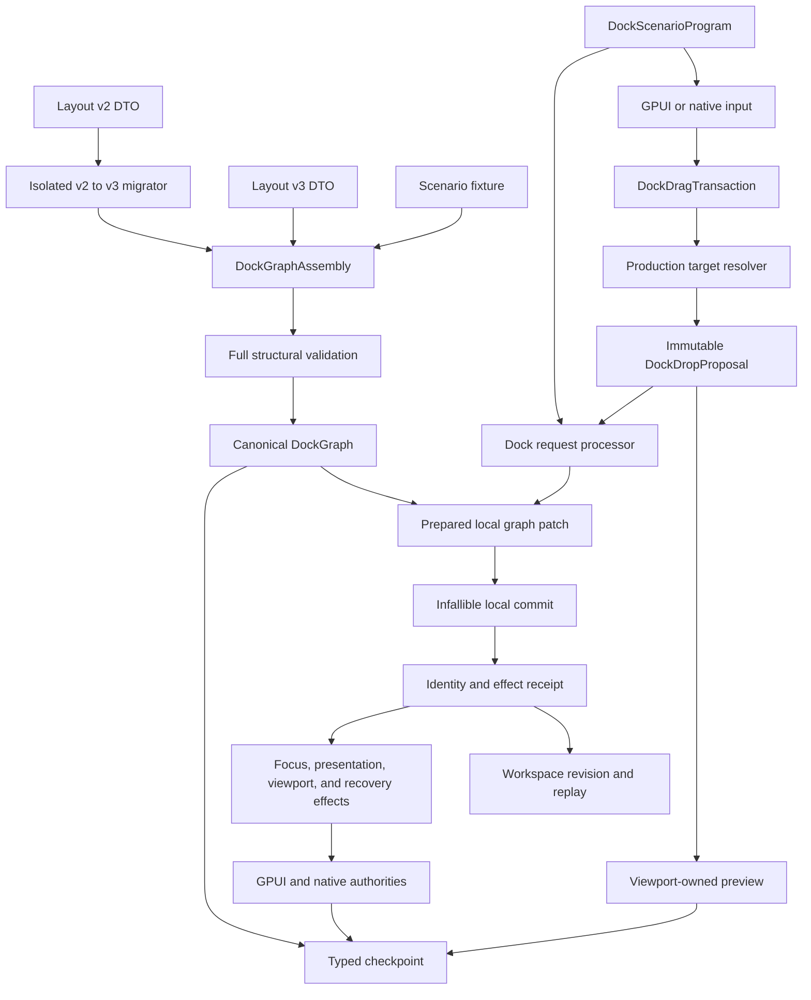
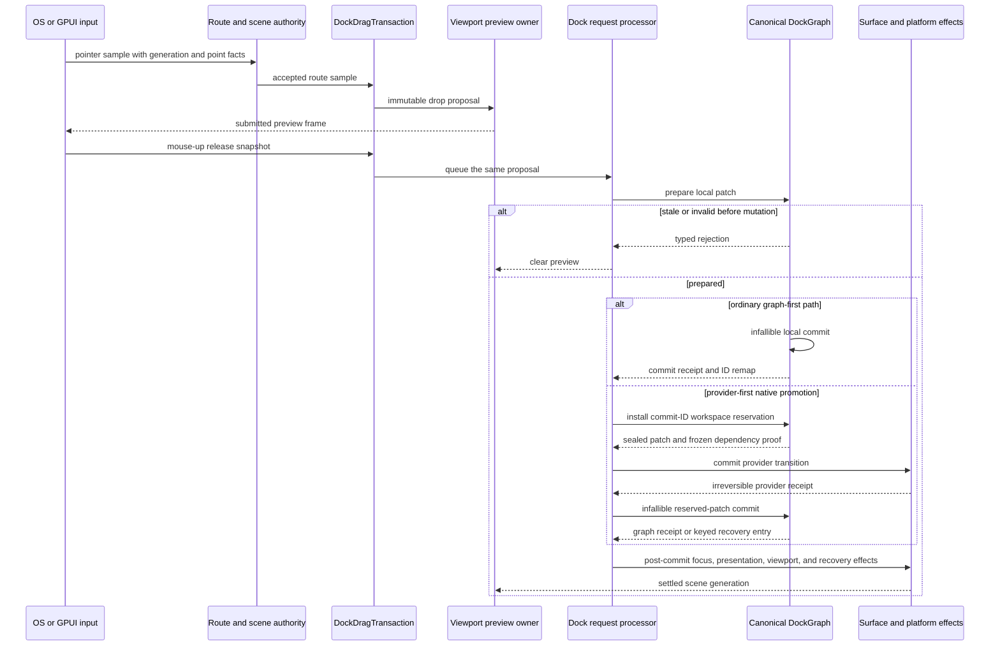
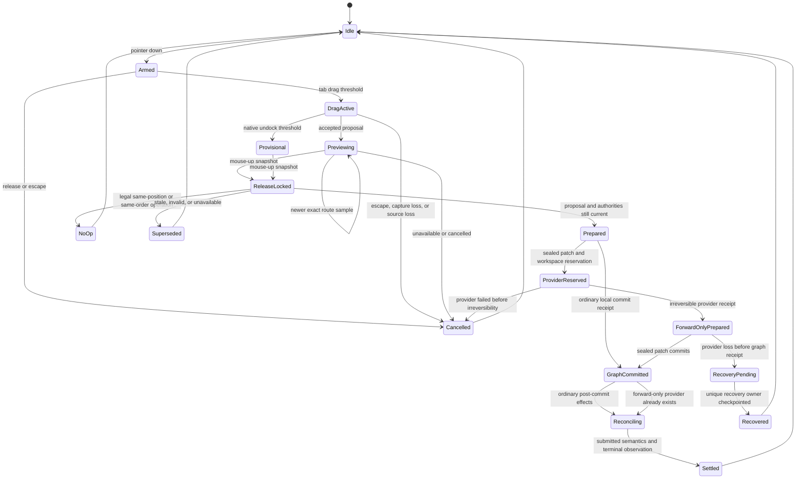

# Docking Kernel and Multiview Parity - Plan

## Goal Capsule

- **Objective:** Open GPUI docking supports complex mutual docking across multiple native windows with deterministic Dear ImGui-aligned behavior, local transaction cost, and functional plus performance evidence at every authority boundary. This plan certifies the real-native workflow on Windows while keeping the semantic, presentation, and transaction architecture platform-neutral for later macOS and Linux certification.
- **Means:** Replace the dual-purpose staged graph and whole-graph snapshot transactions with a canonical binary docking kernel, separate assembly and detached-tree values, a proposal/request/patch/receipt pipeline, and a retained-mode scenario harness that drives headless, GPUI, virtual viewport, native HWND, and ImGui-reference adapters. (KTD1-KTD10)
- **Authority hierarchy:** The Product Contract owns user-visible behavior. The Key Technical Decisions own implementation mechanisms. ADR 0002, ADR 0012, ADR 0030, and ADR 0032 remain authoritative for graph, presentation, platform-window, session, and testkit boundaries. This plan supersedes the public staging and sweep mechanism in the 2026-07-10 authority-convergence plan and `docs/ui/migration-v0.3.md`.
- **Execution profile:** Breaking refactor, characterization-first, staged cutover, no permanent legacy fallback, and sequential Cargo verification to avoid shared-machine load spikes.
- **Stop conditions:** Do not declare the refactor complete while production docking transactions retain whole-graph rollback clones, live-graph staging nodes, duplicate route or preview authority, mouse-up target re-resolution, or an unverified real-HWND workflow.

---

## Product Contract

### Summary

Rebuild the docking and multiview infrastructure around a canonical retained-mode kernel that follows Dear ImGui's mature processing discipline without importing its global immediate-mode context. The new core will use local prepared mutations, explicit structural and content identities, one drag transaction, one drop proposal shared by preview and submit, and one commit receipt that drives focus, presentation, viewport, and recovery effects. The native completion claim in this plan is Windows three-HWND certification; other desktop backends remain architecturally supported but not certified by this delivery.

The existing scenario corpus, GPUI host tests, native three-window runner, and ImGui comparison tools remain the verification foundation. They will be deepened into a functional test-engine equivalent and a layered benchmark system rather than replaced by another DSL or test runtime.

### Problem Frame

The current branch is already in a complex docking correctness and performance phase. Recent commits added zero-allocation native target resolution, multiview drag benchmarks, an ImGui dockable-target benchmark, a scenario-driven dockspace testkit, a real three-HWND workflow, and an eight-step logical transaction benchmark.

The remaining limit is architectural. `DockGraph` is both the authoritative runtime graph and a public staging arena. Checked mutations therefore need retention scans, a full rollback clone, global cleanup, exact whole-graph comparisons, and full validation. `DockWorkspace`, live undock, merge, and recovery then add more expected/projected graph copies. The same user drag is also represented by overlapping host, native route, viewport preview, and live-undock state.

Local allocation reductions improve the current path but cannot remove its graph-size-dependent cost or clarify ownership. Reaching ImGui-grade behavior and comparable performance requires replacing the underlying transaction and interaction model. The adopter outcome is an IDE-style workspace where tabs, groups, subtrees, and floating windows can move across native windows without stale previews, lost semantic ownership, focus surprises, or topology-size-dependent interaction cost.

### Key Decisions

- **Use a fearless breaking refactor.** (session-settled: user-directed - chosen over compatibility-first optimization: the user explicitly authorized deleting obsolete APIs and implementation paths.) Governs R1-R5, R11-R12, R18.
- **Treat pinned Dear ImGui and ImGui Test Engine sources as the behavior and processing reference.** (session-settled: user-directed - chosen over local heuristics: the user requested mature docking and multiview parity.) Governs R2, R6-R10, R13-R17.
- **Require functional and performance proof across complex multi-window workflows.** (session-settled: user-directed - chosen over performance-only microbenchmarks: the user requires both function and feel evidence.) Governs R13-R17.
- **Preserve GPUI's retained and native authority boundaries.** The graph refactor must not absorb GPUI window, focus, renderer, native capture, or platform lifetime ownership. Governs R7-R10.

### Requirements

**Canonical kernel and identity**

- R1. The live `DockGraph` must always be canonical and must never contain unattached construction or staging nodes.
- R2. The main docking topology must use binary split nodes, explicit DockSpace records, leaf-owned tab groups, a distinct central-slot policy, first-class floating roots, and canonical reverse indexes from node to parent, group to leaf, and item to group.
- R3. Stable DockSpace, tab-group, item, and floating identities must be separate from structural node identities, and every structural rewrite must emit an explicit identity-remap receipt.
- R4. A checked graph operation must perform every fallible semantic decision before the first authoritative write, then commit a local patch without business-level failure or whole-graph rollback. Structural patches that allocate or retire nodes must also prove the allocator epoch and reserved capacity are unchanged.
- R5. Mutation outcomes and revisions must distinguish durable topology or selection changes from transient interaction metadata such as MRU and visible-tab overrides.

**Interaction and multiview behavior**

- R6. Preview and submit must consume the same immutable drop proposal; release must never re-hit-test or heuristically select a new target. Target resolution must follow the exhaustive Target Eligibility and Effect Contract, including exact tab/leaf targeting, explicit outer-over-inner precedence, central forwarding, last-focused and stable-order fallback, and fail-closed ambiguity.
- R7. One drag transaction must own payload identity and kind, source authority, phase, route sample, projection, immutable release snapshot, terminal reason, and resulting commit receipt. Payload kinds are item, whole tab group, retained subtree, and whole floating root.
- R8. Native capture, viewport session lineage, point-scoped hit evidence, renderer submission, activation, and HWND lifetime must remain in their existing platform and surface authorities. Native route samples use physical desktop coordinates as the OS truth, retain floating precision through target-window DPI conversion, and pixel-snap only rendered guide bounds; opaque front-to-back hit barriers block surfaces behind them, while hit-test-transparent overlays do not acquire target ownership.
- R9. Escape, stale read dependency, capture loss, source loss, target loss, unavailable routing, destination loss, and application shutdown must have deterministic terminal or recovery transitions with no stale preview or duplicate ownership. The contract must cover failures before prepare, after graph commit, and after submitted destination semantics.
- R10. Persisted selection, focused leaf or MRU, transient visible tab, GPUI focus, and native window activation must be modeled and asserted as distinct states. Center merge must select the moved group's selected item, place the target's prior selection next in MRU, and leave both groups' selection and MRU untouched on cancellation. A committed graph change is not rolled back solely because later focus or activation fails.

**Persistence and public API**

- R11. Durable layout restoration must load a versioned DTO through an isolated migration layer and `DockGraphAssembly`, validate it before publication, and export only the new canonical schema.
- R12. Public low-level staged mutation APIs, unchecked controller construction, graph replacement commits, graph-shaped compatibility adapters, and raw structural-node queued actions must be removed from the normal runtime surface. Public commands use semantic selectors or opaque revision-bound prepared tokens.

**Functional and performance evidence**

- R13. The existing crate-private dockspace scenario corpus must remain the single scenario vocabulary. Fixture schema v2 must replace v1 in place as `dockspace_scenarios_v2.json`, separate semantic operations from interaction scripts (`begin_drag`, `hover`, `leave`, `release`, and `cancel`), declare required versus optional adapter capabilities, and define explicit fixture, harness, warmup, checkpoint, terminal-expectation, fault-injection, and teardown phases. A missing required capability fails the gate; only optional capability may report unsupported metadata.
- R14. The shared corpus must cover complex single-window, virtual multiview, and real three-HWND mutual docking with item, whole-group, retained-subtree, and whole-floating payloads.
- R15. A failed scenario must produce a structured action trace, checkpoint diff, graph and receipt dump, route and capture facts, and captures for every relevant surface or HWND.
- R16. Benchmarks must separately measure proposal resolution, patch preparation, patch commit, full logical resolve-and-commit, GPUI host input-to-preview or submit, and native input-to-presented-frame latency.
- R17. Open GPUI and ImGui ratios may be emitted only for the same scenario operation, workload contract, and measurement layer; native feel evidence that cannot be paired must remain an independent gate.
- R18. The completed refactor must delete superseded staging, sweep, rollback, duplicate preview, duplicate scene, and expected/projected graph paths and update the governing ADRs, migration guide, public API contract, and engineering evidence.
- R19. Every cross-authority prepared command must carry a commit ID, base revision set, and explicit read set. Before ordinary mutation or installation of a provider-first reservation, a global revision change may be locally revalidated only when every declared dependency is unchanged; source, target, ordering, registration, or authority conflicts return `Superseded` before mutation.
- R20. Central membership is a property of the source DockSpace, never of a detached payload. Whole-group and retained-subtree moves preserve internal stable identities when their content survives, while docking a whole floating root retires its floating geometry and ownership through the commit receipt.
- R21. Result vocabulary has three layers: prepare decisions are `Prepared`, `NoOp`, `Cancelled`, or `Superseded`; workspace commit observations are `Committed`, `AlreadyCommitted`, or `Superseded`; drag terminals are `Committed`, `Unchanged`, `Superseded`, `Cancelled`, or `Recovered`. `AlreadyCommitted` returns the original terminal receipt, and `RecoveryPending` is a durable non-terminal state rather than false success.
- R22. Every committed payload freezes a deterministic `focus_anchor`: the item itself, the selected item of a whole group, or the captured focused descendant of a subtree or whole floating root. Missing anchors produce no fallback focus guess. Post-commit focus or activation failure is diagnostic and never rolls back graph authority.
- R23. A provider-first native transition must acquire a commit-ID-bound workspace reservation before the irreversible provider call. The reservation freezes the patch's topology, authority, policy, registration, placement, and allocator dependencies; conflicting commands cannot mutate them until the sealed graph patch commits or recovery reaches a `Recovered` checkpoint. Transfer to the keyed recovery registry changes the reservation owner but does not release its mutation fence. After an irreversible provider receipt, that sealed patch cannot return `Superseded`, and workspace/runtime shutdown must drain the reservation to a graph receipt or `Recovered` before those authorities terminate.

### Success Criteria

- The eight-step `three_dockspace_rehome_cycle` logical transaction reaches at most 5.0x the paired ImGui semantic transaction ratio on the same machine and build profile.
- The same eight-step Open GPUI sequence uses no more than 64 allocations and 8 KiB of allocated bytes, while the commit phase performs zero allocations after capacity reservation.
- Increasing unrelated graph size by 16x while holding the touched topology constant increases median prepare-plus-commit time by no more than 25%.
- The existing zero-allocation target resolver remains zero-allocation.
- The real three-HWND scenario completes mutual dock, whole-group move, cancel, stale-target rejection, close, and destination-loss recovery with no missed terminal event, no stale preview after one submitted frame, and no unintended HWND recreation.
- On the certified Windows release profile, an accepted exact route is visible by the next submitted target frame with p50 at most 12 ms, p95 at most 25 ms, and p99 at most 50 ms; mouse-up release lock is synchronous with p50 at most 0.5 ms and p99 at most 2 ms; graph receipt has p50 at most 6 ms, p95 at most 12 ms, and p99 at most 25 ms; submitted destination semantics settle within two target frames with p50 at most 25 ms, p95 at most 50 ms, and p99 at most 100 ms. Each p50/p95 may regress by at most 10% and each p99 by at most 20% from the U1 branch baseline after the benchmark noise floor is applied.
- Focus, selection, visible-tab, central-slot, floating-root, and identity-remap checkpoints match the declared scenario oracle after every step.
- Every row in the terminal matrix passes for item, group, subtree, and whole-floating payloads, and every adapter reports unsupported capabilities explicitly rather than silently skipping an action or assertion.
- Source scans find no production use of the superseded APIs and fields named in KTD1, KTD4, KTD5, and KTD8.

### Key Flows

- F1. **Preview and commit**
  - **Trigger:** A pointer move crosses the tab or group drag threshold.
  - **Steps:** The drag transaction accepts a generation-bound route sample, the production resolver creates one proposal, the viewport runtime publishes its preview, and an immutable mouse-up snapshot queues that same proposal for preparation and commit.
  - **Outcome:** The committed target, split direction, ratio, and payload are identical to the visible accepted preview. Covers R6-R10.
- F2. **Cross-HWND undock and redock**
  - **Trigger:** An active payload crosses the native undock threshold and leaves its source host.
  - **Steps:** Native capture remains source-owned, a provisional viewport transaction presents the payload, routing selects a target from exact platform facts, graph preparation remains abortable, and any provider-first promotion installs a workspace reservation owning the sealed patch before the first irreversible native receipt.
  - **Outcome:** The same HWND is promoted when supported. Before forward-only, cancellation restores valid source authority; after forward-only, the sealed patch commits or the keyed recovery registry retains the same fenced reservation and exactly one `RecoveryPending` owner until it can prove `Recovered`. Covers R7-R10, R19-R23.
- F3. **Layout restore**
  - **Trigger:** An application loads a persisted layout.
  - **Steps:** The versioned DTO is migrated outside the live graph, assembled into binary topology and stable groups, fully validated, and atomically published.
  - **Outcome:** No staging nodes or runtime-only focus and MRU facts enter durable state. Covers R1-R3, R11-R12.
- F4. **Scenario execution**
  - **Trigger:** A headless, GPUI, virtual viewport, native, or ImGui-reference adapter selects a scenario.
  - **Steps:** The harness mounts the declared world, reaches a ready checkpoint, drives semantic user actions through production input or transaction boundaries, waits on explicit receipts, records checkpoints, and always tears down.
  - **Outcome:** All adapters report typed, comparable evidence without fixed sleeps or pixel guesses. Covers R13-R17.

### Acceptance Examples

- AE1. Given a nested mixed-axis tree, when a tab is dropped on the inner left zone of a leaf, only that leaf is split and unrelated ancestors, siblings, groups, and floating roots retain their identities. Covers R2-R6.
- AE2. Given a whole tab group in viewport A, when it is dragged through viewport B and released on viewport C, the accepted preview and commit use the same proposal, the group order and selected tab survive, and the target becomes focused only after commit. Covers R3, R6-R10.
- AE3. Given a valid graph and a prepared request, when an unrelated tab changes but the request's declared source, target, ordering, registration, and authority dependencies remain unchanged, local revalidation permits commit; when any declared dependency changes, commit returns `Superseded` before mutation and the next structural ID allocation matches an untouched control graph. Covers R4-R5, R9, R19.
- AE4. Given an empty DockSpace with a keep-alive central slot, when a group is dropped at center or on an edge, the DockSpace remains the stable anchor and the resulting central identity follows the declared central policy. Covers R2-R4, R6.
- AE5. Given a sealed patch, workspace reservation, and provider receipt that crossed the forward-only boundary, when the destination disappears before submitted semantics, the graph commits or the original commit ID and its still-active mutation fence enter `RecoveryPending`; `Recovered` is emitted only after graph location and a unique presentation owner agree and atomically release the reservation, without restoring stale source authority. Covers R7-R10, R19, R21-R23.
- AE6. Given a valid layout-v2 n-ary split, when it is imported, the isolated migrator produces a deterministic binary layout-v3 tree that preserves item order, selected tabs, central policy, floating bounds, and effective pane weights. Covers R2-R3, R11.
- AE7. Given a fixed two-leaf move embedded in graphs with 64 and 1,024 unrelated nodes, when the prepared mutation benchmark runs, the larger graph remains within the scaling budget and the patch touches only the declared nodes and authorities. Covers R4, R16-R17.
- AE8. Given a center merge of two groups, when the same proposal commits, the moved group's selected item becomes selected, the target's prior selection becomes the next MRU entry, and a cancelled equivalent drag changes neither group's selection nor MRU. Covers R5-R7, R10, R20.

### Scope Boundaries

**In scope**

- The `open-gpui-docking` graph, operation, workspace, drop, host, viewport, and surface transaction architecture.
- The `open-gpui-docking-native` real-HWND scenario runner and its manifest.
- Versioned docking layout persistence and the public docking construction surface.
- The existing dockspace scenario testkit and Open GPUI/ImGui benchmark tools.

**Deferred to follow-up work**

- Native certification on macOS and Linux after the Windows three-HWND contract is stable; this plan does not claim those backends are certified.
- General component-library design outside the docking, focus, overlay, split, and viewport primitives directly exercised here.
- Broader renderer or platform rewrites not required by the docking transaction and presentation contracts.

**Outside this product's identity**

- Importing ImGui Test Engine as a runtime dependency or copying its proprietary engine implementation.
- Porting `ImGuiContext`, raw node pointers, global moving-window state, PlatformIO callbacks, frame-age garbage collection, or viewport z-order heuristics.
- Pixel-perfect Dear ImGui styling; the reference is behavior, geometry policy, processing order, and test coverage.

---

## Planning Contract

### Key Technical Decisions

- KTD1. **Replace rather than wrap the old kernel.** (session-settled: user-directed - chosen over an incremental compatibility layer: the user authorized fearless refactoring and deletion.) New production paths must not fall back to live staging, whole-graph rollback, or expected/projected graph swaps. Temporary differential adapters may exist only in tests and must be deleted in U9. Governs R1-R5, R11-R12, R18.
- KTD2. **Adopt ImGui's processing discipline, not its global context.** (session-settled: user-directed - chosen over heuristic local behavior: the user asked for mature ImGui docking and multiview parity.) The retained equivalent is proposal, queue, prepare, commit, then focus, viewport, and platform reconciliation. Governs R6-R10, R13-R17.
- KTD3. **Use a binary structural tree with mandatory reverse indexes.** Each split is one branch with two children and one finite ratio in `[0, 1]`; new interactive splits use an interior ratio, while imported zero-share layouts remain representable. A leaf references a stable tab group. The canonical graph atomically maintains node-to-parent, group-to-leaf, and item-to-group indexes, so a prepared operation begins from O(1) stable locators and walks only the affected ancestor path. Binary branch identity replaces n-ary splitter indices for layout, rendering, resize, and accessibility. Local split, sibling promotion, and merge replace same-axis flattening and global canonicalization. Governs R2-R4, R11, R14, R16.
- KTD4. **Separate construction, payload proof, and linear detached ownership.** `DockGraphAssembly` owns unvalidated construction. A drag or prepared command carries a revision-bound `DockPayloadRef` or `PreparedDetach` proof and never owns a copied live subtree. `DetachedDockTree` owns exactly one item, whole tab group, retained subtree, or whole floating root only during assembly/import or inside the infallible commit interval between extraction and insertion. Whole-group and subtree transfer preserve surviving internal identities; central membership remains with the source DockSpace; docking a whole floating root retires its bounds and z-order ownership. No boolean staging mode, unreachable-node exception, or dual semantic owner remains. Governs R1-R4, R11-R12, R20.
- KTD5. **Prepare a local patch and make commit business-infallible.** Preparation follows canonical reverse indexes; records a commit ID, typed base revisions, allocator epoch when allocation or retirement is required, and an explicit authority read set; verifies every semantic precondition; computes symbolic identity remaps and retired nodes; and reserves every collection needed by commit and receipt installation. Ordinary commit accepts the original proof or deterministically revalidates the declared read set, then enters one non-reentrant workspace linearization interval that applies the patch, advances revisions, and installs the replay receipt before any effect or callback is published. A provider-first path first uses that interval to install a `PendingProviderCommit` reservation owning the sealed patch, capacity, and declared dependency epochs; conflicting commands cannot write those dependencies while it exists. After the irreversible provider receipt, re-entry under the same reservation applies the patch and installs the receipt without another stale branch. A transfer to keyed recovery changes the reservation owner without releasing its dependency fence; only the same commit ID may continue recovery writes, and receipt installation or a `Recovered` checkpoint atomically releases the reservation. It emits `Committed`, `AlreadyCommitted`, or pre-irreversibility `Superseded`. A generic undo log and structural copy-on-write are rejected because they cannot restore SlotMap allocator state exactly or remove graph-size-dependent copying. Governs R3-R5, R16, R19, R21, R23.
- KTD6. **Use one drag transaction and one immutable proposal.** The transaction owns source, payload kind and `focus_anchor`, phase, route sample, projection, release snapshot, and terminal result. The proposal owns target, zone, inner or outer class, ratio, preview geometry, source and target generations, and topology dependencies. Target resolution is per-surface and per-node, uses the explicit eligibility and zone policy below, and fails closed when no eligible target exists. Preview and submit read the same proposal. Governs R6-R10, R19-R22.
- KTD7. **Version state by semantic domain and revalidate dependencies, not whole graphs.** Topology and durable selection, structural allocator, registry, policy and placement, transient interaction metadata, presentation scene generation, route facts, and platform session lineage remain separate authority epochs. A prepared patch declares the exact domains and authorities it read. A changed global revision does not invalidate unrelated work when the read set still matches, while source, target, ordering, registration, policy, allocator, or authority changes relevant to the patch produce `Superseded` before mutation. Once a provider-first reservation is installed, commands conflicting with its declared dependencies are rejected or queued before mutation; unrelated interaction-only work may proceed when it cannot alter the reserved proof. Recovery transfer preserves the same dependency fence, and only the original commit ID may advance or release it. Direct mutable registry, policy, options, and lifecycle escape hatches are removed or forced through epoch-advancing APIs. Governs R5-R10, R19, R23.
- KTD8. **Make DockSpace, central policy, groups, and floating roots first-class.** DockSpace is the stable application anchor. Structural nodes are replaceable. Groups preserve tab order and durable selection across structural moves; center merge applies the explicit selection and MRU policy in R10. Floating roots have their own identity, root, bounds, and z-order instead of a node wrapper plus a side list. Layout v3 serializes stable group and floating IDs; runtime structural keys remain non-durable. Central policy is explicit, can remain alive while empty, and never travels with a detached payload. Governs R2-R3, R9-R11, R20.
- KTD9. **Publish layout v3 through assembly with one canonical v2 mapping.** The wire decoder reads the version before decoding the version-specific DTO. V2 non-negative child weights are folded into a right-deep, left-to-right binary chain: at child `i`, ratio is `weight[i] / sum(weight[i..])`; an all-zero suffix uses the canonical unobservable ratio `0.5`, and an all-zero root is invalid. V2 groups receive deterministic preorder IDs scoped by DockSpace and structural path; floating IDs derive from DockSpace and floating z-order ordinal; collisions fail validation. V3 persists those IDs and subsequent exports preserve them. The migrator also defines `SizeRef`, minimum-size, rounding, zero-share, central-path, and sibling-promotion behavior, then verifies resize, deletion, inner-edge, and outer-edge operations against an equivalent binary tree in the pinned ImGui reference. Invalid or unsupported data fails before live publication. Governs R1-R3, R11-R12.
- KTD10. **Extend the existing testkit into a retained-mode test engine without exposing it as a second public engine.** Keep one crate-private fixture-v2 vocabulary and add explicit world definition, harness, semantic-operation program, interaction script, typed checkpoint, terminal expectation, named fault injection, virtual and native viewport backends, and failure bundle. Arrange APIs may build state directly; user-action APIs must use production input and proposal paths. Production target probes may establish readiness and identity but cannot supply correctness-gate release coordinates; boundary points come from an independent scene-geometry oracle with paired inside and outside samples. The external native runner receives only a feature-gated, doc-hidden projection through `native_scenario_support`, and every adapter declares required and optional capabilities with no silent skip. Governs R13-R17, R21-R23.

### High-Level Technical Design

The diagrams define the intended boundaries and sequencing. Exact type and helper names may change during implementation, but ownership and direction must remain.

### Identity and Revision Model

| Domain | Stable identity | May be remapped | Revision or proof | Persistence |
|---|---|---|---|---|
| DockSpace | `DockSpaceId` | No | topology revision | Yes |
| Tab group | group identity | No while the group survives | topology and selection revision | Yes |
| Structural branch or leaf | structural node identity | Yes, with commit receipt | topology revision | DTO-local only |
| Floating root | floating identity | No while the floating root survives | topology revision | Yes |
| Interaction metadata | item, group, or focused-leaf facts | Not applicable | interaction revision | No, except selected tab |
| Presentation and preview | host, viewport, and scene identity | Recreated by owner only | scene generation | No |
| Native window session | runtime and lineage identity | Never inferred from graph IDs | platform session proof | No |
| Canonical reverse indexes | node-parent, group-leaf, item-group keys | Rebuilt only inside the commit receipt | topology and allocator epoch | No |
| Authority registry and policy | registry, policy, placement, lifecycle epochs | Not remapped | declared read-set epoch | No |

### Preserved and Superseded Decisions

**Preserved**

- `docs/adr/0002-docking-gpui-integration.md`: pure semantic graph, derived presentation, and GPUI window separation.
- `docs/adr/0012-docking-runtime-capability-alignment.md`: platform capability and runtime ownership boundaries.
- `docs/adr/0030-open-gpui-dock-surface-window-session-authority.md`: exact session lineage, single HWND owner, terminal observation, and teardown ordering.
- `docs/adr/0032-dockspace-scenario-testkit.md`: crate-private scenario vocabulary, production-authority adapters, and measurement-layer discipline.
- Source-owned native capture, immutable release sampling, exact route facts, opaque barriers, same-HWND promotion, and receipt-driven recovery.

**Superseded**

- KTD33 in `docs/plans/2026-07-10-001-refactor-ui-framework-authority-convergence-plan.md`, specifically public staging roots, retention closure, and one final global sweep.
- The staged `insert_node -> set_root` contract and local simplify versus canonicalize guidance in `docs/ui/migration-v0.3.md`.
- N-ary same-axis flattening as the runtime canonical topology.
- Whole-graph rollback, expected/projected graph commits, and graph replacement as transaction mechanisms.
- Duplicate host-scene, route-projection, foreign-preview, and release-publication authorities.
- The old `DockAction` variants that queue raw structural node IDs without a revision-bound semantic selector.

### Implementation Constraints

- No production caller may mutate live nodes, groups, roots, floatings, central policy, or selection history outside the commit engine.
- No prepared transaction or recovery value may own a complete expected or projected `DockGraph`.
- Every cross-authority command carries `commit_id`, typed base revisions, and an explicit read set; no caller may convert a global revision mismatch directly into either success or rejection without deterministic dependency revalidation.
- Node-parent, group-leaf, and item-group reverse indexes are canonical graph invariants, updated atomically by every patch. Transaction-local indexes may copy only the already-located affected path; no prepare path may recursively scan unrelated roots to discover ownership.
- Structural patches carry an allocator epoch and reserved-capacity proof. Any intervening allocation or retirement that could consume a reserved slot returns `Superseded`; interaction-only changes may still pass when their read set is unchanged.
- Registry, policy, placement, panel-lifecycle, and viewport-session mutations advance their own epochs; direct mutable escape hatches are removed or wrapped in epoch-advancing commands.
- A `DockPayloadRef` or `PreparedDetach` is a read proof, not a second owner. `DetachedDockTree` is owned only by assembly/import or the infallible commit interval.
- Commit receipts, not graph inspection after mutation, drive focus, selection, presentation, and platform effects.
- The workspace linearization interval installs the replay receipt before publishing any post-commit effect or callback. Full receipts are retained while effect or recovery leases exist, then compacted to bounded tombstones for the session generation; an evicted stale commit cannot be replayed.
- Provider-first work installs `PendingProviderCommit { commit_id, sealed_patch, dependency_epochs, reserved_capacity }` before leaving the workspace interval. Conflicting topology, allocator, registry, policy, placement, lifecycle, or authority commands are rejected or queued until receipt installation or a `Recovered` checkpoint atomically releases the reservation. An irreversible provider receipt removes the stale-check branch and obligates the original sealed commit or keyed recovery continuation; transferring the reservation to recovery never opens the frozen dependencies to another commit.
- Correctness waits use explicit readiness, receipt, scene-generation, or terminal predicates. Fixed frame counts are allowed only in tests whose subject is exact frame timing.
- Native interaction tests must be unassisted by window teleport, target uncovering, or z-order manipulation unless the scenario is explicitly classified as assisted and excluded from feel gates.
- Drag activation is explicit rather than heuristic: tab/group drag begins at the inclusive GPUI logical `DRAG_THRESHOLD`; native provisional undock begins only after the inclusive per-DPI physical hysteresis and source-host exit predicate. No payload kind adds a hidden time or direction threshold, and terminal reset clears both phases.
- Test Engine source under `repo-ref/imgui_test_engine/imgui_test_engine` is reference-only; do not copy its proprietary implementation.

### Terminal Matrix Contract

The same rows apply to item, whole-group, retained-subtree, and whole-floating payloads. A scenario is incomplete if an adapter silently omits a required row. `AlreadyCommitted` is an observation of an existing terminal receipt, not a fifth drag terminal; `RecoveryPending` is non-terminal and must remain keyed by the original commit ID until a unique owner is checkpointed.

| Failure point | Graph outcome | Payload or window ownership | Focus and preview outcome | Recovery or retry outcome |
|---|---|---|---|---|
| Escape or capture loss before release | No patch is prepared or committed | Source remains authoritative; provisional native resources are cancelled | Preview clears by the next submitted frame; restore source descendant focus only when the source lease is still valid | Terminal `Cancelled`; no replay entry |
| Source closes before prepare | No graph mutation | Source teardown transfers the payload only through the declared close policy; otherwise payload lifecycle ends | Preview clears; no stale source focus restoration | Terminal `Cancelled`; no graph receipt |
| Source lease closes after prepare but before commit | Prepared patch is retired without mutation | Close policy transfers the payload to its declared owner or ends it; source is never restored as if it were live | No focus restoration; preview clears | Terminal `Superseded` or `Cancelled` according to close policy, keyed by commit ID |
| Target closes after preview but before commit | Proposal read set fails before mutation | Source remains authoritative | Preview clears; focus stays or returns to the valid source descendant | Terminal `Superseded`; a new pointer sample may produce a new proposal, but release never retargets |
| Relevant source, target, order, registration, policy, authority, or allocator changes before commit | No graph mutation and allocator state is unchanged | Existing owner remains authoritative | No focus or activation effect | Terminal `Superseded`; same commit ID cannot mutate later |
| Unrelated interaction-only revision changes before commit | Patch commits only after deterministic read-set revalidation | Receipt transfers semantic ownership once | Post-commit focus follows the frozen anchor | `Committed`, or `AlreadyCommitted` returning the original terminal on replay |
| Provider-first reservation exists before provider call | No graph mutation; sealed patch, dependency epochs, and capacity remain reserved | Source remains semantic owner; provisional provider work is not yet irreversible | Preview remains tied to the locked proposal; conflicting commands cannot redirect it | Provider failure releases reservation and yields `Cancelled`; success enters `ForwardOnlyPrepared` |
| Provider-first receipt exists before graph commit | Reserved graph patch must commit without another stale result and must not be guessed or rebuilt | Provider/destination owns the provisional window; source cannot resurrect | Preview clears; pending focus waits for graph receipt or recovery | `ForwardOnlyPrepared` is non-terminal; destination or runtime loss transfers the reservation to `RecoveryPending` |
| Destination fails after graph commit but before submitted semantics | Graph commit remains authoritative | Recovery-owner priority is committed destination session, surviving provisional destination, declared recovery DockSpace, then keyed runtime recovery registry | Pending focus is cancelled or redirected; source focus is never restored after forward-only | `Recovered` only after graph location and unique presentation owner checkpoint; otherwise `RecoveryPending` |
| Destination fails after submitted semantics | Graph commit and submitted destination remain authoritative until an explicit follow-up close or recovery command | Destination or recovery owner retains the payload | No rollback to stale source focus; activation failure is diagnostic, not graph rollback | Forward-only recovery or ordinary close, each keyed by commit ID |
| Application shutdown with provisional or pending focus work | Shutdown stops new work, cancels pre-irreversible reservations, and drains every irreversible reservation to a graph receipt or `Recovered` before workspace authority terminates | The still-live runtime/recovery authority retains the fenced reservation while dependents settle, then tears down dependent windows before anchors | All previews and pending focus or activation work are cancelled | Shutdown is a drain barrier, not an expiry path; an unresolved `RecoveryPending` blocks authority teardown and fails the gate rather than losing its owner |

### Target Eligibility and Effect Contract

Target selection is deterministic and shared by preview, release locking, headless probes, GPUI input, and native routing. A candidate is eligible only when all of the following hold: the target surface and DockSpace registration are current; the target leaf or central policy is alive or explicitly keep-alive; payload and target ownership are unique; the payload is not an ancestor or descendant of the target in a way that would create a cycle; panel and placement policy allows the payload kind; the route sample's front-to-back hit evidence is not blocked by an opaque surface; and the proposed zone supports the payload kind and current lifecycle phase.

For each eligible surface, the resolver evaluates zones from the same scene generation in this order:

1. An exact tab-bar or leaf target whose payload-specific zone contains the route point.
2. An explicitly hit outer-edge guide. Outer wins over any overlapping inner guide and suppresses inner delivery.
3. An exact inner center or edge zone on the deepest eligible leaf.
4. A parent or DockSpace center forwarded to the explicit central leaf.
5. The last-focused eligible leaf, then stable child order when no central or focus authority exists.

No eligible candidate or any ambiguous boundary hit is `Cancelled`/`Superseded` according to phase; the resolver never chooses a nearby target. Transparent foreign overlays do not own the route, while opaque foreign surfaces terminate candidate search behind them. A route sample whose desktop-to-target-DPI transform or scene generation is stale cannot produce a proposal.

Post-commit effects use the following landing matrix. The frozen `focus_anchor` is used when valid; a missing or rejected anchor produces no fallback guess. Activation failure records diagnostics and leaves the graph terminal unchanged.

| Landing class | Durable selection and MRU | Focused leaf and GPUI focus | Native activation and lifecycle |
|---|---|---|---|
| Center/tab merge | The moved item or moved group's selected item becomes selected; the target's prior selected item becomes the next MRU entry | Target leaf; focus intent points to the frozen anchor | Activate the existing target session after submitted semantics |
| Inner or outer edge | The new leaf preserves each moved group's selection; a single moved item becomes its new group's selected item; unrelated target MRU is unchanged | New leaf containing the anchor; no intent when the anchor is absent | Activate the target session after the new leaf is submitted |
| Undock to new floating root | Payload-internal selections and MRU remain intact | Leaf containing the captured focused descendant; otherwise no focus guess | Activate the provisional session only after ownership and submitted semantics agree |
| Whole-floating redock or same-HWND promotion | Payload-internal selections remain intact; center redock additionally applies the center-merge MRU rule | Destination leaf containing the anchor | Reuse the existing HWND/session when supported; never recreate solely to apply focus |
| `NoOp` / `Unchanged` | No selection or MRU revision | No new focus intent | No activation or lifecycle change |
| Cancel before commit | No selection or MRU revision | Restore the captured source descendant only while its lease and source window remain valid | Retire provisional resources without activating the target |

### Alternative Approaches Considered

| Approach | Decision | Reason |
|---|---|---|
| Keep the n-ary tree and add local patches | Rejected | It lowers migration cost but preserves same-axis flattening, ambiguous structural identity, and a topology mismatch in ImGui parity scenarios. |
| Structural copy-on-write | Rejected | The measured experiment increased latency and allocations, and first write still copies graph-size-dependent container structure. |
| Generic undo or mutation journal | Rejected | SlotMap insertion and removal change generation and free-list state, so a failed transaction cannot restore exact allocator behavior without becoming a prepared patch. |
| Import ImGui DockContext or ImGui Test Engine | Rejected | Their global context, pointer lifetime, immediate-mode submission, platform callbacks, and licensing do not match GPUI's retained and native authority model. |
| Binary retained graph plus local prepared patch | Chosen | It preserves GPUI ownership while adopting ImGui's local split, merge, central, request, and test semantics. |

### System-Wide Impact

- **Public API:** Low-level graph construction and unchecked controller paths break. `DockSurface`, stable item and space IDs, panel descriptors, placement values, and opaque durable layout values remain the application-facing direction.
- **Persistence:** Layout v3 changes structural topology and identity semantics. The v2 migrator is isolated and one-way; runtime IDs remain non-durable.
- **Workspace:** All named commands, locked drops, merge, resize, float, recovery, and replay consume patches and receipts instead of graph snapshots.
- **Workspace linearization:** Patch application, revision advancement, and receipt registration occur in one non-reentrant interval; full receipt retention follows effect and recovery leases and ends in bounded tombstones rather than unbounded history.
- **Host and viewport:** One drag transaction and one proposal replace overlapping session and preview state while keeping frame coordinator, viewport runtime, and platform facts authoritative.
- **Native lifecycle:** Live undock narrows to provisional viewport lifecycle and recovery. It no longer owns a second graph transaction model.
- **Testing:** Existing fixtures remain the vocabulary, but schema and adapters gain binary topology, action programs, typed checkpoints, virtual viewport support, and all-surface failure artifacts.
- **Performance:** Cost must scale with affected topology rather than stored graph size, and benchmark output must retain operation, layer, scope, and workload metadata.
- **Read and render paths:** Parent/group/item indexes become canonical invariants, while layout, presentation, split rendering, host geometry, interaction resize, and accessibility consumers migrate from n-ary handle indices to branch identity plus ratio.

### Risks and Mitigations

| Risk | Impact | Mitigation |
|---|---|---|
| Binary conversion changes pane sizing | User layouts may visibly drift | Define deterministic weight-preserving folding, add layout-v2 golden migrations, and compare resolved bounds before enabling export v3. |
| V2 migration is deterministic only at initial layout | Resize, sibling deletion, or later inner/outer docking can diverge across implementations | Persist the right-deep fold, `SizeRef`, minimum-size, zero-share, rounding, central-path, and sibling-promotion rules and run post-import differential operations against the pinned ImGui reference. |
| Structural IDs change during split and merge | Stale preview or session references may commit to the wrong node | Separate group and floating identity, bind proposals to revisions, and require explicit ID remaps in receipts. |
| Detached payload is treated as a second live owner | Source and destination can both expose the same content during an async drag | Use `DockPayloadRef`/`PreparedDetach` until the linear commit interval and make recovery ownership explicit. |
| State-domain revisions become too coarse or too permissive | Valid work may be rejected or MRU and selection may be overwritten | Declare patch read sets, test topology-only and interaction-only races, and keep revisions typed rather than one exact-graph comparison. |
| Untracked registry or allocator changes invalidate prepared proof | Commit can allocate unexpectedly or target stale policy or registration | Advance dedicated authority epochs and include allocator epoch plus reserved-capacity proof in structural patches. |
| Forward-only native recovery diverges from graph commit | Payload can become duplicated or ownerless | Preserve existing irreversible-receipt boundary and make recovery consume the same graph and viewport receipts idempotently. |
| The refactor grows into a platform rewrite | Delivery risk and regression surface increase | Keep ADR 0002, 0012, and 0030 authority boundaries and defer unrelated platform work. |
| Functional parity is inferred from benchmark output | Regressions can hide behind faster numbers | Require typed checkpoints and native gates before accepting any performance result. |
| ImGui comparisons become apples-to-oranges | Ratios mislead optimization decisions | Pair only identical scenario, operation, scope, and measurement-layer rows; publish native-only evidence separately when pairing is impossible. |

### Phased Delivery

1. Characterize behavior and introduce the new domain without changing the public runtime path.
2. Move all graph operations and workspace commits to the binary patch engine.
3. Converge drag, preview, live-undock, recovery, public API, and persistence on the new receipts.
4. Expand functional parity and native performance evidence, then delete every legacy path and update architecture records.

---

## Implementation Units

### U1. Lock the Behavior and Evidence Contract

**Goal:** Turn the current scenario corpus into a complete characterization boundary before replacing graph and interaction authority.

**Requirements:** R3-R10, R13-R17, R21-R23; F1-F4; AE1-AE5.

**Dependencies:** None.

**Files:**

- `crates/gpui_docking/src/fixtures/dockspace_scenarios_v2.json` (rename from v1)
- `crates/gpui_docking/src/dockspace_testkit/topology.rs`
- `crates/gpui_docking/src/dockspace_testkit/ops.rs`
- `crates/gpui_docking/src/dockspace_testkit/assertions.rs`
- `crates/gpui_docking/src/dockspace_testkit/fixtures.rs`
- `crates/gpui_docking/src/dockspace_scenario_fixture_tests.rs`
- `crates/gpui_docking/src/graph_move_tests.rs`
- `crates/gpui_docking/src/graph_split_tests.rs`
- `crates/gpui_docking/src/graph_floating_tests.rs`
- `crates/gpui_docking/src/workspace_selection_tests.rs`

**Approach:**

1. Rename the fixture authority to schema v2 and land its parser, round-trip, semantic-operation versus interaction-script split, terminal algebra, named fault points, and required/optional capability declarations before changing the graph representation.
2. Extend checkpoints so they distinguish topology, durable selection, MRU or focused leaf, visible tab, central policy, floating ownership, structural identity, action outcome, created or retired or remapped IDs, revision deltas, commit receipt state, and unreachable-node count.
3. Add failure-atomic snapshots that compare graph content, surviving identities, revision domains, read dependencies, and the next structural ID allocation against an untouched control graph.
4. Characterize the current nested inner-edge, whole-group move, empty-space, float or redock, tab reorder, stale request, and recovery behavior for the production-supported item, whole-group, and whole-floating payloads. Define retained-subtree expectations in v2 but mark that capability unsupported until U4/U6.
5. Capture the pre-refactor Windows native latency baseline and noise floor for drag activation, accepted preview, release lock, graph receipt, submitted semantics, and focus settlement.
6. Keep fixture setup direct and deterministic while user-interaction assertions remain separate from arrangement assertions.
7. Encode provider-first reservation ownership, fence transfer, forward-only recovery, and shutdown-drain checkpoints in fixture v2; mark the current adapter capability unsupported until U5/U6 rather than weakening the expected contract.

**Patterns to follow:** `docs/adr/0032-dockspace-scenario-testkit.md`; `repo-ref/imgui_test_engine/imgui_test_suite/imgui_tests_docking.cpp` for scenario breadth; current exact per-step layout checkpoints.

**Test scenarios:**

- Covers AE1. A nested mixed-axis inner-edge operation changes only the targeted leaf and its required ancestors.
- Covers AE2. A whole-group cross-space move preserves group order, selected tab, and unrelated identities.
- Covers AE3. Every typed prepare failure leaves graph state, revisions, and next ID allocation unchanged.
- Re-selecting the selected tab changes MRU metadata without reporting a topology change.
- Empty central DockSpace, floating root, hidden tab, and tab-order fixtures produce distinct typed checkpoints.
- Every currently supported payload records expected graph, ownership, focus, preview, receipt, and recovery facts; retained-subtree rows are schema-valid and explicitly unsupported rather than silently skipped.
- `NoOp` maps to terminal `Unchanged` without revision, ownership, or focus changes; `AlreadyCommitted` returns the original terminal; unavailable release without a proposal is `Cancelled`.
- Provider-first fixtures distinguish reservation installation, irreversible receipt, recovery transfer with the fence still active, receipt or `Recovered` release, and shutdown-drain completion.
- A checkpoint mismatch reports the exact action, field, expected value, actual value, and pre-step state.

**Verification:** Fixture v2 parses and round-trips before U2, the existing production path passes item/group/whole-floating characterization, retained-subtree and provider-reservation behavior are explicitly capability-gated where not yet implemented, and the Windows native baseline is recorded.

### U2. Introduce the Canonical Binary Domain and Layout Assembly

**Goal:** Define and validate the replacement graph model, identity domains, reverse indexes, construction boundary, payload proof, and durable layout schema behind a crate-private cutover boundary.

**Requirements:** R1-R3, R5, R10-R12, R20-R21; F3; AE4, AE6.

**Dependencies:** U1.

**Files:**

- `crates/gpui_docking/src/graph.rs`
- `crates/gpui_docking/src/ids.rs`
- `crates/gpui_docking/src/graph_validation.rs`
- `crates/gpui_docking/src/graph_query.rs`
- `crates/gpui_docking/src/graph_index.rs` (new)
- `crates/gpui_docking/src/graph_assembly.rs` (new)
- `crates/gpui_docking/src/payload_ref.rs` (new)
- `crates/gpui_docking/src/detached_tree.rs` (new)
- `crates/gpui_docking/src/layout.rs`
- `crates/gpui_docking/src/layout_validation.rs`
- `crates/gpui_docking/src/layout_migration.rs` (new)
- `crates/gpui_docking/src/builder.rs`
- `crates/gpui_docking/src/layout_tests.rs`
- `docs/adr/0033-docking-kernel-transaction-architecture.md` (new)
- `docs/adr/README.md`

**Approach:**

1. Model DockSpace records, binary branches, group leaves, stable groups, first-class floating roots, explicit central policy, and canonical node-parent/group-leaf/item-group indexes per KTD3, KTD4, and KTD8.
2. Keep unvalidated and unattached values inside `DockGraphAssembly`. Use `DockPayloadRef`/`PreparedDetach` for live proofs; reserve `DetachedDockTree` for assembly/import and the linear commit interval. Central policy remains owned by its DockSpace during extraction.
3. Validate cycles, shared ownership, reverse-index consistency, invalid ratios, duplicate items, invalid central references, durable-ID collisions, and floating ownership before publication.
4. Add layout v3 and the exact KTD9 v2 migrator, including version-first decoding, deterministic right-deep folding, inclusive ratio semantics, stable group/floating ID synthesis, `SizeRef`, rounding, zero-share, central-path, and sibling-promotion rules.
5. Keep the replacement kernel crate-private and non-authoritative until U4 atomically migrates production readers and writers; temporary comparison exists only in tests and is not a runtime fallback.

**Execution note:** Start with layout and graph characterization tests, then introduce the new types behind crate-private adapters until the model invariants hold.

**Patterns to follow:** ImGui binary split, merge, central, and settings rebuild behavior in `repo-ref/imgui/imgui.cpp`; current stable `DockItemId` and `DockSpaceId`; repository versioned layout validation.

**Test scenarios:**

- Covers AE4. An empty DockSpace keeps its central policy without an unreachable placeholder node.
- Covers AE6. Layout-v2 splits with 2, 3, and 8 children, zero-share suffixes, and central paths migrate to the one canonical layout-v3 tree with equivalent resolved weights.
- Invalid cycles, shared children, duplicate group ownership, non-finite ratios, and invalid central references fail before publication.
- Moving a group between main and floating roots preserves group identity while structural leaves may remap.
- Extracting and redocking a whole floating root preserves its content identities and retires floating bounds and z-order ownership through the receipt.
- Export followed by import preserves durable group and floating IDs, topology, group order, selected tabs, central policy, floating bounds, and z-order but not runtime MRU or platform facts.
- Post-migration resize, sibling deletion, inner-edge docking, and outer-edge docking match the equivalent pinned-ImGui binary fixture.
- The replacement canonical graph has no API or validation mode that accepts unattached nodes.

**Verification:** Layout and graph tests prove canonical replacement publication, reverse-index integrity, stable durable identities, structural remap semantics, and isolated deterministic v2 migration without making the replacement runtime-authoritative yet.

### U3. Build the Prepared Local Patch Engine

**Goal:** Replace checked mutation rollback with a read-only planner, symbolic local patch, typed preconditions, and infallible commit receipt.

**Requirements:** R3-R5, R9, R16, R19, R21; AE3, AE7.

**Dependencies:** U2.

**Files:**

- `crates/gpui_docking/src/graph_patch.rs` (new)
- `crates/gpui_docking/src/graph_transaction.rs` (new)
- `crates/gpui_docking/src/graph_op_validation.rs`
- `crates/gpui_docking/src/graph_query.rs`
- `crates/gpui_docking/src/graph_validation.rs`
- `crates/gpui_docking/src/op.rs`
- `crates/gpui_docking/src/graph_validation_tests.rs`
- `crates/gpui_docking/src/graph_op_fixture_tests.rs`

**Approach:**

1. Locate the affected path through U2's canonical reverse indexes and build explicit read sets for spaces, groups, nodes, floatings, central policy, ordering, registration, policy, placement, lifecycle, and state domains; bind them to a commit ID, typed base revisions, and allocator epoch when structural capacity is required.
2. Represent new nodes with symbolic references until commit, and record existing-node replacements, new groups or nodes, retired structures, authority edits, state edits, and identity remaps.
3. Move all typed semantic failures, dependency checks, expectation checks, and capacity reservation for graph edits and receipt installation before the first live mutation. If global revisions changed, revalidate only the declared read set and return `Superseded` on a relevant mismatch.
4. Make commit apply the proven patch in dependency order and return `Committed`, `AlreadyCommitted`, or `Superseded` with revisions, changed domains, identity remaps, retired identities, and post-commit effect facts.

**Patterns to follow:** Existing `DockEdgeDockPlan` preview and current-plan check; ImGui request processing as a single mutation boundary; current workspace commit receipt and replay discipline.

**Test scenarios:**

- Covers AE3. A stale topology, selection, group, or floating precondition rejects before any SlotMap or map mutation.
- Covers AE7. A fixed local move touches the same authorities in small and large unrelated graphs.
- Capacity and symbolic-reference planning complete before authoritative insertion.
- An unrelated structural insertion or retirement supersedes a patch that depends on allocator capacity, while an unrelated selection-only update can still pass local revalidation.
- Commit preserves all surviving group, space, item, and floating identities and reports every structural remap.
- Interaction-only MRU changes reject only patches that declared that metadata as an input.
- A prepared A-to-C move remains valid when an unrelated group B changes selection, but is superseded when source or target membership, target ordering, registration, or authority changes.
- Replaying a completed commit ID returns `AlreadyCommitted` with the original receipt, while attempting to consume a non-replayable prepared value twice is rejected without changing the graph.

**Verification:** No successful or failed checked graph operation clones or restores a complete graph, and commit has no business-error branch.

### U4. Migrate Every Graph Operation and Delete Global Canonicalization

**Goal:** Atomically cut production graph readers, construction, layout, rendering, resize, selection, item/group/subtree moves, edge and empty-space splits, floating operations, close, and merge onto the binary patch engine, then delete the old graph architecture.

**Requirements:** R1-R5, R9-R10, R18, R20-R22; F1, F3; AE1, AE4, AE8.

**Dependencies:** U3.

**Files:**

- `crates/gpui_docking/src/graph_mutation.rs`
- `crates/gpui_docking/src/graph_tab_stack.rs`
- `crates/gpui_docking/src/graph_edge_dock.rs`
- `crates/gpui_docking/src/graph_floating_mutation.rs`
- `crates/gpui_docking/src/graph_ops.rs`
- `crates/gpui_docking/src/graph_layout.rs`
- `crates/gpui_docking/src/presentation_scene.rs`
- `crates/gpui_docking/src/render.rs`
- `crates/gpui_docking/src/render_split.rs`
- `crates/gpui_docking/src/host_render_session.rs`
- `crates/gpui_docking/src/interaction.rs`
- `crates/gpui_docking/src/action.rs`
- `crates/gpui_docking/src/builder.rs`
- `crates/gpui_docking/src/controller.rs`
- `crates/gpui_docking/src/layout.rs`
- `crates/gpui_docking/src/dockspace_testkit/topology.rs`
- `crates/gpui_docking/src/graph_canonical.rs` (delete after all consumers migrate in this unit)
- `crates/gpui_docking/src/graph_move_tests.rs`
- `crates/gpui_docking/src/graph_split_tests.rs`
- `crates/gpui_docking/src/graph_floating_tests.rs`
- `crates/gpui_docking/src/workspace_resize_policy_tests.rs`

**Approach:**

1. Migrate low-risk state updates first, then item moves, whole-group and retained-subtree moves, edge and empty-space splits, floating extraction or merge, and structural collapse.
2. Use binary sibling promotion and local root or central updates instead of same-axis flattening and graph-wide reachability cleanup.
3. Preserve group identity for whole-group moves and internal stable identities for retained-subtree moves; allocate a new group only when an operation creates a new logical group. Center merge selects the moved group's selected item, places the target's prior selection next in MRU, and leaves both histories unchanged on cancel.
4. Preserve source DockSpace central policy during extraction and retire floating geometry only when whole-floating docking commits.
5. Migrate layout resolution, presentation, split rendering, host geometry, pointer resize, corner resize, and accessibility resize from n-ary `handle_index + Vec<f32>` semantics to binary branch identity plus ratio.
6. Migrate every construction consumer to `DockGraphAssembly`, remove live staged mutators and unchecked publication, then delete `may_have_staging_nodes`, retention capture, final sweep, whole-graph rollback, n-ary fraction normalization, old detach or reattach behavior, and `graph_canonical.rs` only after a source scan proves no consumer remains.

**Execution note:** Keep the expanded U1 checkpoints as the oracle; do not retain a second production mutation engine for comparison.

**Patterns to follow:** ImGui local split, merge, sibling promotion, central transfer, selected-tab restore, and outer or inner target semantics; the existing nested inner-edge locality fix.

**Test scenarios:**

- Covers AE1. Center, tab-bar, inner edge, outer edge, and empty-space moves modify only the planned local structure.
- Covers AE4. Splitting, undocking, or redocking the central leaf preserves the DockSpace anchor and transfers central policy correctly.
- Whole-group moves preserve group order and selection; single-item moves create or merge groups according to the proposal.
- Center merge and cancellation satisfy AE8 for durable selection and transient MRU independently.
- Removing the last group from a non-central leaf promotes its sibling and reports structural remaps.
- Floating extraction, raise, bounds update, center merge, edge merge, and close use one floating authority.
- Malformed ratios and impossible payload or target combinations fail before commit without recursive panic.
- Branch resize, corner resize, hit geometry, presentation bounds, and accessibility actions preserve effective pane behavior after binary cutover.
- Retained-subtree moves first become production-supported here and pass their graph-level terminal and identity checkpoints.

**Verification:** Every production reader and `DockOp` family uses the binary U3 kernel, the crate compiles without old staged APIs or `graph_canonical.rs`, and graph, layout, render, interaction, resize, accessibility, and testkit topology fixtures pass.

### U5. Convert DockWorkspace to Revision-Bound Patches and Receipts

**Goal:** Replace graph snapshots, exact graph matches, and graph replacement with domain-aware prepared commits and idempotent receipts.

**Requirements:** R4-R5, R7, R9-R10, R12, R18-R19, R21-R23; AE3, AE5.

**Dependencies:** U4.

**Files:**

- `crates/gpui_docking/src/workspace.rs`
- `crates/gpui_docking/src/workspace_drop_transaction.rs`
- `crates/gpui_docking/src/workspace_move_transaction.rs`
- `crates/gpui_docking/src/workspace_merge_transaction.rs`
- `crates/gpui_docking/src/workspace_floating_transaction.rs`
- `crates/gpui_docking/src/workspace_resize_transaction.rs`
- `crates/gpui_docking/src/workspace_panel_transaction.rs`
- `crates/gpui_docking/src/surface/live_undock_runtime.rs`
- `crates/gpui_docking/src/surface/payload_recovery.rs`
- `crates/gpui_docking/src/surface/payload_recovery_executor.rs`
- `crates/gpui_docking/src/surface/owner.rs`
- `crates/gpui_docking/src/workspace_move_tests.rs`
- `crates/gpui_docking/src/workspace_selection_tests.rs`
- `crates/gpui_docking/src/workspace_panel_lifecycle_tests.rs`

**Approach:**

1. Make workspace preparation own a single-use graph patch plus commit ID, typed base revisions, allocator proof when needed, and declared domain and authority read set, not expected and projected graphs.
2. Define one non-reentrant linearization interval that has reserved graph and replay-registry capacity, applies an ordinary patch, advances topology/selection/interaction revisions, and installs the receipt before any effect, notification, or callback can observe the workspace.
3. For provider-first work, use the same interval before the provider call to install `PendingProviderCommit` with the sealed patch, frozen dependency epochs, and reserved capacity. Conflicting commands return pre-write `Superseded` or queue; after an irreversible provider receipt, the reserved patch has no stale branch and must commit or transfer intact to recovery. Recovery transfer preserves the reservation and fence under the original commit ID until receipt installation or a `Recovered` checkpoint atomically releases both.
4. Retain a full receipt while drag, viewport, focus, or recovery leases exist; retire it to a bounded session-generation tombstone afterward. `AlreadyCommitted` returns the retained original terminal, while expired-generation work is `Superseded` and cannot mutate.
5. Derive focus, selection, panel lifecycle, and caller-visible outcomes from the receipt rather than re-querying a replaced graph.
6. Migrate the graph-commit mechanism used by live-undock, payload recovery, and `surface/owner.rs` while preserving their existing interaction state machines for U6.
7. Remove generic `set_graph`, `replace_graph`, exact graph comparison, and expected or projected graph commit APIs from all production flows.

**Patterns to follow:** Existing commit IDs, receipts, ABA tests, named command policy, and panel lifecycle ownership.

**Test scenarios:**

- A prepared drop rejects a relevant ABA change but remains valid across an unrelated interaction-domain update.
- A target-registration or stable-child-order change supersedes a prepared drop, while an unrelated tab selection permits the declared local patch to commit.
- Replaying a committed ID returns the original receipt without applying the patch again.
- Re-selecting the current tab updates MRU and interaction revision without advancing topology revision.
- Merge, resize, float, close, restore, and locked payload drop all use the same workspace commit boundary.
- A failed panel lifecycle or policy validation never prepares or commits a graph patch.
- No workspace prepared value contains a complete graph clone.
- A graph commit followed by reentrant destination-semantics failure enters exactly one recovery path keyed by the original commit ID.
- Reentrant observation cannot see a modified graph without its revisions and replay receipt, and cannot replay a commit during the linearization interval.
- A provider callback that reenters with a conflicting structural, registry, policy, placement, lifecycle, or allocator command cannot invalidate the reserved patch; the conflict is rejected or queued before mutation.
- Provider failure before irreversibility releases the reservation without graph mutation; provider success followed by destination loss, runtime shutdown, or deferred graph execution retains the reservation in exactly one recovery entry until commit or `Recovered`.
- A recovery transfer does not admit a conflicting write; only the original commit ID may mutate reserved dependencies, and successful receipt or `Recovered` publication releases the fence exactly once.
- Full receipts retire only after every registered effect/recovery lease acknowledges terminal state; bounded tombstone eviction is generation-safe.

**Verification:** Workspace tests prove exact single-use and replay behavior using typed revisions and receipts, and source scans find no production graph replacement commit.

### U6. Converge Drag, Preview, Native Routing, and Live-Undock Sagas

**Goal:** Make one drag transaction and one queued request processor authoritative from pointer movement through graph commit and platform settlement.

**Requirements:** R6-R10, R14-R15, R18-R23; F1-F2; AE2, AE5, AE8.

**Dependencies:** U5.

**Files:**

- `crates/gpui_docking/src/interaction.rs`
- `crates/gpui_docking/src/host_interactions.rs`
- `crates/gpui_docking/src/host_viewport_drop.rs`
- `crates/gpui_docking/src/viewport_payload_drag.rs`
- `crates/gpui_docking/src/native_captured_drag.rs`
- `crates/gpui_docking/src/drag.rs`
- `crates/gpui_docking/src/viewport_drop_route/request.rs`
- `crates/gpui_docking/src/viewport_drop_route/model.rs`
- `crates/gpui_docking/src/viewport_drop_route/planner.rs`
- `crates/gpui_docking/src/viewport_frame_coordinator.rs`
- `crates/gpui_docking/src/viewport_target_resolver.rs`
- `crates/gpui_docking/src/viewport_routed_preview.rs`
- `crates/gpui_docking/src/viewport_runtime.rs`
- `crates/gpui_docking/src/viewport_runtime/drop_resolution.rs`
- `crates/gpui_docking/src/viewport_runtime_handle/route_ops.rs`
- `crates/gpui_docking/src/surface/live_undock.rs`
- `crates/gpui_docking/src/surface/live_undock_runtime.rs`
- `crates/gpui_docking/src/surface/payload_recovery.rs`
- `crates/gpui_docking/src/surface/payload_recovery_executor.rs`
- `crates/gpui_docking/src/surface/window_session.rs`

**Approach:**

1. Consolidate host anchor, active `DockPayloadRef`, payload kind and frozen `focus_anchor`, native route, projection, release, and live-undock identities into one `DockDragTransaction` per KTD6.
2. Make the frame coordinator and registry the only source of generation-bound scene and window facts; native transport publishes a physical-desktop route sample and front-to-back native hit evidence but owns no scene copy. Target DPI conversion retains floating precision until preview rendering pixel-snaps the guide.
3. Implement the Target Eligibility and Effect Contract as the single resolver policy, including tab-bar, outer, inner, central, last-focused, stable-order, transparent-overlay, opaque-barrier, and fail-closed behavior.
4. Make viewport runtime the only preview owner, including foreign-target preview and cleanup.
5. Queue one request from the immutable release snapshot and prepare through U5. Ordinary paths commit graph first; same-HWND/provider-first promotion installs U5's `PendingProviderCommit` reservation before the provider call, enters `ForwardOnlyPrepared` only after the irreversible provider receipt, then commits the reserved patch or transfers the same still-fenced reservation to keyed `RecoveryPending` without rebuilding the proposal.
6. Execute focus, presentation, activation, promotion, restoration, or recovery from the receipt. `Recovered` requires both a unique graph location and a unique presentation owner checkpoint.
7. Treat focus and native activation as post-commit effects: failure is recorded without rolling back an authoritative graph commit; cancellation restores source descendant focus only while its source lease and window remain valid, and missing anchors cause no heuristic fallback.

**Patterns to follow:** Current source-owned native capture, immutable mouse-up frame, exact hit stack, no-input barrier, same-HWND promotion, renderer-submitted semantics, and ImGui preview-to-queued-request ordering.

**Test scenarios:**

- Covers AE2. A three-viewport whole-group drag uses one payload identity, one accepted proposal, and one commit receipt.
- Covers AE5. Destination loss before and after the forward-only boundary selects the correct restore or committed-destination recovery path.
- Provider-first shutdown or destination loss between irreversible receipt and graph receipt retains the reservation fence and reaches a graph receipt or `Recovered` exactly once without source resurrection; shutdown cannot tear down workspace/runtime authority while the entry remains `RecoveryPending`.
- A provider callback's conflicting workspace mutation is rejected or queued while the reservation remains valid; after the irreversible receipt the sealed patch never returns `Superseded`.
- Escape, capture loss, source loss, target loss, unavailable route, and opaque occlusion clear every preview and settle one terminal reason.
- Source closure at `after_prepare_before_commit` retires the patch without a write; source or destination loss at `after_graph_commit_before_effects` keeps the graph receipt final and enters exactly one recovery path.
- A newer pointer move after mouse-up cannot redirect the locked release.
- Preview never changes focus; successful commit emits the landing-class selection and focus intent; focus or activation rejection leaves terminal `Committed`; cancel restores the source snapshot only when its lease remains valid.
- Item, group, subtree, and whole-floating payloads cover valid anchor, missing anchor, invalid source lease, and rejected activation.
- Logical drag threshold, physical native hysteresis, DPI conversion, exact boundary inclusion, and terminal reset have inside/outside input vectors.
- Application shutdown cancels provisional drags and pending focus or activation effects, drains every irreversible reservation while recovery authority is still live, and produces one terminal observation per transaction before authority teardown.
- Same-HWND promotion creates no second semantic owner and does not recreate the native window.
- The focus-stamp fallback is used only by an explicitly degraded backend and is visible in diagnostics.

**Verification:** Host, route, live-undock, and recovery suites show one transaction and proposal authority, with no duplicate scene or foreign-preview state.

### U7. Cut Over the Public API and Persistence Surface

**Goal:** Finalize the application-facing canonical construction and layout contract after U4 removed the old graph architecture.

**Requirements:** R1-R3, R11-R12, R18; F3; AE6.

**Dependencies:** U5, U6.

**Files:**

- `crates/gpui_docking/src/builder.rs`
- `crates/gpui_docking/src/controller.rs`
- `crates/gpui_docking/src/action.rs`
- `crates/gpui_docking/src/model.rs`
- `crates/gpui_docking/src/lib.rs`
- `crates/gpui_docking/src/public_surface_tests.rs`
- `crates/gpui_docking/src/surface/builder.rs`
- `crates/gpui_docking/README.md`
- `docs/ui/migration-v0.3.md`
- `docs/adr/0002-docking-gpui-integration.md`
- `docs/adr/0032-dockspace-scenario-testkit.md`

**Approach:**

1. Keep stable item, space, panel, placement, and `DockSurface` concepts while hiding structural IDs, patches, and assembly internals from application code. Replace public raw-node queued actions with semantic selectors or opaque revision-bound prepared tokens.
2. Expose only the U4 canonical builders, export layout v3, and accept layout v2 only through the isolated migrator; document binary topology, durable group/floating IDs, and removed API surface.
3. Update public-surface snapshot tests and ADR language so no document still promises staging roots, n-ary canonicalization, raw-node queued actions, or graph replacement.

**Patterns to follow:** The existing `DockSurface` facade and root/prelude API fences; repository migration and public-surface tests.

**Test scenarios:**

- Application setup can build tabs, binary splits, central policy, and floatings without obtaining mutable live graph access.
- Invalid custom topology returns a typed build error rather than reaching recursive normalization or runtime rendering.
- Layout-v2 import succeeds only through migration and the next export is layout v3.
- Removed staged and unchecked symbols are absent from the public root, prelude, model facade, README examples, and migration guide.
- Public callers cannot queue a command that embeds a mutable or unversioned structural node identity.
- Existing stable item and space IDs continue to round-trip through application-facing layout operations.

**Verification:** Public API tests, examples, and documentation describe one canonical construction path and no legacy runtime escape hatch.

### U8. Build the Complex Functional Parity Harness

**Goal:** Turn the scenario testkit into an ImGui Test Engine-style retained harness and prove complex docking behavior through virtual and real viewports.

**Requirements:** R6-R10, R13-R15, R17, R21-R23; F1-F4; AE1-AE5, AE8.

**Dependencies:** U6, U7.

**Files:**

- `crates/gpui_docking/src/dockspace_testkit/mod.rs`
- `crates/gpui_docking/src/dockspace_testkit/fixtures.rs`
- `crates/gpui_docking/src/dockspace_testkit/headless.rs`
- `crates/gpui_docking/src/dockspace_testkit/gpui_host.rs`
- `crates/gpui_docking/src/dockspace_testkit/topology.rs`
- `crates/gpui_docking/src/dockspace_testkit/assertions.rs`
- `crates/gpui_docking/src/native_scenario_support.rs`
- `crates/gpui_docking/src/fixtures/dockspace_scenarios_v2.json`
- `examples/docking-native/src/native_interactive_tests/scenario_runner.rs`
- `examples/docking-native/src/native_interactive_tests.rs`
- `examples/docking-native/tests/native_windows_interactive.native-scenarios.toml`
- `xtask/src/native_windows_interactive.rs`

**Approach:**

1. Complete U1's fixture-v2 harness with retained mount and warmup, explicit settle predicates, unconditional teardown, phase checkpoints, and the full result algebra including `RecoveryPending`.
2. Add a virtual viewport backend that records create, move, focus, close, ownership, recreation, physical-desktop routing, DPI transforms, and occlusion facts while running the same scenario program as the native backend.
3. Limit the production target probe to readiness and semantic identity. Derive release coordinates from an independent scene-geometry oracle, inject real pointer sequences through the production input router, and pair every zone with just-inside and just-outside boundary samples.
4. Maintain a normative adapter × action × oracle × fault × environment capability matrix. Missing required coverage fails; only optional rows may report unsupported. `native_scenario_support` must project payload kind, interaction script, fault, settle predicate, terminal expectation, typed checkpoint, and capability requirement, and expected results must come from the fixture rather than headless production replay.
5. Promote the eight-step three-DockSpace workload to native-ready and add complex action variants for item, whole-group, retained-subtree, and whole-floating payloads, cancel, focus, hidden tabs, central transfer, close, shutdown, provider-first failure, and recovery.
6. Model mixed-DPI, negative desktop coordinates, monitor crossing, foreign occlusion, transparent overlay, and backend hover availability as environment profiles over the same topology and interaction scripts rather than duplicated fixtures.
7. Produce replayable failure bundles for every surface and HWND.

**Patterns to follow:** ImGui Test Engine's arrange versus user-action separation, semantic `DockInto` target calculation plus real input, warmup lifecycle, multi-viewport backend capability model, and detailed action logging.

**Test scenarios:**

- Single tab, whole group, retained subtree, and whole floating payloads dock to center, inner edge, outer edge, empty central space, floating root, and another viewport.
- Tab threshold, out-of-bounds reorder, hide or reappear order, selected tab, visible tab, focused leaf, and native activation remain distinct.
- Parent DockSpace targeting forwards to central or last-focused leaf according to the declared scenario.
- Target eligibility and zone precedence match the dedicated contract for every payload kind, including overlapping outer/inner guides and fail-closed ambiguous boundaries.
- Host hidden or keep-alive transitions preserve or release DockSpace ownership according to policy.
- Virtual and native backends agree on semantic checkpoints while native adds capture, z-order, DPI, activation, and HWND lifetime evidence.
- Teardown executes after success, assertion failure, timeout, capture loss, and panic, leaving no window, route, or input-capture leak.
- Every required terminal-matrix row executes for all payload kinds; reducing a required adapter capability or dropping a projected v2 field fails the gate.
- Virtual and real viewports agree on physical-desktop to logical-coordinate transforms, exact boundary inclusion, transparent-overlay pass-through, and opaque-barrier blocking.
- Native feel gates run unassisted and report any target uncovering, teleport, or synthetic assist as disqualifying metadata.

**Verification:** The same scenario IDs execute across headless, GPUI, virtual viewport, real HWND, and ImGui-reference adapters with typed per-step evidence.

### U9. Establish Performance Gates and Remove the Legacy Architecture

**Goal:** Prove the new cost model, publish fair ImGui comparisons, delete migration-only runtime code, and close the architecture record.

**Requirements:** R4, R13-R23; AE7.

**Dependencies:** U8.

**Files:**

- `crates/gpui_docking/src/benchmark_support.rs`
- `crates/gpui_docking/src/dockspace_testkit/benchmarks.rs`
- `crates/gpui_docking/benches/tab_drag_latency.rs`
- `crates/gpui_docking/benches/tab_drag_allocations.rs`
- `tools/benchmark_docking_drag.py`
- `tools/test_benchmark_docking_drag.py`
- `tools/benchmarks/imgui_docking_preview.cpp`
- `.github/workflows/native-windows-interactive.yml`
- `docs/adr/0033-docking-kernel-transaction-architecture.md`
- `docs/knowledge/engineering/current-state.md`
- `docs/knowledge/engineering/verification/`

**Approach:**

1. Measure proposal resolution, patch prepare, patch commit, logical end-to-end transaction, host input-to-preview, native input-to-preview, and native input-to-settled-submit as separate rows.
2. Add a scaling matrix across item, whole-group, retained-subtree, and whole-floating payload kinds; payload sizes of 1, 8, and 64 tabs; unrelated topology sizes of 64, 512, and 4,096 nodes; and 1, 3, and 8 viewports. Report subtree depth/node count and whole-floating HWND/session/presentation cost separately, plus affected nodes, allocations, bytes, invalidations, submitted frames, preview misses, HWND churn, focus changes, and capture loss.
3. Extend the ImGui reference executable only where the operation, workload, and layer are genuinely paired; keep native-only gates separate when platform stacks make a ratio invalid.
4. Enforce the Success Criteria, remove test-only legacy differential adapters, and source-scan for every superseded field, helper, transaction type, and duplicate authority.
5. Update ADR 0033, current-state documentation, and a dated verification record with the final functional and performance evidence.

**Patterns to follow:** Current scenario comparison keys and fail-closed benchmark merging; ImGui Test Engine environment metadata and baseline reporting without its branch-checkout script.

**Test scenarios:**

- Covers AE7. Fixed local patches remain within the scaling budget across 64, 512, and 4,096 unrelated nodes, with payload and viewport axes reported separately.
- Every payload kind has prepare/commit allocation and unrelated-topology scaling rows; whole-group and whole-floating also run the real three-HWND latency gate.
- The eight-step sequence meets latency, allocation, byte, and paired ImGui ratio thresholds.
- Commit allocation count is zero after preparation and resolver allocation count remains zero.
- Benchmark merging rejects mismatched operation, workload, scope, step count, or measurement layer.
- Native reports enforce the Success Criteria p50/p95/p99 and submitted-frame budgets for preview, release lock, graph receipt, submitted semantics, and focus/activation settlement; threshold breach fails the run.
- Source scans prove old staging, retention, rollback, graph replacement, expected or projected graph, duplicate preview, and duplicate host-scene paths are gone.

**Verification:** All functional gates pass before performance results are accepted, every success threshold is met, and the final diff contains no abandoned experiment or fallback implementation.

---

## Verification Contract

Run Cargo commands sequentially and reuse the workspace target directory.

| Gate | Command | Required outcome |
|---|---|---|
| Formatting | `cargo fmt --all -- --check` | No formatting diff. |
| Docking unit and integration suite | `cargo nextest run --locked -p open-gpui-docking --no-fail-fast --test-threads 1` | All graph, workspace, host, viewport, surface, testkit, and benchmark-contract tests pass. |
| Native example suite | `cargo nextest run --locked -p open-gpui-docking-native --no-fail-fast --test-threads 1` | All non-interactive native example tests pass. |
| Cross-package type check | `cargo check --locked -p open-gpui-docking -p open-gpui-docking-native --all-targets` | Public and native integration surfaces compile. |
| Lints | `cargo clippy --locked -p open-gpui-docking -p open-gpui-docking-native --all-targets --no-deps -- -D warnings` | No new warnings. |
| Benchmark contract tests | `python -m unittest tools.test_benchmark_docking_drag` | Pairing, schema, checkpoint, and fail-closed behavior pass. |
| Headless ImGui comparison | `python tools/benchmark_docking_drag.py --json` | Functional preconditions pass and every paired row satisfies R17. |
| Native latency benchmark | `python tools/benchmark_docking_drag.py --json --native-latency` | Certified Windows release-profile rows satisfy the frame, p95, p99, and branch-baseline regression budgets in Success Criteria. |
| Real Windows interactive gate | `cargo run --locked -p xtask -- native-windows-interactive` | Every required real-HWND scenario publishes its exact behavior receipt and passes. |
| Final workspace regression | `cargo nextest run --locked --workspace --all-features --no-fail-fast --test-threads 1` | No workspace regression after legacy deletion. |

### Performance Gates

- The committed `three_dockspace_rehome_cycle` baseline is `16,210.9 ns/sequence`, approximately `250 allocations/sequence`, and `17,759 bytes/sequence`; use the same scenario and measurement metadata when measuring the replacement.
- The final logical transaction satisfies the latency, allocation, byte, scaling, and paired-ImGui thresholds in Success Criteria.
- The full scaling matrix reports item, whole-group, retained-subtree, and whole-floating payload kinds; payload sizes 1, 8, and 64 tabs; unrelated topology sizes 64, 512, and 4,096 nodes; and viewport counts 1, 3, and 8 without collapsing the axes into one aggregate.
- Proposal resolver and commit allocation claims are measured independently.
- Native p50, p95, p99, submitted-frame count, and regression from the U1 branch baseline are enforced for drag activation, accepted preview presentation, release lock, graph receipt, submitted destination semantics, and settled focus or activation.
- Functional checkpoint failure, missing native receipt, preview miss, capture loss, or unintended HWND recreation fails the benchmark run rather than producing a favorable latency number.

---

## Definition of Done

- U1 is done when fixture v2 and result algebra are authoritative, the existing implementation passes expanded topology, identity, state-domain, atomic-failure, and diagnostic characterization for item/group/whole-floating payloads, retained-subtree and provider-reservation capabilities are explicitly unsupported until their implementation units, and the Windows native latency baseline is recorded.
- U2 is done when the crate-private replacement domain publishes only indexed canonical binary graphs, payload proof is distinct from detached ownership, persistent group/floating identity is defined, and layout v2 migrates through the exact KTD9 algorithm without becoming the production runtime yet.
- U3 is done when checked operations prepare local patches with commit IDs, authority read sets, allocator proof, and reserved receipt capacity; locally revalidate unrelated interaction changes; commit without business failure; preserve allocator semantics on rejection; and emit complete receipts.
- U4 is done when every production graph reader, builder, layout, renderer, resize path, accessibility action, testkit topology path, and graph operation uses the binary patch engine; retained-subtree is supported; and runtime staging, n-ary flattening, global sweep, rollback clones, and `graph_canonical.rs` are deleted.
- U5 is done when every workspace, live-undock, recovery, and surface-owner graph commit uses one non-reentrant patch/revision/receipt linearization interval, provider reservations retain their dependency fence across recovery transfer, receipt installation releases reservations exactly once, bounded receipt leases/tombstones remain generation-safe, and no graph snapshot or replacement remains.
- U6 is done when one drag transaction, proposal, preview owner, request processor, provider-first `ForwardOnlyPrepared` boundary, focus-anchor policy, and receipt/recovery path covers normal, native captured, live-undock, focus failure, shutdown drain, `RecoveryPending`, and recovery workflows without tearing down authority around an unresolved reservation.
- U7 is done when the public API and documentation expose only canonical construction, layout v3, semantic commands, and stable application identities, with no raw structural-node action surface.
- U8 is done when fixture-v2 complex scenarios pass through headless, GPUI, virtual viewport, real three-HWND, and ImGui-reference adapters; every required capability and terminal row passes; geometry boundary points come from the independent oracle; and the native runner uses only the complete doc-hidden projection boundary.
- U9 is done when every performance threshold and functional gate passes across every payload, size, unrelated-topology, and viewport axis; native feel budgets fail closed; benchmark pairing is fair; and all superseded production and test fallback code is removed.
- The final code contains no abandoned COW, undo-log, dual-kernel, or compatibility experiment.
- All item, group, subtree, and whole-floating terminal paths end in exactly one of `Committed`, `Unchanged`, `Superseded`, `Cancelled`, or `Recovered`, with no stale preview, duplicate owner, or pending focus work. `AlreadyCommitted` returns an existing terminal, and `RecoveryPending` is never reported as terminal success and always retains one keyed recovery owner until a later step resolves it.
- The completed native product claim is Windows three-HWND certification; macOS and Linux remain explicitly uncertified follow-up gates.
- ADRs, migration guidance, public API tests, current-state documentation, and verification evidence describe the shipped architecture rather than the removed one.

---

## Appendix

### Primary Sources

- `crates/gpui_docking/src/graph.rs`, `graph_op_validation.rs`, `graph_canonical.rs`, `workspace.rs`, and `workspace_drop_transaction.rs` for the current staging, rollback, revision, and graph-snapshot paths.
- `crates/gpui_docking/src/native_captured_drag.rs`, `viewport_drop_route/`, `viewport_runtime/`, and `surface/live_undock_runtime.rs` for current capture, route, preview, promotion, and recovery authority.
- `docs/adr/0002-docking-gpui-integration.md`, `docs/adr/0012-docking-runtime-capability-alignment.md`, `docs/adr/0030-open-gpui-dock-surface-window-session-authority.md`, and `docs/adr/0032-dockspace-scenario-testkit.md` for preserved boundaries.
- `docs/plans/2026-07-10-001-refactor-ui-framework-authority-convergence-plan.md` and `docs/ui/migration-v0.3.md` for superseded public staging and sweep commitments.
- `repo-ref/imgui/imgui.cpp`, `repo-ref/imgui/imgui_internal.h`, and `repo-ref/imgui/imgui_demo.cpp` for docking request order, local binary split or merge, central policy, preview or submit parity, focus, selection, persistence, and viewport transitions.
- `repo-ref/imgui_test_engine/imgui_test_suite/imgui_tests_docking.cpp`, `imgui_tests_viewports.cpp`, and `imgui_test_engine/imgui_te_context.cpp` for scenario breadth, production drop-point calculation plus real input, warmup, viewport backends, diagnostics, and performance metadata.

### Current Baseline and Recent Branch Direction

- `caa33f3e perf(docking): make native drag resolution zero allocation`
- `2fd57943 perf(docking): add multiview drag benchmark`
- `97062471 test(docking): benchmark imgui dockable target path`
- `9fa9b20e refactor(docking): add scenario-driven dockspace verification`
- `96191489 test(docking): add complex native dockspace scenario runner`
- `4003699b perf(docking): optimize complex dockspace transactions`
