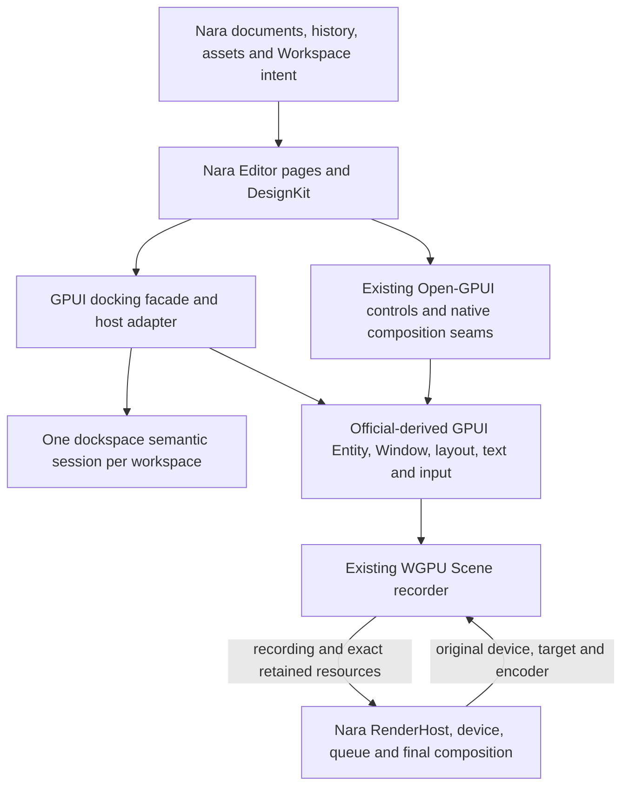
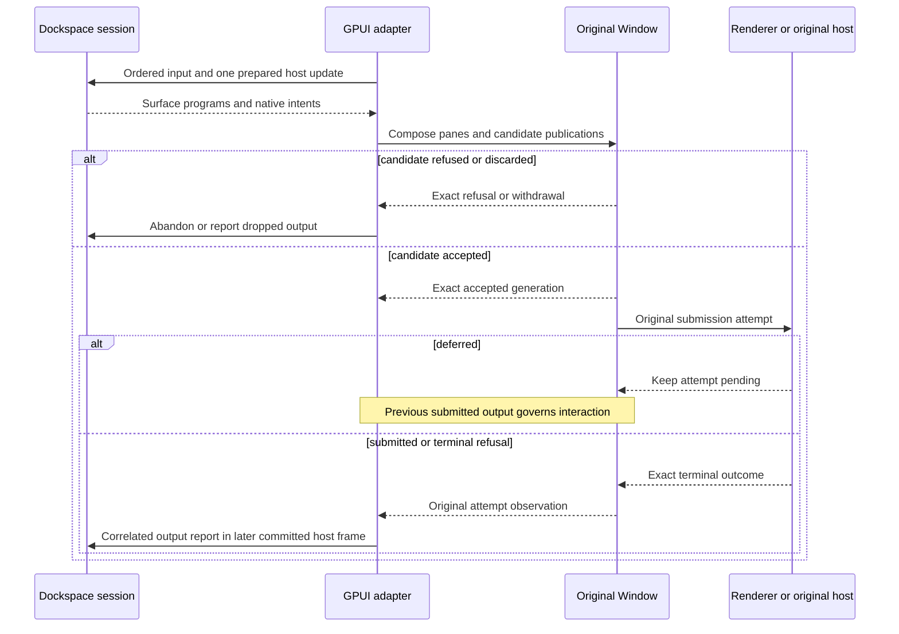

# Editor Framework Evolution - Plan

## Goal Capsule

**Objective:** Application authors can build a docked editor with independent document Views, editable property controls and engine viewports through public Open-GPUI interfaces.

**Means:** Extend the existing GPUI and component owners, qualify a shared `dockspace` adapter, and use a complete Nara page to select subsequent rendering work.

**Authority:** The user's November 13 direction prioritizes upper-layer composition over the earlier state-ergonomics work. Accepted ADRs still govern behavior. This proposal does not supersede ADR 0033, select a new compiler floor, switch Nara's Editor default, or adopt the supplied compositor design wholesale.

**Execution profile:** Local, reviewable units with Conventional Commits; no push or publication is implied. U1 establishes compatibility, U2–U4 improve existing controls, U5–U6 qualify the docking candidate, and U7 is a separately selected cutover. U8 belongs in Nara. These are coordinated repository deliverables, not a requirement to open or merge PRs during planning.

**Stop conditions:** Preserve concurrent edits. Stop a cutover when it would introduce two semantic docking writers, manufacture Submitted/native-terminal facts, silently change the compiler floor, or remove an incumbent contract without a replacement decision. An unmet condition is a candidate result rather than a reason to hide the difference behind an adapter.

---

## Product Contract

### Summary

Build a reusable upper layer on official GPUI mechanisms and add focused framework extensions where real consumers require them.
Prioritize complete property-control workflows and evaluation of the existing renderer-neutral `dockspace` library.
Retain GPUI's Entity/state model while evaluating retained rendering independently from state authoring.

### Problem Frame

Open-GPUI's fixed upstream adoption endpoint is reconciled, but upstream runtime coverage does not establish the usability of the fork's controls or a complete Nara Editor.
The previous roadmap emphasized independent docking-kernel development and state ergonomics before examining the user's shared docking implementation and mature control references.
Maintaining two docking runtimes would increase long-term cost if one renderer-neutral implementation can serve both GPUI and egui.

Nara already has a bounded GPUI consumer with original engine device/queue use, submitted interaction and editable Session workflows.
Its current Source Editor still uses Winit and earlier Nara controls; its default-enabled ImGui reference, Source Editor and independent GPUI fixture are separate compositions.
The next useful result is a coherent editing page with reusable controls and independent Views, rather than another inventory of proposed abstractions.

### Key Decisions

- Keep state authoring on the existing GPUI model. (session-settled: user-directed — chosen over prioritizing a new state architecture: its design risk is not justified by the current consumers.) Governs R2.
- Develop wrappers and focused extensions around official GPUI mechanisms. (session-settled: user-directed — chosen over a broad framework redesign: the user wants to preserve GPUI as the foundation.) Governs R1, R3.
- Evaluate the user's `dockspace` as the shared docking implementation. This is a candidate selection, not approval to replace the incumbent. Governs R4–R7.

### Requirements

**Framework and controls**

- R1. Reuse complete official GPUI mechanisms and document each necessary core extension against the fixed upstream source; ordinary applications remain supported.
- R2. Preserve Entity ownership, explicit notifications and existing control-local state; no new Signals runtime, universal state store or scheduler is a prerequisite.
- R3. Generic controls expose the composition needed by a real editor while preserving their original focus, text/IME, semantic activation, accessibility and publication owners.

**Docking and independent Views**

- R4. Each opted-in workspace has exactly one semantic docking runtime; the GPUI adapter translates its outputs and native intents without maintaining a second authoritative layout or drag reducer.
- R5. One document can have multiple simultaneously visible View instances with distinct pane identities and GPUI entities; local camera, draft, scroll and focus state stay independent.
- R6. Logical surfaces and real native windows are qualified separately, with exact frame submission, capture, coordinates and native retirement supplied by GPUI.
- R7. Replacement preserves declared facade workflows and provides an explicit persistence migration; a contract difference requires a recorded selection before incumbent deletion.

**Engine fit and rendering**

- R8. Nara owns document/history/assets, Workspace intent, DesignKit recipes and final engine rendering; Open-GPUI remains independently consumable.
- R9. A complete native editing page proves the selected controls and docking scope before an Editor-default decision; game/runtime UI retains a separate acceptance path.
- R10. Rendering optimizations preserve direct-path visual and interaction semantics and demonstrate measured benefit at their actual CPU/GPU/resource boundary.

### Acceptance Examples

- AE1. An ordinary application edits a numeric draft, cancels a scrub, and rejects a proposed value while retaining correct text selection and focus. A Nara Position row composes the same scalar control and owns its history grouping. Covers R2, R3, R8.
- AE2. Two Views share one document but have different drafts and navigation. Moving a View between panes preserves its local state; duplicating it constructs another entity. Closing either View leaves the document and its surviving View under their original owners. Covers R4, R5, R8.
- AE3. A detached destination accepts a candidate but its renderer defers submission. Input remains governed by the last submitted output; a healthy sibling continues making progress. A stale completion cannot admit a replacement attempt. Covers R4, R6.
- AE4. An anchor closes while a dependent window has outstanding GPU use. The adapter drains the exact group, waits for renderer quiescence and actual native terminal facts, and refuses old-generation callbacks after reopening. Covers R6, R7.
- AE5. A resource picker receives replies for query B before query A. The selected item remains stable even when absent from the current results; the late A result cannot replace B, and composition Enter does not commit a choice. Covers R3, R8.

### Scope Boundaries

The selected work concerns generic controls, docking adaptation, complete Editor consumers and a bounded rendering research sequence.
It does not import Nara ECS, asset schemas, graph/history owners or engine RenderHost policy into the framework.
Broad external-host expansion is deferred; regressions of the existing host contracts remain maintenance work.
Gamepad/player focus, authored runtime HUDs, world-space UI, HDR/display mapping and a complete Editor-default switch require their own consumers.

---

## Planning Contract

### Verified Baseline and Source Pins

| Source | Fixed revision or identity | Decision-relevant evidence |
| --- | --- | --- |
| Open-GPUI | `a09ad0a63ed640d5a45b7efa084da59d6e7a9ae7` | Current runtime, components, host and incumbent docking owners; clean at initial inspection. |
| Official GPUI adoption endpoint | `27bbbc1cc480a7500cec122f120e796d1fb8500c` | Existing reconciliation endpoint, not a moving upstream HEAD. Read-only Zed checkout separately remains `78f5d7446c55f6c1aa9b66e8111f6b3f4625ebb0`. |
| `dockspace` | `54dff16830ee3211260feef50f3b8b559dc1c501` | Renderer-neutral core and existing GPUI harness. Six harness files are modified locally; their changes are not attributed to this commit. |
| GPUI Kit | `6f7f4d96982c476fc0cb3491c6c4d775371554f1` | Native behavior-bearing Base elements plus styled components, with shared GPUI state entities. |
| shadcn/ui | `dd41d19e2f80ff6891951f7ced74c2c9a650b065` | Base UI wrappers with concrete parts/content composition. |
| Base UI | `fb9fbbf35e72bd4a5494b678c85d2ea0457fed60` | Numeric edit/commit phases and independent choice/query/open channels. Cloned under `repo-ref/base-ui` for this assessment. |
| GPUI Fast | `d1d6286f88908b1d4544db69da481688ef391929` | Retained frames/layout, scroll caching and direct-versus-retained oracles. Its `UPSTREAM` pins Zed `d2a4fb6ded7c470be25d1541281da3882495b65b`, a different baseline. |
| Nara | `ed073fa97cda12fbe0ffaa0bbc3445534e70c5d2` | Initial observation was `2aa72ff4cb7f36a9e27867e1ddd4fe20bfa00db3`; concurrent work advanced HEAD. Inspected UI sources are unchanged across that transition. |
| Supplied compositor research | SHA-256 `cb231c7649ec464e0a3b519b0bfb81ec7d264900c66bb2a19fba08b29424a3d6` | Design suggestions explicitly written without reviewing these current repositories; use as research input. |

External checkout aliases used below are `dockspace:` for the `Latias94/dockspace` repository, locally `/Users/frankorz/codes/rust/egui_docking`, and `nara:` for `/Users/frankorz/codes/rust/nara`.
Paths after those prefixes are relative to that repository, not proposed files inside Open-GPUI.
The supplied research is locally `/Users/frankorz/Downloads/open-gpui-nara-compositor.md`; its essential conclusions are reconciled here so a later checkout does not depend on Downloads.

Current Nara native qualification consumes Open-GPUI `f75c10b2a9bf7b4dcb2c8c2aa446203997601369`, not the current framework HEAD.
Its actual fixture is Windows-specific, with recorded DX12/Vulkan scope.
A source pin update must qualify the path/Element/API migrations in `docs/ui/migration-v0.3.md`; earlier engine results do not automatically qualify the new source.

### Key Technical Decisions

- KTD1. **Extend existing owners before creating new frameworks.** Keep generic UI work in `ui_core` and `ui_components`, following Accepted ADR 0008. Use explicit GPUI-aware content/appearance seams; the neutral core stays dependency-clean. This implements R1–R3 without exposing private adapter mechanics.
- KTD2. **Adapt control architecture and contracts selectively.** GPUI Kit Base itself depends on GPUI; it is a native behavior layer, not a renderer-neutral store. Its `Entity<InputState>` reuse and Tree content callbacks fit this project. Base UI supplies useful editing/choice contracts; shadcn supplies composition recipes. React/DOM scheduling and the whole GPUI Kit runtime closure are not dependencies of the selected design. Governs R3.
- KTD3. **Qualify a whole-library docking adapter.** `DockspaceSession` privately owns its graph, interaction and presentation state. Its public boundary cannot simply replace the incumbent private graph. The candidate owns logical docking semantics; the adapter maps GPUI entities, exact outputs and native facts. Reuse or extract GPUI-facing group/capture/retirement responsibilities where necessary, without leaving the old controller or live-undock reducer active for the same workspace. Governs R4, R6.
- KTD4. **Make dependency and contract compatibility a real gate.** `dockspace` itself inherits Rust 1.95 and declares Apache-2.0; Open-GPUI's floor is 1.93. First determine whether the selected core can genuinely support 1.93. If not, record the proposed adapter-specific toolchain or broader policy change for selection before production adoption. A manifest edit alone is not compiler proof. Governs R1, R7.
- KTD5. **Keep semantic activation private mechanics private.** Existing public activation/value intents remain the control contract. `ActivationBinding` being private is intentional under `docs/knowledge/engineering/decisions/semantic-activation-authority.md`; new skin/content seams must preserve that owner. Governs R3.
- KTD6. **Use complete pages as the integration surface.** Ordinary Gallery consumers establish generic behavior; Nara composes them into Dialogue/Inspector workflows and its DesignKit. Nara's Accepted ADRs 0107, 0111 and 0118 retain document, Host and Workspace ownership. Governs R8, R9.

### High-Level Technical Design

Dockspace native intents request work from GPUI rather than owning another event loop or renderer.
Multiple logical regions in one real Window share that Window's exact frame authority.
The adapter must also serialize the candidate's affine host-frame updates across multiple windows.

Shutdown remains stronger than successful output submission: a close request, logical removal, renderer quiescence and native terminal are distinct facts under ADRs 0030/0031.

### Current Gaps That Change the Plan

The existing dockspace GPUI harness is useful real content integration: `DockPane` retains an `AnyView`, and `element.rs` mounts that view through GPUI.
However, `dockspace:integration/gpui-harness/src/host.rs:151` requires exactly one logical surface, line 155 forbids native surfaces, and the checks around line 186 forbid content closing.
The workbench's contained floating root is inside its one native window.
No native-multiview qualification follows from that demo or its dirty `--smoke-close` addition.

The candidate supports multiple surfaces, native effects and optional persistence in its public core, but the GPUI harness does not implement those bridges.
It also uses weighted N-ary layout data, while Accepted ADR 0033 selects binary topology and additional identity/transaction contracts.
U7 must resolve this difference deliberately; similar screenshots do not establish architectural equivalence.
No functional core defect was reproduced by this source-only assessment.

`NumberInput` already supports stepping, controlled `f32` values and spinbutton semantics, but `crates/ui_components/src/number_input.rs:543` displays the value in a `div`.
It does not mount the existing editable text controller or implement scrub/commit phases.
Tree already has substantial movement, lazy-child, focus and virtualization behavior; its bounded controlled/content/appearance seams need attention.
Combobox already combines text, listbox and overlay owners; external query/result composition is the targeted extension.

### Alternatives and Tradeoffs

| Choice | Benefit | Cost or reason to defer |
| --- | --- | --- |
| Existing controls with selective native content/appearance seams — recommended | Reuses text, focus and publication owners while enabling application skins | Each seam needs a complete consumer and lifecycle coverage. |
| Import GPUI Kit's whole Base/Component/Shell closure | Broad existing component surface | Different GPUI source/type identity and extra product/runtime policy; source adaptation is narrower. |
| Build a new generic headless/state framework | Broad theoretical reuse | Duplicates ownership work before another renderer or consumer proves the interface. |
| Adopt dockspace behind a GPUI adapter — recommended candidate | One reusable docking implementation across toolkits | Requires U1/U5/U6 and a formal U7 contract decision. |
| Finish only the incumbent binary kernel | Fits the already accepted internal design | Continues independent docking maintenance; retain as the incumbent until the candidate gate resolves. |
| Insert dockspace beneath the old authoritative controller | Appears to minimize facade changes | Its public API is a complete session; graph mirroring or two reducers violates R4. |

### Sequencing and Assumptions

The proposed order is U1 and U2 first, then U3/U4 alongside U5, followed by U6 when its native scope is selected.
U8 first completes the existing Dialogue workflow through its current Host, independently of candidate docking and its compiler gate.
Its subsequent docked Scene/Hierarchy/Inspector page uses the required controls and U5 proof; neither increment waits for every native platform or a compositor.
U7 follows the candidate decision and its declared acceptance scope, never merely the existence of a harness.
This proposes evaluating the shared candidate before further implementation under the [incumbent docking plan](2026-08-21-1349-refactor-docking-kernel-parity-plan.md); the user has not yet selected replacement.

Assumptions are that an initial scalar editor, hierarchy and searchable choice are sufficient to expose the first useful generic seams, and that the existing GPUI harness is the cheapest proof vehicle.
Neither assumption mandates a new crate, a numeric precision change, or a complete property-grid subsystem.
If a full adapter cannot express an existing required lifecycle through the candidate's public interface, report and fix that named candidate gap instead of recreating private reducers in Open-GPUI.

---

## Implementation Units

### U1. Establish the shared docking dependency and contract boundary

**Goal:** Produce a reproducible candidate dependency and a precise GPUI extension/contract inventory before production adoption. Covers R1, R4, R6, R7; follows KTD3/KTD4.

**Files:** `Cargo.toml`, `docs/adr/0033-docking-kernel-transaction-architecture.md`, the existing import/verification owners; `dockspace:Cargo.toml`, `crates/dockspace/Cargo.toml`, `integration/gpui-harness/Cargo.toml`, its README and `tests/embedding.rs`.

**Approach:** Pin one candidate revision and feature set; separate the six concurrent harness modifications from that source. Check real compiler support, package contents and the adapter's fork-specific accepted-frame APIs. Record preserved ADR 0030/0031 behavior and explicit ADR 0033 differences. Prefer direct `dockspace` consumption without `egui`, `eframe` or `winit` dependencies in the GPUI adapter.

**Test scenarios:** An independently locked consumer builds with the declared minimum compiler and selected default/serde features; a clean package/Git consumer does not depend on a sibling path; there is one intended GPUI and WGPU source identity. Compilation here proves dependency compatibility, not native multiview.

**Verification:** A supported immutable dependency, compiler policy and contract inventory are documented. An incompatible floor leaves production adoption gated rather than silently changing the core's promise.

### U2. Make NumberInput a complete editable scalar

**Goal:** Deliver typed drafts and bounded scrubbing through the existing text and semantic owners. Covers R2, R3, AE1; follows KTD1/KTD2/KTD5.

**Dependencies:** Existing TextInputController; independent of docking.

**Files:** `crates/ui_components/src/number_input.rs`, `text_input.rs`, `text_editing.rs`; `crates/ui_components/tests/semantic_activation/value_controls.rs`, `tests/a11y_controls/ime.rs`; a focused consumer under `examples/ui-foundation-gallery`. Add `crates/ui_components/tests/number_editing.rs` for the complete edit loop if existing files do not provide a coherent home.

**Approach:** Compose the original text controller with numeric parsing, stepping and edit phases. Base UI NumberField informs value-change versus value-committed behavior; GPUI Kit informs shared native state ownership. Keep invalid/incomplete text distinct from committed numeric values and preserve the existing `f32` public contract in this slice. Wider precision requires a separate concrete consumer; Nara owns units, vector composition and history grouping.

**Test scenarios:** Type `-` and `1.` without manufacturing committed values; Enter commits a valid draft and Escape cancels it; owner refusal and external updates while dirty follow an explicit policy; composing Enter remains text input; read-only/disabled states gate edits; pointer release commits a scrub once and capture loss/unmount cancels it. Verify keyboard, pointer and AccessKit through their actual semantic paths.

**Verification:** One ordinary entity-backed consumer displays accepted value, local draft and commit/cancel results. The same control supports a compact property recipe without another input implementation.

### U3. Expose bounded Tree content and selection composition

**Goal:** Let an application bind its accepted selection and supply row content without replacing Tree interaction. Covers R2, R3, R8; follows KTD1/KTD2.

**Dependencies:** None beyond existing Tree owners.

**Files:** `crates/ui_components/src/tree/mod.rs`, `model.rs`, `runtime.rs`, `movement.rs`; `crates/ui_components/tests/layout.rs`; `examples/ui-foundation-gallery/tests/foundation_gallery/component_smoke_tree_virtualized.rs`.

**Approach:** Add only the controlled selection/expansion and content/appearance seams required by the consumer. Reuse GPUI Kit's native content-callback pattern. Preserve stable row identity, disclosure hit regions, roving focus, lazy children and movement validation. Use current scoped tokens/recipes for row appearance.

**Test scenarios:** Application selection and Inspector selection agree; a row action does not also activate or drag the row; a rejected move leaves the model and selection unchanged; hidden/virtualized rows retain correct identity after expansion and reorder; custom row content preserves keyboard and final accessibility structure.

**Verification:** A generic two-object Tree with custom content and an application-owned selection works through the public interface; Nara-specific hierarchy types remain outside the crate.

### U4. Complete external-query Combobox composition

**Goal:** Support asynchronous application-provided choices without coupling selection identity to the current result page. Covers R3, R8, AE5; follows KTD1/KTD2/KTD5.

**Dependencies:** Existing text, resource adapter and WindowOverlayRuntime.

**Files:** `crates/ui_components/src/combobox/runtime.rs` and its existing model/render owners; `crates/ui_components/tests/choice.rs`, `tests/resource_adapter.rs`, `tests/theme_scope.rs`, `tests/window_overlay_runtime/ownership.rs`; the same focused Gallery consumer.

**Approach:** Separate selected value, query text, results and open state where the public consumer needs control. Add bounded result content/appearance customization. Use the current resource owner or application request generation to reject stale replies; preserve original text and window-scoped overlay custody.

**Test scenarios:** B then A reply order retains B; selection absent from filtered/paged results remains identifiable; result rename does not change selection identity; loading/empty/error states preserve navigation; composing Enter/Escape does not incorrectly activate/dismiss; closing or relocating the host retires the exact popup/focus and request ownership.

**Verification:** A mock-provider consumer with custom result content works independently of Nara assets. Nara can supply typed asset keys, thumbnails and unresolved-reference presentation above it.

### U5. Qualify document multiview and shared logical surfaces

**Goal:** Extend the candidate adapter beyond its current single-surface assumptions with real retained pane content. Covers R4–R7, AE2/AE3; follows KTD3.

**Dependencies:** U1; initial proof can use ordinary custom GPUI content before U2–U4 finish.

**Files:** `dockspace:integration/gpui-harness/src/host.rs`, `element.rs`, `input.rs`, `presentation.rs`, `tests/embedding.rs`; new focused multiview tests there. Use `dockspace:integration/dockspace-host-harness/tests/logical_surfaces.rs` and `crates/gpui_docking/src/host_multiview_scenario_tests.rs` as scenario anchors.

**Approach:** One candidate session supplies multiple pane/surface records. Bind distinct View instances to distinct GPUI entities and stable external pane keys. Aggregate outputs per actual Window instead of creating one independent frame ticket per logical region. Prototype persistence/factory mapping through the public candidate APIs, without mirroring its graph.

**Test scenarios:** Two Views of one document have independent draft/navigation state; moving a View preserves state while duplication creates another entity; a duplicate simultaneous entity mount is diagnosed; two logical surfaces in one Window route/clamp input correctly; candidate refusal leaves old interaction usable; deferred output does not starve healthy progress; save/restore preserves distinct View keys and one content location.

**Verification:** Real pane controls receive events after tab changes and relocation. Typed core-output reports match exact GPUI accepted/submitted attempts; diagnostic placeholders and recording-only surfaces do not satisfy real-content assertions.

### U6. Bridge native docking effects and group retirement

**Goal:** Qualify the candidate workspace across real native GPUI windows. Covers R4, R6, R7, AE3/AE4; follows KTD3.

**Dependencies:** U5 and the selected backend's actual native capability support.

**Files:** A concrete native bridge beside the candidate GPUI harness; `dockspace:crates/dockspace/src/runtime/native/session.rs`, `native_effect.rs`, and `integration/dockspace-host-harness/tests/native_surface_creation.rs`, `shared_window_close.rs`, `native_document_restore.rs` as existing contracts. Adapt scenario coverage from `crates/gpui_docking/src/surface/window_session_tests.rs`, `surface/payload_recovery_tests.rs`, `native_captured_drag.rs`, and `examples/docking-multiviewport/src/main.rs`.

**Approach:** Translate candidate managed-native intents through GPUI's existing create, placement, capture, first-submission, group-drain and retirement mechanisms. The current surface-local pointer producer must be replaced by the supported managed producer configuration. Preserve transport order and exact lineage; unsupported desktop/hover facts remain unsupported.

**Test scenarios:** Programmatic detach/redock preserves the original View; real captured drag distinguishes source motion from target hover; negative coordinates and mixed DPI use current mappings; ordinary close allow/veto/defer is separate from forced anchor shutdown; create/first-live/destination failure leaves one surviving content owner; busy close and delayed native terminal prevent premature reopen; late callbacks cannot affect another group/generation.

**Verification:** At least two real windows and an isolated sibling workspace pass the declared platform scenarios. Core/virtual tests qualify semantics; physical capture, IME, title-bar movement and native termination require their owning runners. Reuse existing runners rather than creating a generic GUI test language.

### U7. Select the replacement and remove the displaced docking implementation

**Goal:** Converge production docking on the selected implementation after the compatibility proof. Covers R4, R7; follows KTD3/KTD4.

**Dependencies:** An explicit replacement decision based on U1/U5/U6 and the facade/persistence acceptance scope. This unit is not authorized by writing the plan.

**Files:** `crates/gpui_docking` facade, dependency and runtime owners; existing layout/snapshot tests and examples; `docs/adr/0033-docking-kernel-transaction-architecture.md` plus a replacement ADR; migration/release documentation. Candidate package/release changes stay in `dockspace`.

**Approach:** Reconcile binary/N-ary topology, group/central/floating identity, transaction and persistence differences before updating ADR authority. Move all opted-in production readers/writers together. Retain a useful high-level facade and GPUI-specific native lifecycle responsibilities, while deleting the displaced graph/controller/interaction engines and temporary comparison paths. Only required persistence conversion remains.

**Test scenarios:** Restore representative existing layouts including closed historical pane keys; malformed or unrecognized mapping fails atomically; lazy factories create one View per occurrence; close/reopen and revision-consistent snapshots retain their contracts; no GPUI handle or frame proof is persisted; equivalent interaction scenarios pass without the old semantic runtime.

**Verification:** One documented runtime owns each production workspace. No fallback, mirror or recovery writer reaches the old engine. Qualified performance/interaction controls and public consumers remain usable, with exact package, compiler and platform scope recorded.

### U8. Prove the first coherent Nara page

**Goal:** Make the selected framework useful for a complete native editing workflow. Covers R5, R8, R9; follows KTD6.

**Dependencies:** The existing Dialogue increment requires only the controls it actually exercises and qualification of its exact framework source pin. The subsequent docked Scene/Hierarchy/Inspector page requires U2–U5; U6 applies only to a native-detached-window claim. Candidate docking and its compiler-policy gate do not block the first increment.

**Files:** `nara:tests/fixtures/gpui-engine-consumer` existing `examples/gpui_view/{panels,engine,renderer,native}.rs` and `tests/gpui_view.rs`; Nara's owning UI integration plan, Editor component composition and DesignKit recipes. Open-GPUI receives only named generic defects and their focused regressions.

**Approach:** Finish and qualify the two-View external Dialogue workflow through its existing Viewer/Host composition. Then use the selected scalar/Tree/choice controls and the qualified docking candidate in the first coherent Scene/Hierarchy/Inspector page. Preserve Nara Session/history/Workspace and original RenderHost. The latest native journal/intrinsic-geometry follow-ups already exist; do not plan them as missing prerequisites. Keep the current Editor-default decision separate.

**Test scenarios:** Edit multiline text/properties, Cancel/Apply, Undo/Redo, Save/Reopen and preview through the original document; two Views retain local state; resource lookup and long paths/CJK remain usable; readonly/invalid/pending states stay distinct; actual captures use accepted frames and the DesignKit adoption exceptions. Closing the last panel does not implicitly close the document contrary to Accepted ADR 0118.

**Verification:** Nara returns a complete Dialogue receipt independently of the later docked-page receipt, each with its exact selected source and native limits. A design mockup, standalone graph demo or baseline GPU consumer does not count as either complete workflow.

---

## Compositor and Retention Follow-Up

Retained rendering is a separate extension opportunity and does not require changing application state authoring.
GPUI Fast supplies concrete implementation references, especially `fast/layout.rs`, `fast/retained.rs`, `fast/dependencies.rs`, `fast/layers` and their oracle tests.
Its small hook/module organization is useful for maintaining the upstream delta; its entire implementation and behavior policy are not selected for import.

| Stage | Existing foundation and reference | Next deliverable and selection gate |
| --- | --- | --- |
| C0: attribute current work | Existing profiler, serial benchmark comparison and Nara hosted work cases | Same-source native workloads: static UI plus changing engine image, scalar editing, variable-height scrolling, continuous splitter resize and a change-dense control. Separate description/layout/prepaint/paint, recording/uploads, GPU raster/composite and retained bytes. |
| C1: one bounded retained-work experiment | Existing cached Views, original Taffy owner and WGPU recording; GPUI Fast retained layout/frame records | Select persistent layout or unchanged upload reuse according to C0. Compare direct and experimental paths under the same semantic workload; retain the experiment only when improvement exceeds measured noise and agreed regression/resource budgets. |
| C2: one optional expensive raster boundary | Existing exact clip/transform, image import, working-domain and submission/resource owners; GPUI Fast tile/policy references | Only after raster cost justifies it, cache one stable expensive region. Include ink/shadow bounds, opacity semantics, text background dependence, eviction and submitted-resource retirement. Define the numeric budget from C0 before implementation. |
| C3: scroll specialization | Current List/Tree virtualization plus GPUI Fast's separate div tiles and virtual-list row replay | Choose the needed representation. Preserve fractional scrolling, focus/IME/a11y and popup geometry. Reference tiles are not evidence that every list should become a texture. |
| C4: transport/threading | Current deferred delivery retains UI-thread `Rc`/`Cell` and non-Send resource custody | Consider only with measured owner occupancy and a separate immutable-data/completion design. Deferred delivery itself supplies no cross-thread transport. |

GPUI Fast's scroll policy includes 100 ms hover freezing, accessibility-dependent bypasses, path overlay handling and reference-specific 512-pixel/64 MiB defaults.
These are concrete policies to evaluate, not performance-neutral changes or budgets selected for Nara.
Borrow its retained-versus-fresh primitive/hitbox/event oracle approach and add actual GPU pixels for any raster optimization.
Existing `retained_visual` is same-window noninteractive CPU replay custody, not a general raster cache.

Nara continues to own its render graph, device/queue and final composition.
The framework decides whether UI content is reusable; the engine decides actual dependencies, submission and physical retirement.
Group opacity must have identical semantics in direct and cached modes.
Cache eviction ends reuse while submitted leases still protect resources.
Queue completion intervals, existing native-work counters, missing short profiler events and estimated pixel rectangles must not be reported as GPU execution time or actual scanout.

---

## Verification Contract

This assessment ran no Cargo, native, browser or performance tests.
The commands below belong to future implementation, selected by the changed contract and run serially with the checkout's existing target.

| Scope | Existing entry point | Required evidence |
| --- | --- | --- |
| Generic controls | `cargo nextest run --locked -p open-gpui-ui-components --test semantic_activation --test choice --test layout --test resource_adapter --test theme_scope --test window_overlay_runtime --test-threads=1` plus the new scalar test | Focused real semantic/input outcomes; no claim that this one selection covers the whole component library. |
| Neutral dependency contract | Existing `crates/ui_core/tests/headless_contracts.rs`, import/API gates | No GPUI dependency or native runtime state moves into the neutral core. |
| Candidate adapter | `dockspace:integration/gpui-harness` embedding tests and selected compiler/package consumer | Real retained panes, exact output admission and independent Views; retain test-support versus ordinary-consumer distinctions. |
| Multiwindow adapter | Existing docking scenario owners and `examples/docking-multiviewport` adapted to the candidate | Actual native windows/capture/close results on each claimed platform; unsupported capabilities are explicit. |
| Nara product | `nara:tests/fixtures/gpui-engine-consumer/tests/gpui_view.rs` and the complete Dialogue/page consumer | Current fixture's Windows restriction and exact Git pin remain visible; Mac framework success does not qualify that engine trajectory. |
| Optimization | `scripts/compare_benchmarks.py` plus current native consumer instrumentation | Fixed source pair, hardware, fonts, a11y, color domain, physical size, warmup, build mode and declared noise/regression/resource thresholds; report rebuild/eviction and dense cases. |
| Documentation | Existing `xtask scan-doc-links`, affected relative links and `git diff --check` | Valid local paths and accurate source/result boundaries. |

Preserve existing cache/candidate/atlas/native regressions for any changed core seam.
Compare the corresponding official implementation before changing a framework owner and again before committing it, as required by the maintenance handoff.
Record upstream SHA, adopted reference SHA when applicable, local commit and actual platform qualification in the existing owning evidence rather than adding a synchronization scanner.

### Risks and Dependencies

| Risk | Practical consequence | Treatment |
| --- | --- | --- |
| Candidate compiler/source mismatch | A library can work locally yet fail the supported external consumer | U1/KTD4 gates production adoption and release policy. |
| Two docking authorities | Move/close/recovery can duplicate or lose content | R4 and U5/U7 require one semantic writer; preserve only GPUI-facing physical ownership. |
| Multiple surfaces treated as multiple Window tickets | Invalid frame authority or cross-window starvation | Per-real-window output grouping and deferred-sibling progress in U5/U6. |
| Numeric editing copies domain policy | Generic controls acquire Nara history/schema responsibility | U2 exposes edit results; Nara composes and admits them. |
| Broad reference imports | Duplicate GPUI types, engine state or script/runtime dependencies | KTD1/KTD2 and independently locked consumers. |
| Cache success inferred from fewer callbacks | Upload/raster cost or memory can regress unnoticed | R10 and staged C0–C4 attribution with direct-mode controls. |
| Design/reference prose conflicts with Accepted behavior | A panel close or input cancel silently changes document behavior | U8 uses the DesignKit adoption exceptions and original document protocols. |
| Concurrent sibling-repository development | A plan cites dirty work as a committed feature or overwrites another session | Pin reviewed source, preserve local changes, and recheck before implementation. |

---

## Definition of Done

For the selected initial work, an ordinary public application can edit a scalar, compose a custom Tree row and asynchronously choose an item using existing GPUI owners.
The candidate docking proof can display independent Views and reports its dependency, persistence, output and native-capability gaps honestly.
Nara's complete Dialogue workflow can ship independently of candidate docking; its later docked page supplies complete domain results through the original Session and RenderHost.

A production docking replacement additionally requires U7's explicit decision, declared compiler/dependency policy, persistence/facade evidence and removal of the displaced semantic implementation.
Abandoned experimental mechanisms and temporary comparison adapters are removed when their owning decision is made; surviving required migration code has one owner.
Each completed unit returns its exact commit, migration notes and executed platform/compiler/consumer scope.

Compositor C1–C4 are follow-up selections after C0, not prerequisites for the controls, dockspace proof or first Nara page.
No full Editor migration, new state architecture or cross-platform performance claim follows from completing the planning document.

---

## Sources and References

- Framework authority and maintenance: [maintenance handoff](2026-11-12-framework-maintenance-handoff.md), [fork strategy](../adr/0001-open-gpui-fork-strategy.md), [current UI product boundary](../adr/0008-open-gpui-ui-component-productization-roadmap.md), [dock group lifetime](../adr/0030-open-gpui-dock-surface-window-session-authority.md), [renderer lifecycle](../adr/0031-open-gpui-renderer-surface-lifecycle-authority.md), [incumbent kernel decision](../adr/0033-docking-kernel-transaction-architecture.md).
- Native controls: `repo-ref/gpui-kit/crates/base/src/number_input.rs`, `crates/component/src/input/number_input.rs`, `crates/base/src/tree.rs:522`; [GPUI Kit source](https://github.com/longbridge/gpui-kit). Preserve Apache notices for adapted implementation.
- Web interaction/composition contracts: `repo-ref/base-ui/packages/react/src/number-field/{root,scrub-area}`, `combobox/root/AriaCombobox.tsx`; `repo-ref/ui/apps/v4/registry/bases/base/ui/{combobox,popover}.tsx`; [Base UI](https://github.com/mui/base-ui), [shadcn/ui](https://github.com/shadcn-ui/ui). Preserve MIT notices for substantial copied material; translate contracts through native owners.
- Docking candidate: `dockspace:crates/dockspace/src/{lib.rs,runtime/session.rs,runtime/presentation.rs,runtime/native/session.rs,runtime/persistence.rs}`, `integration/gpui-harness/src/{host,element,input,presentation}.rs`, `integration/gpui-harness/tests/embedding.rs`; [dockspace source](https://github.com/Latias94/dockspace).
- Retained rendering: `repo-ref/gpui-fast/docs/{architecture,retained-mode,scroll-layers}.md`, `crates/gpui/src/fast/{layout,retained,dependencies}.rs`, `fast/tests/{oracle,layers_oracle}.rs`, `crates/gpui_wgpu/src/fast/layers/tile_cache.rs`; [GPUI Fast source](https://github.com/longbridge/gpui-fast).
- Nara consumer and authority: `nara:docs/plans/2026-11-12-nara-ui-integration-handoff.md`, especially latest native follow-ups and `UI Quality And Component Development`; `docs/architecture/adr/{0107-shared-ui-foundation-and-independent-product-layers,0111-editor-scene-view-execution-and-picking-authority,0118-editor-workspaces-frontends-and-creation-templates}.md`; `tests/fixtures/gpui-engine-consumer/{README.md,Cargo.toml,examples/gpui_view}`.
- Nara appearance and research: `nara:docs/design/editor-reference/README.md` and `nara-editor-design-spec-v0.4.md`; `docs/research/2026-11-11-open-gpui-engine-integration-layers.md`, including the already reconciled compositor proposal and later cost/consumer records.
